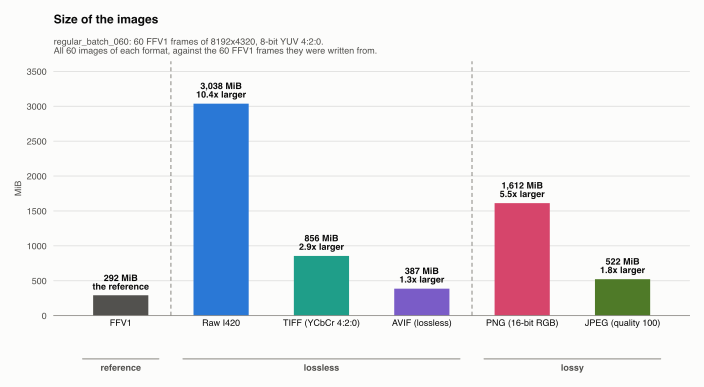
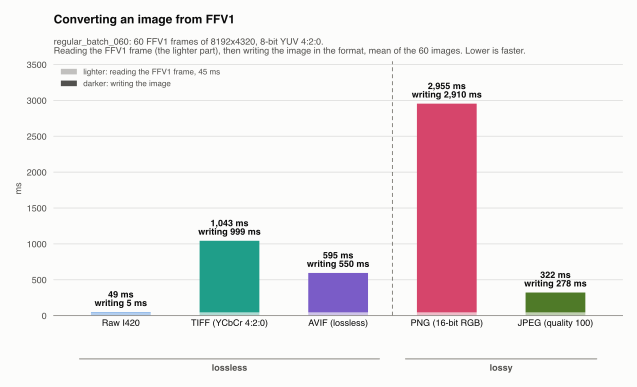
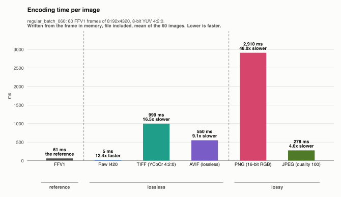
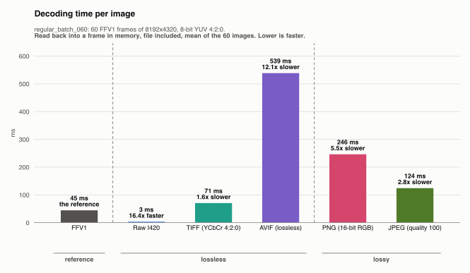
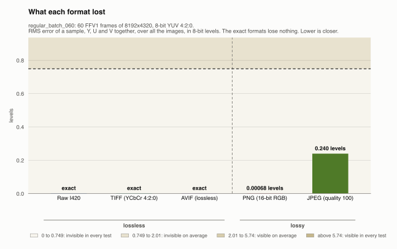
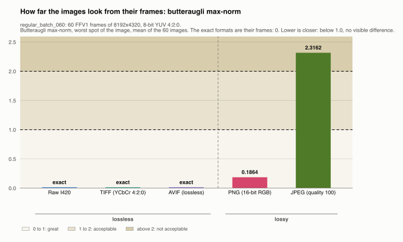
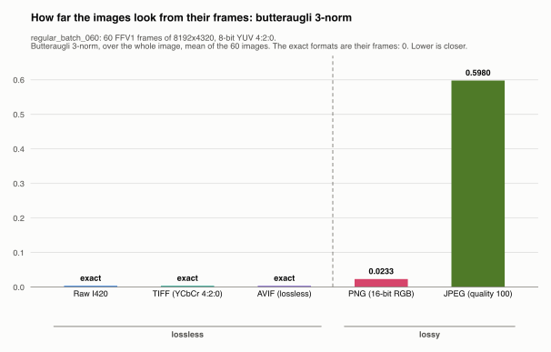
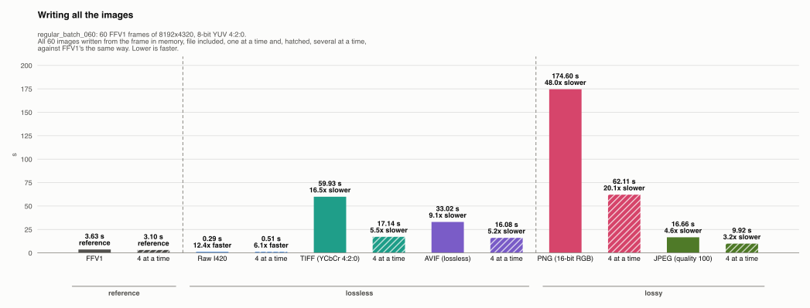
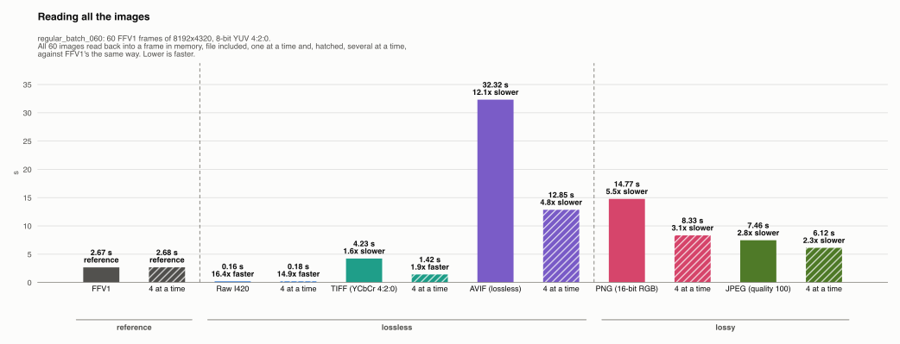

# regular_batch_060: FFV1 frames into other image formats

Generated by `scripts/image_formats.py` from the analysis' reports (`cargo run --release`, [`images.json`](images.json) and [`images-quality.json`](images-quality.json)); do not edit.

The frames are stored as FFV1, one Matroska file per frame: 60 frames of 8192x4320, 8-bit YUV 4:2:0, BT.709 in limited range. What does it cost to turn them into another image format, and what does it give? Each frame is converted from FFV1 into the other formats, and each format is compared with FFV1: the size of the images, the time to convert an image (reading the FFV1 frame, then writing the image), and the time to read it back. The formats are in two groups, each in its own folder with its own README:

- **[Lossless](lossless/README.md)**: raw, TIFF and AVIF keep the frames **exactly**, like FFV1, with no conversion. The analysis reads every image back and checks it byte for byte against its frame: they lose nothing and differ from FFV1 only in size and speed.
- **[Lossy](lossy/README.md)**: PNG holds only RGB, and JPEG holds YCbCr with another matrix (BT.601) and range (full), so neither can hold the frames as they are. Each frame is converted, losing as little as the format allows, and the analysis measures how far each image read back is from its frame.

In every format, nothing is dropped or repeated: one image per frame. FFV1 has [its own folder](reference/ffv1/README.md), and each format's folder has its own charts, frame by frame.

## The formats

| Format | Group | Files | Settings |
|---|---|---|---|
| [FFV1](reference/ffv1/README.md) | reference | `frame_<k>.mkv` | FFV1 version 3, 16 slices, in Matroska |
| [Raw I420](lossless/raw/README.md) | lossless | `frame_<k>.yuv` | I420 planes, no header |
| [TIFF (YCbCr 4:2:0)](lossless/tiff/README.md) | lossless | `frame_<k>.tiff` | YCbCr 4:2:0 as it is, deflate compression; FFmpeg's encoder and decoder |
| [AVIF (lossless)](lossless/avif/README.md) | lossless | `frame_<k>.avif` | SVT-AV1 lossless, still picture, preset 8; dav1d |
| [PNG (16-bit RGB)](lossy/png/README.md) | lossy | `frame_<k>.png` | 16-bit RGB, sRGB, chroma repeated over its 2x2 block; default compression |
| [JPEG (quality 100)](lossy/jpeg/README.md) | lossy | `frame_<k>.jpg` | JFIF, BT.601 full range, 4:2:0, quality 100; FFmpeg's decoder |

FFV1 and AVIF carry the frames' color tags: BT.709 matrix, limited range, BT.709 primaries, sRGB transfer. Raw has no header, so the reader needs the size and these tags from elsewhere (here, `images.json`). TIFF has the size, but FFmpeg tags its YCbCr as BT.601 (the standard's default) with black at 15: its samples are exact, but a reader that converts it to RGB by the tags shows slightly wrong colors ([TIFF](lossless/tiff/README.md#the-format)). PNG is tagged sRGB, and JPEG's colors are JFIF's by definition (BT.601, full range), so any viewer shows both right.

## How it was measured

The input is `ffv1/regular/batch_060/`: 60 FFV1 frames (292.3 MiB), written by `prepare` (see the [README](../README.md#the-input)). The analysis read every frame, then, frame after frame, wrote it in each format, FFV1 again included, and read it back.

- **Converting from FFV1** is reading the FFV1 frame, then writing the image: FFV1's decoding time plus the format's encoding time, frame by frame.
- **Encoding** is from the frame in memory to the file written; **decoding** from the file to the frame in memory. For PNG and JPEG, both include the color conversion.
- One image at a time, each format with the threads it uses on its own; the formats run one after the other, so their times don't overlap. Then each format's whole sequence again, 4 images at a time (the hatched bars).
- Writing and reading the file are included, but the OS keeps the files in its cache: the disk's speed is not measured.

To measure again, then redraw this folder, from `ffv1-analysis/`:

```sh
cargo run --release --bin prepare   # the FFV1 frames, if not there yet
cargo run --release                 # images.json and images-quality.json
uv run scripts/image_formats.py     # the charts and the READMEs
```

The images go to `output/<format>/` (not tracked: 6.5 GiB here).

## Every format against FFV1

In every chart, FFV1, the reference, comes first, in gray, and a dashed line parts it from the lossless formats and those from the lossy ones, named under the bars.

| Format | Per image | vs FFV1 | vs raw | Converting from FFV1, per image | Writing, per image | Reading, per image | Lost (RMS error) |
|---|---|---|---|---|---|---|---|
| *[FFV1](reference/ffv1/README.md), the reference* | 4.9 MiB | – | 10.4x smaller | – | 61 ms | 45 ms | nothing (exact) |
| [Raw I420](lossless/raw/README.md) | 50.6 MiB | 10.4x larger | – | 49 ms | 5 ms | 3 ms | nothing (exact) |
| [TIFF (YCbCr 4:2:0)](lossless/tiff/README.md) | 14.3 MiB | 2.9x larger | 3.5x smaller | 1043 ms | 999 ms | 71 ms | nothing (exact) |
| [AVIF (lossless)](lossless/avif/README.md) | 6.4 MiB | 1.3x larger | 7.9x smaller | 595 ms | 550 ms | 539 ms | nothing (exact) |
| [PNG (16-bit RGB)](lossy/png/README.md) | 26.9 MiB | 5.5x larger | 1.9x smaller | 2955 ms | 2910 ms | 246 ms | 0.00068 levels |
| [JPEG (quality 100)](lossy/jpeg/README.md) | 8.7 MiB | 1.8x larger | 5.8x smaller | 322 ms | 278 ms | 124 ms | 0.240 levels |



Converting an image from FFV1 is reading the FFV1 frame, 45 ms, then writing the image:







### What each format loses

FFV1 and the lossless formats lose nothing; the lossy ones lose a little, measured as an **RMS error** (root mean square): for every sample, the difference between the image read back and its frame, in 8-bit levels, squared, averaged, and square-rooted. It is the typical error of a sample, a large error weighing more than a small one; 1 is the smallest step of an 8-bit sample. The chart shades bands of how visible an RMS error is, from a viewer study (Afnan et al., 2023): below 0.75 levels no viewer saw it on any image, up to 2.01 the average viewer didn't, up to 5.74 the average viewer did, and above, every viewer did. The [lossy README](lossy/README.md#what-they-lose) has it plane by plane, with the other measures.



### How far they look: butteraugli

**Butteraugli**, Google's perceptual metric, says how visible the difference between each image and its frame is: its max-norm is the worst spot (below 1.0 no visible difference, above 2.0 not acceptable), its 3-norm the whole image. The [lossy README](lossy/README.md#how-far-they-look-butteraugli) explains both.

The exact formats are their frames, byte for byte: their distance is 0, not measured.

| Format | Max-norm, mean | Max-norm, worst image | 3-norm, mean |
|---|---|---|---|
| PNG (16-bit RGB) | 0.1864 | 0.5273 (frame 48) | 0.0233 |
| JPEG (quality 100) | 2.3162 | 2.5940 (frame 0) | 0.5980 |

Each image's scores are in the lossy formats' folders.





### All the images, against FFV1

Each format's 60 images, one at a time and, in the hatched bar next to it, 4 at a time, each against FFV1's the same way.

| | Writing all 60 images | Against FFV1 |
|---|---|---|
| *FFV1, the reference* | 3.63 s | – |
| FFV1, 4 images at a time | 3.10 s | – |
| Raw I420 | 0.29 s | 12.4x faster |
| Raw I420, 4 images at a time | 0.51 s | 6.1x faster |
| TIFF (YCbCr 4:2:0) | 59.93 s | 16.5x slower |
| TIFF (YCbCr 4:2:0), 4 images at a time | 17.14 s | 5.5x slower |
| AVIF (lossless) | 33.02 s | 9.1x slower |
| AVIF (lossless), 4 images at a time | 16.08 s | 5.2x slower |
| PNG (16-bit RGB) | 174.60 s | 48.0x slower |
| PNG (16-bit RGB), 4 images at a time | 62.11 s | 20.1x slower |
| JPEG (quality 100) | 16.66 s | 4.6x slower |
| JPEG (quality 100), 4 images at a time | 9.92 s | 3.2x slower |



| | Reading all 60 images | Against FFV1 |
|---|---|---|
| *FFV1, the reference* | 2.67 s | – |
| FFV1, 4 images at a time | 2.68 s | – |
| Raw I420 | 0.16 s | 16.4x faster |
| Raw I420, 4 images at a time | 0.18 s | 14.9x faster |
| TIFF (YCbCr 4:2:0) | 4.23 s | 1.6x slower |
| TIFF (YCbCr 4:2:0), 4 images at a time | 1.42 s | 1.9x faster |
| AVIF (lossless) | 32.32 s | 12.1x slower |
| AVIF (lossless), 4 images at a time | 12.85 s | 4.8x slower |
| PNG (16-bit RGB) | 14.77 s | 5.5x slower |
| PNG (16-bit RGB), 4 images at a time | 8.33 s | 3.1x slower |
| JPEG (quality 100) | 7.46 s | 2.8x slower |
| JPEG (quality 100), 4 images at a time | 6.12 s | 2.3x slower |



## What it shows

- **No format is smaller than FFV1** (4.9 MiB per image): the closest, AVIF (lossless), is 1.3x its size, and raw 10.4x.
- **Converting an image from FFV1** takes from 49 ms (Raw I420, mostly reading the FFV1 frame, 45 ms) to 2,955 ms (PNG (16-bit RGB)): JPEG (quality 100) 322 ms, AVIF (lossless) 595 ms, TIFF (YCbCr 4:2:0) 1,043 ms.
- **Only Raw I420 reads back faster than FFV1** (45 ms per image): Raw I420 3 ms; TIFF (YCbCr 4:2:0) 71 ms, AVIF (lossless) 539 ms, PNG (16-bit RGB) 246 ms, JPEG (quality 100) 124 ms.
- **Raw I420, TIFF (YCbCr 4:2:0) and AVIF (lossless) give the frames back exactly**, like FFV1; PNG (16-bit RGB) loses 0.00068 levels (RMS); JPEG (quality 100) loses 0.240 levels (RMS). What they give in exchange is an image any viewer opens; see the [lossy README](lossy/README.md#what-it-shows).
- **Butteraugli puts the lossy formats in different classes**: PNG (16-bit RGB) scores 0.1864 on average, 0.0000 to 0.5273 (max-norm): *great* for every image; JPEG (quality 100) scores 2.3162 on average, 2.1119 to 2.5940 (max-norm): *not acceptable* for every image. Its max-norm is the single most visible spot of an image, so small errors spread over many samples leave a visible spot somewhere, while a few changed samples don't (PNG (16-bit RGB) changes 0.00% of its samples, by at most 1 levels; JPEG (quality 100) changes 5.74% of its samples, by at most 2 levels).
- **The two metrics disagree on JPEG (quality 100)**: by its RMS error, 0.240 levels, it is *invisible in every test* in the viewer study, while butteraugli's max-norm calls it *not acceptable*. They measure different things: the study's bands judge the error on average over the image, as its viewers saw whole images, while the max-norm judges the single worst spot, by a model of the eye meant to be strict. The truth is likely between: invisible to a viewer looking at the image, a difference a model or a close look at the right spot can find.
- **Raw I420 is over mosaicod's upload limit**: a message to mosaicod carries at most 50 MiB (its default), and Raw I420's largest image is 50.6 MiB. Served back, a `DoGet` message may carry up to 512 MiB, so every format comes back one image per message at most.

## Limits

- One batch: frames with more detail make every format bigger and slower, and may change the ratios.
- The files were read from the OS cache: from a disk or over the network, the larger formats (raw, PNG, TIFF) lose more time than the tables show.
- Each image is timed once, on a machine doing other things: see below.

### Each image is timed once

Every time in these results is a single measurement: each image is written once and read back once, and each format's 60 images make its totals. Nothing is repeated to average out the noise of a single run, so a time can be off for reasons that have nothing to do with the format:

- **The machine is busy with something else** for a moment: another program, the OS indexing files, a backup. The image that runs at that moment takes longer.
- **A warm-up at the start**: the first images of a format also pay for things done only once, such as loading the codec's code, allocating its buffers, or filling the CPU's caches.
- **The machine's own state**: a laptop slows its CPU down when it gets hot, and the OS decides which cores run what; neither is the same from one run to the next.

So a rerun gives slightly different times, more so for the shortest ones (a few milliseconds), where any pause is a large share. The sizes and the losses don't change: they are the same every run.

To tell a slow image from a slow format, each format's README marks every frame whose time is over 1.5x the format's median, and calls the slow frames at the very start a warm-up and the others single spikes. Those frames are included in the means and totals, so one spike makes the mean a little higher than the median. In this run:

- [FFV1](reference/ffv1/README.md), writing: 9 of 60 images (1 a warm-up).
- [Raw I420](lossless/raw/README.md), writing: 11 of 60 images (1 a warm-up).
