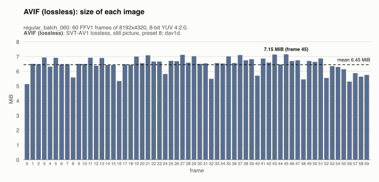
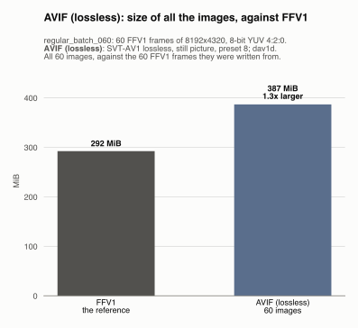
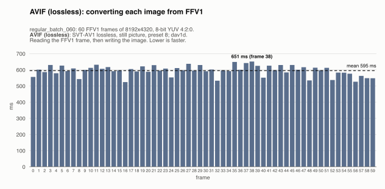
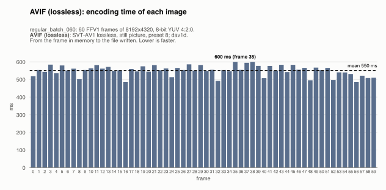
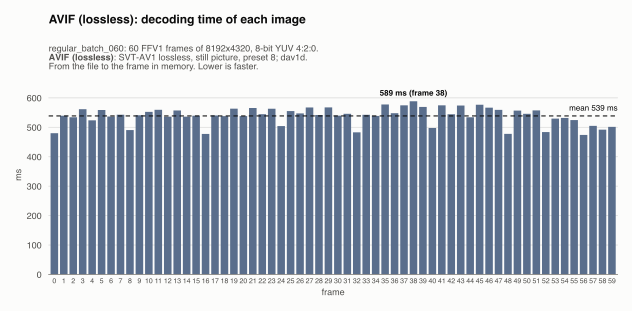
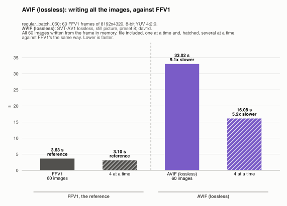
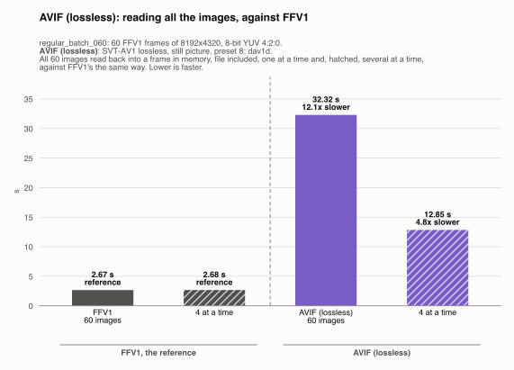
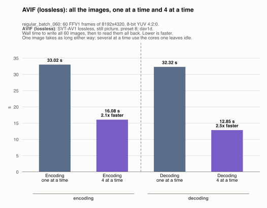

# AVIF (lossless): regular_batch_060

Generated by `scripts/image_formats.py` from the analysis' report (`cargo run --release`, [`images.json`](../../images.json)); do not edit. One of the [lossless formats](../README.md), in [the comparison of the image formats](../../README.md): each one written from the FFV1 frames, and compared with them.

## The format

Each frame encoded on its own by SVT-AV1 in lossless, still-picture mode, in an AVIF file written by FFmpeg's AVIF muxer, and read back with dav1d. AVIF is a standard image format: any AVIF reader opens these files, which keep the YUV 4:2:0 frame and its color tags (BT.709, limited range). Lossless AV1 is slow at this size, in both directions; the SVT-AV1 preset does not change a lossless image.

Settings: SVT-AV1 lossless, still picture, preset 8; dav1d. The files are `output/avif/frame_<k>.*`, one per frame, 60 here, and each one was read back and checked byte for byte against its frame: none of them loses anything.

## Its numbers

| | All the images | Per image (mean) | Against |
|---|---|---|---|
| Size | 386.8 MiB | 6.45 MiB | FFV1: 1.3x larger (292.3 MiB); raw: 7.9x smaller |
| Converting from FFV1 | 35.70 s | 595 ms | reading the FFV1 frame (45 ms), then writing the image (550 ms) |
| Writing (encoding) | 33.02 s | 550 ms | FFV1: 9.1x slower (3.63 s) |
| Reading (decoding) | 32.32 s | 539 ms | FFV1: 12.1x slower (2.67 s) |
| Lost | nothing: every image is exact | | |

The largest image (7.15 MiB) fits in the 50 MiB a message may carry to mosaicod (its default decode limit), and served back to a client it comes in one `DoGet` message, which may carry up to 512 MiB.

## Size of each image

One bar per frame, its image's size; the dashed line is the mean.

The images take 6.45 MiB on average, from 5.13 MiB (frame 0) to 7.15 MiB (frame 45): a frame with more detail takes more bytes.

## Size of all the images, against FFV1

All 60 images, against the 60 FFV1 frames they were written from. They take 386.8 MiB, 1.3x larger than FFV1's 292.3 MiB.

## Converting each image from FFV1

One bar per frame: the time to read its FFV1 frame and write its image. The dashed line is the mean.

Converting an image from FFV1 takes 595 ms on average (median 598 ms), from 524 ms (frame 16) to 651 ms (frame 38). No frame takes over 1.5x the median: the time is steady from image to image.

## Encoding time of each image

One bar per frame: the time to write its image, from the frame in memory to the file written. The dashed line is the mean.

Writing an image takes 550 ms on average (median 553 ms), from 487 ms (frame 56) to 600 ms (frame 35). No frame takes over 1.5x the median: the time is steady from image to image.

## Decoding time of each image

One bar per frame: the time to read its image back, from the file to the frame in memory (the file is in the OS cache, so the disk's speed is not measured). The dashed line is the mean.

Reading an image takes 539 ms on average (median 542 ms), from 474 ms (frame 56) to 589 ms (frame 38). No frame takes over 1.5x the median: the time is steady from image to image.

## All the images, against FFV1

The time for all 60 images, against FFV1's, the reference: the gray bars, first. Each way is compared with FFV1's the same way: one image at a time, and several at a time (hatched).

**Encoding.** Writing all 60 images takes 33.02 s, 9.1x slower than FFV1's 3.63 s.

**Decoding.** Reading all 60 images back takes 32.32 s, 12.1x slower than FFV1's 2.67 s.

## Several images at a time

Every format is also written and read back 4 images at a time (one image leaves most cores idle): all 60 images, then all of them read back (each one checked byte for byte again). One image takes as long as before; what changes is the whole sequence: it takes less.

| All the images | One at a time | 4 at a time | Several at a time |
|---|---|---|---|
| Encoding | 33.02 s | 16.08 s | 2.1x faster |
| Decoding | 32.32 s | 12.85 s | 2.5x faster |

