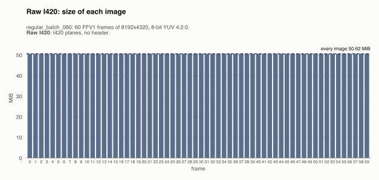
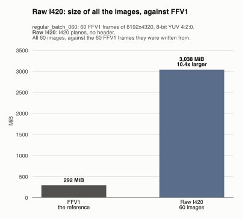
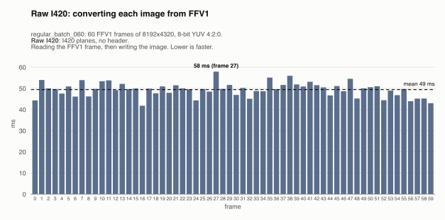
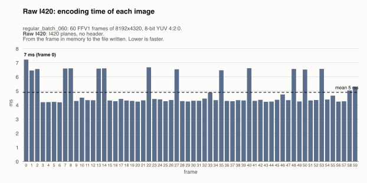
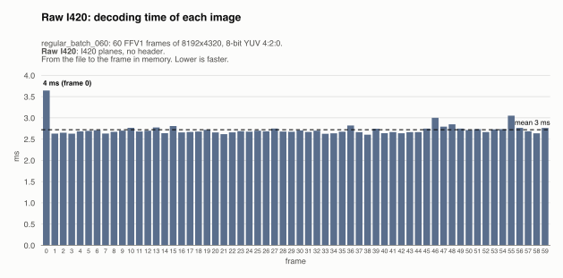
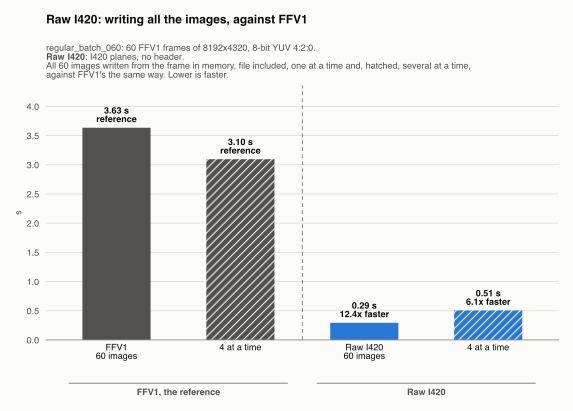
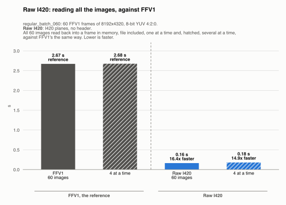
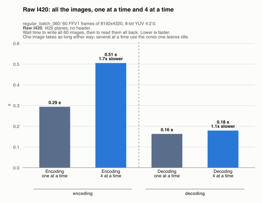

# Raw I420: regular_batch_060

Generated by `scripts/image_formats.py` from the analysis' report (`cargo run --release`, [`images.json`](../../images.json)); do not edit. One of the [lossless formats](../README.md), in [the comparison of the image formats](../../README.md): each one written from the FFV1 frames, and compared with them.

## The format

The frame's three planes written as they are, Y then U then V (I420), with no header and no compression. Writing and reading an image are a copy to and from a file, and every image has the same size, width x height x 1.5 bytes. The reader needs the size and the color tags from elsewhere (here, `images.json`).

Settings: I420 planes, no header. The files are `output/raw/frame_<k>.*`, one per frame, 60 here, and each one was read back and checked byte for byte against its frame: none of them loses anything.

## Its numbers

| | All the images | Per image (mean) | Against |
|---|---|---|---|
| Size | 3,037.5 MiB | 50.62 MiB | FFV1: 10.4x larger (292.3 MiB) |
| Converting from FFV1 | 2.97 s | 49 ms | reading the FFV1 frame (45 ms), then writing the image (5 ms) |
| Writing (encoding) | 0.29 s | 5 ms | FFV1: 12.4x faster (3.63 s) |
| Reading (decoding) | 0.16 s | 3 ms | FFV1: 16.4x faster (2.67 s) |
| Lost | nothing: every image is exact | | |

The largest image (50.62 MiB) is over the 50 MiB a message may carry to mosaicod (its default decode limit), and served back to a client it comes in one `DoGet` message, which may carry up to 512 MiB.

## Size of each image

One bar per frame, its image's size; the dashed line is the mean.

Every image is 50.62 MiB: the format does not compress, so the size depends only on the frame's width and height, not on what it shows.

## Size of all the images, against FFV1

All 60 images, against the 60 FFV1 frames they were written from. They take 3,037.5 MiB, 10.4x larger than FFV1's 292.3 MiB.

## Converting each image from FFV1

One bar per frame: the time to read its FFV1 frame and write its image. The dashed line is the mean.

Converting an image from FFV1 takes 49 ms on average (median 50 ms), from 42 ms (frame 16) to 58 ms (frame 27). No frame takes over 1.5x the median: the time is steady from image to image.

## Encoding time of each image

One bar per frame: the time to write its image, from the frame in memory to the file written. The dashed line is the mean.

Writing an image takes 5 ms on average (median 4 ms), from 4 ms (frame 6) to 7 ms (frame 0). 11 frames take over 1.5x the median: 0 (7 ms), 2 (7 ms), 7 (7 ms), 8 (7 ms), 13 (7 ms), 14 (7 ms), 22 (7 ms), 27 (7 ms), 40 (7 ms), 48 (7 ms), 53 (7 ms); frame 0 is a warm-up, and the others single spikes (each image is timed once: see [the limits](../../README.md#each-image-is-timed-once)).

## Decoding time of each image

One bar per frame: the time to read its image back, from the file to the frame in memory (the file is in the OS cache, so the disk's speed is not measured). The dashed line is the mean.

Reading an image takes 3 ms on average (median 3 ms), from 3 ms (frame 38) to 4 ms (frame 0). No frame takes over 1.5x the median: the time is steady from image to image.

## All the images, against FFV1

The time for all 60 images, against FFV1's, the reference: the gray bars, first. Each way is compared with FFV1's the same way: one image at a time, and several at a time (hatched).

**Encoding.** Writing all 60 images takes 0.29 s, 12.4x faster than FFV1's 3.63 s.

**Decoding.** Reading all 60 images back takes 0.16 s, 16.4x faster than FFV1's 2.67 s.

## Several images at a time

Every format is also written and read back 4 images at a time (one image leaves most cores idle): all 60 images, then all of them read back (each one checked byte for byte again). One image takes as long as before; what changes is the whole sequence. Here it doesn't always take less: a format that barely uses the CPU (copying memory to files), or already uses every core on one image, gains nothing from several at a time, and the images only compete for the cores and the memory's bandwidth.

| All the images | One at a time | 4 at a time | Several at a time |
|---|---|---|---|
| Encoding | 0.29 s | 0.51 s | 1.7x slower |
| Decoding | 0.16 s | 0.18 s | 1.1x slower |

