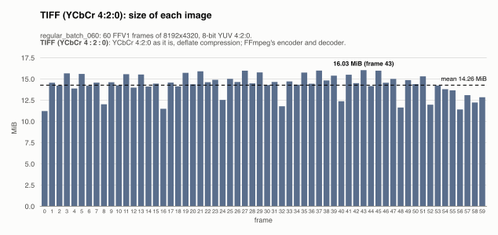
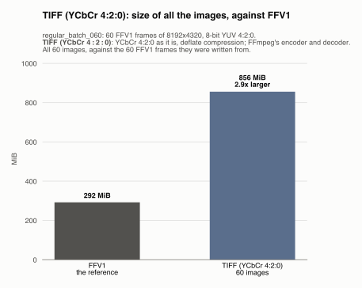
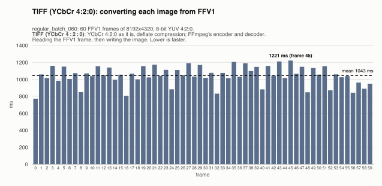
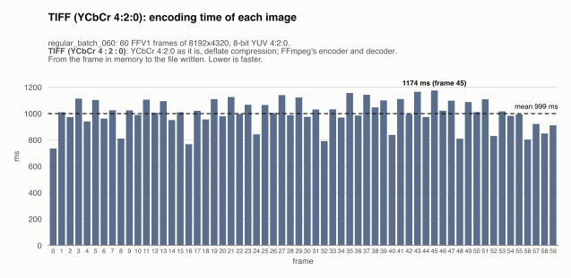
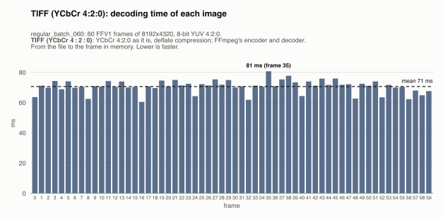
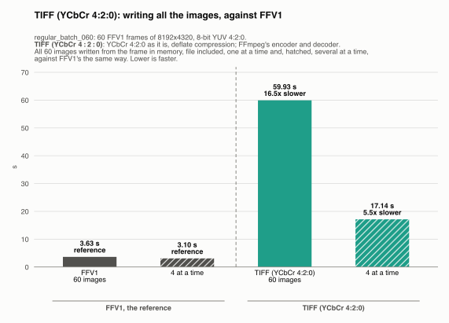
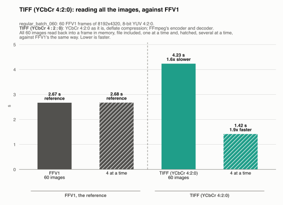
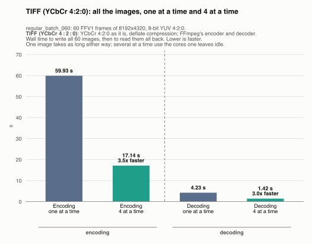

# TIFF (YCbCr 4:2:0): regular_batch_060

Generated by `scripts/image_formats.py` from the analysis' report (`cargo run --release`, [`images.json`](../../images.json)); do not edit. One of the [lossless formats](../README.md), in [the comparison of the image formats](../../README.md): each one written from the FFV1 frames, and compared with them.

## The format

Each frame as a YCbCr TIFF with 4:2:0 subsampling, the planes as they are, Deflate compressed, written and read with FFmpeg's TIFF encoder and decoder. Every FFmpeg TIFF compression (none, PackBits, LZW, Deflate) gave the frame back exactly on a test frame; Deflate was the smallest (11.8 MB, against 53.1 MB with none, 46.8 MB with PackBits, 27.8 MB with LZW), so it is the one measured. YCbCr TIFF is part of the TIFF 6.0 standard, but many programs only read RGB TIFF. FFmpeg's encoder writes no `YCbCrCoefficients` tag, so by the standard's default the file says BT.601, not the frames' BT.709, and black at 15, not 16: the samples are exact, and FFmpeg reads them back as they are, but a reader that converts to RGB by the tags shows slightly wrong colors (Pillow: up to 11 levels on frame 0).

Settings: YCbCr 4:2:0 as it is, deflate compression; FFmpeg's encoder and decoder. The files are `output/tiff/frame_<k>.*`, one per frame, 60 here, and each one was read back and checked byte for byte against its frame: none of them loses anything.

## Its numbers

| | All the images | Per image (mean) | Against |
|---|---|---|---|
| Size | 855.9 MiB | 14.26 MiB | FFV1: 2.9x larger (292.3 MiB); raw: 3.5x smaller |
| Converting from FFV1 | 62.60 s | 1043 ms | reading the FFV1 frame (45 ms), then writing the image (999 ms) |
| Writing (encoding) | 59.93 s | 999 ms | FFV1: 16.5x slower (3.63 s) |
| Reading (decoding) | 4.23 s | 71 ms | FFV1: 1.6x slower (2.67 s) |
| Lost | nothing: every image is exact | | |

The largest image (16.03 MiB) fits in the 50 MiB a message may carry to mosaicod (its default decode limit), and served back to a client it comes in one `DoGet` message, which may carry up to 512 MiB.

## Size of each image

One bar per frame, its image's size; the dashed line is the mean.

The images take 14.26 MiB on average, from 11.21 MiB (frame 0) to 16.03 MiB (frame 43): a frame with more detail takes more bytes.

## Size of all the images, against FFV1

All 60 images, against the 60 FFV1 frames they were written from. They take 855.9 MiB, 2.9x larger than FFV1's 292.3 MiB.

## Converting each image from FFV1

One bar per frame: the time to read its FFV1 frame and write its image. The dashed line is the mean.

Converting an image from FFV1 takes 1043 ms on average (median 1055 ms), from 772 ms (frame 0) to 1221 ms (frame 45). No frame takes over 1.5x the median: the time is steady from image to image.

## Encoding time of each image

One bar per frame: the time to write its image, from the frame in memory to the file written. The dashed line is the mean.

Writing an image takes 999 ms on average (median 1009 ms), from 735 ms (frame 0) to 1174 ms (frame 45). No frame takes over 1.5x the median: the time is steady from image to image.

## Decoding time of each image

One bar per frame: the time to read its image back, from the file to the frame in memory (the file is in the OS cache, so the disk's speed is not measured). The dashed line is the mean.

Reading an image takes 71 ms on average (median 71 ms), from 60 ms (frame 16) to 81 ms (frame 35). No frame takes over 1.5x the median: the time is steady from image to image.

## All the images, against FFV1

The time for all 60 images, against FFV1's, the reference: the gray bars, first. Each way is compared with FFV1's the same way: one image at a time, and several at a time (hatched).

**Encoding.** Writing all 60 images takes 59.93 s, 16.5x slower than FFV1's 3.63 s.

**Decoding.** Reading all 60 images back takes 4.23 s, 1.6x slower than FFV1's 2.67 s.

## Several images at a time

Every format is also written and read back 4 images at a time (one image leaves most cores idle): all 60 images, then all of them read back (each one checked byte for byte again). One image takes as long as before; what changes is the whole sequence: it takes less.

| All the images | One at a time | 4 at a time | Several at a time |
|---|---|---|---|
| Encoding | 59.93 s | 17.14 s | 3.5x faster |
| Decoding | 4.23 s | 1.42 s | 3.0x faster |

