# JPEG (quality 100): regular_batch_060

Generated by `scripts/image_formats.py` from the analysis' report (`cargo run --release`, [`images.json`](../../images.json)); do not edit. One of the [lossy formats](../README.md), in [the comparison of the image formats](../../README.md): each one written from the FFV1 frames, and compared with them.

## The format

A standard JFIF file any viewer shows in the right colors, as close to the frame as JPEG allows. JPEG's YCbCr is BT.601 in full range, so each frame is converted to it from BT.709 in limited range, then written at quality 100 (every quantization step 1, the least JPEG can lose) in 4:2:0, its U and V planes passed as they are, with no RGB or resampling in the encoder (`jpeg-encoder` crate). It is read back with FFmpeg's decoder, which also gives the 4:2:0 planes as they are, then converted back. What is lost: the rounding of the two conversions and of the DCT.

Settings: JFIF, BT.601 full range, 4:2:0, quality 100; FFmpeg's decoder. The files are `output/jpeg/frame_<k>.*`, one per frame, 60 here, and each one was read back and compared with its frame: see [what it loses](#what-it-loses).

## Its numbers

| | All the images | Per image (mean) | Against |
|---|---|---|---|
| Size | 522.4 MiB | 8.71 MiB | FFV1: 1.8x larger (292.3 MiB); raw: 5.8x smaller |
| Converting from FFV1 | 19.33 s | 322 ms | reading the FFV1 frame (45 ms), then writing the image (278 ms) |
| Writing (encoding) | 16.66 s | 278 ms | FFV1: 4.6x slower (3.63 s) |
| Reading (decoding) | 7.46 s | 124 ms | FFV1: 2.8x slower (2.67 s) |
| Lost | RMS error 0.240 levels | | FFV1: nothing |

The largest image (9.74 MiB) fits in the 50 MiB a message may carry to mosaicod (its default decode limit), and served back to a client it comes in one `DoGet` message, which may carry up to 512 MiB.

## Size of each image

One bar per frame, its image's size; the dashed line is the mean.

The images take 8.71 MiB on average, from 6.80 MiB (frame 0) to 9.74 MiB (frame 45): a frame with more detail takes more bytes.

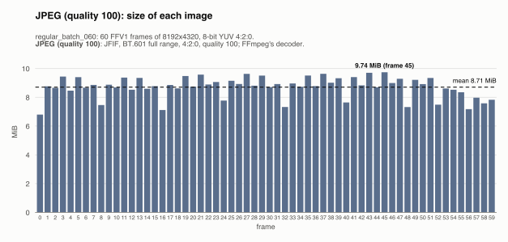

## Size of all the images, against FFV1

All 60 images, against the 60 FFV1 frames they were written from. They take 522.4 MiB, 1.8x larger than FFV1's 292.3 MiB.

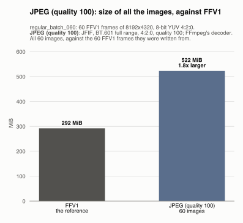

## Converting each image from FFV1

One bar per frame: the time to read its FFV1 frame and write its image. The dashed line is the mean.

Converting an image from FFV1 takes 322 ms on average (median 323 ms), from 296 ms (frame 48) to 343 ms (frame 46). No frame takes over 1.5x the median: the time is steady from image to image.

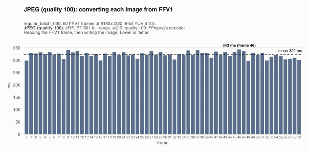

## Encoding time of each image

One bar per frame: the time to write its image, from the frame in memory to the file written. The dashed line is the mean.

Writing an image takes 278 ms on average (median 278 ms), from 257 ms (frame 48) to 299 ms (frame 46). No frame takes over 1.5x the median: the time is steady from image to image.

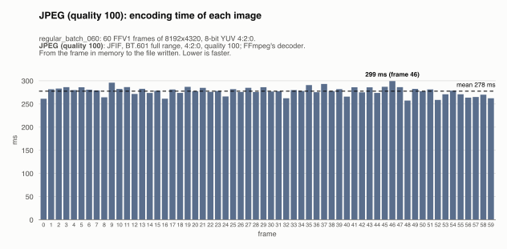

## Decoding time of each image

One bar per frame: the time to read its image back, from the file to the frame in memory (the file is in the OS cache, so the disk's speed is not measured). The dashed line is the mean.

Reading an image takes 124 ms on average (median 125 ms), from 109 ms (frame 0) to 140 ms (frame 37). No frame takes over 1.5x the median: the time is steady from image to image.

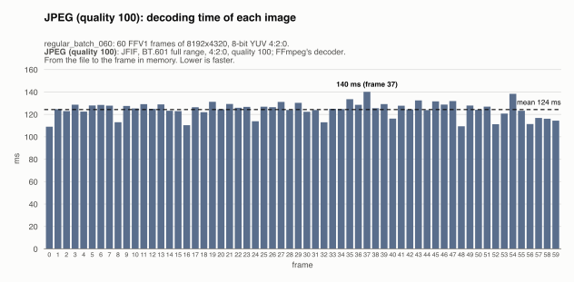

## All the images, against FFV1

The time for all 60 images, against FFV1's, the reference: the gray bars, first. Each way is compared with FFV1's the same way: one image at a time, and several at a time (hatched).

**Encoding.** Writing all 60 images takes 16.66 s, 4.6x slower than FFV1's 3.63 s.

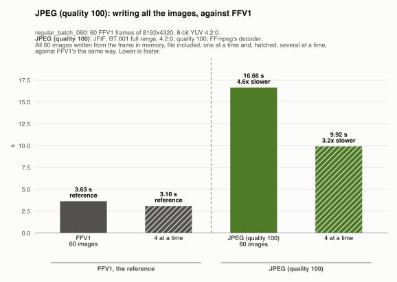

**Decoding.** Reading all 60 images back takes 7.46 s, 2.8x slower than FFV1's 2.67 s.

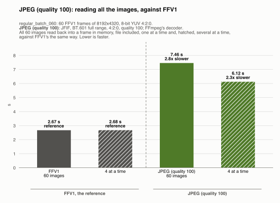

## Several images at a time

Every format is also written and read back 4 images at a time (one image leaves most cores idle): all 60 images, then all of them read back. One image takes as long as before; what changes is the whole sequence: it takes less.

| All the images | One at a time | 4 at a time | Several at a time |
|---|---|---|---|
| Encoding | 16.66 s | 9.92 s | 1.7x faster |
| Decoding | 7.46 s | 6.12 s | 1.2x faster |

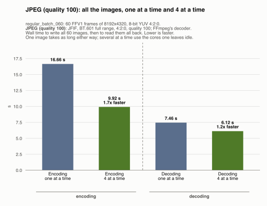

## What it loses

How far the images read back are from their frames, over all the frames, plane by plane (the measures are explained in the [lossy README](../README.md#what-they-lose)):

| | Y | U | V |
|---|---|---|---|
| PSNR (higher is closer) | 60.53 dB | 60.15 dB | 60.98 dB |
| RMS error, 8-bit levels | 0.240 | 0.251 | 0.228 |
| Largest error, 8-bit levels | 2 | 2 | 2 |
| Samples changed | 121,980,619 (5.74%) | 33,365,253 (6.29%) | 27,559,847 (5.19%) |

One bar per frame: the RMS error of a sample of its image, Y, U and V together. The dashed line is the mean.

An image is off by 0.240 levels on average, from 0.208 (frame 0) to 0.255 (frame 45).

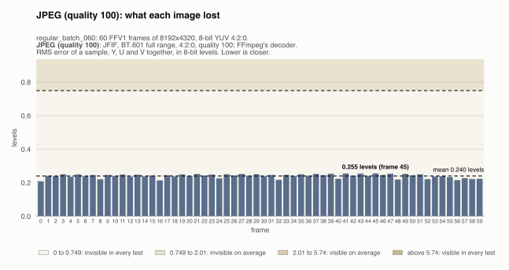

## How far it looks: butteraugli

Butteraugli and its two norms are explained in the [lossy README](../README.md#how-far-they-look-butteraugli).

| Format | Max-norm, mean | Max-norm, worst image | 3-norm, mean |
|---|---|---|---|
| JPEG (quality 100) | 2.3162 | 2.5940 (frame 0) | 0.5980 |

One bar per frame: the max-norm of its image, worst spot of the image. The dashed line is the mean.

The max-norm is 2.3162 on average, from 2.1119 (frame 47) to 2.5940 (frame 0).

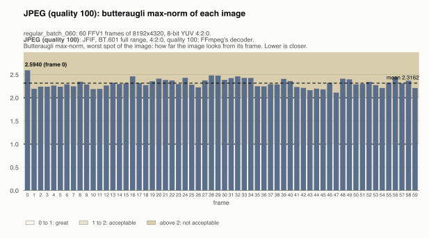

One bar per frame: the 3-norm of its image, over the whole image. The dashed line is the mean.

The 3-norm is 0.5980 on average, from 0.5268 (frame 43) to 0.7518 (frame 0).

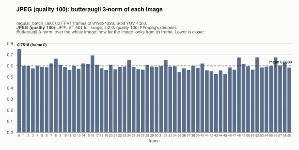
