# PNG (16-bit RGB): regular_batch_060

Generated by `scripts/image_formats.py` from the analysis' report (`cargo run --release`, [`images.json`](../../images.json)); do not edit. One of the [lossy formats](../README.md), in [the comparison of the image formats](../../README.md): each one written from the FFV1 frames, and compared with them.

## The format

PNG holds only RGB, so each frame is converted to it, as closely as PNG allows. 16-bit RGB, so that rounding loses next to nothing, with each U and V sample repeated over the 2x2 pixels it covers, so that reading the image back and averaging each 2x2 block gives the sample again. What is lost is mostly the colors a YUV frame can hold but RGB can't, outside the RGB cube, clipped to it. Tagged sRGB, so any viewer shows it right; written and read with the `png` crate (one thread).

Settings: 16-bit RGB, sRGB, chroma repeated over its 2x2 block; default compression. The files are `output/png/frame_<k>.*`, one per frame, 60 here, and each one was read back and compared with its frame: see [what it loses](#what-it-loses).

## Its numbers

| | All the images | Per image (mean) | Against |
|---|---|---|---|
| Size | 1,611.7 MiB | 26.86 MiB | FFV1: 5.5x larger (292.3 MiB); raw: 1.9x smaller |
| Converting from FFV1 | 177.27 s | 2955 ms | reading the FFV1 frame (45 ms), then writing the image (2910 ms) |
| Writing (encoding) | 174.60 s | 2910 ms | FFV1: 48.0x slower (3.63 s) |
| Reading (decoding) | 14.77 s | 246 ms | FFV1: 5.5x slower (2.67 s) |
| Lost | RMS error 0.00068 levels | | FFV1: nothing |

The largest image (30.64 MiB) fits in the 50 MiB a message may carry to mosaicod (its default decode limit), and served back to a client it comes in one `DoGet` message, which may carry up to 512 MiB.

## Size of each image

One bar per frame, its image's size; the dashed line is the mean.

The images take 26.86 MiB on average, from 20.32 MiB (frame 0) to 30.64 MiB (frame 37): a frame with more detail takes more bytes.

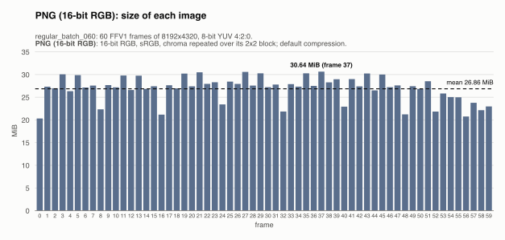

## Size of all the images, against FFV1

All 60 images, against the 60 FFV1 frames they were written from. They take 1,611.7 MiB, 5.5x larger than FFV1's 292.3 MiB.

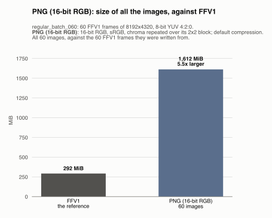

## Converting each image from FFV1

One bar per frame: the time to read its FFV1 frame and write its image. The dashed line is the mean.

Converting an image from FFV1 takes 2955 ms on average (median 3024 ms), from 2342 ms (frame 0) to 3311 ms (frame 37). No frame takes over 1.5x the median: the time is steady from image to image.

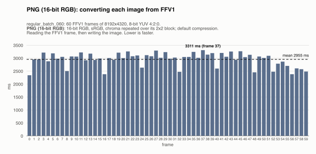

## Encoding time of each image

One bar per frame: the time to write its image, from the frame in memory to the file written. The dashed line is the mean.

Writing an image takes 2910 ms on average (median 2978 ms), from 2304 ms (frame 0) to 3264 ms (frame 37). No frame takes over 1.5x the median: the time is steady from image to image.

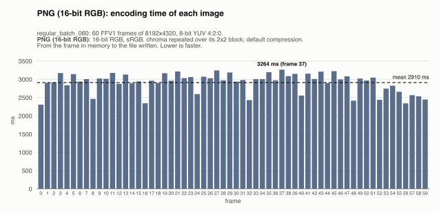

## Decoding time of each image

One bar per frame: the time to read its image back, from the file to the frame in memory (the file is in the OS cache, so the disk's speed is not measured). The dashed line is the mean.

Reading an image takes 246 ms on average (median 246 ms), from 224 ms (frame 48) to 295 ms (frame 37). No frame takes over 1.5x the median: the time is steady from image to image.

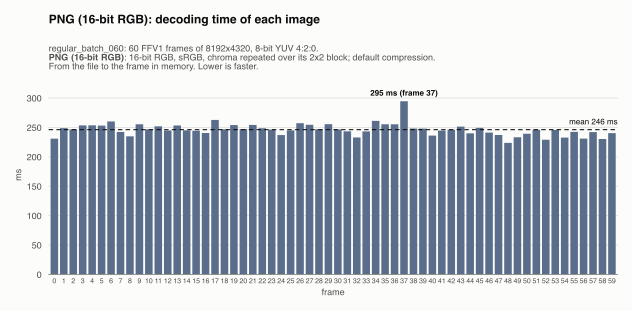

## All the images, against FFV1

The time for all 60 images, against FFV1's, the reference: the gray bars, first. Each way is compared with FFV1's the same way: one image at a time, and several at a time (hatched).

**Encoding.** Writing all 60 images takes 174.60 s, 48.0x slower than FFV1's 3.63 s.

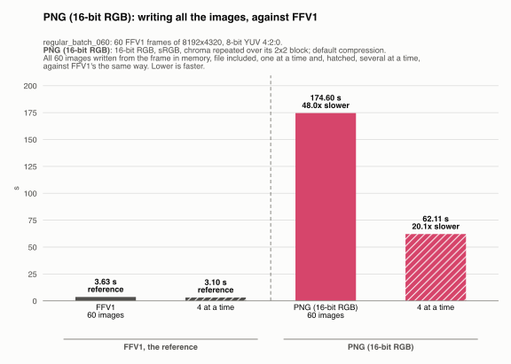

**Decoding.** Reading all 60 images back takes 14.77 s, 5.5x slower than FFV1's 2.67 s.

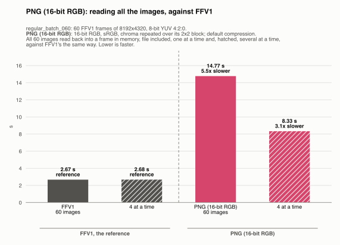

## Several images at a time

Every format is also written and read back 4 images at a time (one image leaves most cores idle): all 60 images, then all of them read back. One image takes as long as before; what changes is the whole sequence: it takes less.

| All the images | One at a time | 4 at a time | Several at a time |
|---|---|---|---|
| Encoding | 174.60 s | 62.11 s | 2.8x faster |
| Decoding | 14.77 s | 8.33 s | 1.8x faster |

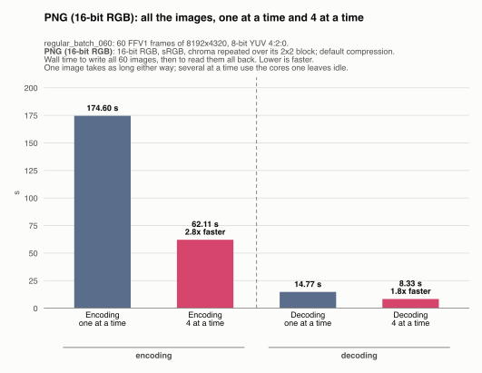

## What it loses

How far the images read back are from their frames, over all the frames, plane by plane (the measures are explained in the [lossy README](../README.md#what-they-lose)):

| | Y | U | V |
|---|---|---|---|
| PSNR (higher is closer) | 121.96 dB | ∞ (exact) | 103.97 dB |
| RMS error, 8-bit levels | 0.00020 | 0 | 0.0016 |
| Largest error, 8-bit levels | 1 | 0 | 1 |
| Samples changed | 88 (1 in 24,129,164) | none | 1,384 (1 in 383,556) |

One bar per frame: the RMS error of a sample of its image, Y, U and V together. The dashed line is the mean.

An image is off by 0.00059 levels on average, from 0 (frame 41) to 0.0014 (frame 50); 8 of the 60 images give their frame back exactly.

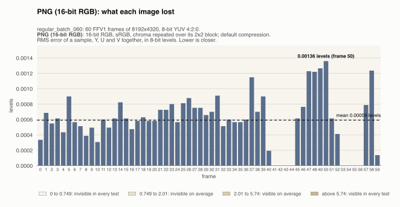

## How far it looks: butteraugli

Butteraugli and its two norms are explained in the [lossy README](../README.md#how-far-they-look-butteraugli).

| Format | Max-norm, mean | Max-norm, worst image | 3-norm, mean |
|---|---|---|---|
| PNG (16-bit RGB) | 0.1864 | 0.5273 (frame 48) | 0.0233 |

One bar per frame: the max-norm of its image, worst spot of the image. The dashed line is the mean.

The max-norm is 0.1864 on average, from 0.0000 (frame 41) to 0.5273 (frame 48).

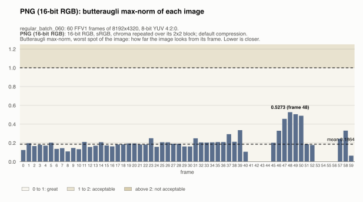

One bar per frame: the 3-norm of its image, over the whole image. The dashed line is the mean.

The 3-norm is 0.0233 on average, from 0.0000 (frame 41) to 0.0627 (frame 48).

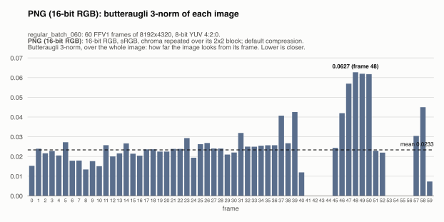
