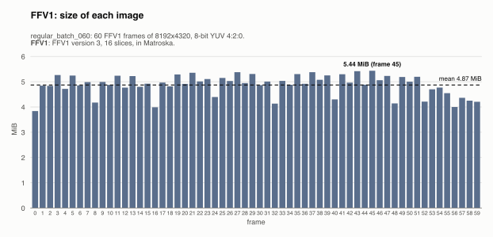
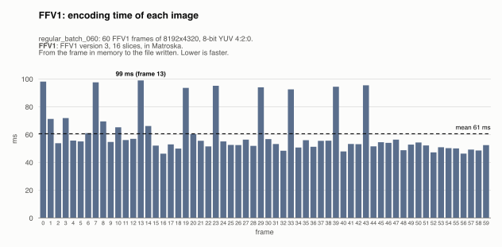
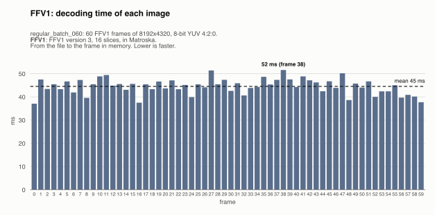
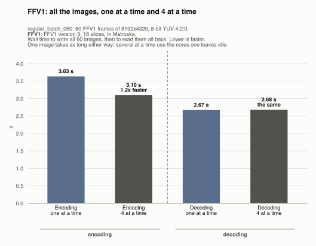

# FFV1: regular_batch_060

Generated by `scripts/image_formats.py` from the analysis' report (`cargo run --release`, [`images.json`](../../images.json)); do not edit. The reference of [the comparison of the image formats](../../README.md): every other format is written from these frames.

## The format

The input: each frame of the video as one FFV1 frame (version 3, 16 slices coded in parallel) in its own Matroska file, with FFmpeg's own encoder and decoder. FFV1 is a lossless, intra-only video codec made for archiving; it keeps the YUV 4:2:0 frame and its color tags. It is not an image format: reading the files needs FFmpeg or another FFV1 decoder. Every other format is written from these frames and compared with them; to time FFV1's own writing, each frame is also written again as FFV1.

Settings: FFV1 version 3, 16 slices, in Matroska. The files are `output/ffv1/frame_<k>.*`, one per frame, 60 here, and each one was read back and checked byte for byte against its frame: none of them loses anything.

## Its numbers

| | All the images | Per image (mean) | Against |
|---|---|---|---|
| Size | 292.3 MiB | 4.87 MiB | FFV1: the same (292.3 MiB); raw: 10.4x smaller |
| Writing (encoding) | 3.63 s | 61 ms | the reference |
| Reading (decoding) | 2.67 s | 45 ms | the reference |
| Lost | nothing: every image is exact | | |

The largest image (5.44 MiB) fits in the 50 MiB a message may carry to mosaicod (its default decode limit), and served back to a client it comes in one `DoGet` message, which may carry up to 512 MiB.

## Size of each image

One bar per frame, its image's size; the dashed line is the mean.

The images take 4.87 MiB on average, from 3.84 MiB (frame 0) to 5.44 MiB (frame 45): a frame with more detail takes more bytes.

## Encoding time of each image

One bar per frame: the time to write its image, from the frame in memory to the file written. The dashed line is the mean.

Writing an image takes 61 ms on average (median 54 ms), from 46 ms (frame 16) to 99 ms (frame 13). 9 frames take over 1.5x the median: 0 (98 ms), 7 (98 ms), 13 (99 ms), 19 (94 ms), 23 (95 ms), 29 (94 ms), 33 (93 ms), 39 (94 ms), 43 (95 ms); frame 0 is a warm-up, and the others single spikes (each image is timed once: see [the limits](../../README.md#each-image-is-timed-once)).

## Decoding time of each image

One bar per frame: the time to read its image back, from the file to the frame in memory (the file is in the OS cache, so the disk's speed is not measured). The dashed line is the mean.

Reading an image takes 45 ms on average (median 45 ms), from 37 ms (frame 0) to 52 ms (frame 38). No frame takes over 1.5x the median: the time is steady from image to image.

## Several images at a time

Every format is also written and read back 4 images at a time (one image leaves most cores idle): all 60 images, then all of them read back (each one checked byte for byte again). One image takes as long as before; what changes is the whole sequence. Here it doesn't always take less: a format that barely uses the CPU (copying memory to files), or already uses every core on one image, gains nothing from several at a time, and the images only compete for the cores and the memory's bandwidth.

| All the images | One at a time | 4 at a time | Several at a time |
|---|---|---|---|
| Encoding | 3.63 s | 3.10 s | 1.2x faster |
| Decoding | 2.67 s | 2.68 s | the same |

