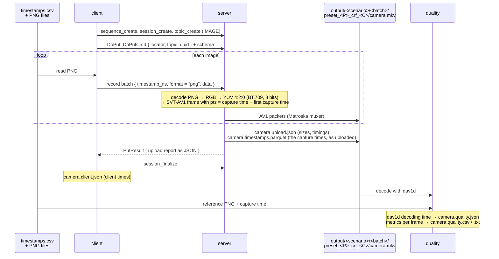
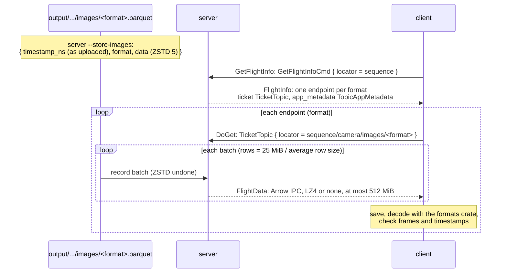

# image-sequence: from timestamped images to an AV1 video

A Rust workspace that uploads an image sequence with
[mosaicod](https://github.com/mosaico-labs/mosaico)'s upload flow, turns it
into an AV1 video in a Matroska (`.mkv`) file, and measures how much quality
the video lost compared with the images. It then turns the video back into
images, in six formats, and serves them back to a client as mosaicod serves
a topic, to compare the formats a client could get its frames in (see
[Back to images](#back-to-images)).

The images are the 8K PNG frames of `datasets/ImageSequence/001`, each with
the capture time a camera would have recorded, from the
[timestamp datasets](datasets/README.md).

| Crate | What it does |
|---|---|
| [`client`](crates/client/src/main.rs) | Reads a `timestamps.csv` and uploads its images, one PNG per record batch with its capture time, with mosaicod's Arrow Flight upload flow. With `--fetch`, reads the image topics back (`GetFlightInfo`, then `DoGet` per topic), timing and checking them |
| [`server`](crates/server/src/main.rs) | Receives the upload and encodes it with FFmpeg (SVT-AV1) into 8-bit YUV 4:2:0 (`yuv420p`) while the images arrive, saving the uploaded capture times. Then turns a video back into images (`--extract-images`), measures them with butteraugli (`--image-quality`), stores them as image topics (`--store-images`), and serves those back (`GetFlightInfo`, `DoGet`) |
| [`formats`](crates/formats/src/lib.rs) | The six image formats a frame can be written in and read back from, shared by the server and the client: raw I420, zstd, lossless AVIF, FFV1 (exact) and PNG, JPEG (converted, for comparison) |
| [`quality`](crates/quality/src/main.rs) | Times decoding the video with FFmpeg's `libdav1d` (dav1d) alone, then decodes it again and compares every frame with its PNG: PSNR, PSNR-HVS, MS-SSIM and CIEDE2000 from `av-metrics`, SSIMULACRA2 and butteraugli |
| [`common`](crates/common/src/lib.rs) | The protocol messages (upload and read path), the image schema, CSV reading, PNG decoding, the RGB to YUV conversion, the choice of a constant or variable frame rate, and the output paths |


## Data flow



The client reads each PNG only when it is about to be sent, so the images
are never all in memory. It also checks first that every image fits in one
message (at most ~49.9 MiB: the server accepts messages up to 50 MiB,
mosaicod's default), and stops before uploading anything if one doesn't. On
the server, PNG decoding runs on its own thread, decoding up to 4 queued
images in parallel; at 8K it is still slower than the encoder, which waits
for it most of the time (see [`encoder.rs`](crates/server/src/encoder.rs)).

### The video

| Property | Value |
|---|---|
| Codec | AV1, SVT-AV1 through FFmpeg, constant quality (CRF) |
| Container | Matroska (`.mkv`), FFmpeg's muxer |
| Pixels | 8-bit YUV 4:2:0 (`yuv420p`), BT.709 matrix, limited range; tagged with BT.709 primaries and the sRGB transfer curve of the PNGs |
| Frames | one per PNG, in upload order: none dropped or repeated |
| Frame rate | constant when the capture times allow it without losing timing, otherwise variable (see [Constant or variable frame rate](#constant-or-variable-frame-rate)) |
| Timestamps | each frame's capture time minus the first one, in **milliseconds** (at a constant frame rate, the frame's index times the frame period, within 0.5 ms of it) |
| First capture time | the `CAPTURE_START_NS` tag, in nanoseconds since the Unix epoch |

**Presets at 8K.** `libsvtav1` does not support presets below 5 at 8K: it
refuses to open the encoder ("8k+ resolution support is limited to M5 and
faster presets"), and the server fails the upload with "opening the SVT-AV1
encoder: Invalid argument". SVT-AV1 also warns that its 8K support is a
work in progress, not meant for benchmarking.

The RGB to YUV conversion is in [`images.rs`](crates/common/src/images.rs):
each U and V sample is the average of the 2x2 pixels it covers. Only 8-bit
PNGs are accepted. The encoder and the quality tool's decoder also support
10-bit YUV 4:2:0 (`yuv420p10le`), but the server always encodes 8-bit for
now.

**Alpha.** The dataset PNGs are RGBA, but the video has no alpha channel
(SVT-AV1 encodes only YUV), so the server drops it from every image without
looking at it. That loses nothing only because the images are opaque: all
900 frames of sequences 001–003 have alpha 255 in every pixel. An image with
transparent pixels would be encoded as if they were opaque, showing
whatever color they hold. The `quality` crate decodes the reference PNGs the
same way, so the alpha is gone on both sides of the comparison.

### Capture times

The video keeps each image's capture time, but only to the millisecond:
read back, a capture time can be up to 0.5 ms off the one in the CSV.

The CSV gives each capture time in nanoseconds since the Unix epoch, but a
video does not store absolute times: each frame has a timestamp (its pts)
counted from the start of the video. So the server splits every capture
time in two (see [`encoder.rs`](crates/server/src/encoder.rs)):

- the first image's capture time, written once on the file as the
  `CAPTURE_START_NS` tag, in nanoseconds
- each frame's timestamp: its capture time minus the first one, also in
  nanoseconds (at a variable frame rate; at a constant one, the frame's
  index in frame periods, see below)

For example, the first frames of `regular/batch_060`. The first one was
captured at 1767225600000000000 ns (2026-01-01 00:00:00 UTC), so the file
gets the tag `CAPTURE_START_NS=1767225600000000000`, and each frame the
timestamp:

| Frame | Capture time in the CSV (ns) | − `CAPTURE_START_NS` (ns) | = Timestamp given to the encoder |
|---|---|---|---|
| 0 | 1767225600000000000 | 1767225600000000000 | 0 ns |
| 1 | 1767225600033366667 | 1767225600000000000 | 33366667 ns (33.366667 ms) |
| 2 | 1767225600066733333 | 1767225600000000000 | 66733333 ns (66.733333 ms) |
| 3 | 1767225600100100000 | 1767225600000000000 | 100100000 ns (100.1 ms) |

A frame's capture time is then `CAPTURE_START_NS` plus its timestamp:
frame 2 is 1767225600000000000 + 66733333 = 1767225600066733333 ns. The
precision is lost when the video is written: Matroska stores timestamps in
units of its `TimestampScale`, and FFmpeg's Matroska muxer always uses the
default, 1 ms. Every timestamp is rounded to the nearest millisecond, so it
is off by up to 0.5 ms. The same frames, ~33.37 ms apart (29.97 fps, not a
whole number of milliseconds), read back as `CAPTURE_START_NS` plus the
stored timestamp:

| Frame | Timestamp given to the encoder | Stored in the video | Capture time read back (ns) | Capture time in the CSV (ns) | Difference |
|---|---|---|---|---|---|
| 0 | 0 ms | 0 ms | 1767225600**000000000** | 1767225600**000000000** | 0 |
| 1 | 33.366667 ms | 33 ms | 1767225600**033000000** | 1767225600**033366667** | −0.367 ms |
| 2 | 66.733333 ms | 67 ms | 1767225600**067000000** | 1767225600**066733333** | +0.267 ms |
| 3 | 100.1 ms | 100 ms | 1767225600**100000000** | 1767225600**100100000** | −0.100 ms |

The first frame is always exact: its timestamp is 0, and the tag keeps the
nanoseconds. The others are rounded one by one, so the error does not add
up: it stays within ±0.5 ms however long the video is. Anything that needs
the exact nanoseconds of a frame has to keep them outside the video, as the
CSV does.

The quality tool reads every frame's capture time back the same way and
compares it with the CSV: the difference of each frame is the
`capture_error_ns` column of `quality.csv`, and the largest one is in the
summary. It reports the difference, but does not fail when it is larger
than 0.5 ms.

**Timestamp order.** The server rejects an image whose capture time is not
after the previous one: a video shows its frames in time order, one at a
time. It also rejects an image with no capture time (a null `timestamp_ns`):
it would have no place in the video. A rejected sequence leaves no video,
not even one of the images received before the bad one: the server waits
for the encoder to stop and removes the file. The datasets
[`duplicate-timestamps/`](datasets/duplicate-timestamps/README.md) and
[`out-of-order/`](datasets/out-of-order/README.md) are made for this check:
the server's unit tests (`cargo test -p server`) run it on their capture
times and check that it rejects exactly their faulty images, and accepts
the batch just before the first one and every batch of the other scenarios.

**Frame durations.** Every frame lasts until the next one's capture time.
The last frame, which no frame follows, lasts as long as the gap before it
(the camera's latest spacing), or one nominal frame period if it is the
only one; at a constant frame rate every frame lasts one period. A
variable video stores no duration for the other frames: its track has no
`DefaultDuration`, and Matroska then defines a frame's duration as the gap
to the next frame's timestamp
([RFC 9559](https://www.rfc-editor.org/rfc/rfc9559#name-blockduration-element),
`BlockDuration`), so the file holds the capture times and nothing else
(FFmpeg's muxer writes a `BlockDuration` only against a `DefaultDuration`).
The last frame ends at the segment's `Duration`: `sparse/batch_003`
(frames 0, 10 and 30) has frames at 0, 334 and 1001 ms and lasts 1.668 s,
so frame 30 is shown for 667 ms, like the gap before it. `ffprobe` shows
the packets of such a video with no duration (`N/A`), or with one it
guessed from an average rate (see below).

### Constant or variable frame rate

Every PNG becomes one frame, and every frame decodes back to one image:
the video never drops or repeats a frame to keep a frame rate. Its frame
rate follows from the capture times
([`common/src/timing.rs`](crates/common/src/timing.rs)):

- **Constant** when it loses no timing: frame *k* at *k* frame periods,
  with every capture time read back within 0.5 ms, as close as the
  millisecond timestamps keep them anyway. The rate tried first is
  30000/1001, then the one of the first and last capture times (as a
  fraction with a denominator of at most 1001, like 25/1 or 24000/1001).
  The stream declares it (Matroska's `DefaultDuration`), so players and
  `ffprobe` see a constant rate. SVT-AV1 encodes before the rate is known,
  so its rate control always gets the nominal `--frame-rate`.
- **Variable** otherwise: each frame at its own capture time, as described
  above. Neither the stream (no `DefaultDuration`) nor the AV1 bitstream
  (no `timing_info` in its sequence header) declares a frame rate: the
  nominal `--frame-rate` only drives SVT-AV1's rate control. Dropped
  frames, jitter and rate changes are kept as they were captured, with no
  frame added and no rate made up. The frame rate `ffprobe` shows is its
  own estimate from the timestamps: `jitter`, whose gaps average 33.4 ms,
  gets `avg_frame_rate=30000/1001`; `rate-change` and `sparse`, which no
  single rate fits, get `0/0`. In the file, the missing `DefaultDuration`
  is what tells a variable video from a constant one.

On the scenarios' `batch_060`:

| Scenario | Frame rate | Why |
|---|---|---|
| `regular` | constant 30000/1001 | evenly spaced |
| `jitter` | variable | up to 4.8 ms off any even spacing |
| `frame-drops` | variable | a 66.7 ms gap would need a repeated frame |
| `rate-change` | variable | 33.4 ms then 66.7 ms apart: no single rate fits |
| `sparse` (`batch_003`: frames 0, 10, 30) | variable | 333.7 ms then 667.3 ms apart; `batch_002`, with one gap, is constant 3000/1001 |

The server decides, from the capture times it received; the client only
sends the images and their times. The server encodes while the images
arrive, before it knows the last capture time, so it always encodes at a
variable frame rate. Once the last image is in, if the capture times fit
a constant frame rate, it rewrites the timestamps to it without
re-encoding ([`encoder::make_constant`](crates/server/src/encoder.rs)):
every packet is copied in order, frame *k* at *k* frame periods, and the
rate is declared. AV1 packets hold no timestamps of their own, so only the
container changes. The rewrite fails, leaving the video variable, unless
the video holds exactly one frame per image received. The choice is in
the upload report (`timing` in `upload.json`).

**Packet timestamps.** SVT-AV1 outputs one packet per frame, in the order
the frames are shown, but when the frames are very unevenly spaced (as in
`sparse/`) it can give a packet the timestamp of another frame, far ahead,
which the Matroska muxer rejects as out of order. So the server stamps the
k-th packet with the k-th frame's capture time itself, and fails if the
encoder outputs more or fewer packets than frames.

## Building and running

Tools:

- Rust
- FFmpeg 9.0 with the `libsvtav1` encoder and the `libdav1d` decoder
- `pkg-config` to find FFmpeg libraries on system

Data:

- the timestamps: [`datasets/`](datasets/README.md), already in the
  repository, one `<scenario>/batch_NNN/timestamps.csv` per scenario and
  batch size;
- the PNG frames they point to: `datasets/ImageSequence/001/` at the root of
  the repository, not in git. Download them from the root with
  `scripts/build-datasets.sh images`, which fetches the SEPE 8K image
  sequences 001, 002 and 003 (~24 GB; the timestamps use only 001).

From `image-sequence/`:

```sh
cargo build --release

# 1. the server, in its own terminal
./target/release/server

# 2. upload a batch: any timestamps.csv of datasets/
./target/release/client --timestamps datasets/<scenario>/<batch>/timestamps.csv

# 3. compare the video with the images, with the same timestamps.csv
./target/release/quality --timestamps datasets/<scenario>/<batch>/timestamps.csv
```

Without `--timestamps`, the client and `quality` use
`datasets/regular/batch_060/timestamps.csv`, the batch of the
[results](#results) and of the [end-to-end test](#end-to-end-test).
Batches of `duplicate-timestamps/` and `out-of-order/` that repeat a capture
time or go back in time are rejected by the server (see
[Capture times](#capture-times)).

The sequence is named after the scenario and batch (for example
`jitter_batch_120`) and the topic is `camera`. Each video goes in a folder
of its scenario, batch and encoder settings, so that encodings of the same
batch with different presets and CRFs sit side by side:
`output/<scenario>/<batch>/preset_<P>_crf_<C>/camera.mkv`, with
`camera.upload.json` (the server's sizes and times),
`camera.timestamps.parquet` (the capture times as uploaded, to the
nanosecond: the video keeps them to the millisecond), `camera.client.json`
(the client's times), `camera.quality.csv`, `camera.quality.txt` and
`camera.quality.json` next to it; and, from [Back to images](#back-to-images),
`images/<format>/` (the images), `images/<format>.parquet` (the image
topics), `fetched/<format>/` (the client's copies), `camera.images.json`,
`camera.images-quality.json` and `camera.fetch-<compression>.json`. The client writes its file under its own
`--out-dir`, so it stays apart from the server's when the two run on
different machines. `quality` takes the same `--preset` and
`--crf` as the server (same defaults) to find the video. `output/` is not
tracked by git. The server keeps sequences only in memory, as a stand-in for
mosaicod's database: uploading the same batch twice needs a server restart
(or a new `--sequence` name), and the video is then overwritten.

Main options:

| Program | Option | Default | Meaning |
|---|---|---|---|
| `server` | `--preset` | 9 | SVT-AV1 preset, 0 (slowest, best) to 13. At 8K `libsvtav1` accepts only 5 and faster (see [The video](#the-video)) |
| `server` | `--crf` | 30 | SVT-AV1 constant rate factor, 1 (best) to 63 (smallest) |
| `server`, `quality` | `--lossless` | off | Encode losslessly instead of with a CRF (see [Lossless: the conversion alone](#lossless-the-conversion-alone)); the video goes to `preset_<P>_lossless/` |
| `server` | `--frame-rate` | 30000/1001 | Nominal rate for SVT-AV1's rate control; the frames keep their capture times |
| `client`, `quality` | `--timestamps` | `datasets/regular/batch_060/timestamps.csv` | The batch to upload, or to compare the video with |
| `client` | `--sequence`, `--topic` | from the CSV, `camera` | Locator of the uploaded topic |
| `server`, `client` | `--out-dir` | `output/` | Where the video and the server's report, or the client's times, are written |
| `server`, `client` | `--addr`, `--url` | `127.0.0.1:6726`, `http://127.0.0.1:6726` | Where the server listens and the client connects (mosaicod's default port) |
| `quality` | `--preset`, `--crf` | 9, 30 | Settings the video was encoded with, to find it in `output/` |
| `quality` | `--video` | the server's video for those settings | The video to compare, instead |
| `quality` | `--step` | 1 | Measure one frame every N |
| `quality` | `--refresh-conversion` | off | Measure the YUV 4:2:0 conversion again instead of reusing `yuv420.quality.json` |
| `quality` | `--yuv444-floor` | off | Measure no video, only what the conversion to YUV 4:4:4 alone loses (see [Lossless 4:4:4](#lossless-the-conversion-alone)), into `yuv444.quality.json` |
| `quality` | `--jobs` | 4 | Frames measured at the same time. Butteraugli needs ~9 GiB at 8K and runs for one frame at a time; with 4 jobs the tool stays at ~15 GB resident |
| `server` | `--extract-images <video>` | | Instead of listening: the video back to images, in every format, timed and checked |
| `server` | `--image-quality <video>` | | Instead of listening: butteraugli of the PNG and JPEG images |
| `server` | `--store-images <video>` | | Instead of listening: each format's images as an image topic (Parquet), with the uploaded capture times |
| `server` | `--do-get-compression` | `lz4` | IPC compression of the `DoGet` streams that serve the image topics back: `lz4`, as mosaicod, or `none` |
| `client` | `--fetch` | off | Instead of uploading: read the sequence's image topics back, time and check them |


## Results

The results are reported by a Python script,
[`scripts/report.py`](scripts/report.py), with matplotlib. It needs
[uv](https://docs.astral.sh/uv/) (`brew install uv`), which installs
matplotlib on its first run. After the three steps of
[Building and running](#building-and-running):

```sh
uv run scripts/report.py   # takes the same --preset and --crf as quality
uv run scripts/report.py --compare-only   # only presets-crfs/, from video-results/
uv run scripts/report.py --compare-datasets --preset 5   # only dataset-comparisons/
uv run scripts/report.py --redraw --preset 5   # every chart in video-results/ again, from video-results/
```

[`scripts/run.sh`](scripts/run.sh) runs everything instead: it builds the
workspace, starts the server for the upload, then runs the client, `quality`
and `scripts/report.py`; the logs go to
`output/logs/<scenario>/<batch>/preset_<P>_crf_<C>/`.
It takes a `timestamps.csv` as argument (default
`datasets/regular/batch_060/timestamps.csv`), and other settings with
`PRESET` and `CRF`:

```sh
scripts/run.sh                   # video-results/regular/batch_060/preset_9_crf_30/
PRESET=4 CRF=35 scripts/run.sh   # video-results/regular/batch_060/preset_4_crf_35/
LOSSLESS=1 scripts/run.sh        # video-results/regular/batch_060/preset_9_lossless/
```

The report collects one encoding into
`video-results/<scenario>/<batch>/preset_<P>_crf_<C>/`:

- `summary.md`: what the video lost, the client's and the server's times,
  the file size and the raw metric tables, with the charts;
- `client.json`, `upload.json`, `quality.csv`, `quality.json`: copies of
  what the client, the server and `quality` wrote;
- `video-quality/`: `loss-overview.svg`, every measure of loss at once
  (the video's mean in blue, its worst frame, and what the YUV 4:2:0
  conversion alone lost in orange, and the 4:4:4 one in dashed black if
  measured) over the bands of what the eye sees, and one folder per
  measure, `<measure>/<measure>.svg`, with the loss of each frame (see
  [The metrics](#the-metrics)). The shaded bands say how visible the loss
  is, darker = more visible, and the dashed lines mark where one band ends
  and the next starts; the key under each chart names every band with its
  range;
- `client-time/client-time.svg`: the client's side of the upload;
- `server-time/`: `server-time.svg`, the server's side, and
  `server-timeline.svg`, every frame through the server's queues, decoder
  and encoder on one time axis;
- `client-server-time/client-server-time.svg`: the client's and the server's times on
  one axis, to show how they fit together (see below);
- `filesize-comparison/filesize-comparison.svg`: the size of the images
  against the video's.

**Comparing presets and CRFs.** Each run of the report also rebuilds the
charts in `video-results/<scenario>/<batch>/presets-crfs/` from every
`preset_<P>_crf_<C>/` folder of the batch. Every chart is one measure
against the CRF, always on the x axis, one line per preset and one point per
CRF, on a scale fitted to the values instead of starting at 0 (spanning at
least ±5% around them, so that smaller differences stay flat). Lower is
better everywhere. The lossless encodings (`preset_<P>_lossless/`) have no
CRF: they are on the right, in a panel and on a scale of their own, one
diamond per preset with its value. Every chart carries its own title,
description, CRF axis and keys, so that it can be cut out and used on its
own (in a paper, say); the keys give the values that fall between the
axis ticks (lossless sizes, conversion floors) in bold. Each preset has its
own color, the same in every chart (blue, crimson, dark yellow), and its
own marker and line style. `README.md` in that folder shows all the
charts, with a table of every encoding of the batch linking to its
summary.

- `compare-presets-data.svg`: video size, butteraugli max-norm and 3-norm,
  and the encoder's working time, one chart above the other.
- `video-size.svg`: the video size.
- `butteraugli-max.svg`: the max-norm, the worst spot of each frame, over
  its visibility bands: whether the worst differences can be seen. A table
  under the CRF axis gives each encoding's video size, and the lossless
  panel the YUV 4:2:0 conversion's loss (orange) and the 4:4:4 one's
  (dashed black), if measured.
- `butteraugli-3norm.svg`: the 3-norm, the whole frame, with the same
  table. It has no visibility scale, so it says nothing about whether a loss
  is visible, but on the same images a lower one is less visible loss over
  the whole frame: it ranks the settings of one batch, not encodings of
  different batches.
- `encoder-wall-time.svg` and `encoder-working-time.svg`, both in
  `encode-time.svg`: how long the encoder took for each encoding. Its wall
  time also counts waiting for decoded PNGs; its working time is the AV1
  encoding itself. At 8K PNG decoding is the bottleneck, so the wall time
  follows the decoder, not the CRF.

To fill them, run the pipeline once per setting, for example the CRFs of
`regular/batch_060`:

```sh
for crf in 18 22 26 30 35; do PRESET=9 CRF=$crf scripts/run.sh; done
```

**Timing runs.** Each time is from a single run, and the machine's state
moves it: `jitter/batch_060` and `regular/batch_060` give byte-identical
AV1 packets, yet their encoder working times differ by up to ~10% at the
same CRF. Keep the machine awake (`caffeinate -i` on macOS: a sleep in the
middle of an upload throttles it), close what uses the CPU (a browser
showing the charts can take most of a core), and let it rest between runs
(see the sweep below).

**Comparing datasets.** `--compare-datasets --preset <P>` writes
`video-results/dataset-comparisons/` from the encodings with that preset of every
batch in `video-results/`, one line per batch, in the layout of `presets-crfs/`,
each dataset in its own color: `video-size-per-frame.svg`, `bitrate.svg`
(over the time the frames cover), `butteraugli-max.svg` and
`butteraugli-3norm.svg` (with each dataset's 4:4:4 conversion on its row
of the lossless panel), `encoder-working-time-per-frame.svg`,
`encoder-working-total-time.svg`, all of them in
`compare-datasets-data.svg`, and a `README.md` with what images each batch
holds and a table of every encoding. The batches have different numbers of
images (`sparse` has 20), hence the sizes and times per frame. Datasets
with the same frames give nearly the same lines: the first is then drawn
wide and pale underneath, so that the ones on it still show. Some batches
hold other frames of the sequence than `regular/batch_060`
(`rate-change/batch_060` takes every other frame after its first 30,
`sparse` keeps 2 in 30): their frames differ more from one to the next, so
part of their difference is the content, not the timing. To fill it, run
every CRF and the lossless encoding of each batch, each after a 2-minute
pause so that the run before (its encoding and its quality measurement)
does not heat the machine and slow its encoding, then the comparison:

```sh
for b in regular/batch_060 frame-drops/batch_060 jitter/batch_060 rate-change/batch_060 sparse/batch_020; do
    for crf in 18 22 26 30 35 lossless; do
        sleep 120
        if [ $crf = lossless ]; then PRESET=5 LOSSLESS=1 scripts/run.sh datasets/$b/timestamps.csv
        else PRESET=5 CRF=$crf scripts/run.sh datasets/$b/timestamps.csv; fi
    done
done
uv run scripts/report.py --compare-datasets --preset 5
```

`duplicate-timestamps/batch_060` and `out-of-order/batch_060` are not in it:
their capture times are those of `regular/batch_060` (the duplicate and the
backward time come later, at images 75 and 91), and their larger batches are
rejected by the server.

**Client and server times.** The client and the server are meant to run in
different places, so each one times its own side and the two are charted
apart, although they overlap: the server decodes and encodes while the
client sends. The client's stages run one after the other and add up to
its total; the server's overlap, since it decodes and encodes while the
images arrive.

| Side | Stage | What it is |
|---|---|---|
| Client (`client.json`) | Setup | reading the CSV, checking the image sizes, connecting, creating the sequence, session and topic |
| | Reading the PNGs | reading the images from disk, each one just before it is sent |
| | Sending to the server | the rest of `DoPut` until the last image is handed to gRPC, which takes an image only when it has room to send it |
| | Waiting for the server | from the last image handed over to the server's report: the last images in flight, and the server finishing the video |
| | Finalizing | `session_finalize` |
| Server (`upload.json`) | Receiving | from the first message to the last image received; the server takes the images only as fast as it decodes them |
| | PNG decoding | decoding the PNGs and converting them to YUV 4:2:0, up to 4 at a time |
| | AV1 encoding | the encoder working, PNG to AV1, while the images arrive |
| | Encoder idle | the encoder waiting for the next decoded PNG; working and idle add up to the encoder's time, from the first frame to the file closed |

**Client and server together.** Both totals cover the same span: the
client's `DoPut` stays open until the server has closed the video and sent
its report. The server decodes and encodes while the client sends, so the
client's *waiting for the server* is only what is left after its last
image: the last image in flight (from the client handing it to gRPC to the
server receiving it), then the server finishing (the last frames, the
encoder flush, the file closed). `client-server-time.svg` draws both on one axis,
with the server's decoder and encoder busy times below. Both clocks start
with the upload; on two machines the server's row shifts right by the
network latency.

**The server as a pipeline of queues.** The server's stages overlap
because each image goes through two queues: received images wait in the
decode queue (up to 4) until the decoder takes them, up to 4 at a time,
and decoded frames wait in the encoder's queue (up to 2) until the encoder
takes them, one by one, in order. The server records when each frame
entered each step (`frames` in `upload.json`), and `server-timeline.svg`
draws one row per frame, colored by step: waiting in the decode queue,
decoding, waiting for the encoder, encoder busy. Steps of different frames
in the same column of time ran at the same time. When decoding is the
bottleneck, as at 8K, the images pile up in the decode queue (and slow the
upload down, since the server stops reading when the queue is full) while
the encoder stays idle between frames.

**Why the encoding comes in bursts.** The decoder takes the queued images
together and decodes them in parallel, so a batch of up to 4 frames
finishes at once, about every 0.5 s at 8K (the thin gaps in the PNG decoding
row of `client-server-time.svg`). The encoder then takes the 4 frames in a quick
burst, 5–20 ms each, and waits idle for the next batch: the regularly
spaced blue bursts, at the decoder's pace. The first burst is wider: frame 0
is decoded alone, and its encoding includes opening SVT-AV1. *Encoder busy*
is the time the encode thread spends handing a frame to SVT-AV1 and writing
the packets it has ready. SVT-AV1 compresses on its own threads, alongside
the decoding, so most of its work is not in that row. It shows at the end:
after the last frame, flushing the encoder and closing the file take
another ~0.6 s, the end of the server's *finishing*.

The summary also gives the quality tool's AV1 decoding time: the whole video
decoded with dav1d with nothing else running, file reading included
(`camera.quality.json`).

The results so far:

- [`regular/batch_060`, presets 5, 6 and 9 compared](video-results/regular/batch_060/presets-crfs/README.md),
  at CRF 18, 22, 26, 30 and 35 and lossless, for example
  [preset 9, CRF 30](video-results/regular/batch_060/preset_9_crf_30/summary.md)
  and the lossless ones, the YUV 4:2:0 conversion alone:
  [preset 5](video-results/regular/batch_060/preset_5_lossless/summary.md),
  [preset 6](video-results/regular/batch_060/preset_6_lossless/summary.md),
  [preset 9](video-results/regular/batch_060/preset_9_lossless/summary.md)
- [the datasets compared at preset 5](video-results/dataset-comparisons/README.md):
  `regular`, `frame-drops`, `jitter`, `rate-change` and `sparse`, every CRF
  and lossless

### Back to images

To give a client the frames as images, the server turns a video back into
one image per frame in six formats (the [`formats`](crates/formats/src/lib.rs)
crate, one file per format):

- **exact**, the frames as dav1d decodes them, 8-bit YUV 4:2:0: raw I420,
  zstd, lossless AVIF (SVT-AV1) and FFV1. Every image is read back and checked
  byte for byte against its frame;
- **converted**, for comparison: PNG (16-bit RGB) and JPEG (quality 100,
  BT.601 full range), losing as little as each allows; what each loses is
  measured (RMS error and butteraugli).

Each format is timed one image at a time, then 4 at a time. The server then
stores each format's images as an image topic, one Parquet file laid out as
mosaicod stores one, its `timestamp_ns` copied from the uploaded capture
times, and serves them back as mosaicod serves a topic:



From `image-sequence/`, for `regular/batch_060` with preset 5 and CRF 18:

```sh
PRESET=5 CRF=18 scripts/run.sh                       # upload, encode, measure the video
V=output/regular/batch_060/preset_5_crf_18/camera.mkv
./target/release/server --extract-images $V          # the six formats, timed and checked
./target/release/server --image-quality $V           # butteraugli of PNG and JPEG
uv run scripts/image_formats.py --preset 5 --crf 18  # image-results/.../server/
scripts/fetch.sh                                     # --store-images, then the client's fetch, LZ4 and none
uv run scripts/fetch_results.py --preset 5 --crf 18  # image-results/.../client/
uv run scripts/format_support.py                     # image-results/format-support/
```

The results:

- [`regular/batch_060`, preset 5, CRF 18](image-results/regular/batch_060/preset_5_crf_18/server/README.md):
  the six formats on the server, and the [client reading them back](image-results/regular/batch_060/preset_5_crf_18/client/README.md)
- [how widely the formats are supported](image-results/format-support/README.md), from public sources:
  browsers, viewers, Python, FFmpeg, use on the web, and how simple each is to decode

### The metrics

All of them compare each decoded frame with its source image. Higher is
better for every one except butteraugli, where lower is better.

| Metric | Crate | Compares | Unit / range |
|---|---|---|---|
| PSNR (`psnr_*`) | `av-metrics` | decoded YUV vs the PNG converted to YUV 4:2:0, as the encoder received it | dB; 100 = identical |
| PSNR-HVS (`psnr_hvs_*`) | `av-metrics` | same | dB; PSNR weighted by how visible each frequency is to the eye |
| MS-SSIM (`msssim_db_*`) | `av-metrics` | same | dB: −10·log10(1 − MS-SSIM); 20 dB = MS-SSIM 0.99, 30 dB = 0.999 |
| CIEDE2000 (`ciede2000_db`) | `av-metrics` | same, converted to colors | 45 − 20·log10(mean ΔE₀₀); 45 = an average color difference of 1 |
| SSIMULACRA2 (`ssimulacra2`) | [`ssimulacra2`](https://github.com/rust-av/ssimulacra2) | decoded frame vs the **PNG**, in linear RGB | up to 100; ~90 visually lossless, ~70 high quality, ~50 medium |
| Butteraugli (`butteraugli_max`, `butteraugli_3norm`) | [`butteraugli`](https://github.com/imazen/butteraugli) | same | **lower is better**; max-norm, the worst spot of the frame, in Google's three classes: <1 great, 1–2 acceptable, >2 not acceptable. 3-norm: averages the whole frame instead of taking its worst spot; it has no visibility scale, so it is only in the raw tables |

`*` is the plane: `y`, `u`, `v`, or `avg` (weighted by samples, so Y counts
4x).

**The reference.** The `av-metrics` metrics compare with the same YUV 4:2:0
frame the encoder received, so they measure only what the AV1 encoding
lost. SSIMULACRA2 and butteraugli compare with the PNG itself (both frames
converted to linear RGB once and shared by the two), so they also count the
conversion to YUV 4:2:0, including its half-resolution color.

**The conversion alone.** To tell the two apart, SSIMULACRA2 and butteraugli
are computed a second time between the PNG and the frame the encoder
received, converted back to RGB the same way as a decoded frame:
`ssimulacra2_yuv420`, `butteraugli_max_yuv420` and
`butteraugli_3norm_yuv420`. That is what YUV 4:2:0 loses before any
encoding; the gap between them and the video's values is what AV1 added.
It does not depend on the encoder settings, so `quality` measures it once
per image and keeps it in `output/<scenario>/<batch>/yuv420.quality.json`,
shared by every encoding of the batch: later runs reuse it (an image whose
PNG changed size, or a value from another version of the measurement, is
measured again), and `--refresh-conversion` measures all of it again. Each
`quality.csv` still has the `*_yuv420` columns.

### Lossless: the conversion alone

With `--lossless` (`LOSSLESS=1 scripts/run.sh`), the server encodes with
SVT-AV1's lossless mode (`lossless=1`) instead of a CRF: the decoded frames
are exactly the YUV 4:2:0 frames the encoder received, so the only loss left
is the conversion from the PNGs to 8-bit YUV 4:2:0. It is a full encoding of
its own, in `preset_<P>_lossless/`, with the same charts and summary as the
others: the `av-metrics` metrics show no loss (PSNR and CIEDE2000 100 dB,
PSNR-HVS and MS-SSIM `inf`), and SSIMULACRA2 and butteraugli equal their
`*_yuv420` values. Its size is what keeping every YUV 4:2:0 sample costs:
566.5 MiB for the 60 frames of `regular/batch_060` at preset 9, against
1931.4 MiB of PNG. It has no CRF, so in the `presets-crfs/` charts it gets a
panel of its own, as a diamond in its preset's color (see
[Results](#results)).

The preset changes only the size and the encoding time of a lossless video,
not its frames, so its quality is the same at every preset. `scripts/run.sh`
measures it once per batch: a lossless run that finds another preset's
lossless video already measured decodes both with dav1d, and if the MD5 of
every frame matches it copies that one's `camera.quality.csv` and
`camera.quality.txt` instead of running `quality` (~7 min at 8K). Its
`camera.quality.json` then names where they came from (`reused_from`) and has
no AV1 decoding time, which belongs to each video; the summary says so. It
copies only from a video that was measured, never from one that copied its
own, so the record of the measurement is never lost. If a frame differs, it
measures as usual.

**Why the size changes with the preset.** Lossless AV1 (quantizer index 0)
leaves the encoder only one way to save bits: predicting each block well,
since the difference between the prediction and the frame is stored
exactly. Nothing is quantized, the transform is always a 4x4
Walsh–Hadamard, and the in-loop filters (deblocking, CDEF, loop
restoration) are off. What a preset changes is how hard SVT-AV1 searches
for the prediction: how many intra modes it tries, how far and how finely
it searches for motion and in how many reference frames, how finely it
splits the blocks, and which optional tools it evaluates. A slower preset
finds slightly better predictions, so slightly smaller differences to store:

| Lossless | Video size | MiB per frame | Smaller than raw YUV 4:2:0 (50.6 MiB per frame) | Encoder working |
|---|---|---|---|---|
| preset 5 | 548.0 MiB | 9.13 | 5.5x | 43.6 s |
| preset 6 | 554.0 MiB | 9.23 | 5.5x | 32.2 s |
| preset 9 | 566.5 MiB | 9.44 | 5.4x | 28.1 s |

Preset 5 saves only 3% on preset 9. Most of the bits of lossless 8K camera
footage go to what no prediction can foresee, the sensor noise and fine
texture that change from frame to frame, and a lossless video has to keep
them bit for bit however long the encoder searches. Searching more improves
only the predictable part (edges, smooth areas, motion), which is already
small. In the lossy encodings the presets are further apart, because there
the preset also chooses the transforms and filters and changes what is
lost. The slower presets search longer: lossless preset 5 takes ~1.6x the
encoder time of preset 9 for its 3% (single runs, see
[Timing runs](#results)).

**Lossless 4:4:4.** SVT-AV1 encodes only 4:2:0 (its `--color-format`
accepts nothing else), so there is no lossless 4:4:4 video. Its only loss
would be the conversion to 8-bit YUV 4:4:4, which needs no encoding:
`quality --yuv444-floor` measures it on each image, the same way as the
4:2:0 conversion, into `output/<scenario>/<batch>/yuv444.quality.json`
(~4 min for the 60 images), and `scripts/report.py` copies it to
`video-results/<scenario>/<batch>/yuv444.quality.json` and draws it, in dashed
black, wherever the orange 4:2:0 conversion is: in each encoding's
SSIMULACRA2 and butteraugli charts and loss overview (with a column in its
`summary.md`), in the lossless panel of the two butteraugli charts of
`presets-crfs/`, and on each dataset's row of the lossless panel in
`dataset-comparisons/`. It needs no video, so it is measured once per
batch, for every batch of `video-results/`, and is the same for all its
encodings. On every batch it is no lower than the 4:2:0 conversion: on
`regular/batch_060`, butteraugli max-norm 1.39 against 1.36, 3-norm 0.48
against 0.47, SSIMULACRA2 89.33 against 89.65 (higher is better), and
nearly the same on the others (in each `presets-crfs/README.md`). The PNGs carry almost no color detail
finer than 2x2 pixels (0.28 levels on average on the first image), so
averaging it loses next to nothing. In RGB, 4:4:4 does lose less (0.58
against 0.86 levels of RMS error on the first image), but both floors are
mostly the rounding to 8-bit limited range, and butteraugli sees 4:4:4's
rounding of every pixel's color slightly more than 4:2:0's smoother
color.

**Is it acceptable?** Each chart shades the values the eye can or cannot
see. CIEDE2000, SSIMULACRA2 and butteraugli have their own scales (in the
table above). PSNR, PSNR-HVS and MS-SSIM do not: their scores depend on the
content, so the same dB can be invisible on one image and visible on
another (Huynh-Thu and Ghanbari, 2008 [[1]](#references)).
Their bands come from a study that measured where viewers stop seeing the
loss: Afnan et al., 2023 [[2]](#references), Table 4.
25 viewers flicker-compared 10 images with JPEG versions of falling quality
on a 4K display at 1:1, and each metric was taken where a viewer stopped
seeing a difference. Its best, mean and worst values, over every image and
viewer, are fixed thresholds, the same for any content and resolution:

| Measure | Column | No viewer saw it on any image | Mean threshold | Every viewer saw it on every image |
|---|---|---|---|---|
| Pixel error | `psnr_avg` | PSNR 50.64 dB = 0.75 levels | 42.08 dB = 2.0 levels | 32.95 dB = 5.7 levels |
| Brightness error weighted by visibility | `psnr_hvs_y` | PSNR-HVS 51.82 dB = 0.65 levels | 44.65 dB = 1.5 levels | 37.85 dB = 3.3 levels |
| Structure lost over scales | `msssim_db_y` | MS-SSIM 0.9998 = 0.02 % lost | 0.9970 = 0.30 % | 0.9882 = 1.18 % |

That makes four bands: *invisible in every test*, *invisible on average*,
*visible on average* and *visible in every test*. The study computes
PSNR-HVS and MS-SSIM on Y only, so those two charts use the `*_y` columns.
It has no PSNR of Y alone, so the brightness error alone is not charted:
its values (`psnr_y`) are only in `quality.csv` and in the raw metric table
of `summary.md`, and the brightness is judged by PSNR-HVS of Y. The study tested JPEG, whose artifacts differ from AV1's, so the
bands say how large a loss viewers can see, not exactly what they would see
in these videos.

### References

1. Q. Huynh-Thu and M. Ghanbari, "Scope of validity of PSNR in image/video
   quality assessment", *Electronics Letters*, vol. 44, no. 13,
   pp. 800–801, 2008. [doi:10.1049/el:20080522](https://doi.org/10.1049/el:20080522)
2. Afnan, F. Ullah, Yaseen, J. Lee, S. Jamil and O.-J. Kwon, "Subjective
   Assessment of Objective Image Quality Metrics Range Guaranteeing Visually
   Lossless Compression", *Sensors*, vol. 23, no. 3, 1297, 2023.
   [doi:10.3390/s23031297](https://doi.org/10.3390/s23031297)
   ([open access](https://pmc.ncbi.nlm.nih.gov/articles/PMC9918960/))


## End-to-end test

[`scripts/e2e.sh`](scripts/e2e.sh) checks that the client and the server
work together: it builds the workspace, starts the server, uploads
`regular/batch_060` (the first 60 frames of sequence 001) with the client,
and checks the video the server wrote: AV1, 8192x4320, one frame per image
(with `ffprobe`), and in its upload report `yuv420p`, the constant frame
rate 30000/1001, the first and last capture times, and the video size.
Frames missing from `datasets/ImageSequence/001/` are downloaded first from
the dataset's Google Drive folder (~2 GB for the 60). It removes and writes
again `output/regular/batch_060/preset_9_crf_30/`, the video of the default
settings.

The test runs on GitHub Actions, together with the unit tests, on every
push and pull request to `main` that changes the workspace
([`image-sequence.yml`](../.github/workflows/image-sequence.yml)). They run on
`ubuntu-latest`, with FFmpeg 9 from
[BtbN's prebuilt shared build](https://github.com/BtbN/FFmpeg-Builds).
Tests do not run on
macOS because encoding the 8K frames needs ~11 GB of memory, more than the 7 GB
available on the standard macOS runner.
The downloaded frames are cached between runs.
