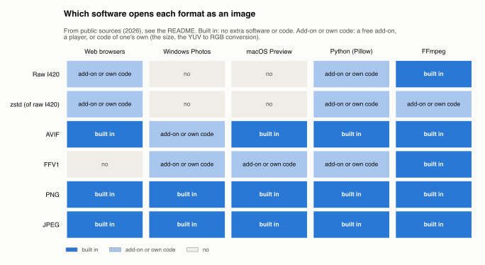
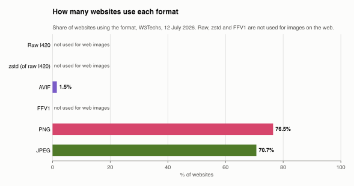

# How widely the image formats are supported

Generated by `scripts/format_support.py` from public sources, listed at the end; not from this workspace's measurements (for those, see each encoding's folder, e.g. [`regular/batch_060/preset_5_crf_18`](../regular/batch_060/preset_5_crf_18/server/README.md)). Do not edit: update the script's tables.

The formats are the six the server can turn a video's frames into: raw I420, zstd, lossless AVIF and FFV1, which keep the frames exactly, and PNG and JPEG, which convert them.

## In short

- **The most used**: PNG and JPEG, on about three websites in four each, built into every browser, viewer and library. AVIF is built into most browsers but on 1.5% of websites; FFV1 is used for archiving (the Library of Congress accepts it for preservation [12]), raw and zstd are not image formats at all.
- **The simplest to decode**: raw (nothing to decode) and zstd (a fast, ubiquitous decompressor), but only for a client with its own code, which knows the size and converts YUV to RGB. Of the real image formats, JPEG is the simplest and the most widely accelerated, then PNG; FFV1 and AVIF need a video decoder.

For a chart that puts this support next to the formats' measured size, speed and loss, to choose one, see [choosing a format](../regular/batch_060/preset_5_crf_18/server/README.md#choosing-a-format).

## Which software opens them

Whether each opens the file as an image: *built in* needs no extra software or code; *add-on or own code* needs a free add-on, a player, or code of one's own; *no* can't.

| Format | Web browsers | Windows Photos | macOS Preview | Python (Pillow) | FFmpeg |
|---|---|---|---|---|---|
| Raw I420 | add-on or own code: no image format: a page needs its own code (JavaScript, WebGL) to read the planes | no: no image format | no: no image format | add-on or own code: a few lines of NumPy, given the size, then a YUV to RGB conversion | built in: `-f rawvideo -pix_fmt yuv420p -s WxH`: the size and layout given on the command line |
| zstd (of raw I420) | add-on or own code: zstd is only an HTTP transfer encoding (Chrome 123+, Firefox 126+ [2], Safari 26.3 [2] [15], which caniuse's own zstd page still calls partial [14]); the planes inside need the page's own code, as raw | no: no image format | no: no image format | add-on or own code: decompressing is in the standard library since Python 3.14 (`compression.zstd`), then the planes as raw | add-on or own code: FFmpeg doesn't decompress zstd files: `zstd -d` first, then as raw |
| AVIF | built in: ~94% of users' browsers (caniuse, 2026) [1] | add-on or own code: needs the free AV1 Video Extension from the Microsoft Store [4] | built in: since macOS 13 Ventura [4] | built in: natively since Pillow 11.3 [3] | built in: with libdav1d or libaom |
| FFV1 | no: no browser decodes FFV1 | add-on or own code: a player with FFmpeg's decoder: VLC [10], or LAV Filters / ffdshow [13] | add-on or own code: a player with FFmpeg's decoder, such as VLC [10] | add-on or own code: through FFmpeg (PyAV); Pillow doesn't read it | built in: FFmpeg's FFV1 decoder, in libavcodec since 2003 [13] |
| PNG | built in | built in | built in | built in | built in |
| JPEG | built in | built in | built in | built in | built in |

## How much the web uses them

PNG and JPEG lead, on 76.5% and 70.7% of websites, AVIF is on 1.5% (W3Techs, 12 July 2026 [6]); the shares add up to more than 100% because a website uses several formats.

## How simple they are to decode

From the simplest to the most complex, by what a decoder must do:

| | Format | What decoding takes |
|---|---|---|
| 1 | Raw I420 | Nothing: the file is the planes. The reader must know the size and the pixel layout from elsewhere, and convert YUV to RGB to show it. |
| 2 | zstd (of raw I420) | A general-purpose decompressor, > 500 MB/s per core whatever the level [7], then the planes as raw. The library is everywhere (Linux, Python's standard library), but it knows nothing about images. |
| 3 | JPEG | The most widely implemented image decoder: Huffman decoding and an 8x8 inverse DCT, SIMD-accelerated in libjpeg-turbo, 2-6x faster than plain libjpeg [8], and with hardware decoders on phones, cameras and GPUs. |
| 4 | PNG | Inflate (zlib) and per-row filters: simple, but one deflate stream, so a single core decodes it. Rust's native `png` crate is about as fast as a C library's wrapper [9]. |
| 5 | FFV1 | An intra-only video codec with a range coder (RFC 9043 [5]). The implementations are few: FFmpeg's, a Go decoder, MediaConch [5]; FFmpeg's developers say decoding speed was not its main goal [10]. |
| 6 | AVIF | A full AV1 intra decoder (dav1d, libaom) behind libavif: the most complex here, and on the CPU slower than JPEG [11]. GPUs decode AV1 video in hardware [11], but there is no evidence of that for still AVIF images. |

Every fact with a number [n] is from that source, below. The others are general knowledge, not from these sources: Python 3.14's standard library module `compression.zstd`; hardware JPEG decoders (e.g. NVIDIA's nvJPEG, phones' image signal processors); reading raw planes with NumPy or FFmpeg's `rawvideo`, FFV1 through PyAV, and FFmpeg not reading zstd files; and that no browser decodes FFV1 (no source was found either way).

## Sources

1. [caniuse data for AVIF, as cited by a Redmine feature request (April 2026)](https://redmine.org/issues/43943)
2. [caniuse: Content-Encoding: zstd](https://caniuse.com/mdn-http_headers_content-encoding_zstd)
3. [nixpkgs: pillow-avif-plugin removed, Pillow has native AVIF since 11.3](https://code.ornl.gov/nix/nixpkgs/-/commit/45fabc4e86ddcc597a3c5cc12273e14368e81f33)
4. [Wikipedia: AVIF (support in operating systems and viewers)](https://en.wikipedia.org/wiki/AVIF)
5. [RFC 9043: FFV1 Video Coding Format Versions 0, 1, and 3](https://www.rfc-editor.org/rfc/rfc9043)
6. [W3Techs: usage statistics of image file formats for websites](https://w3techs.com/technologies/overview/image_format)
7. [zstd(1) man page](https://man.archlinux.org/man/zstd.1.en.txt)
8. [libjpeg-turbo](https://ecosystemdashboard.linaro.org/libjpeg-turbo/)
9. [Google: decoder benchmarks for Rust](https://github.com/google/decoder-benchmarks-for-rust)
10. [FFmpeg developers on FFV1 decoding speed (VLC issue)](https://code.videolan.org/videolan/vlc/-/issues/9606)
11. [Cloudflare: Introducing support for the AVIF image format](https://blog.cloudflare.com/generate-avif-images-with-image-resizing/)
12. [Library of Congress: Sustainability of Digital Formats, FFV1](https://loc.gov/preservation/digital/formats/fdd/fdd000341.shtml)
13. [Wikipedia: FFV1 (implementations, libavcodec since 2003, Windows codec packs)](https://en.wikipedia.org/wiki/FFV1)
14. [caniuse: zstd (Zstandard) content-encoding](https://caniuse.com/zstd)
15. [youngju.dev: Content-Encoding zstd and dictionary transport (Safari 26.3, July 2026)](https://www.youngju.dev/blog/2026-07-17-content-encoding-zstd-dictionary-transport.en)
