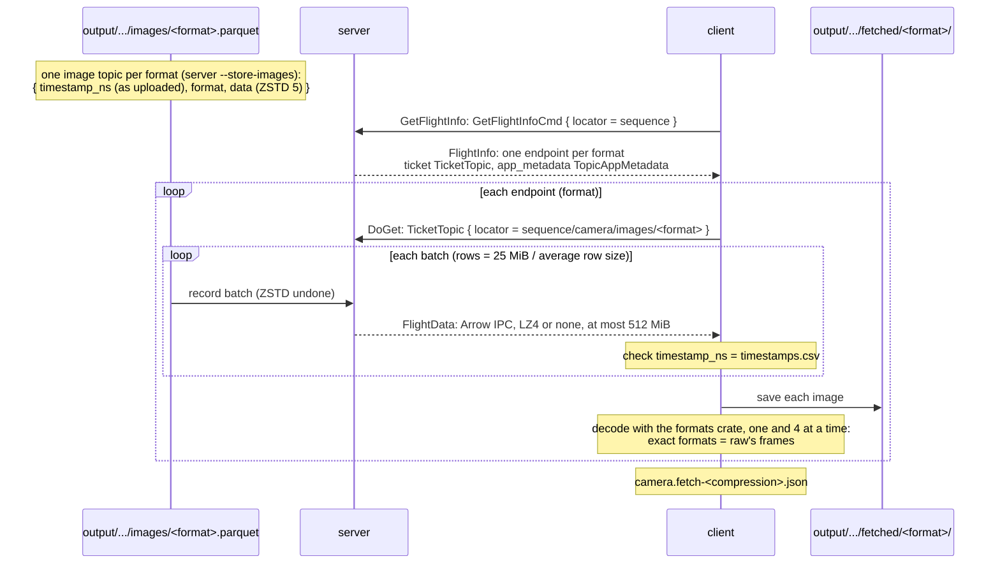
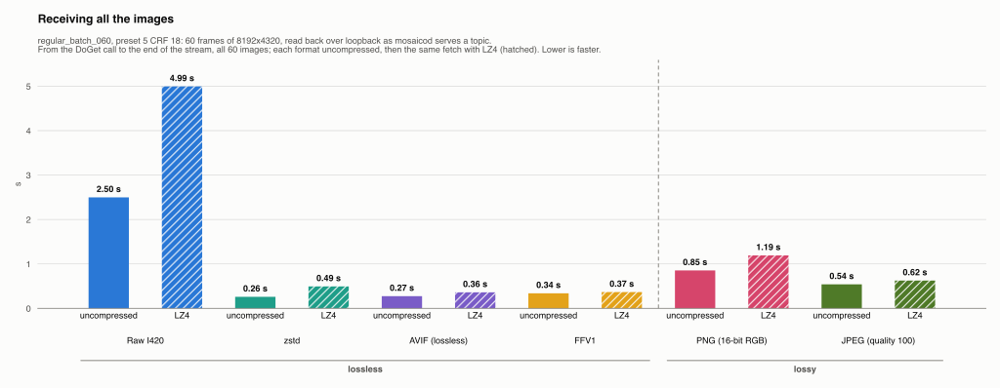
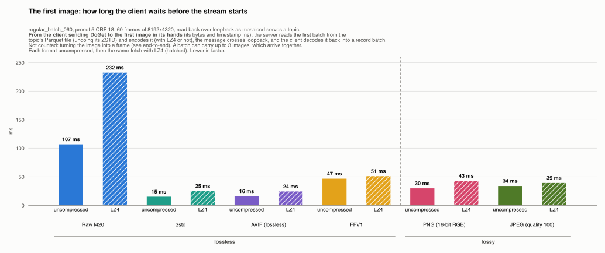
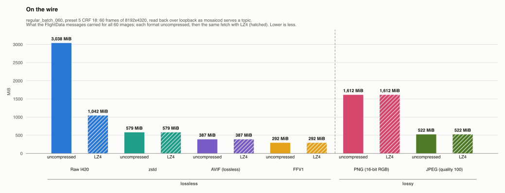
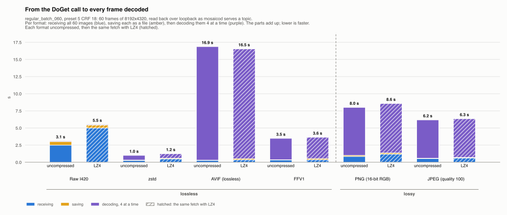

# regular_batch_060, preset 5 CRF 18: the images read back by a client

Generated by `scripts/fetch_results.py` from the client's reports (`client --fetch`, copied here as `fetch-none.json` and `fetch-lz4_frame.json`); do not edit. The images are the server's, from its [results](../server/README.md): one topic per format, 60 frames of 8192x4320.

## How the images are read back

As mosaicod serves a topic to its clients:

1. **Stored as an image topic** (`server --store-images`): each format's images in one Parquet file, laid out as mosaicod stores an image topic: a row per image (`timestamp_ns`, `format`, `data`) in capture order, the image bytes ZSTD level 5 with no dictionary and no statistics, the timestamps uncompressed with page statistics and a bloom filter. `timestamp_ns` is a copy of the capture times the client uploaded, which the server saved as they came (`camera.timestamps.parquet`, next to the video): row k for image k, as the video drops and repeats no frame. The video's own times are only to the millisecond.
2. **`GetFlightInfo`** on the sequence (a `GetFlightInfoCmd` with its locator): the server answers with one endpoint per topic (`camera/images/<format>`), its ticket a `TicketTopic` and its metadata a `TopicAppMetadata` (the format, the frames' size, the rows and bytes).
3. **`DoGet`** with each ticket: the server reads the topic's Parquet file in batches of as many rows as fit mosaicod's target message size (25 MiB) at the topic's average row size, and sends them with Arrow Flight's encoder, as mosaicod does: a batch over 25 MiB is split by rows, but one row (an image) is never split, so a message carries up to 512 MiB (mosaicod's limit), and the client accepts that much. The IPC data is LZ4-compressed, as mosaicod sends it, or not: both are measured.
4. **The client** saves each image as a file and decodes it with the server's own readers (the `formats` crate): one at a time, then 4 at a time. Every image of an exact format must decode to the same frame as raw's, and every image's `timestamp_ns` must be the one uploaded, or the fetch fails.

Client and server run on the same machine, over loopback: the network is not a bottleneck, and the two share the CPU. Each time is one run.

## What was measured

- **Receiving**: from the `DoGet` call to the end of the stream, for all the images: the server reading the Parquet file (and undoing its ZSTD), compressing with LZ4 or not, gRPC over loopback, and the client decoding the Arrow IPC messages (and undoing the LZ4).
- **First image**: how long the client waits before the stream starts: from its `DoGet` request to the first image in its hands (the image's bytes and its `timestamp_ns`). In between, the server reads the first batch from the topic's Parquet file (undoing its ZSTD) and encodes it (with LZ4 or not), the message crosses loopback, and the client decodes it back into a record batch. Decoding the image into a frame is not counted; a batch can carry up to 3 images, which arrive together. Raw's first message is a whole 50.6 MiB image, so it starts later than the others.
- **On the wire**: what the `FlightData` messages carried (IPC headers and bodies), against the image bytes themselves.
- **Saving** each image as a file, and **decoding** the files to frames, one at a time and 4 at a time (the OS keeps the files in its cache).

`GetFlightInfo` took 3.6 ms uncompressed and 2.9 ms with LZ4: negligible.

## Results

| Format | Images | On the wire, none | On the wire, LZ4 | Receiving, none | Receiving, LZ4 | First image, none / LZ4 | Messages | Same frames as raw |
|---|---|---|---|---|---|---|---|---|
| Raw I420 | 3,037.5 MiB | 3,037.5 MiB | 1,041.9 MiB | 2.50 s | 4.99 s | 107 ms / 232 ms | 61 | the reference |
| zstd | 579.1 MiB | 579.2 MiB | 579.2 MiB | 0.26 s | 0.49 s | 15 ms / 25 ms | 31 | yes |
| AVIF (lossless) | 386.8 MiB | 386.8 MiB | 386.8 MiB | 0.27 s | 0.36 s | 16 ms / 24 ms | 55 | yes |
| FFV1 | 292.3 MiB | 292.3 MiB | 292.3 MiB | 0.34 s | 0.37 s | 47 ms / 51 ms | 37 | yes |
| PNG (16-bit RGB) | 1,611.7 MiB | 1,611.7 MiB | 1,611.7 MiB | 0.85 s | 1.19 s | 30 ms / 43 ms | 61 | – (converted) |
| JPEG (quality 100) | 522.4 MiB | 522.4 MiB | 522.4 MiB | 0.54 s | 0.62 s | 34 ms / 39 ms | 31 | – (converted) |

### Until the client holds every frame

| Format | Receiving | Saving | Decoding, one at a time | Decoding, 4 at a time | Receiving + saving + decoding 4 at a time |
|---|---|---|---|---|---|
| Raw I420 | 2.50 s | 0.51 s | 0.21 s | 0.10 s | 3.11 s |
| zstd | 0.26 s | 0.07 s | 1.80 s | 0.67 s | 1.00 s |
| AVIF (lossless) | 0.27 s | 0.04 s | 35.76 s | 16.55 s | 16.87 s |
| FFV1 | 0.34 s | 0.03 s | 3.55 s | 3.11 s | 3.48 s |
| PNG (16-bit RGB) | 0.85 s | 0.15 s | 16.43 s | 7.00 s | 8.00 s |
| JPEG (quality 100) | 0.54 s | 0.05 s | 7.81 s | 5.58 s | 6.18 s |

Uncompressed streams; with LZ4 the chart below shows both.

### On a real network

Over loopback the wire costs almost nothing. On a link, the bytes alone would take at least (the stream with fewer bytes, LZ4 or not):

| Format | Fewer bytes on the wire | At 1 Gbit/s | At 10 Gbit/s | Per image at 1 Gbit/s |
|---|---|---|---|---|
| Raw I420 | 1,041.9 MiB | 8.7 s | 0.9 s | 146 ms |
| zstd | 579.2 MiB | 4.9 s | 0.5 s | 81 ms |
| AVIF (lossless) | 386.8 MiB | 3.2 s | 0.3 s | 54 ms |
| FFV1 | 292.3 MiB | 2.5 s | 0.2 s | 41 ms |
| PNG (16-bit RGB) | 1,611.7 MiB | 13.5 s | 1.4 s | 225 ms |
| JPEG (quality 100) | 522.4 MiB | 4.4 s | 0.4 s | 73 ms |

## What it shows

- **LZ4 shrinks Raw I420** from 3,038 to 1,042 MiB on the wire (2.9x), and receiving takes 4.99 s against 2.50 s uncompressed: over loopback, compressing and decompressing cost more than the bytes saved; on a slow link, where the bytes dominate, it would pay.
- **LZ4 doesn't shrink zstd, AVIF (lossless), FFV1, PNG (16-bit RGB), JPEG (quality 100)**: their images are already compressed, so Arrow's IPC writer keeps their buffers as they are (it does when LZ4 doesn't make one smaller), and the streams carry the same bytes. It still costs time, as the writer compresses every buffer before keeping it as it is: zstd 0.26 s uncompressed, 0.49 s with LZ4; AVIF (lossless) 0.27 s uncompressed, 0.36 s with LZ4; PNG (16-bit RGB) 0.85 s uncompressed, 1.19 s with LZ4; JPEG (quality 100) 0.54 s uncompressed, 0.62 s with LZ4.
- **Receiving is fast against decoding** for every compressed format: zstd 0.26 s to receive, 0.67 s to decode 4 at a time; AVIF (lossless) 0.27 s to receive, 16.55 s to decode 4 at a time; FFV1 0.34 s to receive, 3.11 s to decode 4 at a time; PNG (16-bit RGB) 0.85 s to receive, 7.00 s to decode 4 at a time; JPEG (quality 100) 0.54 s to receive, 5.58 s to decode 4 at a time. Over loopback the client waits on its decoder, not on the stream (zstd arrives fastest, 2,231 MiB/s).
- **Raw is the slowest to receive** (2.50 s uncompressed): 3,038 MiB, one image per message (each over mosaicod's 50 MiB upload limit but within its 512 MiB download one), and the server undoes the Parquet ZSTD of every image.
- **Every image comes back with the capture time it was uploaded with**, to the nanosecond: the client checked each `timestamp_ns` of every format against its `timestamps.csv`, in both runs.
- **The exact formats arrive exact**: zstd, AVIF (lossless), FFV1 decoded on the client to the same 60 frames as raw, byte for byte, in both runs.

## Limits

- Loopback: no network between client and server, so receiving measures the server's reading and encoding and the client's decoding, not a link. The table above gives the link's share.
- Client and server share the machine: each slows the other a little.
- One run of each, files in the OS cache (see the server's limits).
