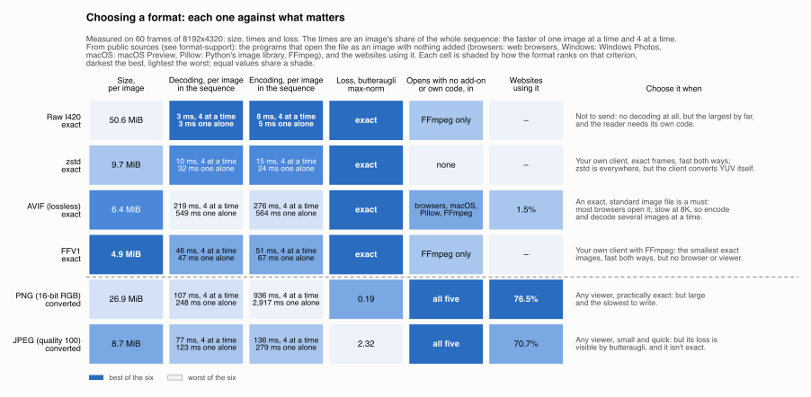
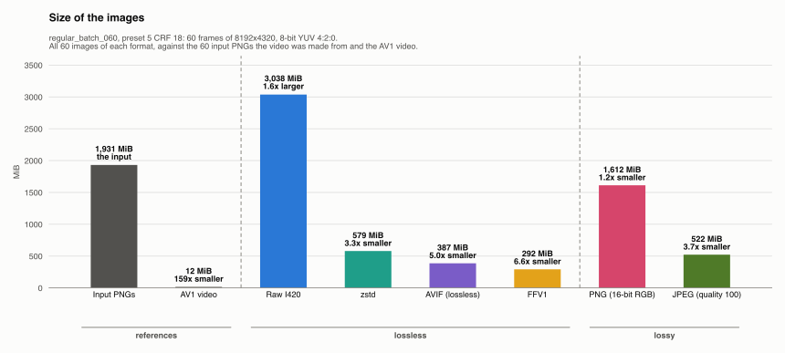
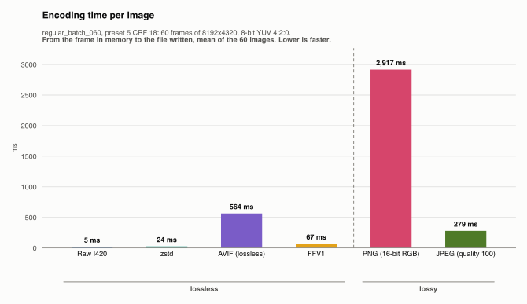
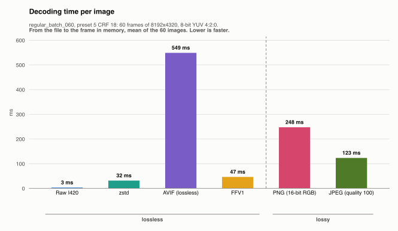
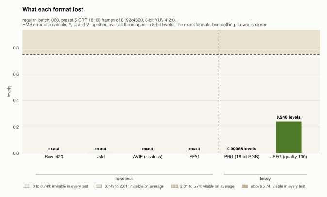
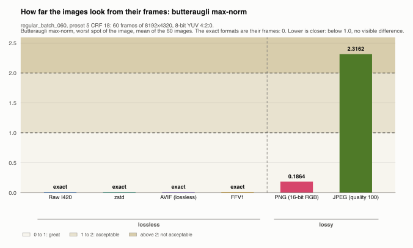
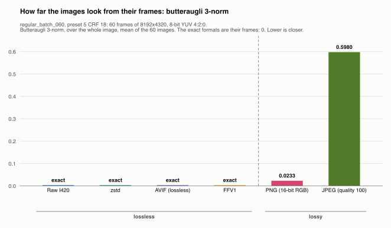
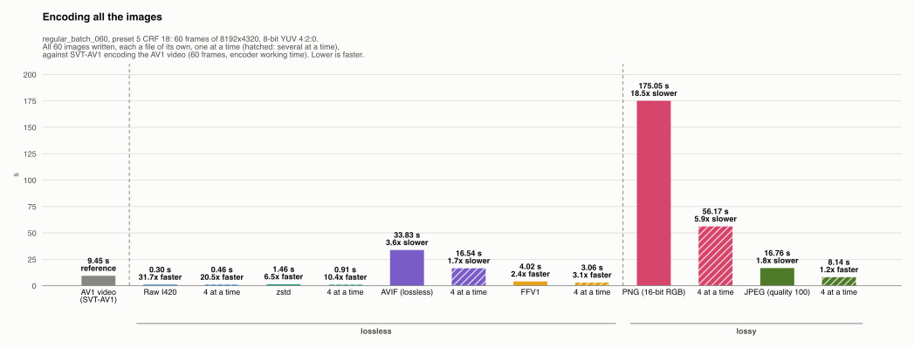
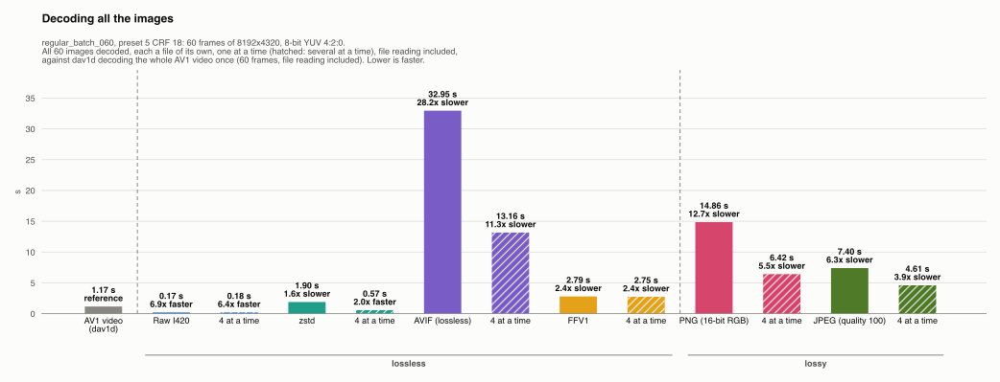

# regular_batch_060, preset 5 CRF 18: the video back to images

Generated by `scripts/image_formats.py` from the server's report (`server --extract-images`, copied here as `images.json`); do not edit.

Which format should the server use to stream a video's frames back to a client as images? The frames are 8-bit YUV 4:2:0, BT.709 in limited range. The formats compared are in two groups, each in its own folder with its own README:

- **[Lossless](lossless/README.md)**: raw, zstd, AVIF and FFV1 keep the frames **exactly as dav1d decodes them**, with no conversion. The server reads every image back and checks it byte for byte against its frame: they lose nothing and differ only in size and speed.
- **[Lossy](lossy/README.md)**, for comparison: PNG holds only RGB, and JPEG holds YCbCr with another matrix (BT.601) and range (full), so neither can hold the frames as they are. Each frame is converted, losing as little as the format allows, and the server measures how far each image read back is from its frame.

In every format, nothing is dropped or repeated: one image per frame. This page compares all the formats together; each group's README compares its formats among themselves, and each format's folder has its own charts, frame by frame.

## Choosing a format

Every format against what decides the choice: size, decoding and encoding time and loss, measured here; and from public sources (see [format support](../../../../format-support/README.md)), which programs open the file as an image with no add-on and no code of one's own (of five: web browsers, Windows Photos, macOS Preview, Python's Pillow, FFmpeg), and how many websites use it: a program that needs an add-on, a player or code of one's own to open a format doesn't count. Each cell holds the value and is shaded by how the format ranks on it among the six: darkest the best, lightest the worst. There is no overall score: how much each criterion weighs is the reader's choice, and the last column says when each format is the one to pick.



## The formats

**Lossless** ([`lossless/`](lossless/README.md)): they keep the frames exactly as dav1d decodes them.

| Format | Files | Settings |
|---|---|---|
| [Raw I420](lossless/raw/README.md) | `frame_<k>.yuv` | I420 planes, no header |
| [zstd](lossless/zstd/README.md) | `frame_<k>.yuv.zst` | I420 planes, zstd level 3, multithreaded |
| [AVIF (lossless)](lossless/avif/README.md) | `frame_<k>.avif` | SVT-AV1 lossless, still picture, preset 8; dav1d |
| [FFV1](lossless/ffv1/README.md) | `frame_<k>.mkv` | FFV1 version 3, 16 slices, in Matroska |

**Lossy** ([`lossy/`](lossy/README.md)): they convert the frames, losing as little as the format allows.

| Format | Files | Settings |
|---|---|---|
| [PNG (16-bit RGB)](lossy/png/README.md) | `frame_<k>.png` | 16-bit RGB, sRGB, chroma repeated over its 2x2 block; default compression |
| [JPEG (quality 100)](lossy/jpeg/README.md) | `frame_<k>.jpg` | JFIF, BT.601 full range, 4:2:0, quality 100; FFmpeg's decoder |

AVIF and FFV1 carry the video's color tags: BT.709 matrix, limited range, BT.709 primaries, sRGB transfer. Raw and zstd have no header, so the reader needs the size and these tags from elsewhere (here, `images.json`; a client reading the images back gets the size in the topic's metadata). PNG is tagged sRGB, and JPEG's colors are JFIF's by definition (BT.601, full range), so any viewer shows both right.

## How it was measured

The input is the video `output/regular/batch_060/preset_5_crf_18/camera.mkv` (12.1 MiB, 60 frames of 8192x4320), encoded by the server from `datasets/regular/batch_060/timestamps.csv` with SVT-AV1 preset 5 CRF 18. The server decoded it with dav1d (1.2 s, 19 ms per frame), then, frame after frame, wrote the frame in each format and read it back.

- **Encoding** is from the frame in memory to the file written; **decoding** from the file to the frame in memory. For PNG and JPEG, both include the color conversion.
- One image at a time, each format with the threads it uses on its own; the formats run one after the other, so their times don't overlap. Then each format's whole sequence again, 4 images at a time (the hatched bars).
- Writing and reading the file are included, but the OS keeps the files in its cache: the disk's speed is not measured.

To measure again, then redraw this folder (the video uploaded first with `PRESET=5 CRF=18 scripts/run.sh datasets/regular/batch_060/timestamps.csv`):

```sh
cargo build --release
./target/release/server --extract-images output/regular/batch_060/preset_5_crf_18/camera.mkv
./target/release/server --image-quality output/regular/batch_060/preset_5_crf_18/camera.mkv   # butteraugli, PNG and JPEG
uv run scripts/image_formats.py --timestamps datasets/regular/batch_060/timestamps.csv --preset 5 --crf 18
```

The client reading the images back is measured apart: see [its results](../client/README.md).

The images go next to the video, to `images/<format>/` (not tracked: 6.3 GiB here).

## Every format together

In every chart, a dashed line parts the lossless formats from the lossy ones, named under the bars; the references (the input PNGs, the AV1 video) come first.

| Format | Group | All the images | Per image | vs the input PNGs | vs raw | Encoding, per image | Decoding, per image | Lost (RMS error) |
|---|---|---|---|---|---|---|---|---|
| *Input PNGs, the video's source* | reference | 1,931.4 MiB | 32.2 MiB | – | – | – | – | – |
| *AV1 video* | reference | 12.1 MiB | 0.20 MiB | 159x smaller | 250x smaller | – | 19 ms | – |
| Raw I420 | lossless | 3,037.5 MiB | 50.6 MiB | 1.6x larger | – | 5 ms | 3 ms | nothing (exact) |
| zstd | lossless | 579.1 MiB | 9.7 MiB | 3.3x smaller | 5.2x smaller | 24 ms | 32 ms | nothing (exact) |
| AVIF (lossless) | lossless | 386.8 MiB | 6.4 MiB | 5.0x smaller | 7.9x smaller | 564 ms | 549 ms | nothing (exact) |
| FFV1 | lossless | 292.3 MiB | 4.9 MiB | 6.6x smaller | 10.4x smaller | 67 ms | 47 ms | nothing (exact) |
| PNG (16-bit RGB) | lossy | 1,611.7 MiB | 26.9 MiB | 1.2x smaller | 1.9x smaller | 2917 ms | 248 ms | 0.00068 levels |
| JPEG (quality 100) | lossy | 522.4 MiB | 8.7 MiB | 3.7x smaller | 5.8x smaller | 279 ms | 123 ms | 0.240 levels |

The input PNGs are the images the video was made from (8-bit RGBA, as uploaded); the AV1 video holds them, lossily. Every format here holds the video's frames, not the PNGs.







### What each format loses

The lossless formats lose nothing; the lossy ones lose a little, measured as an **RMS error** (root mean square): for every sample, the difference between the image read back and its frame, in 8-bit levels, squared, averaged, and square-rooted. It is the typical error of a sample, a large error weighing more than a small one; 1 is the smallest step of an 8-bit sample. The chart shades the video results' bands of how visible an RMS error is, from a viewer study (Afnan et al., 2023): below 0.75 levels no viewer saw it on any image, up to 2.01 the average viewer didn't, up to 5.74 the average viewer did, and above, every viewer did. The [lossy README](lossy/README.md#what-they-lose) has it plane by plane, with the other measures.



### How far they look: butteraugli

**Butteraugli**, Google's perceptual metric, says how visible the difference between each image and its frame is: its max-norm is the worst spot (below 1.0 no visible difference, above 2.0 not acceptable), its 3-norm the whole image. The [lossy README](lossy/README.md#how-far-they-look-butteraugli) explains both.

The exact formats are their frames, byte for byte: their distance is 0, not measured. For scale, the last row is what the AV1 video itself lost against the PNGs it was made from, measured by the quality tool the same way.

| Format | Max-norm, mean | Max-norm, worst image | 3-norm, mean |
|---|---|---|---|
| PNG (16-bit RGB) | 0.1864 | 0.5273 (frame 48) | 0.0233 |
| JPEG (quality 100) | 2.3162 | 2.5940 (frame 0) | 0.5980 |
| *for scale: the AV1 video, against its source PNGs* | 4.0070 | 7.3287 (frame 40) | 1.0894 |

Each image's scores are in the lossy formats' folders.





### All the images, against the AV1 video

Each format's images, each a file of its own, one at a time and, in the hatched bar next to it, 4 at a time, against the AV1 video, its frames depending on each other. **Encoding**: the images written from the decoded frames, against SVT-AV1 encoding the video on the server while the PNGs arrived (the encoder's working time, without its waits for decoded PNGs). **Decoding**: the images read back, against dav1d decoding the whole video in one pass. File reading is included in both decodings.

| | Encoding all 60 images | Against the AV1 video |
|---|---|---|
| *AV1 video (SVT-AV1), the reference* | 9.45 s | – |
| Raw I420 | 0.30 s | 31.7x faster |
| Raw I420, 4 images at a time | 0.46 s | 20.5x faster |
| zstd | 1.46 s | 6.5x faster |
| zstd, 4 images at a time | 0.91 s | 10.4x faster |
| AVIF (lossless) | 33.83 s | 3.6x slower |
| AVIF (lossless), 4 images at a time | 16.54 s | 1.7x slower |
| FFV1 | 4.02 s | 2.4x faster |
| FFV1, 4 images at a time | 3.06 s | 3.1x faster |
| PNG (16-bit RGB) | 175.05 s | 18.5x slower |
| PNG (16-bit RGB), 4 images at a time | 56.17 s | 5.9x slower |
| JPEG (quality 100) | 16.76 s | 1.8x slower |
| JPEG (quality 100), 4 images at a time | 8.14 s | 1.2x faster |



| | Decoding all 60 images | Against the AV1 video |
|---|---|---|
| *AV1 video (dav1d), the reference* | 1.17 s | – |
| Raw I420 | 0.17 s | 6.9x faster |
| Raw I420, 4 images at a time | 0.18 s | 6.4x faster |
| zstd | 1.90 s | 1.6x slower |
| zstd, 4 images at a time | 0.57 s | 2.0x faster |
| AVIF (lossless) | 32.95 s | 28.2x slower |
| AVIF (lossless), 4 images at a time | 13.16 s | 11.3x slower |
| FFV1 | 2.79 s | 2.4x slower |
| FFV1, 4 images at a time | 2.75 s | 2.4x slower |
| PNG (16-bit RGB) | 14.86 s | 12.7x slower |
| PNG (16-bit RGB), 4 images at a time | 6.42 s | 5.5x slower |
| JPEG (quality 100) | 7.40 s | 6.3x slower |
| JPEG (quality 100), 4 images at a time | 4.61 s | 3.9x slower |



## What it shows

- **Among the lossless formats**, FFV1 is the smallest (4.9 MiB per image) and fast in both directions; see the [lossless README](lossless/README.md#what-it-shows) for how they compare.
- **The lossy formats don't save anything over it**: PNG (16-bit RGB) is 5.5x its size and loses 0.00068 levels (RMS); JPEG (quality 100) is 1.8x its size and loses 0.240 levels (RMS). What they give is an image any viewer opens; see the [lossy README](lossy/README.md#what-it-shows).
- **Butteraugli puts the lossy formats in different classes**: PNG (16-bit RGB) scores 0.1864 on average, 0.0000 to 0.5273 (max-norm): *great* for every image, 5% of what the AV1 video lost against its source PNGs; JPEG (quality 100) scores 2.3162 on average, 2.1119 to 2.5940 (max-norm): *not acceptable* for every image, 58% of what the AV1 video lost against its source PNGs. Its max-norm is the single most visible spot of an image, so small errors spread over many samples leave a visible spot somewhere, while a few changed samples don't (PNG (16-bit RGB) changes 0.00% of its samples, by at most 1 levels; JPEG (quality 100) changes 5.74% of its samples, by at most 2 levels).
- **The two metrics disagree on JPEG (quality 100)**: by its RMS error, 0.240 levels, it is *invisible in every test* in the viewer study, while butteraugli's max-norm calls it *not acceptable*. They measure different things: the study's bands judge the error on average over the image, as its viewers saw whole images, while the max-norm judges the single worst spot, by a model of the eye meant to be strict. The truth is likely between: invisible to a viewer looking at the image, a difference a model or a close look at the right spot can find.
- **Raw I420 is over the upload limit**: a message to the server carries at most 50 MiB (mosaicod's default), and Raw I420's largest image is 50.6 MiB. Served back, a `DoGet` message may carry up to 512 MiB, so every format comes back one image per message at most ([the client's results](../client/README.md)).
- **The video itself is still 24x smaller than the smallest images**, and dav1d decodes a frame of it in 19 ms, faster than any compressed format here. A client that can run dav1d is better served by the AV1 packets than by any of these images; images are worth it only for a client that can't decode AV1, or needs any frame on its own without the keyframe before it.

## Limits

- One batch, one encoding: a video with more detail (a lower CRF, a busier scene) makes every format bigger and slower, and may change the ratios.
- The files were read from the OS cache: from a disk or over the network, the larger formats (raw, PNG, zstd) lose more time than the tables show.
- Each image is timed once, on a machine doing other things: see below.

### Each image is timed once

Every time in these results is a single measurement: each image is written once and read back once, and each format's 60 images make its totals. Nothing is repeated to average out the noise of a single run, so a time can be off for reasons that have nothing to do with the format:

- **The machine is busy with something else** for a moment: another program, the OS indexing files, a backup. The image that runs at that moment takes longer.
- **A warm-up at the start**: the first images of a format also pay for things done only once, such as loading the codec's code, allocating its buffers, or filling the CPU's caches.
- **The machine's own state**: a laptop slows its CPU down when it gets hot, and the OS decides which cores run what; neither is the same from one run to the next.

So a rerun gives slightly different times, more so for the shortest ones (a few milliseconds), where any pause is a large share. The sizes and the losses don't change: they are the same every run.

To tell a slow image from a slow format, each format's README marks every frame whose time is over 1.5x the format's median, and calls the slow frames at the very start a warm-up and the others single spikes. Those frames are included in the means and totals, so one spike makes the mean a little higher than the median. In this run:

- [Raw I420](lossless/raw/README.md), writing: 6 of 60 images (none a warm-up).
- [zstd](lossless/zstd/README.md), reading: 1 of 60 images (all a warm-up).
- [FFV1](lossless/ffv1/README.md), writing: 15 of 60 images (1 a warm-up).

Comparisons between formats far apart (zstd's 32 ms to read an image against AVIF (lossless)'s 549 ms) are safe; between formats within a few percent of each other they are not, without repeating the run.
