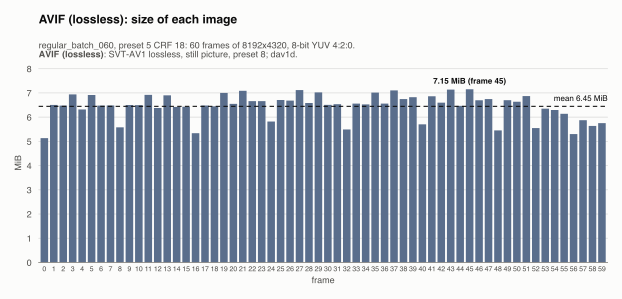
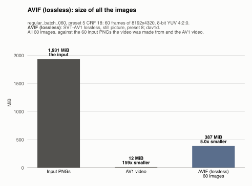
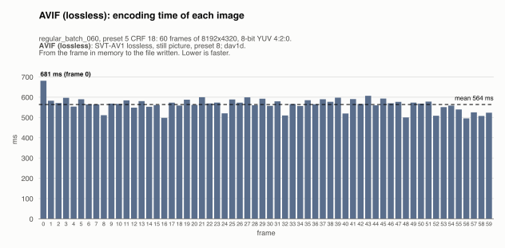
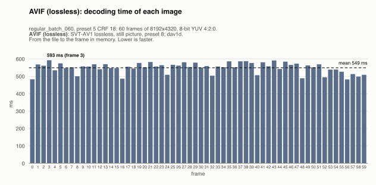
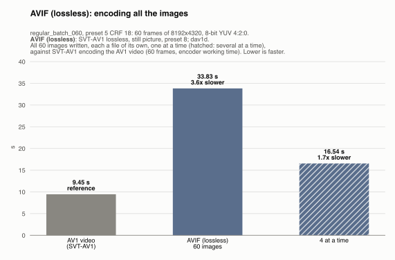
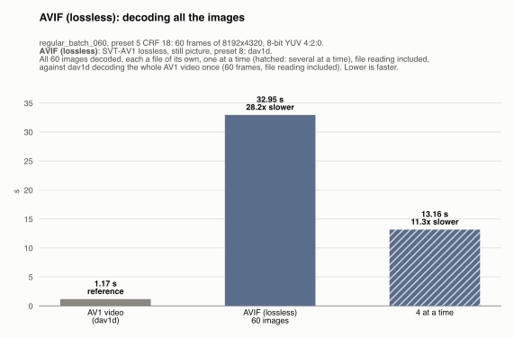
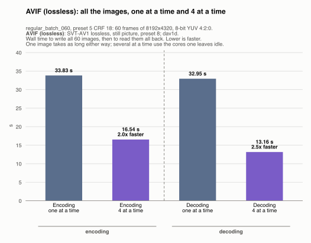

# AVIF (lossless): regular_batch_060, preset 5 CRF 18

Generated by `scripts/image_formats.py` from the server's report (`server --extract-images`, [`images.json`](../../images.json)); do not edit. One of the [lossless formats](../README.md), in [the comparison of the image formats](../../README.md).

## The format

Each frame encoded on its own by SVT-AV1 in lossless, still-picture mode, in an AVIF file written by FFmpeg's AVIF muxer, and read back with dav1d, the AV1 decoder of the video. AVIF is a standard image format: any AVIF reader opens these files, which keep the YUV 4:2:0 frame and its color tags (BT.709, limited range). Lossless AV1 is slow at this size, in both directions; the SVT-AV1 preset does not change a lossless image.

Settings: SVT-AV1 lossless, still picture, preset 8; dav1d. The files are `output/.../images/avif/frame_<k>.*`, one per frame of the video, 60 here, and each one was read back and checked byte for byte against its frame: none of them loses anything.

## Its numbers

| | All the images | Per image (mean) | Against |
|---|---|---|---|
| Size | 386.8 MiB | 6.45 MiB | the input PNGs: 5.0x smaller (1,931.4 MiB); raw: 7.9x smaller; the AV1 video: 32x larger (12.1 MiB) |
| Encoding | 33.83 s | 564 ms | the AV1 video: 3.6x slower (9.45 s) |
| Decoding | 32.95 s | 549 ms | the AV1 video: 28.2x slower (1.17 s) |
| Lost | nothing: every image is exact | | |

The largest image (7.15 MiB) fits in the 50 MiB a message may carry to the server (mosaicod's default decode limit), and served back to a client it comes in one `DoGet` message, which may carry up to 512 MiB.

## Size of each image

One bar per frame, its image's size; the dashed line is the mean.

The images take 6.45 MiB on average, from 5.13 MiB (frame 0) to 7.15 MiB (frame 45): a frame with more detail takes more bytes.

## Size of all the images, against the input and the video

All 60 images, against the 60 input PNGs the video was made from (8-bit RGBA, as uploaded) and the AV1 video, the two references, first. The images take 386.8 MiB, 5.0x smaller than the input PNGs (1,931.4 MiB) and 32x the AV1 video (12.1 MiB), which is 159x smaller than the input.

## Encoding time of each image

One bar per frame: the time to write its image, from the frame in memory to the file written. The dashed line is the mean.

Writing an image takes 564 ms on average (median 568 ms), from 495 ms (frame 56) to 681 ms (frame 0). No frame takes over 1.5x the median: the time is steady from image to image.

## Decoding time of each image

One bar per frame: the time to read its image back, from the file to the frame in memory (the file is in the OS cache, so the disk's speed is not measured). The dashed line is the mean.

Reading an image takes 549 ms on average (median 556 ms), from 482 ms (frame 56) to 593 ms (frame 3). No frame takes over 1.5x the median: the time is steady from image to image.

## All the images, against the AV1 video

The time for all 60 images, against the same step on the AV1 video, the reference: the gray bar, first.

**Encoding.** Writing all 60 images takes 33.83 s, 3.6x slower than the 9.45 s SVT-AV1 worked to encode the video on the server (its working time, without its waits for decoded PNGs). The two do not do the same work: SVT-AV1 compresses heavily and loses detail (preset 5 CRF 18), while every image here is an exact copy of a frame already decoded. The comparison says what each step costs, not which is more efficient.

**Decoding.** Reading all 60 images back takes 32.95 s, 28.2x slower than the 1.17 s dav1d takes to decode the whole AV1 video. The images are read one by one, each a file of its own; the video in one pass, its frames depending on each other, so a client wanting any single frame of the video must decode from the keyframe before it.

## Several images at a time

Every format is also written and read back 4 images at a time (one image leaves most cores idle): all 60 images, then all of them read back (each one checked byte for byte again). One image takes as long as before; what changes is the whole sequence: it takes less.

| All the images | One at a time | 4 at a time | Several at a time |
|---|---|---|---|
| Encoding | 33.83 s | 16.54 s | 2.0x faster |
| Decoding | 32.95 s | 13.16 s | 2.5x faster |

