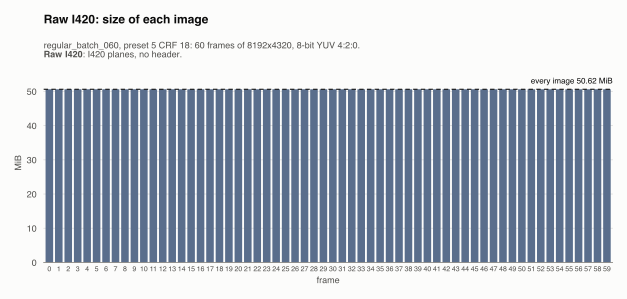
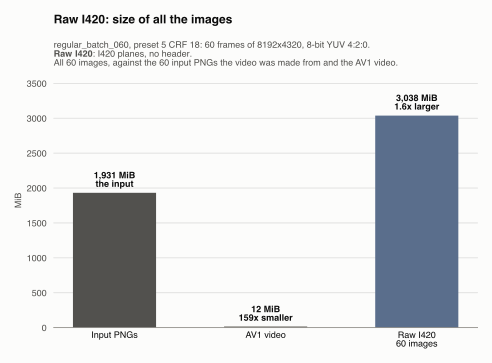
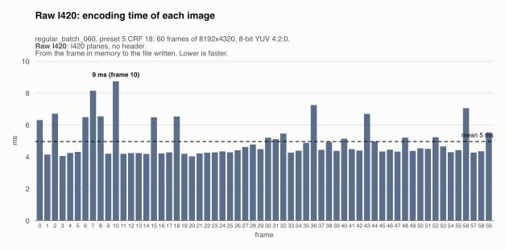
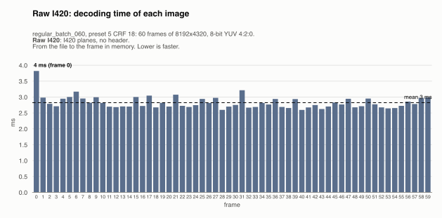
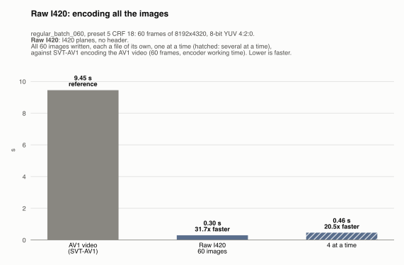
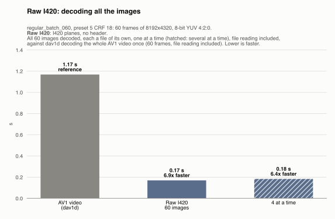
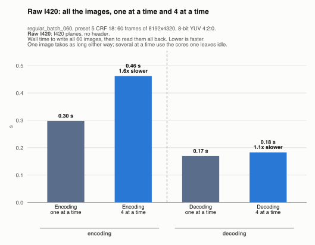

# Raw I420: regular_batch_060, preset 5 CRF 18

Generated by `scripts/image_formats.py` from the server's report (`server --extract-images`, [`images.json`](../../images.json)); do not edit. One of the [lossless formats](../README.md), in [the comparison of the image formats](../../README.md).

## The format

The frame's three planes written as they are, Y then U then V (I420), with no header and no compression. Writing and reading an image are a copy to and from a file, and every image has the same size, width x height x 1.5 bytes. The reader needs the size and the color tags from elsewhere (here, `images.json`).

Settings: I420 planes, no header. The files are `output/.../images/raw/frame_<k>.*`, one per frame of the video, 60 here, and each one was read back and checked byte for byte against its frame: none of them loses anything.

## Its numbers

| | All the images | Per image (mean) | Against |
|---|---|---|---|
| Size | 3,037.5 MiB | 50.62 MiB | the input PNGs: 1.6x larger (1,931.4 MiB); raw: –; the AV1 video: 250x larger (12.1 MiB) |
| Encoding | 0.30 s | 5 ms | the AV1 video: 31.7x faster (9.45 s) |
| Decoding | 0.17 s | 3 ms | the AV1 video: 6.9x faster (1.17 s) |
| Lost | nothing: every image is exact | | |

The largest image (50.62 MiB) is over the 50 MiB a message may carry to the server (mosaicod's default decode limit), and served back to a client it comes in one `DoGet` message, which may carry up to 512 MiB.

## Size of each image

One bar per frame, its image's size; the dashed line is the mean.

Every image is 50.62 MiB: the format does not compress, so the size depends only on the frame's width and height, not on what it shows.

## Size of all the images, against the input and the video

All 60 images, against the 60 input PNGs the video was made from (8-bit RGBA, as uploaded) and the AV1 video, the two references, first. The images take 3,037.5 MiB, 1.6x larger than the input PNGs (1,931.4 MiB) and 250x the AV1 video (12.1 MiB), which is 159x smaller than the input.

## Encoding time of each image

One bar per frame: the time to write its image, from the frame in memory to the file written. The dashed line is the mean.

Writing an image takes 5 ms on average (median 4 ms), from 4 ms (frame 20) to 9 ms (frame 10). 6 frames take over 1.5x the median: 2 (7 ms), 7 (8 ms), 10 (9 ms), 36 (7 ms), 43 (7 ms), 56 (7 ms); single spikes (each image is timed once: see [the limits](../../README.md#each-image-is-timed-once)).

## Decoding time of each image

One bar per frame: the time to read its image back, from the file to the frame in memory (the file is in the OS cache, so the disk's speed is not measured). The dashed line is the mean.

Reading an image takes 3 ms on average (median 3 ms), from 3 ms (frame 40) to 4 ms (frame 0). No frame takes over 1.5x the median: the time is steady from image to image.

## All the images, against the AV1 video

The time for all 60 images, against the same step on the AV1 video, the reference: the gray bar, first.

**Encoding.** Writing all 60 images takes 0.30 s, 31.7x faster than the 9.45 s SVT-AV1 worked to encode the video on the server (its working time, without its waits for decoded PNGs). The two do not do the same work: SVT-AV1 compresses heavily and loses detail (preset 5 CRF 18), while every image here is an exact copy of a frame already decoded. The comparison says what each step costs, not which is more efficient.

**Decoding.** Reading all 60 images back takes 0.17 s, 6.9x faster than the 1.17 s dav1d takes to decode the whole AV1 video. The images are read one by one, each a file of its own; the video in one pass, its frames depending on each other, so a client wanting any single frame of the video must decode from the keyframe before it.

## Several images at a time

Every format is also written and read back 4 images at a time (one image leaves most cores idle): all 60 images, then all of them read back (each one checked byte for byte again). One image takes as long as before; what changes is the whole sequence. Here it doesn't always take less: a format that barely uses the CPU (copying memory to files) gains nothing from several at a time, and the images only compete for the memory's bandwidth.

| All the images | One at a time | 4 at a time | Several at a time |
|---|---|---|---|
| Encoding | 0.30 s | 0.46 s | 1.6x slower |
| Decoding | 0.17 s | 0.18 s | 1.1x slower |

