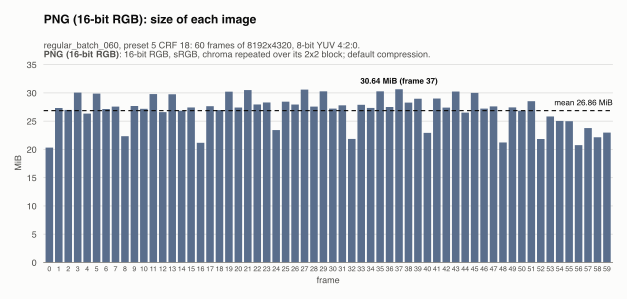
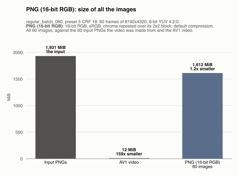
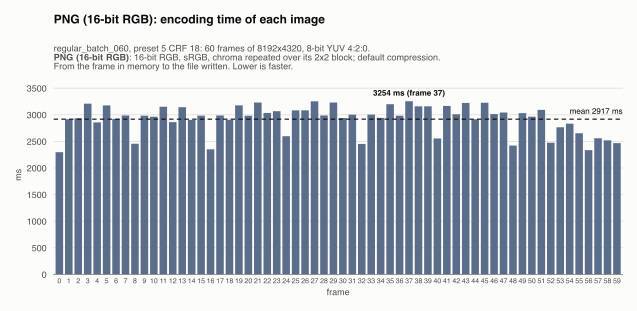
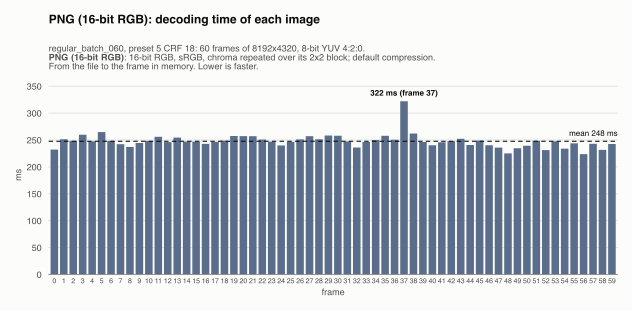
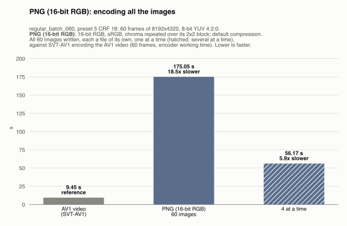
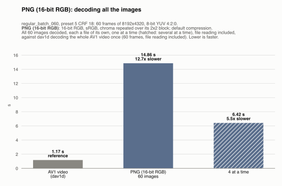
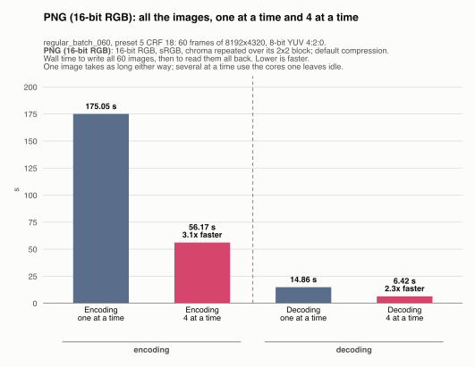
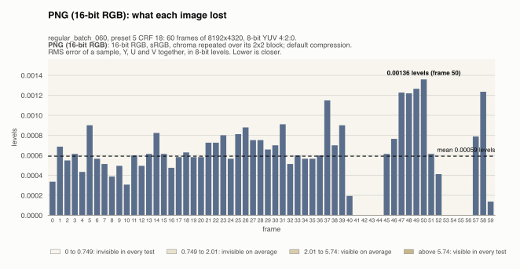
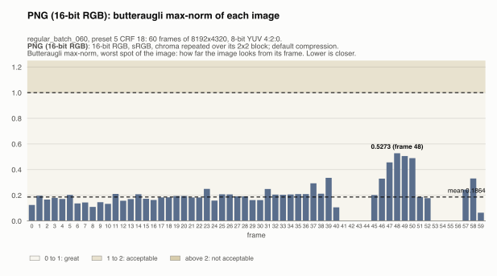
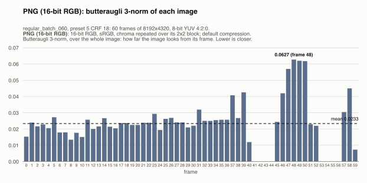

# PNG (16-bit RGB): regular_batch_060, preset 5 CRF 18

Generated by `scripts/image_formats.py` from the server's report (`server --extract-images`, [`images.json`](../../images.json)); do not edit. One of the [lossy formats](../README.md), in [the comparison of the image formats](../../README.md).

## The format

For comparison: PNG holds only RGB, so each frame is converted to it, as closely as PNG allows. 16-bit RGB, so that rounding loses next to nothing, with each U and V sample repeated over the 2x2 pixels it covers, so that reading the image back and averaging each 2x2 block gives the sample again. What is lost is mostly the colors a YUV frame can hold but RGB can't, outside the RGB cube, clipped to it. Tagged sRGB, like the PNGs the video was made from, so any viewer shows it right; written and read with the `png` crate (one thread).

Settings: 16-bit RGB, sRGB, chroma repeated over its 2x2 block; default compression. The files are `output/.../images/png/frame_<k>.*`, one per frame of the video, 60 here, and each one was read back and compared with its frame: see [what it loses](#what-it-loses).

## Its numbers

| | All the images | Per image (mean) | Against |
|---|---|---|---|
| Size | 1,611.7 MiB | 26.86 MiB | the input PNGs: 1.2x smaller (1,931.4 MiB); raw: 1.9x smaller; the AV1 video: 133x larger (12.1 MiB) |
| Encoding | 175.05 s | 2917 ms | the AV1 video: 18.5x slower (9.45 s) |
| Decoding | 14.86 s | 248 ms | the AV1 video: 12.7x slower (1.17 s) |
| Lost | RMS error 0.00068 levels | | the exact formats: nothing |

The largest image (30.64 MiB) fits in the 50 MiB a message may carry to the server (mosaicod's default decode limit), and served back to a client it comes in one `DoGet` message, which may carry up to 512 MiB.

## Size of each image

One bar per frame, its image's size; the dashed line is the mean.

The images take 26.86 MiB on average, from 20.32 MiB (frame 0) to 30.64 MiB (frame 37): a frame with more detail takes more bytes.

## Size of all the images, against the input and the video

All 60 images, against the 60 input PNGs the video was made from (8-bit RGBA, as uploaded) and the AV1 video, the two references, first. The images take 1,611.7 MiB, 1.2x smaller than the input PNGs (1,931.4 MiB) and 133x the AV1 video (12.1 MiB), which is 159x smaller than the input.

## Encoding time of each image

One bar per frame: the time to write its image, from the frame in memory to the file written. The dashed line is the mean.

Writing an image takes 2917 ms on average (median 2983 ms), from 2296 ms (frame 0) to 3254 ms (frame 37). No frame takes over 1.5x the median: the time is steady from image to image.

## Decoding time of each image

One bar per frame: the time to read its image back, from the file to the frame in memory (the file is in the OS cache, so the disk's speed is not measured). The dashed line is the mean.

Reading an image takes 248 ms on average (median 247 ms), from 224 ms (frame 56) to 322 ms (frame 37). No frame takes over 1.5x the median: the time is steady from image to image.

## All the images, against the AV1 video

The time for all 60 images, against the same step on the AV1 video, the reference: the gray bar, first.

**Encoding.** Writing all 60 images takes 175.05 s, 18.5x slower than the 9.45 s SVT-AV1 worked to encode the video on the server (its working time, without its waits for decoded PNGs). The two do not do the same work: SVT-AV1 compresses heavily and loses detail (preset 5 CRF 18), while every image here is a frame already decoded, converted. The comparison says what each step costs, not which is more efficient.

**Decoding.** Reading all 60 images back takes 14.86 s, 12.7x slower than the 1.17 s dav1d takes to decode the whole AV1 video. The images are read one by one, each a file of its own; the video in one pass, its frames depending on each other, so a client wanting any single frame of the video must decode from the keyframe before it.

## Several images at a time

Every format is also written and read back 4 images at a time (one image leaves most cores idle): all 60 images, then all of them read back. One image takes as long as before; what changes is the whole sequence: it takes less.

| All the images | One at a time | 4 at a time | Several at a time |
|---|---|---|---|
| Encoding | 175.05 s | 56.17 s | 3.1x faster |
| Decoding | 14.86 s | 6.42 s | 2.3x faster |

## What it loses

How far the images read back are from their frames, over all the frames, plane by plane (the measures are explained in the [lossy README](../README.md#what-they-lose)):

| | Y | U | V |
|---|---|---|---|
| PSNR (higher is closer) | 121.96 dB | ∞ (exact) | 103.97 dB |
| RMS error, 8-bit levels | 0.00020 | 0 | 0.0016 |
| Largest error, 8-bit levels | 1 | 0 | 1 |
| Samples changed | 88 (1 in 24,129,164) | none | 1,384 (1 in 383,556) |

One bar per frame: the RMS error of a sample of its image, Y, U and V together. The dashed line is the mean.

An image is off by 0.00059 levels on average, from 0 (frame 41) to 0.0014 (frame 50); 8 of the 60 images give their frame back exactly.

## How far it looks: butteraugli

Butteraugli and its two norms are explained in the [lossy README](../README.md#how-far-they-look-butteraugli).

| Format | Max-norm, mean | Max-norm, worst image | 3-norm, mean |
|---|---|---|---|
| PNG (16-bit RGB) | 0.1864 | 0.5273 (frame 48) | 0.0233 |
| *for scale: the AV1 video, against its source PNGs* | 4.0070 | 7.3287 (frame 40) | 1.0894 |

One bar per frame: the max-norm of its image, worst spot of the image. The dashed line is the mean.

The max-norm is 0.1864 on average, from 0.0000 (frame 41) to 0.5273 (frame 48).

One bar per frame: the 3-norm of its image, over the whole image. The dashed line is the mean.

The 3-norm is 0.0233 on average, from 0.0000 (frame 41) to 0.0627 (frame 48).

