# regular_batch_060: AV1 encoding results

Generated by `scripts/report.py` from the client's, the server's and the quality tool's reports, copied next to it; do not edit. 60 images of 8192x4320, 1931.4 MiB of PNG, encoded as `yuv420p` with SVT-AV1 preset 9 and CRF 22.

## What the video lost

Every frame of the video compared with its PNG, as a loss: 0 means identical, higher means more was lost. *4:2:0 conversion alone* is what turning the PNG into YUV 4:2:0 (half-resolution color) loses before any encoding; the video's loss includes it. *4:4:4 conversion alone* is what turning it into YUV 4:4:4 (full-resolution color) would lose: the floor of a lossless 4:4:4 video, which SVT-AV1 cannot encode, measured without encoding and so the same for every encoding of the batch.

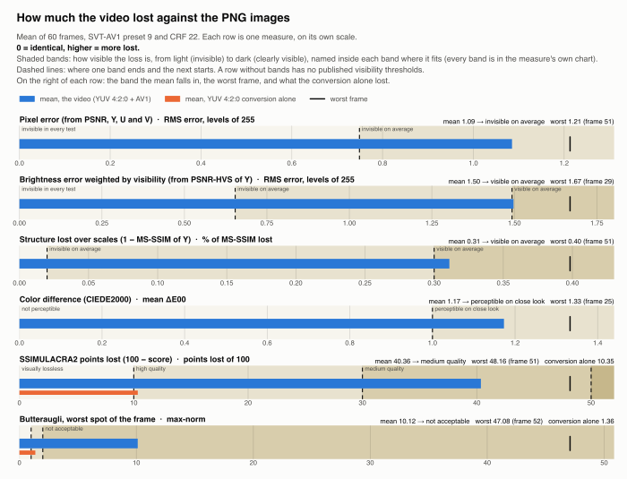

| Measure | Unit | Mean | Worst frame | 4:2:0 conversion alone | 4:4:4 conversion alone | The mean is | What it measures |
|---|---|---|---|---|---|---|---|
| Pixel error (from PSNR, Y, U and V) | RMS error, levels of 255 | 1.09 | 1.21 (frame 51) | – | – | invisible on average | average error of a sample; 1 is the smallest step of an 8-bit value |
| Brightness error weighted by visibility (from PSNR-HVS of Y) | RMS error, levels of 255 | 1.50 | 1.67 (frame 29) | – | – | visible on average | the brightness error in the details the eye sees best |
| Structure lost over scales (1 − MS-SSIM of Y) | % of MS-SSIM lost | 0.31 | 0.40 (frame 51) | – | – | visible on average | edges and textures of the brightness, from fine to coarse |
| Color difference (CIEDE2000) | mean ΔE00 | 1.17 | 1.33 (frame 25) | – | – | perceptible on close look | the average color shift a person would see |
| SSIMULACRA2 points lost (100 − score) | points lost of 100 | 40.36 | 48.16 (frame 51) | 10.35 | 10.67 | medium quality | perceived quality, against the PNG |
| Butteraugli, worst spot of the frame | max-norm | 10.12 | 47.08 (frame 52) | 1.36 | 1.39 | not acceptable | how visible the worst difference is |

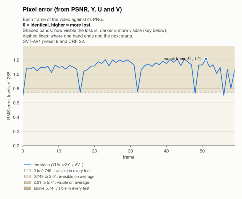

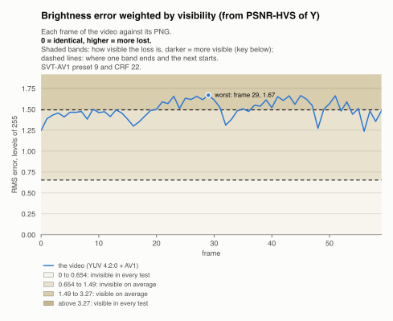

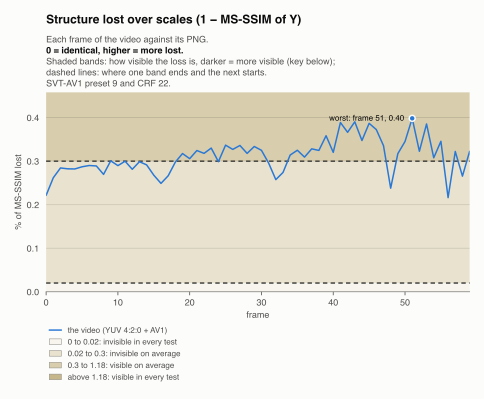

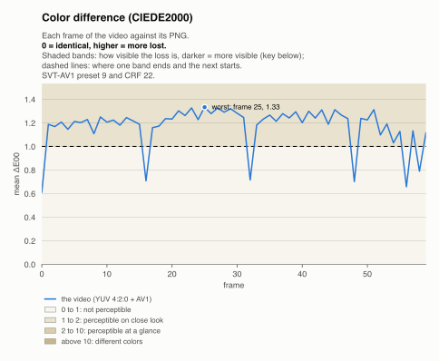

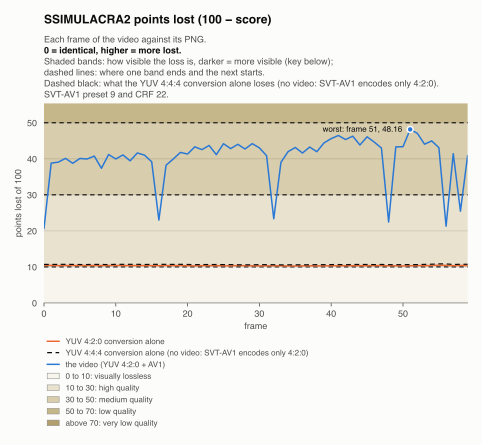

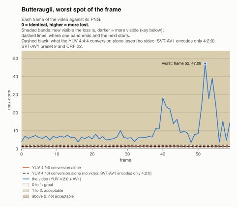

The quality tool decoded the whole video with dav1d in 1.9 s (31.4 frames/s), file reading included.

## Client time

The client's side of the upload, measured where it runs. The stages run one after the other and add up to the total.

| Setup (CSV, connect, create topic) | Reading the PNGs from disk | Sending to the server | Waiting for the server to finish | Finalizing the session | Total |
|---|---|---|---|---|---|
| 2.7 ms | 0.5 s | 7.0 s | 2.4 s | 0.2 ms | 9.9 s |

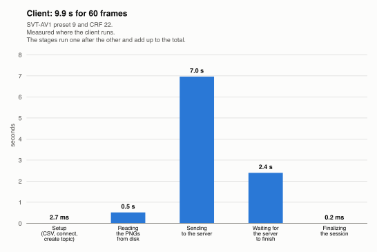

## Server time

The server's side, measured where it runs. The stages overlap: it decodes and encodes the images while they arrive. The encoder working and idle add up to its 9.3 s.

| Receiving the images (first message to last image) | Decoding the PNGs to YUV 4:2:0 | AV1 encoding (encoder working) | Encoder idle, waiting for decoded PNGs | Total | Encoding speed |
|---|---|---|---|---|---|
| 8.0 s | 9.1 s | 1.4 s | 8.0 s | 9.9 s | 6.42 frames/s |

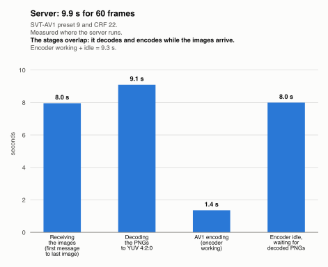

Each frame through the server: waiting in the decode queue, decoding, waiting for the encoder, encoding. Frames that overlap in time ran at the same time.

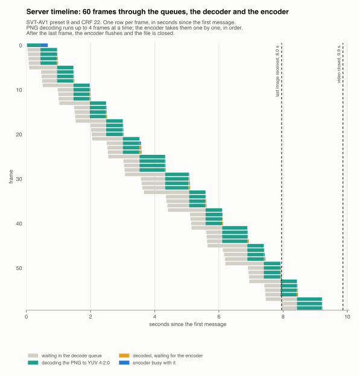

## Client and server together

The client's and the server's times on one axis. The server decodes and encodes while the client sends, so the client waits only for the last image in flight and the server finishing.

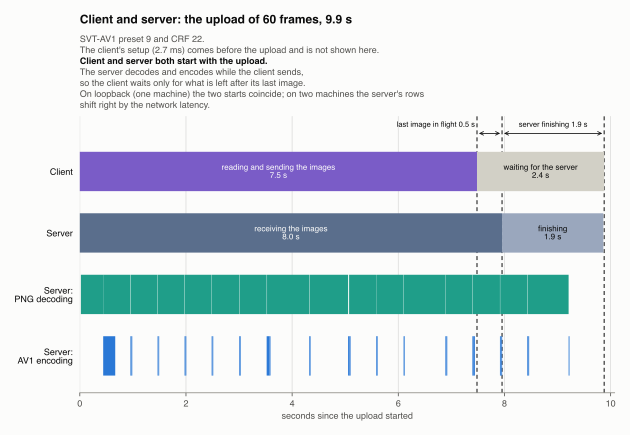

## File size

| Video size | Bitrate | Smaller than PNG |
|---|---|---|
| 5.93 MiB | 24.8 Mbit/s | 326x |

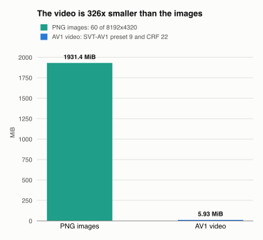

## Raw metric values

The metrics' own scores, over the measured frames. Higher is better for every metric except `butteraugli_*`, where lower is better. `*_yuv420`: the PNG against itself converted to YUV 4:2:0, `*_yuv444`: to YUV 4:4:4, without encoding. Capture times read back within 0.500 ms of the CSV.

| Metric | Mean | Min | Max |
|---|---|---|---|
| `psnr_y` | 49.468 | 48.373 | 51.405 |
| `psnr_u` | 44.630 | 43.377 | 51.496 |
| `psnr_v` | 45.849 | 44.678 | 52.157 |
| `psnr_avg` | 47.492 | 46.453 | 51.414 |
| `psnr_hvs_y` | 44.647 | 43.683 | 46.284 |
| `psnr_hvs_u` | 39.484 | 37.922 | 48.803 |
| `psnr_hvs_v` | 39.872 | 38.577 | 48.376 |
| `psnr_hvs_avg` | 38.678 | 37.574 | 43.355 |
| `msssim_db_y` | 25.109 | 23.998 | 26.652 |
| `msssim_db_u` | 18.616 | 17.137 | 27.970 |
| `msssim_db_v` | 19.603 | 18.299 | 28.252 |
| `msssim_db_avg` | 21.983 | 20.786 | 27.009 |
| `ciede2000_db` | 43.734 | 42.503 | 49.300 |
| `butteraugli_max` | 10.116 | 3.513 | 47.084 |
| `butteraugli_3norm` | 2.297 | 1.043 | 9.998 |
| `ssimulacra2` | 59.640 | 51.843 | 79.350 |
| `butteraugli_max_yuv420` | 1.361 | 1.279 | 1.529 |
| `butteraugli_3norm_yuv420` | 0.469 | 0.462 | 0.477 |
| `ssimulacra2_yuv420` | 89.649 | 89.525 | 89.740 |
| `ssimulacra2_yuv444` | 89.332 | 89.158 | 89.430 |
| `butteraugli_max_yuv444` | 1.393 | 1.310 | 1.535 |
| `butteraugli_3norm_yuv444` | 0.484 | 0.477 | 0.495 |
