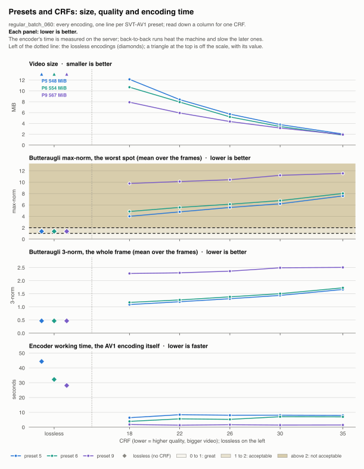
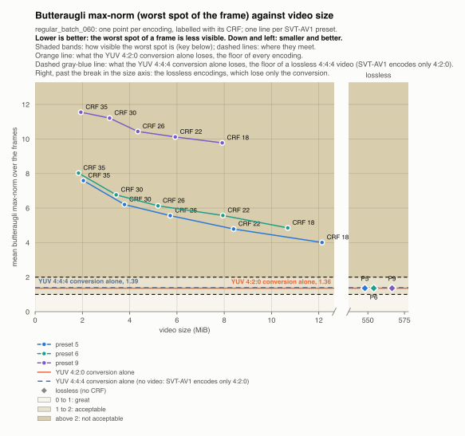
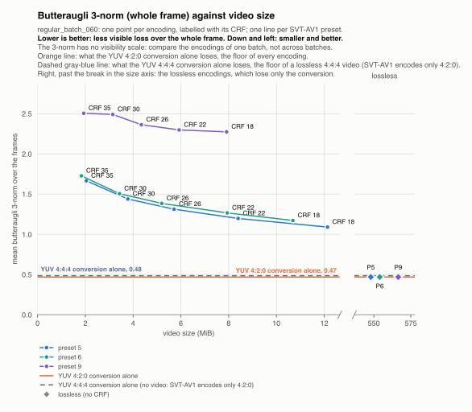
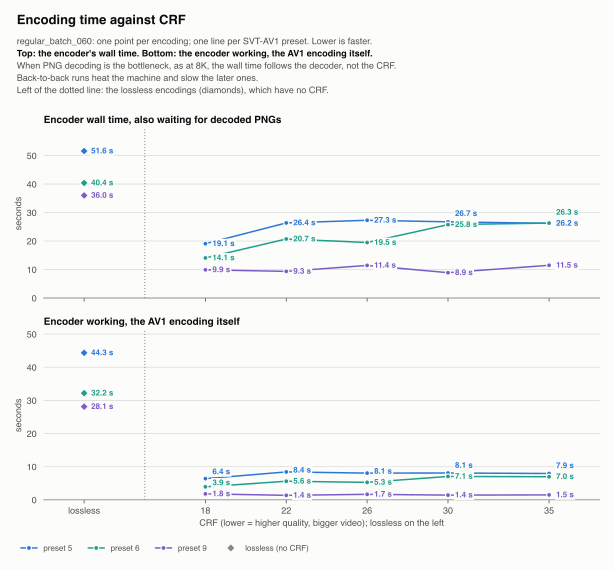

# regular_batch_060: presets and CRFs compared

Generated by `scripts/report.py` from every encoding in `results/`; do not edit. 18 encodings, one line per SVT-AV1 preset in each chart. Lower is better everywhere; in the size charts, down and left is smaller and better. The lossless encodings are diamonds: they have no CRF and lose only the YUV 4:2:0 conversion.

The dashed gray-blue line is what the conversion to YUV 4:4:4 alone loses: the floor of a lossless 4:4:4 video, measured without encoding, as SVT-AV1 encodes only 4:2:0. The PNGs carry almost no color detail finer than 2x2 pixels, so 4:2:0 loses almost nothing more than 4:4:4: both floors are mostly the rounding to 8-bit limited range.

## Every setting at once

Video size, butteraugli max-norm and 3-norm, and the encoder's working time, on a shared CRF axis: read down a column for one CRF.

## Butteraugli max-norm against size

The worst spot of each frame, over its visibility bands: whether the worst differences can be seen.

## Butteraugli 3-norm against size

The whole frame. It has no visibility scale: it ranks the settings of this batch, not encodings of different batches.

## Encoding time

The encoder's wall time, which also counts waiting for decoded PNGs, and its working time, the AV1 encoding itself. Back-to-back runs heat the machine and slow the later ones.

## Every encoding

Means over the frames; *conversion alone* is the floor of every encoding; *4:4:4 conversion alone*, of a lossless 4:4:4 video.

| Preset | CRF | Video size | Smaller than PNG | Butteraugli max-norm | Butteraugli 3-norm | Encoder working | Details |
|---|---|---|---|---|---|---|---|
| 5 | lossless | 548.0 MiB | 3.5x | 1.36 | 0.47 | 44.3 s | [summary](../preset_5_lossless/summary.md) |
| 5 | 18 | 12.1 MiB | 159x | 4.01 | 1.09 | 6.4 s | [summary](../preset_5_crf_18/summary.md) |
| 5 | 22 | 8.4 MiB | 230x | 4.79 | 1.20 | 8.4 s | [summary](../preset_5_crf_22/summary.md) |
| 5 | 26 | 5.7 MiB | 338x | 5.56 | 1.31 | 8.1 s | [summary](../preset_5_crf_26/summary.md) |
| 5 | 30 | 3.8 MiB | 511x | 6.20 | 1.44 | 8.1 s | [summary](../preset_5_crf_30/summary.md) |
| 5 | 35 | 2.0 MiB | 946x | 7.59 | 1.66 | 7.9 s | [summary](../preset_5_crf_35/summary.md) |
| 6 | lossless | 554.0 MiB | 3.5x | 1.36 | 0.47 | 32.2 s | [summary](../preset_6_lossless/summary.md) |
| 6 | 18 | 10.7 MiB | 181x | 4.85 | 1.17 | 3.9 s | [summary](../preset_6_crf_18/summary.md) |
| 6 | 22 | 7.9 MiB | 243x | 5.57 | 1.27 | 5.6 s | [summary](../preset_6_crf_22/summary.md) |
| 6 | 26 | 5.2 MiB | 372x | 6.13 | 1.38 | 5.3 s | [summary](../preset_6_crf_26/summary.md) |
| 6 | 30 | 3.4 MiB | 563x | 6.76 | 1.50 | 7.1 s | [summary](../preset_6_crf_30/summary.md) |
| 6 | 35 | 1.8 MiB | 1053x | 8.03 | 1.73 | 7.0 s | [summary](../preset_6_crf_35/summary.md) |
| 9 | lossless | 566.5 MiB | 3.4x | 1.36 | 0.47 | 28.1 s | [summary](../preset_9_lossless/summary.md) |
| 9 | 18 | 7.9 MiB | 244x | 9.77 | 2.27 | 1.8 s | [summary](../preset_9_crf_18/summary.md) |
| 9 | 22 | 5.9 MiB | 326x | 10.12 | 2.30 | 1.4 s | [summary](../preset_9_crf_22/summary.md) |
| 9 | 26 | 4.3 MiB | 444x | 10.43 | 2.36 | 1.7 s | [summary](../preset_9_crf_26/summary.md) |
| 9 | 30 | 3.2 MiB | 613x | 11.21 | 2.49 | 1.4 s | [summary](../preset_9_crf_30/summary.md) |
| 9 | 35 | 1.9 MiB | 999x | 11.55 | 2.50 | 1.5 s | [summary](../preset_9_crf_35/summary.md) |
| conversion alone | | | | 1.36 | 0.47 | | |
| 4:4:4 conversion alone | | | | 1.39 | 0.48 | | |
