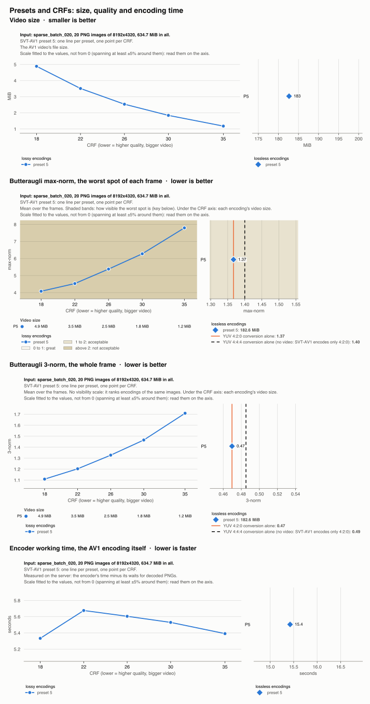
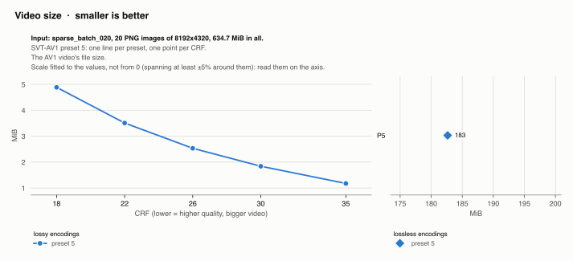
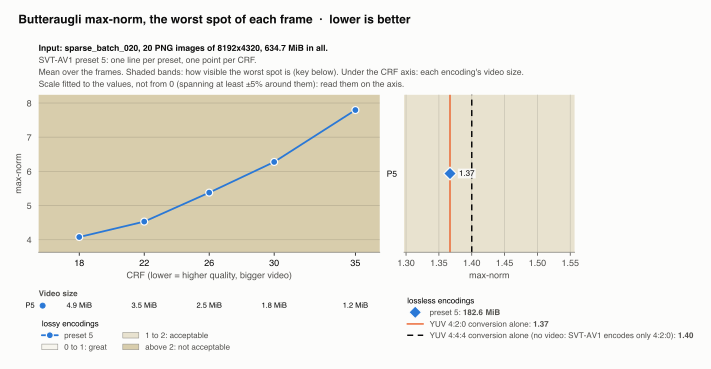
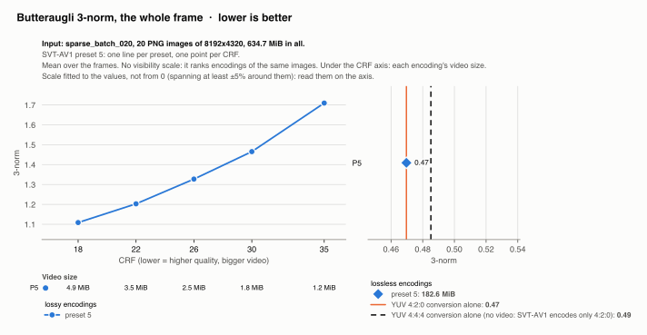
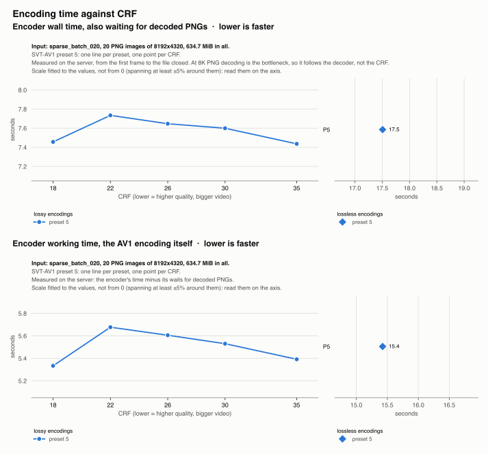

# sparse_batch_020: presets and CRFs compared

Generated by `scripts/report.py` from every encoding in `results/`; do not edit. 6 encodings. Every chart is one measure against the CRF, one line per SVT-AV1 preset, on a scale fitted to the values (not from 0). The lossless encodings, which have no CRF and lose only the YUV 4:2:0 conversion, are on the right, on a scale of their own, with their values in bold in the key. Every chart has its own title, key and axes, so that it can be used on its own. Lower is better everywhere.

In the lossless panels of the quality charts, the solid orange line is the YUV 4:2:0 conversion and the dashed black one the YUV 4:4:4 conversion: the floor of a lossless 4:4:4 video, measured without encoding, as SVT-AV1 encodes only 4:2:0. 4:4:4 loses no less than 4:2:0 here (butteraugli max-norm 1.40 against 1.37): the PNGs carry almost no color detail finer than 2x2 pixels, so both floors are mostly the rounding to 8-bit limited range.

## Every setting at once

Video size, butteraugli max-norm and 3-norm, and the encoder's working time, one above the other.

## Video size

## Butteraugli max-norm

The worst spot of each frame, over its visibility bands: whether the worst differences can be seen. The table under the CRF axis gives each encoding's video size.

## Butteraugli 3-norm

The whole frame. It has no visibility scale: it ranks the settings of this batch, not encodings of different batches.

## Encoding time

The encoder's wall time, which also counts waiting for decoded PNGs ([`encoder-wall-time.svg`](encoder-wall-time.svg)), and its working time, the AV1 encoding itself ([`encoder-working-time.svg`](encoder-working-time.svg)), one above the other. One run per encoding: a single run can be off by ~10%.

## Every encoding

Means over the frames; *4:2:0 conversion alone* is the floor of every encoding; *4:4:4 conversion alone*, of a lossless 4:4:4 video.

| Preset | CRF | Video size | Smaller than PNG | Butteraugli max-norm | Butteraugli 3-norm | Encoder working | Details |
|---|---|---|---|---|---|---|---|
| 5 | lossless | 182.6 MiB | 3.5x | 1.37 | 0.47 | 15.4 s | [summary](../preset_5_lossless/summary.md) |
| 5 | 18 | 4.9 MiB | 130x | 4.08 | 1.11 | 5.3 s | [summary](../preset_5_crf_18/summary.md) |
| 5 | 22 | 3.5 MiB | 181x | 4.53 | 1.20 | 5.7 s | [summary](../preset_5_crf_22/summary.md) |
| 5 | 26 | 2.5 MiB | 251x | 5.38 | 1.33 | 5.6 s | [summary](../preset_5_crf_26/summary.md) |
| 5 | 30 | 1.8 MiB | 345x | 6.28 | 1.47 | 5.5 s | [summary](../preset_5_crf_30/summary.md) |
| 5 | 35 | 1.2 MiB | 540x | 7.80 | 1.71 | 5.4 s | [summary](../preset_5_crf_35/summary.md) |
| 4:2:0 conversion alone | | | | 1.37 | 0.47 | | |
| 4:4:4 conversion alone | | | | 1.40 | 0.49 | | |
