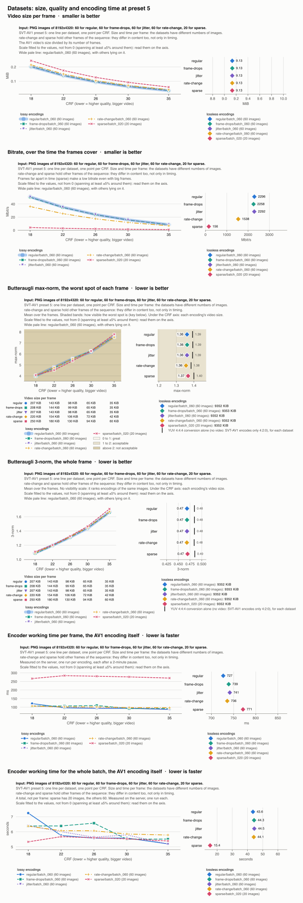
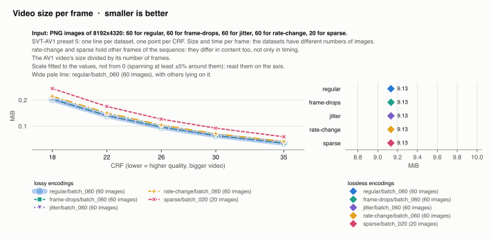
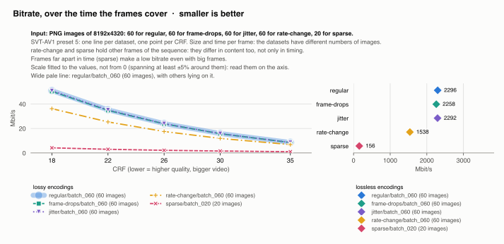
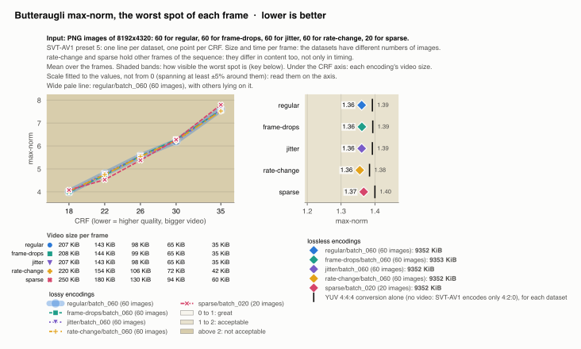
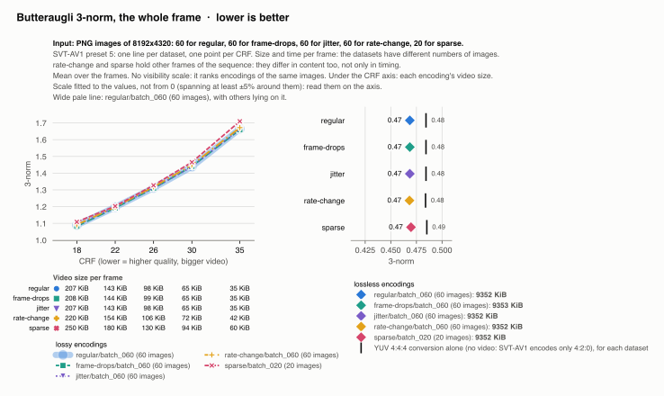
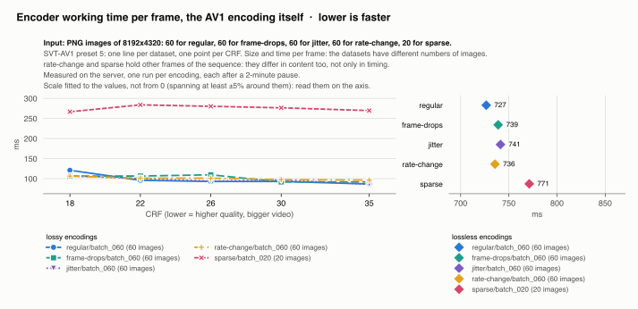
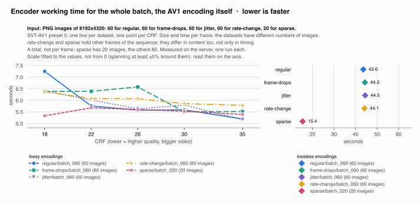

# Datasets compared: SVT-AV1 preset 5

Generated by `scripts/report.py --compare-datasets` from every encoding in `video-results/`; do not edit. Each dataset is one batch of the [timestamp datasets](../../datasets/README.md), encoded with preset 5 at every CRF and losslessly. Every chart is one measure against the CRF, one line per dataset in the same color everywhere, on a scale fitted to the values (not from 0). The lossless encodings are on the right, on a scale of their own, with their values in bold in the key. Every chart has its own title, key and axes, so that it can be used on its own. Lower is better everywhere.

## The datasets

Every image of a batch is one frame, at its capture time. The batches differ in their capture times and, for some, in which frames of the sequence they hold: SVT-AV1 compresses a frame against the ones before it, so frames further apart in the sequence differ more and cost more bits. Compare sizes and quality between datasets with the same frames; between the others, part of the difference is the content, not the timing.

| Dataset | Images | Frames of the sequence | Capture span | Frame rate | Encodings |
|---|---|---|---|---|---|
| [`regular/batch_060`](../regular/batch_060/presets-crfs/README.md) | 60 | 0–59, none skipped | 1.969 s | constant 30000/1001 | 6 |
| [`frame-drops/batch_060`](../frame-drops/batch_060/presets-crfs/README.md) | 60 | 0–60, 1 skipped | 2.002 s | variable | 6 |
| [`jitter/batch_060`](../jitter/batch_060/presets-crfs/README.md) | 60 | 0–59, none skipped | 1.972 s | variable | 6 |
| [`rate-change/batch_060`](../rate-change/batch_060/presets-crfs/README.md) | 60 | 0–88, 29 skipped | 2.939 s | variable | 6 |
| [`sparse/batch_020`](../sparse/batch_020/presets-crfs/README.md) | 20 | 0–280, 261 skipped | 9.343 s | variable | 6 |

## Every setting at once

Size per frame, bitrate, butteraugli max-norm and 3-norm, and the encoder's working time per frame and for the whole batch, one above the other. Sizes and times are also per frame, because the datasets have different numbers of images. The bitrate is over the time the frames cover, so `sparse`, whose frames are far apart, has a low bitrate even with big frames.

## Video size per frame

## Bitrate

## Butteraugli max-norm

The worst spot of each frame, over its visibility bands. The table under the CRF axis gives each encoding's size per frame; in the lossless panel, the black mark on each dataset's row is its YUV 4:4:4 conversion alone, the floor of a lossless 4:4:4 video.

## Butteraugli 3-norm

The whole frame, with the same table and marks. It has no visibility scale: it compares encodings of the same images, so only the datasets with the same frames.

## Encoder working time per frame

## Encoder working time for the whole batch

The total, not per frame: `sparse` has 20 images, the others 60. Its lossless encoding takes about a third of theirs, in proportion, but its lossy ones take about as long as theirs: at these CRFs most of the encoder's working time is a cost per encoding, not per frame, which is also why its time per frame is higher.

## Every encoding

Means over the frames; *4:2:0 conversion alone* is what the YUV 4:2:0 conversion loses on that dataset's images, the floor of its encodings, and *4:4:4 conversion alone* what the YUV 4:4:4 one would lose, the floor of a lossless 4:4:4 video.

| Dataset | CRF | Video size | Per frame | Bitrate | Smaller than PNG | Butteraugli max-norm | Butteraugli 3-norm | Encoder working | Per frame | Details |
|---|---|---|---|---|---|---|---|---|---|---|
| `regular/batch_060` | lossless | 547.97 MiB | 9352 KiB | 2296.0 Mbit/s | 3.5x | 1.36 | 0.47 | 43.6 s | 727 ms | [summary](../regular/batch_060/preset_5_lossless/summary.md) |
| `regular/batch_060` | 18 | 12.14 MiB | 207 KiB | 50.9 Mbit/s | 159x | 4.01 | 1.09 | 7.2 s | 121 ms | [summary](../regular/batch_060/preset_5_crf_18/summary.md) |
| `regular/batch_060` | 22 | 8.40 MiB | 143 KiB | 35.2 Mbit/s | 230x | 4.79 | 1.20 | 5.8 s | 96 ms | [summary](../regular/batch_060/preset_5_crf_22/summary.md) |
| `regular/batch_060` | 26 | 5.72 MiB | 98 KiB | 23.9 Mbit/s | 338x | 5.56 | 1.31 | 5.6 s | 93 ms | [summary](../regular/batch_060/preset_5_crf_26/summary.md) |
| `regular/batch_060` | 30 | 3.78 MiB | 65 KiB | 15.8 Mbit/s | 511x | 6.20 | 1.44 | 5.6 s | 93 ms | [summary](../regular/batch_060/preset_5_crf_30/summary.md) |
| `regular/batch_060` | 35 | 2.04 MiB | 35 KiB | 8.6 Mbit/s | 946x | 7.59 | 1.66 | 5.2 s | 87 ms | [summary](../regular/batch_060/preset_5_crf_35/summary.md) |
| `regular/batch_060` | 4:2:0 conversion alone | | | | | 1.36 | 0.47 | | | |
| `regular/batch_060` | 4:4:4 conversion alone | | | | | 1.39 | 0.48 | | | |
| `frame-drops/batch_060` | lossless | 548.01 MiB | 9353 KiB | 2258.0 Mbit/s | 3.5x | 1.36 | 0.47 | 44.3 s | 739 ms | [summary](../frame-drops/batch_060/preset_5_lossless/summary.md) |
| `frame-drops/batch_060` | 18 | 12.21 MiB | 208 KiB | 50.3 Mbit/s | 158x | 3.99 | 1.08 | 6.4 s | 106 ms | [summary](../frame-drops/batch_060/preset_5_crf_18/summary.md) |
| `frame-drops/batch_060` | 22 | 8.44 MiB | 144 KiB | 34.8 Mbit/s | 229x | 4.73 | 1.19 | 6.4 s | 107 ms | [summary](../frame-drops/batch_060/preset_5_crf_22/summary.md) |
| `frame-drops/batch_060` | 26 | 5.77 MiB | 99 KiB | 23.8 Mbit/s | 334x | 5.57 | 1.31 | 6.6 s | 110 ms | [summary](../frame-drops/batch_060/preset_5_crf_26/summary.md) |
| `frame-drops/batch_060` | 30 | 3.81 MiB | 65 KiB | 15.7 Mbit/s | 507x | 6.28 | 1.44 | 5.5 s | 92 ms | [summary](../frame-drops/batch_060/preset_5_crf_30/summary.md) |
| `frame-drops/batch_060` | 35 | 2.06 MiB | 35 KiB | 8.5 Mbit/s | 938x | 7.56 | 1.66 | 5.5 s | 92 ms | [summary](../frame-drops/batch_060/preset_5_crf_35/summary.md) |
| `frame-drops/batch_060` | 4:2:0 conversion alone | | | | | 1.36 | 0.47 | | | |
| `frame-drops/batch_060` | 4:4:4 conversion alone | | | | | 1.39 | 0.48 | | | |
| `jitter/batch_060` | lossless | 547.97 MiB | 9352 KiB | 2292.5 Mbit/s | 3.5x | 1.36 | 0.47 | 44.5 s | 741 ms | [summary](../jitter/batch_060/preset_5_lossless/summary.md) |
| `jitter/batch_060` | 18 | 12.14 MiB | 207 KiB | 50.8 Mbit/s | 159x | 4.01 | 1.09 | 6.4 s | 107 ms | [summary](../jitter/batch_060/preset_5_crf_18/summary.md) |
| `jitter/batch_060` | 22 | 8.40 MiB | 143 KiB | 35.1 Mbit/s | 230x | 4.79 | 1.20 | 6.0 s | 100 ms | [summary](../jitter/batch_060/preset_5_crf_22/summary.md) |
| `jitter/batch_060` | 26 | 5.72 MiB | 98 KiB | 23.9 Mbit/s | 338x | 5.56 | 1.31 | 5.6 s | 94 ms | [summary](../jitter/batch_060/preset_5_crf_26/summary.md) |
| `jitter/batch_060` | 30 | 3.78 MiB | 65 KiB | 15.8 Mbit/s | 511x | 6.20 | 1.44 | 5.8 s | 97 ms | [summary](../jitter/batch_060/preset_5_crf_30/summary.md) |
| `jitter/batch_060` | 35 | 2.04 MiB | 35 KiB | 8.5 Mbit/s | 946x | 7.59 | 1.66 | 5.2 s | 86 ms | [summary](../jitter/batch_060/preset_5_crf_35/summary.md) |
| `jitter/batch_060` | 4:2:0 conversion alone | | | | | 1.36 | 0.47 | | | |
| `jitter/batch_060` | 4:4:4 conversion alone | | | | | 1.39 | 0.48 | | | |
| `rate-change/batch_060` | lossless | 547.97 MiB | 9352 KiB | 1537.8 Mbit/s | 3.5x | 1.36 | 0.47 | 44.1 s | 736 ms | [summary](../rate-change/batch_060/preset_5_lossless/summary.md) |
| `rate-change/batch_060` | 18 | 12.88 MiB | 220 KiB | 36.2 Mbit/s | 149x | 4.03 | 1.09 | 6.4 s | 106 ms | [summary](../rate-change/batch_060/preset_5_crf_18/summary.md) |
| `rate-change/batch_060` | 22 | 9.03 MiB | 154 KiB | 25.3 Mbit/s | 213x | 4.75 | 1.20 | 6.1 s | 101 ms | [summary](../rate-change/batch_060/preset_5_crf_22/summary.md) |
| `rate-change/batch_060` | 26 | 6.24 MiB | 106 KiB | 17.5 Mbit/s | 308x | 5.54 | 1.32 | 6.1 s | 101 ms | [summary](../rate-change/batch_060/preset_5_crf_26/summary.md) |
| `rate-change/batch_060` | 30 | 4.23 MiB | 72 KiB | 11.9 Mbit/s | 455x | 6.24 | 1.45 | 5.9 s | 98 ms | [summary](../rate-change/batch_060/preset_5_crf_30/summary.md) |
| `rate-change/batch_060` | 35 | 2.44 MiB | 42 KiB | 6.8 Mbit/s | 790x | 7.52 | 1.67 | 5.8 s | 96 ms | [summary](../rate-change/batch_060/preset_5_crf_35/summary.md) |
| `rate-change/batch_060` | 4:2:0 conversion alone | | | | | 1.36 | 0.47 | | | |
| `rate-change/batch_060` | 4:4:4 conversion alone | | | | | 1.38 | 0.48 | | | |
| `sparse/batch_020` | lossless | 182.65 MiB | 9352 KiB | 155.8 Mbit/s | 3.5x | 1.37 | 0.47 | 15.4 s | 771 ms | [summary](../sparse/batch_020/preset_5_lossless/summary.md) |
| `sparse/batch_020` | 18 | 4.88 MiB | 250 KiB | 4.2 Mbit/s | 130x | 4.08 | 1.11 | 5.3 s | 267 ms | [summary](../sparse/batch_020/preset_5_crf_18/summary.md) |
| `sparse/batch_020` | 22 | 3.51 MiB | 180 KiB | 3.0 Mbit/s | 181x | 4.53 | 1.20 | 5.7 s | 284 ms | [summary](../sparse/batch_020/preset_5_crf_22/summary.md) |
| `sparse/batch_020` | 26 | 2.53 MiB | 130 KiB | 2.2 Mbit/s | 251x | 5.38 | 1.33 | 5.6 s | 280 ms | [summary](../sparse/batch_020/preset_5_crf_26/summary.md) |
| `sparse/batch_020` | 30 | 1.84 MiB | 94 KiB | 1.6 Mbit/s | 345x | 6.28 | 1.47 | 5.5 s | 276 ms | [summary](../sparse/batch_020/preset_5_crf_30/summary.md) |
| `sparse/batch_020` | 35 | 1.18 MiB | 60 KiB | 1.0 Mbit/s | 540x | 7.80 | 1.71 | 5.4 s | 270 ms | [summary](../sparse/batch_020/preset_5_crf_35/summary.md) |
| `sparse/batch_020` | 4:2:0 conversion alone | | | | | 1.37 | 0.47 | | | |
| `sparse/batch_020` | 4:4:4 conversion alone | | | | | 1.40 | 0.49 | | | |
