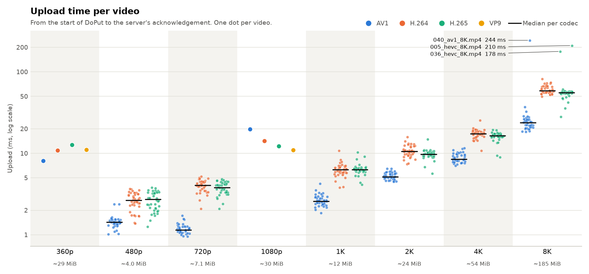

# poc1 results

Upload of every video under `datasets/` with the poc1 Arrow Flight client and server, one `DoPut` per video. Generated by `poc1/scripts/results_md.py` on 2026-10-13.

## Setup

- Client and server on the same machine (Apple M5, Darwin 27.0.0), over loopback.
- Chunk size 1,048,576 bytes, 1 chunk(s) per record batch.
- Datasets: Big Buck Bunny 360p and 1080p (`datasets/360p`, `datasets/1080p`) and the SEPE 8K set in `datasets/LargeFiles` (40 sequences, 480p to 8K, AV1, H.264 and H.265). `LargeFiles/4K-Raw/raw.yuv` is not included: the client only uploads container files.
- Reproduce with `poc1/scripts/run-all.sh`, `poc1/scripts/flatten.py` and `uv run poc1/scripts/results_md.py`.

## Summary

| Measure | Value |
|---|---:|
| Videos received completely (every chunk and byte, matching CRC32) | 728 of 728 |
| Video data | 27.85 GiB |
| Stored `.arrow` files | 27.87 GiB |
| `.arrow` bigger than video by | +0.066% (18.9 MiB) |
| Total upload time | 10.09 s |
| Slowest upload | 243.6 ms (`040_av1_8K.mp4`) |

Findings:

- **The server received all the data** for 728 of 728 videos.
- **The `.arrow` file is a little bigger than the video**, by about 686 bytes per chunk (Arrow IPC framing and the `chunk_index` and `offset` columns). The share therefore falls as files grow: from +0.134% for the smallest files to +0.064% for the largest.
- **Upload time grows with file size**: the median of each group below is 0.30–0.66 ms per MiB on loopback.
- In the ten slowest uploads, 99% of the upload time is spent between the server's first message and the `.arrow` file being written, so the time goes to the server side (receiving and writing), not to the client.

## Upload time

Videos are grouped by resolution; the figure under each resolution is its median video size. The named dots are the three slowest uploads. Big Buck Bunny (360p, 1080p) has one video per codec, SEPE 8K has 40. `poc1/scripts/per_video_charts.py` charts the size of each `.arrow` file against its video, one chart per video, in [`per-video/`](per-video/README.md).

## By resolution and codec

Medians across the videos in each group. Upload is measured by the client, from the start of `DoPut` to the server's acknowledgement; server time is from the first message the server receives until the `.arrow` file is written.

| Dataset | Resolution | Codec | Videos | Complete | Video MiB | `.arrow` MiB | `.arrow` extra | Upload ms | Slowest upload ms | Server ms |
|---|---|---|---:|---:|---:|---:|---:|---:|---:|---:|
| Big Buck Bunny | 360p | AV1 | 1 | 1/1 | 20.13 | 20.14 | +0.070% | 8.09 | 8.09 | 7.69 |
| Big Buck Bunny | 360p | H.264 | 1 | 1/1 | 30.52 | 30.54 | +0.067% | 10.85 | 10.85 | 10.43 |
| Big Buck Bunny | 360p | H.265 | 1 | 1/1 | 27.74 | 27.75 | +0.067% | 12.65 | 12.65 | 12.10 |
| Big Buck Bunny | 360p | VP9 | 1 | 1/1 | 30.18 | 30.20 | +0.068% | 11.08 | 11.08 | 10.56 |
| SEPE 8K | 480p | AV1 | 40 | 40/40 | 2.28 | 2.28 | +0.119% | 1.42 | 2.38 | 1.24 |
| SEPE 8K | 480p | H.264 | 40 | 40/40 | 5.33 | 5.33 | +0.085% | 2.65 | 3.66 | 2.38 |
| SEPE 8K | 480p | H.265 | 40 | 40/40 | 5.27 | 5.27 | +0.085% | 2.73 | 3.81 | 2.44 |
| SEPE 8K | 720p | AV1 | 40 | 40/40 | 3.41 | 3.41 | +0.098% | 1.15 | 1.72 | 0.99 |
| SEPE 8K | 720p | H.264 | 40 | 40/40 | 7.79 | 7.80 | +0.077% | 4.06 | 5.21 | 3.74 |
| SEPE 8K | 720p | H.265 | 40 | 40/40 | 7.89 | 7.90 | +0.079% | 3.78 | 4.82 | 3.53 |
| Big Buck Bunny | 1080p | AV1 | 1 | 1/1 | 30.06 | 30.08 | +0.068% | 19.84 | 19.84 | 18.20 |
| Big Buck Bunny | 1080p | H.264 | 1 | 1/1 | 29.28 | 29.30 | +0.068% | 14.14 | 14.14 | 13.61 |
| Big Buck Bunny | 1080p | H.265 | 1 | 1/1 | 30.00 | 30.03 | +0.068% | 12.27 | 12.27 | 11.80 |
| Big Buck Bunny | 1080p | VP9 | 1 | 1/1 | 30.05 | 30.07 | +0.068% | 10.98 | 10.98 | 10.55 |
| SEPE 8K | 1K | AV1 | 40 | 40/40 | 5.05 | 5.05 | +0.086% | 2.59 | 4.24 | 2.37 |
| SEPE 8K | 1K | H.264 | 40 | 40/40 | 12.38 | 12.39 | +0.073% | 6.30 | 10.75 | 5.93 |
| SEPE 8K | 1K | H.265 | 40 | 40/40 | 12.39 | 12.40 | +0.073% | 6.29 | 10.23 | 5.86 |
| SEPE 8K | 2K | AV1 | 40 | 40/40 | 9.80 | 9.81 | +0.075% | 5.13 | 6.48 | 4.89 |
| SEPE 8K | 2K | H.264 | 40 | 40/40 | 24.86 | 24.87 | +0.068% | 10.54 | 15.81 | 9.98 |
| SEPE 8K | 2K | H.265 | 40 | 40/40 | 24.98 | 25.00 | +0.068% | 9.76 | 14.80 | 9.25 |
| SEPE 8K | 4K | AV1 | 40 | 40/40 | 19.96 | 19.97 | +0.069% | 8.48 | 11.55 | 8.01 |
| SEPE 8K | 4K | H.264 | 40 | 40/40 | 56.51 | 56.55 | +0.065% | 17.36 | 25.25 | 17.09 |
| SEPE 8K | 4K | H.265 | 40 | 40/40 | 56.18 | 56.22 | +0.065% | 16.47 | 19.45 | 16.19 |
| SEPE 8K | 8K | AV1 | 40 | 40/40 | 76.68 | 76.73 | +0.065% | 23.80 | 243.63 | 23.53 |
| SEPE 8K | 8K | H.264 | 40 | 40/40 | 192.48 | 192.60 | +0.064% | 58.46 | 81.65 | 57.72 |
| SEPE 8K | 8K | H.265 | 40 | 40/40 | 188.23 | 188.35 | +0.064% | 55.57 | 210.20 | 55.16 |

## Slowest uploads

| File | Resolution | Codec | Video MiB | Upload ms | Server ms |
|---|---|---|---:|---:|---:|
| `040_av1_8K.mp4` | 8K | AV1 | 76.40 | 243.63 | 243.19 |
| `005_hevc_8K.mp4` | 8K | H.265 | 187.88 | 210.20 | 209.86 |
| `036_hevc_8K.mp4` | 8K | H.265 | 188.90 | 178.17 | 177.88 |
| `026_h264_8K.mp4` | 8K | H.264 | 258.91 | 81.65 | 81.22 |
| `039_h264_8K.mp4` | 8K | H.264 | 236.14 | 73.88 | 73.56 |
| `027_h264_8K.mp4` | 8K | H.264 | 232.57 | 72.78 | 72.47 |
| `025_h264_8K.mp4` | 8K | H.264 | 244.86 | 71.70 | 71.36 |
| `024_h264_8K.mp4` | 8K | H.264 | 235.20 | 71.62 | 71.24 |
| `032_h264_8K.mp4` | 8K | H.264 | 230.51 | 69.45 | 69.16 |
| `033_h264_8K.mp4` | 8K | H.264 | 209.36 | 67.63 | 64.51 |

The per-video data is in [`videos.csv`](videos.csv), one row per video, and the client reports for each dataset folder are in [`reports/`](reports/).
