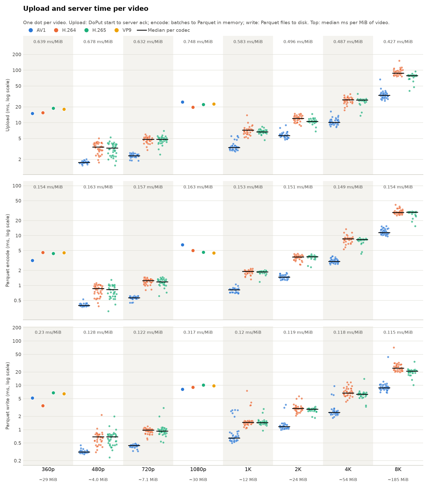

# poc1 results

Upload of every video under `datasets/` with the poc1 Arrow Flight client and server, one `DoPut` per video, stored as mosaicod stores a topic: one Parquet file per record batch. Generated by `poc1/scripts/analyze.py` on 2026-10-13.

## Setup

- Client and server on the same machine (Apple M5, Darwin 27.0.0), over loopback.
- Chunk size 1.00 MiB, 1 chunk(s) per record batch, so 1.00 MiB of video per Parquet file.
- Parquet format: `video` (see `poc1/src/format.rs`).
- Datasets: Big Buck Bunny 360p and 1080p (`datasets/360p`, `datasets/1080p`) and the SEPE 8K set in `datasets/LargeFiles` (40 sequences, 480p to 8K, AV1, H.264 and H.265). `LargeFiles/4K-Raw/raw.yuv` is not included: the client only uploads container files.
- Reproduce with `poc1/scripts/run-all.sh` and `uv run poc1/scripts/analyze.py`.

## Summary

| Measure | Value |
|---|---:|
| Videos received completely (every chunk and byte, matching CRC32) | 728 of 728 |
| Video data | 27.85 GiB |
| Stored Parquet files | 28,894 files, 27.88 GiB |
| Parquet bigger than video by | +35.34 MiB (+0.124%) |
| Same batches as Arrow IPC files (`.arrow`) | 27.87 GiB, +24.28 MiB (+0.085%) vs video |
| Parquet vs `.arrow` | +11.06 MiB (+0.039%) |
| Total upload time | 13.49 s |
| Slowest upload | 151.4 ms (`026_h264_8K.mp4`) |

Findings:

- **The server received all the data** for 728 of 728 videos.
- **The Parquet files are a little bigger than the video**, by about 1.3 KiB per file (Parquet footer, embedded Arrow schema, `timestamp_ns` bloom filter and the `timestamp_ns`, `chunk_index` and `offset` columns). Every file holds the same amount of video, so the share is about the same for every video (+0.121% to +0.181%); bigger record batches would lower it.
- **Parquet takes 11.06 MiB more than `.arrow`** (+0.039%). An Arrow IPC file of the same batches adds about 881 B per chunk (message framing and the `timestamp_ns`, `chunk_index` and `offset` columns) and has one footer per video, while every Parquet file carries its own footer, schema and bloom filter. `.arrow` is computed by the client from the batches it sends; it is how poc1 stored videos before following mosaicod.
- **Upload time grows with file size**: the median of each group below is 0.42–0.82 ms per MiB on loopback.
- In the ten slowest uploads, 100% of the upload time is spent between the server's first message and the last Parquet file being written, so the time goes to the server side (receiving, encoding and writing), not to the client.
- Encoding the Parquet files took 4.37 s and writing them 3.59 s in total. [`per-video/server-time/all-videos.png`](per-video/server-time/all-videos.png) plots both for every video, and [`per-video/server-time/`](per-video/server-time/README.md) has one chart per video splitting its upload time into them.

## `.arrow` vs Parquet

Total size per resolution of the videos, of an Arrow IPC file (`.arrow`) holding the same batches (how poc1 stored videos before following mosaicod, computed by the client) and of the Parquet files the server stored.

| Dataset | Resolution | Videos | Video | `.arrow` | `.arrow` vs video | Parquet | Parquet vs video | Parquet vs `.arrow` | Parquet files |
|---|---|---:|---:|---:|---:|---:|---:|---:|---:|
| Big Buck Bunny | 360p | 4 | 108.57 MiB | 108.66 MiB | +96.8 KiB (+0.087%) | 108.70 MiB | +141.0 KiB (+0.127%) | +44.2 KiB (+0.040%) | 111 |
| SEPE 8K | 480p | 120 | 499.72 MiB | 500.30 MiB | +592.8 KiB (+0.116%) | 500.42 MiB | +710.2 KiB (+0.139%) | +117.4 KiB (+0.023%) | 569 |
| SEPE 8K | 720p | 120 | 749.89 MiB | 750.66 MiB | +793.9 KiB (+0.103%) | 750.87 MiB | +1010.7 KiB (+0.132%) | +216.8 KiB (+0.028%) | 809 |
| Big Buck Bunny | 1080p | 4 | 119.39 MiB | 119.50 MiB | +106.7 KiB (+0.087%) | 119.55 MiB | +156.2 KiB (+0.128%) | +49.5 KiB (+0.040%) | 123 |
| SEPE 8K | 1K | 120 | 1.15 GiB | 1.15 GiB | +1.13 MiB (+0.096%) | 1.15 GiB | +1.51 MiB (+0.129%) | +396.3 KiB (+0.033%) | 1,241 |
| SEPE 8K | 2K | 120 | 2.28 GiB | 2.28 GiB | +2.07 MiB (+0.088%) | 2.28 GiB | +2.92 MiB (+0.125%) | +874.8 KiB (+0.037%) | 2,391 |
| SEPE 8K | 4K | 120 | 5.06 GiB | 5.06 GiB | +4.40 MiB (+0.085%) | 5.07 GiB | +6.41 MiB (+0.124%) | +2.01 MiB (+0.039%) | 5,245 |
| SEPE 8K | 8K | 120 | 17.91 GiB | 17.93 GiB | +15.14 MiB (+0.083%) | 17.94 GiB | +22.53 MiB (+0.123%) | +7.39 MiB (+0.040%) | 18,405 |
| **Total** |  | 728 | 27.85 GiB | 27.87 GiB | +24.28 MiB (+0.085%) | 27.88 GiB | +35.34 MiB (+0.124%) | +11.06 MiB (+0.039%) | 28,894 |

## Upload and server time

Videos are grouped by resolution; the figure under each resolution is its median video size. Big Buck Bunny (360p, 1080p) has one video per codec, SEPE 8K has 40. There are also three charts per video: [`per-video/file-size-comparison/`](per-video/file-size-comparison/README.md) compares the video, `.arrow` and Parquet sizes, [`per-video/server-time/`](per-video/server-time/README.md) shows the upload time with the server's Parquet encode and write times, and [`per-video/client-time/`](per-video/client-time/README.md) shows the client steps before the upload (read, split into batches, Flight encode).

## By resolution and codec

Medians across the videos in each group. Upload is measured by the client, from the start of `DoPut` to the server's acknowledgement; server time is from the first message the server receives until the last Parquet file is written.

| Dataset | Resolution | Codec | Videos | Complete | Video | `.arrow` extra | Parquet extra | Parquet files | Upload ms | Slowest upload ms | Server ms |
|---|---|---|---:|---:|---:|---:|---:|---:|---:|---:|---:|
| Big Buck Bunny | 360p | AV1 | 1 | 1/1 | 20.13 MiB | +18.5 KiB (+0.090%) | +26.6 KiB (+0.129%) | 21 | 15.01 | 15.01 | 14.65 |
| Big Buck Bunny | 360p | H.264 | 1 | 1/1 | 30.52 MiB | +26.9 KiB (+0.086%) | +39.4 KiB (+0.126%) | 31 | 15.48 | 15.48 | 15.04 |
| Big Buck Bunny | 360p | H.265 | 1 | 1/1 | 27.74 MiB | +24.4 KiB (+0.086%) | +35.6 KiB (+0.125%) | 28 | 18.91 | 18.91 | 18.40 |
| Big Buck Bunny | 360p | VP9 | 1 | 1/1 | 30.18 MiB | +26.9 KiB (+0.087%) | +39.4 KiB (+0.127%) | 31 | 18.01 | 18.01 | 17.54 |
| SEPE 8K | 480p | AV1 | 40 | 40/40 | 2.28 MiB | +3.5 KiB (+0.149%) | +3.7 KiB (+0.160%) | 3 | 1.75 | 2.01 | 1.57 |
| SEPE 8K | 480p | H.264 | 40 | 40/40 | 5.33 MiB | +6.0 KiB (+0.107%) | +7.5 KiB (+0.134%) | 6 | 3.44 | 5.04 | 3.22 |
| SEPE 8K | 480p | H.265 | 40 | 40/40 | 5.27 MiB | +6.0 KiB (+0.108%) | +7.5 KiB (+0.134%) | 6 | 3.28 | 5.26 | 2.99 |
| SEPE 8K | 720p | AV1 | 40 | 40/40 | 3.41 MiB | +4.3 KiB (+0.123%) | +5.0 KiB (+0.141%) | 4 | 2.35 | 2.70 | 2.15 |
| SEPE 8K | 720p | H.264 | 40 | 40/40 | 7.79 MiB | +7.6 KiB (+0.098%) | +10.0 KiB (+0.128%) | 8 | 4.81 | 5.97 | 4.52 |
| SEPE 8K | 720p | H.265 | 40 | 40/40 | 7.89 MiB | +7.7 KiB (+0.100%) | +10.0 KiB (+0.129%) | 8 | 4.83 | 7.00 | 4.55 |
| Big Buck Bunny | 1080p | AV1 | 1 | 1/1 | 30.06 MiB | +26.9 KiB (+0.087%) | +39.3 KiB (+0.128%) | 31 | 24.64 | 24.64 | 22.97 |
| Big Buck Bunny | 1080p | H.264 | 1 | 1/1 | 29.28 MiB | +26.0 KiB (+0.087%) | +38.1 KiB (+0.127%) | 30 | 19.68 | 19.68 | 19.10 |
| Big Buck Bunny | 1080p | H.265 | 1 | 1/1 | 30.00 MiB | +26.9 KiB (+0.088%) | +39.4 KiB (+0.128%) | 31 | 22.10 | 22.10 | 21.63 |
| Big Buck Bunny | 1080p | VP9 | 1 | 1/1 | 30.05 MiB | +26.9 KiB (+0.087%) | +39.4 KiB (+0.128%) | 31 | 22.82 | 22.82 | 22.45 |
| SEPE 8K | 1K | AV1 | 40 | 40/40 | 5.05 MiB | +6.0 KiB (+0.109%) | +7.5 KiB (+0.136%) | 6 | 3.37 | 5.59 | 3.14 |
| SEPE 8K | 1K | H.264 | 40 | 40/40 | 12.38 MiB | +11.9 KiB (+0.093%) | +16.3 KiB (+0.127%) | 13 | 7.18 | 13.96 | 6.80 |
| SEPE 8K | 1K | H.265 | 40 | 40/40 | 12.39 MiB | +11.8 KiB (+0.093%) | +16.3 KiB (+0.127%) | 13 | 6.69 | 8.37 | 6.28 |
| SEPE 8K | 2K | AV1 | 40 | 40/40 | 9.80 MiB | +9.3 KiB (+0.095%) | +12.5 KiB (+0.126%) | 10 | 5.66 | 8.99 | 5.35 |
| SEPE 8K | 2K | H.264 | 40 | 40/40 | 24.86 MiB | +21.9 KiB (+0.087%) | +31.3 KiB (+0.124%) | 25 | 12.07 | 14.80 | 11.57 |
| SEPE 8K | 2K | H.265 | 40 | 40/40 | 24.98 MiB | +21.9 KiB (+0.088%) | +31.3 KiB (+0.126%) | 25 | 10.55 | 14.67 | 10.11 |
| SEPE 8K | 4K | AV1 | 40 | 40/40 | 19.96 MiB | +18.1 KiB (+0.088%) | +25.6 KiB (+0.125%) | 20.5 | 10.12 | 16.36 | 9.64 |
| SEPE 8K | 4K | H.264 | 40 | 40/40 | 56.51 MiB | +48.6 KiB (+0.084%) | +71.3 KiB (+0.123%) | 57 | 27.40 | 34.95 | 26.95 |
| SEPE 8K | 4K | H.265 | 40 | 40/40 | 56.18 MiB | +48.6 KiB (+0.084%) | +71.3 KiB (+0.123%) | 57 | 26.93 | 35.52 | 26.43 |
| SEPE 8K | 8K | AV1 | 40 | 40/40 | 76.68 MiB | +65.3 KiB (+0.083%) | +96.4 KiB (+0.123%) | 77 | 33.36 | 66.92 | 32.87 |
| SEPE 8K | 8K | H.264 | 40 | 40/40 | 192.48 MiB | +162.3 KiB (+0.082%) | +241.9 KiB (+0.123%) | 193 | 87.60 | 151.41 | 87.14 |
| SEPE 8K | 8K | H.265 | 40 | 40/40 | 188.23 MiB | +159.0 KiB (+0.082%) | +236.9 KiB (+0.123%) | 189 | 79.00 | 94.69 | 78.41 |

## Slowest uploads

| File | Resolution | Codec | Video | Upload ms | Server ms |
|---|---|---|---:|---:|---:|
| `026_h264_8K.mp4` | 8K | H.264 | 258.91 MiB | 151.41 | 150.90 |
| `039_h264_8K.mp4` | 8K | H.264 | 236.14 MiB | 113.11 | 112.55 |
| `011_h264_8K.mp4` | 8K | H.264 | 171.12 MiB | 112.22 | 111.75 |
| `025_h264_8K.mp4` | 8K | H.264 | 244.86 MiB | 108.68 | 108.20 |
| `032_h264_8K.mp4` | 8K | H.264 | 230.51 MiB | 105.94 | 105.43 |
| `024_h264_8K.mp4` | 8K | H.264 | 235.20 MiB | 103.22 | 102.79 |
| `029_h264_8K.mp4` | 8K | H.264 | 210.79 MiB | 102.61 | 102.08 |
| `030_h264_8K.mp4` | 8K | H.264 | 211.09 MiB | 102.03 | 101.50 |
| `027_h264_8K.mp4` | 8K | H.264 | 232.57 MiB | 101.40 | 100.89 |
| `028_h264_8K.mp4` | 8K | H.264 | 209.97 MiB | 98.88 | 98.33 |

The per-video data is in [`videos.csv`](videos.csv), one row per video, and the raw JSON client reports for each dataset folder (run settings, wire bytes, Flight messages, problems) are in [`reports/`](reports/).
