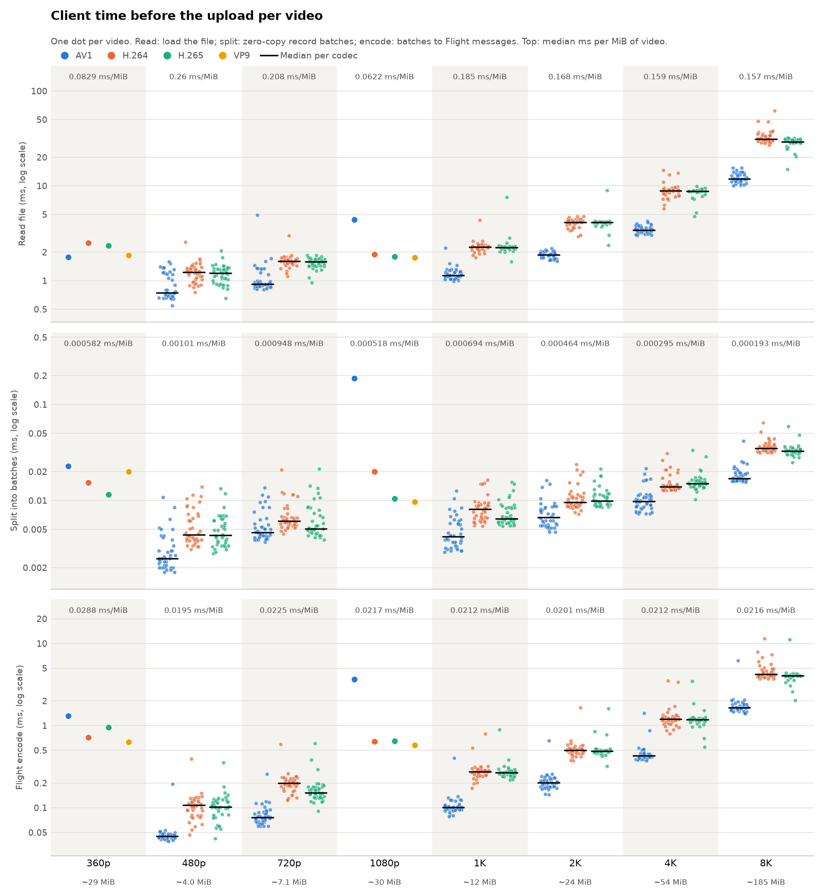

# Client time per video

## What to improve first

- **Read file: 4.76 s, 88% of the client time before the upload.** The client loads the whole video before splitting it. Reading and uploading in a pipeline (sending each batch as soon as it is read) would hide most of this time behind the upload.
- Then: Flight encode 661 ms (12%), Split into batches 8.9 ms (0.16%).

The client spends 5.43 s before the uploads, against 12.72 s of upload.

Generated by `scripts/analyze.py`: one chart per video (728 in total) with the client steps before the upload: loading the file, splitting it into record batches (zero-copy slices) and serializing them into Flight messages.

## All videos

In total the client spent 4.76 s reading files, 8.90 ms splitting them and 0.66 s encoding Flight messages, for 27.85 GiB of video.

## Big Buck Bunny · 360p · AV1

| Video | Size | Read ms | Split ms | Flight encode ms | Total before upload ms | Upload ms | Chart |
|---|---:|---:|---:|---:|---:|---:|---|
| `Big_Buck_Bunny_20MB_av1.mp4` | 20.13 MiB | 1.77 | 0.0228 | 1.30 | 3.10 | 12.6 | [chart](Big-Buck-Bunny/360p/AV1/Big_Buck_Bunny_20MB_av1.png) |

## Big Buck Bunny · 360p · H.264

| Video | Size | Read ms | Split ms | Flight encode ms | Total before upload ms | Upload ms | Chart |
|---|---:|---:|---:|---:|---:|---:|---|
| `Big_Buck_Bunny_30MB_h264.mp4` | 30.52 MiB | 2.50 | 0.0153 | 0.72 | 3.23 | 16.7 | [chart](Big-Buck-Bunny/360p/H.264/Big_Buck_Bunny_30MB_h264.png) |

## Big Buck Bunny · 360p · H.265

| Video | Size | Read ms | Split ms | Flight encode ms | Total before upload ms | Upload ms | Chart |
|---|---:|---:|---:|---:|---:|---:|---|
| `Big_Buck_Bunny_28MB_h265.mp4` | 27.74 MiB | 2.33 | 0.0115 | 0.95 | 3.29 | 14.5 | [chart](Big-Buck-Bunny/360p/H.265/Big_Buck_Bunny_28MB_h265.png) |

## Big Buck Bunny · 360p · VP9

| Video | Size | Read ms | Split ms | Flight encode ms | Total before upload ms | Upload ms | Chart |
|---|---:|---:|---:|---:|---:|---:|---|
| `Big_Buck_Bunny_30MB_vp9.webm` | 30.18 MiB | 1.85 | 0.0200 | 0.63 | 2.50 | 12.6 | [chart](Big-Buck-Bunny/360p/VP9/Big_Buck_Bunny_30MB_vp9.png) |

## Big Buck Bunny · 1080p · AV1

| Video | Size | Read ms | Split ms | Flight encode ms | Total before upload ms | Upload ms | Chart |
|---|---:|---:|---:|---:|---:|---:|---|
| `Big_Buck_Bunny_30MB_av1.mp4` | 30.06 MiB | 4.39 | 0.1875 | 3.65 | 8.23 | 20.3 | [chart](Big-Buck-Bunny/1080p/AV1/Big_Buck_Bunny_30MB_av1.png) |

## Big Buck Bunny · 1080p · H.264

| Video | Size | Read ms | Split ms | Flight encode ms | Total before upload ms | Upload ms | Chart |
|---|---:|---:|---:|---:|---:|---:|---|
| `Big_Buck_Bunny_30MB_h264.mp4` | 29.28 MiB | 1.89 | 0.0201 | 0.64 | 2.55 | 14.2 | [chart](Big-Buck-Bunny/1080p/H.264/Big_Buck_Bunny_30MB_h264.png) |

## Big Buck Bunny · 1080p · H.265

| Video | Size | Read ms | Split ms | Flight encode ms | Total before upload ms | Upload ms | Chart |
|---|---:|---:|---:|---:|---:|---:|---|
| `Big_Buck_Bunny_30MB_h265.mp4` | 30.00 MiB | 1.79 | 0.0105 | 0.65 | 2.45 | 13.5 | [chart](Big-Buck-Bunny/1080p/H.265/Big_Buck_Bunny_30MB_h265.png) |

## Big Buck Bunny · 1080p · VP9

| Video | Size | Read ms | Split ms | Flight encode ms | Total before upload ms | Upload ms | Chart |
|---|---:|---:|---:|---:|---:|---:|---|
| `Big_Buck_Bunny_30MB_vp9.webm` | 30.05 MiB | 1.75 | 0.0097 | 0.58 | 2.34 | 12.5 | [chart](Big-Buck-Bunny/1080p/VP9/Big_Buck_Bunny_30MB_vp9.png) |

## SEPE 8K · 480p · AV1

| Video | Size | Read ms | Split ms | Flight encode ms | Total before upload ms | Upload ms | Chart |
|---|---:|---:|---:|---:|---:|---:|---|
| `001_av1_480p.mp4` | 1.91 MiB | 0.74 | 0.0108 | 0.20 | 0.94 | 2.0 | [chart](SEPE-8K/480p/AV1/001_av1_480p.png) |
| `002_av1_480p.mp4` | 2.30 MiB | 0.64 | 0.0052 | 0.05 | 0.70 | 1.9 | [chart](SEPE-8K/480p/AV1/002_av1_480p.png) |
| `003_av1_480p.mp4` | 2.36 MiB | 0.79 | 0.0043 | 0.05 | 0.84 | 1.8 | [chart](SEPE-8K/480p/AV1/003_av1_480p.png) |
| `004_av1_480p.mp4` | 2.32 MiB | 1.36 | 0.0030 | 0.04 | 1.41 | 1.8 | [chart](SEPE-8K/480p/AV1/004_av1_480p.png) |
| `005_av1_480p.mp4` | 2.61 MiB | 0.79 | 0.0064 | 0.05 | 0.85 | 1.8 | [chart](SEPE-8K/480p/AV1/005_av1_480p.png) |
| `006_av1_480p.mp4` | 2.29 MiB | 1.19 | 0.0050 | 0.05 | 1.24 | 1.5 | [chart](SEPE-8K/480p/AV1/006_av1_480p.png) |
| `007_av1_480p.mp4` | 2.31 MiB | 1.02 | 0.0030 | 0.04 | 1.06 | 1.8 | [chart](SEPE-8K/480p/AV1/007_av1_480p.png) |
| `008_av1_480p.mp4` | 2.11 MiB | 1.23 | 0.0027 | 0.05 | 1.28 | 1.8 | [chart](SEPE-8K/480p/AV1/008_av1_480p.png) |
| `009_av1_480p.mp4` | 2.26 MiB | 0.75 | 0.0027 | 0.04 | 0.79 | 1.7 | [chart](SEPE-8K/480p/AV1/009_av1_480p.png) |
| `010_av1_480p.mp4` | 2.08 MiB | 1.06 | 0.0025 | 0.04 | 1.11 | 1.8 | [chart](SEPE-8K/480p/AV1/010_av1_480p.png) |
| `011_av1_480p.mp4` | 2.31 MiB | 0.73 | 0.0085 | 0.04 | 0.79 | 1.8 | [chart](SEPE-8K/480p/AV1/011_av1_480p.png) |
| `012_av1_480p.mp4` | 2.36 MiB | 1.18 | 0.0023 | 0.04 | 1.22 | 3.2 | [chart](SEPE-8K/480p/AV1/012_av1_480p.png) |
| `013_av1_480p.mp4` | 2.26 MiB | 0.66 | 0.0021 | 0.04 | 0.70 | 1.6 | [chart](SEPE-8K/480p/AV1/013_av1_480p.png) |
| `014_av1_480p.mp4` | 2.47 MiB | 0.70 | 0.0025 | 0.05 | 0.75 | 1.8 | [chart](SEPE-8K/480p/AV1/014_av1_480p.png) |
| `015_av1_480p.mp4` | 2.19 MiB | 0.73 | 0.0034 | 0.05 | 0.78 | 1.8 | [chart](SEPE-8K/480p/AV1/015_av1_480p.png) |
| `016_av1_480p.mp4` | 2.30 MiB | 1.37 | 0.0039 | 0.05 | 1.43 | 1.8 | [chart](SEPE-8K/480p/AV1/016_av1_480p.png) |
| `017_av1_480p.mp4` | 2.32 MiB | 0.73 | 0.0026 | 0.04 | 0.78 | 1.7 | [chart](SEPE-8K/480p/AV1/017_av1_480p.png) |
| `018_av1_480p.mp4` | 2.28 MiB | 0.77 | 0.0021 | 0.04 | 0.82 | 1.7 | [chart](SEPE-8K/480p/AV1/018_av1_480p.png) |
| `019_av1_480p.mp4` | 2.16 MiB | 1.17 | 0.0023 | 0.05 | 1.22 | 1.7 | [chart](SEPE-8K/480p/AV1/019_av1_480p.png) |
| `020_av1_480p.mp4` | 2.36 MiB | 0.74 | 0.0022 | 0.04 | 0.78 | 1.8 | [chart](SEPE-8K/480p/AV1/020_av1_480p.png) |
| `021_av1_480p.mp4` | 2.20 MiB | 1.37 | 0.0025 | 0.04 | 1.42 | 1.8 | [chart](SEPE-8K/480p/AV1/021_av1_480p.png) |
| `022_av1_480p.mp4` | 2.20 MiB | 0.64 | 0.0020 | 0.04 | 0.69 | 1.7 | [chart](SEPE-8K/480p/AV1/022_av1_480p.png) |
| `023_av1_480p.mp4` | 2.05 MiB | 1.31 | 0.0025 | 0.05 | 1.36 | 1.7 | [chart](SEPE-8K/480p/AV1/023_av1_480p.png) |
| `024_av1_480p.mp4` | 2.22 MiB | 1.51 | 0.0029 | 0.05 | 1.56 | 2.0 | [chart](SEPE-8K/480p/AV1/024_av1_480p.png) |
| `025_av1_480p.mp4` | 2.30 MiB | 0.75 | 0.0025 | 0.05 | 0.80 | 1.8 | [chart](SEPE-8K/480p/AV1/025_av1_480p.png) |
| `026_av1_480p.mp4` | 2.52 MiB | 1.41 | 0.0020 | 0.04 | 1.45 | 1.6 | [chart](SEPE-8K/480p/AV1/026_av1_480p.png) |
| `027_av1_480p.mp4` | 2.35 MiB | 0.66 | 0.0025 | 0.04 | 0.71 | 1.7 | [chart](SEPE-8K/480p/AV1/027_av1_480p.png) |
| `028_av1_480p.mp4` | 2.53 MiB | 1.59 | 0.0030 | 0.05 | 1.64 | 1.9 | [chart](SEPE-8K/480p/AV1/028_av1_480p.png) |
| `029_av1_480p.mp4` | 2.21 MiB | 0.75 | 0.0043 | 0.04 | 0.79 | 1.8 | [chart](SEPE-8K/480p/AV1/029_av1_480p.png) |
| `030_av1_480p.mp4` | 2.27 MiB | 0.90 | 0.0020 | 0.04 | 0.95 | 1.7 | [chart](SEPE-8K/480p/AV1/030_av1_480p.png) |
| `031_av1_480p.mp4` | 2.13 MiB | 0.70 | 0.0041 | 0.04 | 0.74 | 1.7 | [chart](SEPE-8K/480p/AV1/031_av1_480p.png) |
| `032_av1_480p.mp4` | 2.03 MiB | 0.64 | 0.0018 | 0.05 | 0.69 | 1.7 | [chart](SEPE-8K/480p/AV1/032_av1_480p.png) |
| `033_av1_480p.mp4` | 2.02 MiB | 1.21 | 0.0020 | 0.04 | 1.25 | 1.6 | [chart](SEPE-8K/480p/AV1/033_av1_480p.png) |
| `034_av1_480p.mp4` | 2.18 MiB | 0.55 | 0.0020 | 0.04 | 0.59 | 1.8 | [chart](SEPE-8K/480p/AV1/034_av1_480p.png) |
| `035_av1_480p.mp4` | 2.36 MiB | 0.69 | 0.0018 | 0.04 | 0.73 | 1.7 | [chart](SEPE-8K/480p/AV1/035_av1_480p.png) |
| `036_av1_480p.mp4` | 2.24 MiB | 0.66 | 0.0023 | 0.04 | 0.71 | 1.7 | [chart](SEPE-8K/480p/AV1/036_av1_480p.png) |
| `037_av1_480p.mp4` | 2.17 MiB | 0.66 | 0.0019 | 0.04 | 0.70 | 1.7 | [chart](SEPE-8K/480p/AV1/037_av1_480p.png) |
| `038_av1_480p.mp4` | 2.56 MiB | 0.71 | 0.0019 | 0.05 | 0.76 | 1.9 | [chart](SEPE-8K/480p/AV1/038_av1_480p.png) |
| `039_av1_480p.mp4` | 2.06 MiB | 0.68 | 0.0024 | 0.04 | 0.72 | 1.7 | [chart](SEPE-8K/480p/AV1/039_av1_480p.png) |
| `040_av1_480p.mp4` | 2.59 MiB | 1.24 | 0.0050 | 0.05 | 1.30 | 1.8 | [chart](SEPE-8K/480p/AV1/040_av1_480p.png) |

## SEPE 8K · 480p · H.264

| Video | Size | Read ms | Split ms | Flight encode ms | Total before upload ms | Upload ms | Chart |
|---|---:|---:|---:|---:|---:|---:|---|
| `001_h264_480p.mp4` | 5.36 MiB | 2.57 | 0.0140 | 0.39 | 2.98 | 3.8 | [chart](SEPE-8K/480p/H.264/001_h264_480p.png) |
| `002_h264_480p.mp4` | 2.57 MiB | 0.85 | 0.0085 | 0.05 | 0.92 | 2.0 | [chart](SEPE-8K/480p/H.264/002_h264_480p.png) |
| `003_h264_480p.mp4` | 5.50 MiB | 1.62 | 0.0089 | 0.12 | 1.75 | 3.6 | [chart](SEPE-8K/480p/H.264/003_h264_480p.png) |
| `004_h264_480p.mp4` | 3.25 MiB | 0.89 | 0.0087 | 0.07 | 0.97 | 4.9 | [chart](SEPE-8K/480p/H.264/004_h264_480p.png) |
| `005_h264_480p.mp4` | 6.91 MiB | 1.39 | 0.0105 | 0.15 | 1.55 | 4.3 | [chart](SEPE-8K/480p/H.264/005_h264_480p.png) |
| `006_h264_480p.mp4` | 4.70 MiB | 1.11 | 0.0069 | 0.08 | 1.20 | 3.1 | [chart](SEPE-8K/480p/H.264/006_h264_480p.png) |
| `007_h264_480p.mp4` | 5.03 MiB | 1.15 | 0.0052 | 0.10 | 1.25 | 3.2 | [chart](SEPE-8K/480p/H.264/007_h264_480p.png) |
| `008_h264_480p.mp4` | 5.96 MiB | 1.30 | 0.0111 | 0.11 | 1.43 | 3.7 | [chart](SEPE-8K/480p/H.264/008_h264_480p.png) |
| `009_h264_480p.mp4` | 6.36 MiB | 1.34 | 0.0065 | 0.11 | 1.46 | 3.8 | [chart](SEPE-8K/480p/H.264/009_h264_480p.png) |
| `010_h264_480p.mp4` | 4.21 MiB | 1.03 | 0.0038 | 0.08 | 1.12 | 2.9 | [chart](SEPE-8K/480p/H.264/010_h264_480p.png) |
| `011_h264_480p.mp4` | 4.54 MiB | 1.20 | 0.0114 | 0.09 | 1.30 | 2.9 | [chart](SEPE-8K/480p/H.264/011_h264_480p.png) |
| `012_h264_480p.mp4` | 3.80 MiB | 0.95 | 0.0045 | 0.13 | 1.09 | 2.5 | [chart](SEPE-8K/480p/H.264/012_h264_480p.png) |
| `013_h264_480p.mp4` | 6.52 MiB | 1.36 | 0.0097 | 0.12 | 1.49 | 6.4 | [chart](SEPE-8K/480p/H.264/013_h264_480p.png) |
| `014_h264_480p.mp4` | 6.23 MiB | 1.30 | 0.0046 | 0.11 | 1.42 | 5.1 | [chart](SEPE-8K/480p/H.264/014_h264_480p.png) |
| `015_h264_480p.mp4` | 6.50 MiB | 1.39 | 0.0072 | 0.12 | 1.52 | 4.0 | [chart](SEPE-8K/480p/H.264/015_h264_480p.png) |
| `016_h264_480p.mp4` | 6.40 MiB | 1.38 | 0.0040 | 0.11 | 1.49 | 4.0 | [chart](SEPE-8K/480p/H.264/016_h264_480p.png) |
| `017_h264_480p.mp4` | 6.13 MiB | 1.33 | 0.0043 | 0.11 | 1.44 | 5.8 | [chart](SEPE-8K/480p/H.264/017_h264_480p.png) |
| `018_h264_480p.mp4` | 4.28 MiB | 0.97 | 0.0048 | 0.08 | 1.05 | 2.9 | [chart](SEPE-8K/480p/H.264/018_h264_480p.png) |
| `019_h264_480p.mp4` | 5.29 MiB | 1.18 | 0.0039 | 0.09 | 1.28 | 3.4 | [chart](SEPE-8K/480p/H.264/019_h264_480p.png) |
| `020_h264_480p.mp4` | 3.53 MiB | 0.92 | 0.0031 | 0.08 | 1.00 | 2.5 | [chart](SEPE-8K/480p/H.264/020_h264_480p.png) |
| `021_h264_480p.mp4` | 5.86 MiB | 1.26 | 0.0034 | 0.12 | 1.38 | 4.3 | [chart](SEPE-8K/480p/H.264/021_h264_480p.png) |
| `022_h264_480p.mp4` | 5.77 MiB | 1.20 | 0.0040 | 0.12 | 1.32 | 3.6 | [chart](SEPE-8K/480p/H.264/022_h264_480p.png) |
| `023_h264_480p.mp4` | 5.09 MiB | 1.11 | 0.0042 | 0.09 | 1.21 | 3.6 | [chart](SEPE-8K/480p/H.264/023_h264_480p.png) |
| `024_h264_480p.mp4` | 4.16 MiB | 1.04 | 0.0035 | 0.08 | 1.12 | 2.9 | [chart](SEPE-8K/480p/H.264/024_h264_480p.png) |
| `025_h264_480p.mp4` | 6.24 MiB | 1.32 | 0.0062 | 0.10 | 1.43 | 4.1 | [chart](SEPE-8K/480p/H.264/025_h264_480p.png) |
| `026_h264_480p.mp4` | 7.10 MiB | 1.48 | 0.0061 | 0.13 | 1.62 | 4.6 | [chart](SEPE-8K/480p/H.264/026_h264_480p.png) |
| `027_h264_480p.mp4` | 3.48 MiB | 0.93 | 0.0041 | 0.07 | 1.01 | 2.3 | [chart](SEPE-8K/480p/H.264/027_h264_480p.png) |
| `028_h264_480p.mp4` | 6.99 MiB | 1.44 | 0.0037 | 0.12 | 1.56 | 4.4 | [chart](SEPE-8K/480p/H.264/028_h264_480p.png) |
| `029_h264_480p.mp4` | 2.29 MiB | 0.76 | 0.0039 | 0.05 | 0.81 | 1.7 | [chart](SEPE-8K/480p/H.264/029_h264_480p.png) |
| `030_h264_480p.mp4` | 6.44 MiB | 1.33 | 0.0038 | 0.11 | 1.45 | 4.0 | [chart](SEPE-8K/480p/H.264/030_h264_480p.png) |
| `031_h264_480p.mp4` | 5.26 MiB | 1.18 | 0.0043 | 0.10 | 1.29 | 2.8 | [chart](SEPE-8K/480p/H.264/031_h264_480p.png) |
| `032_h264_480p.mp4` | 5.88 MiB | 1.25 | 0.0034 | 0.13 | 1.39 | 4.6 | [chart](SEPE-8K/480p/H.264/032_h264_480p.png) |
| `033_h264_480p.mp4` | 4.61 MiB | 1.54 | 0.0033 | 0.09 | 1.63 | 3.1 | [chart](SEPE-8K/480p/H.264/033_h264_480p.png) |
| `034_h264_480p.mp4` | 4.93 MiB | 1.08 | 0.0040 | 0.12 | 1.20 | 3.1 | [chart](SEPE-8K/480p/H.264/034_h264_480p.png) |
| `035_h264_480p.mp4` | 3.94 MiB | 0.97 | 0.0033 | 0.10 | 1.07 | 2.8 | [chart](SEPE-8K/480p/H.264/035_h264_480p.png) |
| `036_h264_480p.mp4` | 5.93 MiB | 1.25 | 0.0062 | 0.12 | 1.39 | 3.7 | [chart](SEPE-8K/480p/H.264/036_h264_480p.png) |
| `037_h264_480p.mp4` | 3.23 MiB | 0.88 | 0.0051 | 0.06 | 0.95 | 2.3 | [chart](SEPE-8K/480p/H.264/037_h264_480p.png) |
| `038_h264_480p.mp4` | 6.76 MiB | 1.52 | 0.0073 | 0.14 | 1.67 | 4.1 | [chart](SEPE-8K/480p/H.264/038_h264_480p.png) |
| `039_h264_480p.mp4` | 3.34 MiB | 0.90 | 0.0040 | 0.06 | 0.96 | 2.3 | [chart](SEPE-8K/480p/H.264/039_h264_480p.png) |
| `040_h264_480p.mp4` | 6.72 MiB | 1.69 | 0.0038 | 0.13 | 1.83 | 4.3 | [chart](SEPE-8K/480p/H.264/040_h264_480p.png) |

## SEPE 8K · 480p · H.265

| Video | Size | Read ms | Split ms | Flight encode ms | Total before upload ms | Upload ms | Chart |
|---|---:|---:|---:|---:|---:|---:|---|
| `001_hevc_480p.mp4` | 5.46 MiB | 1.18 | 0.0133 | 0.36 | 1.55 | 3.9 | [chart](SEPE-8K/480p/H.265/001_hevc_480p.png) |
| `002_hevc_480p.mp4` | 2.28 MiB | 0.82 | 0.0040 | 0.06 | 0.88 | 2.1 | [chart](SEPE-8K/480p/H.265/002_hevc_480p.png) |
| `003_hevc_480p.mp4` | 5.47 MiB | 1.23 | 0.0062 | 0.10 | 1.34 | 3.6 | [chart](SEPE-8K/480p/H.265/003_hevc_480p.png) |
| `004_hevc_480p.mp4` | 3.11 MiB | 0.89 | 0.0065 | 0.06 | 0.96 | 2.3 | [chart](SEPE-8K/480p/H.265/004_hevc_480p.png) |
| `005_hevc_480p.mp4` | 6.68 MiB | 1.42 | 0.0062 | 0.18 | 1.61 | 4.7 | [chart](SEPE-8K/480p/H.265/005_hevc_480p.png) |
| `006_hevc_480p.mp4` | 3.55 MiB | 0.92 | 0.0050 | 0.08 | 1.01 | 2.4 | [chart](SEPE-8K/480p/H.265/006_hevc_480p.png) |
| `007_hevc_480p.mp4` | 4.72 MiB | 1.23 | 0.0049 | 0.12 | 1.36 | 3.0 | [chart](SEPE-8K/480p/H.265/007_hevc_480p.png) |
| `008_hevc_480p.mp4` | 6.04 MiB | 1.32 | 0.0043 | 0.12 | 1.44 | 4.0 | [chart](SEPE-8K/480p/H.265/008_hevc_480p.png) |
| `009_hevc_480p.mp4` | 6.18 MiB | 1.33 | 0.0085 | 0.12 | 1.46 | 4.0 | [chart](SEPE-8K/480p/H.265/009_hevc_480p.png) |
| `010_hevc_480p.mp4` | 4.28 MiB | 1.05 | 0.0070 | 0.08 | 1.14 | 3.0 | [chart](SEPE-8K/480p/H.265/010_hevc_480p.png) |
| `011_hevc_480p.mp4` | 3.93 MiB | 1.03 | 0.0043 | 0.10 | 1.14 | 2.6 | [chart](SEPE-8K/480p/H.265/011_hevc_480p.png) |
| `012_hevc_480p.mp4` | 3.66 MiB | 0.90 | 0.0069 | 0.08 | 0.99 | 2.3 | [chart](SEPE-8K/480p/H.265/012_hevc_480p.png) |
| `013_hevc_480p.mp4` | 6.43 MiB | 1.31 | 0.0041 | 0.11 | 1.42 | 3.9 | [chart](SEPE-8K/480p/H.265/013_hevc_480p.png) |
| `014_hevc_480p.mp4` | 6.52 MiB | 1.43 | 0.0066 | 0.13 | 1.56 | 4.0 | [chart](SEPE-8K/480p/H.265/014_hevc_480p.png) |
| `015_hevc_480p.mp4` | 6.44 MiB | 1.38 | 0.0052 | 0.12 | 1.50 | 3.9 | [chart](SEPE-8K/480p/H.265/015_hevc_480p.png) |
| `016_hevc_480p.mp4` | 6.33 MiB | 1.37 | 0.0042 | 0.11 | 1.49 | 3.8 | [chart](SEPE-8K/480p/H.265/016_hevc_480p.png) |
| `017_hevc_480p.mp4` | 6.18 MiB | 1.25 | 0.0044 | 0.11 | 1.36 | 3.3 | [chart](SEPE-8K/480p/H.265/017_hevc_480p.png) |
| `018_hevc_480p.mp4` | 3.79 MiB | 0.96 | 0.0035 | 0.10 | 1.06 | 2.1 | [chart](SEPE-8K/480p/H.265/018_hevc_480p.png) |
| `019_hevc_480p.mp4` | 5.25 MiB | 1.19 | 0.0031 | 0.09 | 1.29 | 3.0 | [chart](SEPE-8K/480p/H.265/019_hevc_480p.png) |
| `020_hevc_480p.mp4` | 3.91 MiB | 0.92 | 0.0038 | 0.10 | 1.03 | 2.4 | [chart](SEPE-8K/480p/H.265/020_hevc_480p.png) |
| `021_hevc_480p.mp4` | 6.01 MiB | 1.29 | 0.0054 | 0.12 | 1.42 | 3.6 | [chart](SEPE-8K/480p/H.265/021_hevc_480p.png) |
| `022_hevc_480p.mp4` | 5.29 MiB | 1.20 | 0.0038 | 0.10 | 1.31 | 3.5 | [chart](SEPE-8K/480p/H.265/022_hevc_480p.png) |
| `023_hevc_480p.mp4` | 5.04 MiB | 1.14 | 0.0041 | 0.10 | 1.25 | 3.4 | [chart](SEPE-8K/480p/H.265/023_hevc_480p.png) |
| `024_hevc_480p.mp4` | 4.46 MiB | 1.06 | 0.0033 | 0.08 | 1.15 | 2.9 | [chart](SEPE-8K/480p/H.265/024_hevc_480p.png) |
| `025_hevc_480p.mp4` | 6.39 MiB | 1.34 | 0.0049 | 0.12 | 1.47 | 4.4 | [chart](SEPE-8K/480p/H.265/025_hevc_480p.png) |
| `026_hevc_480p.mp4` | 6.92 MiB | 1.49 | 0.0070 | 0.14 | 1.64 | 4.1 | [chart](SEPE-8K/480p/H.265/026_hevc_480p.png) |
| `027_hevc_480p.mp4` | 4.24 MiB | 1.05 | 0.0034 | 0.08 | 1.13 | 2.5 | [chart](SEPE-8K/480p/H.265/027_hevc_480p.png) |
| `028_hevc_480p.mp4` | 6.85 MiB | 1.33 | 0.0069 | 0.15 | 1.49 | 5.6 | [chart](SEPE-8K/480p/H.265/028_hevc_480p.png) |
| `029_hevc_480p.mp4` | 2.00 MiB | 0.66 | 0.0028 | 0.04 | 0.70 | 1.6 | [chart](SEPE-8K/480p/H.265/029_hevc_480p.png) |
| `030_hevc_480p.mp4` | 6.15 MiB | 1.25 | 0.0118 | 0.11 | 1.37 | 4.0 | [chart](SEPE-8K/480p/H.265/030_hevc_480p.png) |
| `031_hevc_480p.mp4` | 4.86 MiB | 1.11 | 0.0036 | 0.10 | 1.21 | 3.2 | [chart](SEPE-8K/480p/H.265/031_hevc_480p.png) |
| `032_hevc_480p.mp4` | 5.99 MiB | 1.32 | 0.0033 | 0.12 | 1.44 | 3.7 | [chart](SEPE-8K/480p/H.265/032_hevc_480p.png) |
| `033_hevc_480p.mp4` | 3.99 MiB | 1.00 | 0.0034 | 0.07 | 1.08 | 2.6 | [chart](SEPE-8K/480p/H.265/033_hevc_480p.png) |
| `034_hevc_480p.mp4` | 4.72 MiB | 1.11 | 0.0034 | 0.10 | 1.21 | 3.0 | [chart](SEPE-8K/480p/H.265/034_hevc_480p.png) |
| `035_hevc_480p.mp4` | 3.19 MiB | 0.89 | 0.0029 | 0.06 | 0.95 | 2.3 | [chart](SEPE-8K/480p/H.265/035_hevc_480p.png) |
| `036_hevc_480p.mp4` | 6.01 MiB | 2.07 | 0.0055 | 0.12 | 2.20 | 4.0 | [chart](SEPE-8K/480p/H.265/036_hevc_480p.png) |
| `037_hevc_480p.mp4` | 3.13 MiB | 0.90 | 0.0031 | 0.06 | 0.96 | 2.3 | [chart](SEPE-8K/480p/H.265/037_hevc_480p.png) |
| `038_hevc_480p.mp4` | 6.85 MiB | 1.45 | 0.0058 | 0.13 | 1.59 | 4.1 | [chart](SEPE-8K/480p/H.265/038_hevc_480p.png) |
| `039_hevc_480p.mp4` | 3.01 MiB | 0.84 | 0.0037 | 0.06 | 0.91 | 2.3 | [chart](SEPE-8K/480p/H.265/039_hevc_480p.png) |
| `040_hevc_480p.mp4` | 6.62 MiB | 1.76 | 0.0064 | 0.13 | 1.90 | 4.0 | [chart](SEPE-8K/480p/H.265/040_hevc_480p.png) |

## SEPE 8K · 720p · AV1

| Video | Size | Read ms | Split ms | Flight encode ms | Total before upload ms | Upload ms | Chart |
|---|---:|---:|---:|---:|---:|---:|---|
| `001_av1_720p.mp4` | 2.97 MiB | 0.81 | 0.0136 | 0.26 | 1.08 | 2.4 | [chart](SEPE-8K/720p/AV1/001_av1_720p.png) |
| `002_av1_720p.mp4` | 3.44 MiB | 1.21 | 0.0085 | 0.10 | 1.32 | 2.5 | [chart](SEPE-8K/720p/AV1/002_av1_720p.png) |
| `003_av1_720p.mp4` | 3.54 MiB | 1.35 | 0.0047 | 0.09 | 1.44 | 2.6 | [chart](SEPE-8K/720p/AV1/003_av1_720p.png) |
| `004_av1_720p.mp4` | 3.52 MiB | 0.89 | 0.0109 | 0.09 | 0.98 | 2.3 | [chart](SEPE-8K/720p/AV1/004_av1_720p.png) |
| `005_av1_720p.mp4` | 3.88 MiB | 0.96 | 0.0085 | 0.12 | 1.09 | 2.4 | [chart](SEPE-8K/720p/AV1/005_av1_720p.png) |
| `006_av1_720p.mp4` | 2.87 MiB | 0.83 | 0.0096 | 0.06 | 0.90 | 1.9 | [chart](SEPE-8K/720p/AV1/006_av1_720p.png) |
| `007_av1_720p.mp4` | 3.48 MiB | 0.93 | 0.0045 | 0.08 | 1.02 | 2.4 | [chart](SEPE-8K/720p/AV1/007_av1_720p.png) |
| `008_av1_720p.mp4` | 3.13 MiB | 4.94 | 0.0076 | 0.08 | 5.03 | 2.2 | [chart](SEPE-8K/720p/AV1/008_av1_720p.png) |
| `009_av1_720p.mp4` | 3.33 MiB | 0.85 | 0.0048 | 0.07 | 0.92 | 2.4 | [chart](SEPE-8K/720p/AV1/009_av1_720p.png) |
| `010_av1_720p.mp4` | 3.02 MiB | 0.86 | 0.0050 | 0.07 | 0.93 | 2.5 | [chart](SEPE-8K/720p/AV1/010_av1_720p.png) |
| `011_av1_720p.mp4` | 3.46 MiB | 0.86 | 0.0098 | 0.08 | 0.95 | 2.3 | [chart](SEPE-8K/720p/AV1/011_av1_720p.png) |
| `012_av1_720p.mp4` | 3.55 MiB | 0.99 | 0.0053 | 0.09 | 1.08 | 2.5 | [chart](SEPE-8K/720p/AV1/012_av1_720p.png) |
| `013_av1_720p.mp4` | 3.32 MiB | 0.87 | 0.0044 | 0.07 | 0.94 | 2.2 | [chart](SEPE-8K/720p/AV1/013_av1_720p.png) |
| `014_av1_720p.mp4` | 3.84 MiB | 1.33 | 0.0114 | 0.09 | 1.44 | 3.6 | [chart](SEPE-8K/720p/AV1/014_av1_720p.png) |
| `015_av1_720p.mp4` | 3.32 MiB | 0.89 | 0.0041 | 0.07 | 0.96 | 2.7 | [chart](SEPE-8K/720p/AV1/015_av1_720p.png) |
| `016_av1_720p.mp4` | 3.37 MiB | 0.93 | 0.0056 | 0.08 | 1.01 | 2.4 | [chart](SEPE-8K/720p/AV1/016_av1_720p.png) |
| `017_av1_720p.mp4` | 2.90 MiB | 1.34 | 0.0039 | 0.06 | 1.41 | 2.3 | [chart](SEPE-8K/720p/AV1/017_av1_720p.png) |
| `018_av1_720p.mp4` | 3.41 MiB | 0.92 | 0.0043 | 0.07 | 0.99 | 2.4 | [chart](SEPE-8K/720p/AV1/018_av1_720p.png) |
| `019_av1_720p.mp4` | 3.42 MiB | 0.88 | 0.0043 | 0.07 | 0.96 | 2.5 | [chart](SEPE-8K/720p/AV1/019_av1_720p.png) |
| `020_av1_720p.mp4` | 3.10 MiB | 0.82 | 0.0042 | 0.07 | 0.89 | 2.4 | [chart](SEPE-8K/720p/AV1/020_av1_720p.png) |
| `021_av1_720p.mp4` | 3.32 MiB | 0.89 | 0.0040 | 0.07 | 0.97 | 2.2 | [chart](SEPE-8K/720p/AV1/021_av1_720p.png) |
| `022_av1_720p.mp4` | 3.29 MiB | 1.46 | 0.0043 | 0.07 | 1.53 | 2.4 | [chart](SEPE-8K/720p/AV1/022_av1_720p.png) |
| `023_av1_720p.mp4` | 3.01 MiB | 0.86 | 0.0052 | 0.07 | 0.94 | 2.7 | [chart](SEPE-8K/720p/AV1/023_av1_720p.png) |
| `024_av1_720p.mp4` | 2.85 MiB | 1.72 | 0.0057 | 0.07 | 1.80 | 2.2 | [chart](SEPE-8K/720p/AV1/024_av1_720p.png) |
| `025_av1_720p.mp4` | 3.60 MiB | 0.99 | 0.0065 | 0.11 | 1.11 | 3.0 | [chart](SEPE-8K/720p/AV1/025_av1_720p.png) |
| `026_av1_720p.mp4` | 3.82 MiB | 0.99 | 0.0050 | 0.12 | 1.11 | 4.4 | [chart](SEPE-8K/720p/AV1/026_av1_720p.png) |
| `027_av1_720p.mp4` | 3.23 MiB | 0.82 | 0.0063 | 0.07 | 0.91 | 2.5 | [chart](SEPE-8K/720p/AV1/027_av1_720p.png) |
| `028_av1_720p.mp4` | 3.85 MiB | 1.16 | 0.0053 | 0.11 | 1.28 | 2.6 | [chart](SEPE-8K/720p/AV1/028_av1_720p.png) |
| `029_av1_720p.mp4` | 3.49 MiB | 0.95 | 0.0041 | 0.08 | 1.03 | 2.3 | [chart](SEPE-8K/720p/AV1/029_av1_720p.png) |
| `030_av1_720p.mp4` | 3.43 MiB | 0.87 | 0.0037 | 0.06 | 0.94 | 2.3 | [chart](SEPE-8K/720p/AV1/030_av1_720p.png) |
| `031_av1_720p.mp4` | 3.24 MiB | 0.91 | 0.0046 | 0.06 | 0.97 | 2.5 | [chart](SEPE-8K/720p/AV1/031_av1_720p.png) |
| `032_av1_720p.mp4` | 3.04 MiB | 0.86 | 0.0039 | 0.06 | 0.92 | 2.2 | [chart](SEPE-8K/720p/AV1/032_av1_720p.png) |
| `033_av1_720p.mp4` | 3.29 MiB | 0.91 | 0.0041 | 0.06 | 0.97 | 2.3 | [chart](SEPE-8K/720p/AV1/033_av1_720p.png) |
| `034_av1_720p.mp4` | 3.51 MiB | 1.60 | 0.0044 | 0.08 | 1.68 | 2.5 | [chart](SEPE-8K/720p/AV1/034_av1_720p.png) |
| `035_av1_720p.mp4` | 3.56 MiB | 0.92 | 0.0043 | 0.08 | 1.00 | 2.5 | [chart](SEPE-8K/720p/AV1/035_av1_720p.png) |
| `036_av1_720p.mp4` | 3.18 MiB | 0.88 | 0.0040 | 0.06 | 0.94 | 2.4 | [chart](SEPE-8K/720p/AV1/036_av1_720p.png) |
| `037_av1_720p.mp4` | 3.41 MiB | 0.95 | 0.0039 | 0.06 | 1.02 | 2.5 | [chart](SEPE-8K/720p/AV1/037_av1_720p.png) |
| `038_av1_720p.mp4` | 3.91 MiB | 1.34 | 0.0039 | 0.10 | 1.44 | 2.5 | [chart](SEPE-8K/720p/AV1/038_av1_720p.png) |
| `039_av1_720p.mp4` | 3.57 MiB | 0.93 | 0.0051 | 0.08 | 1.02 | 2.2 | [chart](SEPE-8K/720p/AV1/039_av1_720p.png) |
| `040_av1_720p.mp4` | 3.83 MiB | 1.36 | 0.0041 | 0.09 | 1.46 | 2.5 | [chart](SEPE-8K/720p/AV1/040_av1_720p.png) |

## SEPE 8K · 720p · H.264

| Video | Size | Read ms | Split ms | Flight encode ms | Total before upload ms | Upload ms | Chart |
|---|---:|---:|---:|---:|---:|---:|---|
| `001_h264_720p.mp4` | 7.62 MiB | 3.00 | 0.0210 | 0.59 | 3.61 | 4.9 | [chart](SEPE-8K/720p/H.264/001_h264_720p.png) |
| `002_h264_720p.mp4` | 4.49 MiB | 1.11 | 0.0083 | 0.13 | 1.24 | 3.4 | [chart](SEPE-8K/720p/H.264/002_h264_720p.png) |
| `003_h264_720p.mp4` | 7.81 MiB | 1.58 | 0.0067 | 0.22 | 1.80 | 4.1 | [chart](SEPE-8K/720p/H.264/003_h264_720p.png) |
| `004_h264_720p.mp4` | 6.14 MiB | 1.35 | 0.0122 | 0.13 | 1.50 | 4.0 | [chart](SEPE-8K/720p/H.264/004_h264_720p.png) |
| `005_h264_720p.mp4` | 8.87 MiB | 1.77 | 0.0068 | 0.26 | 2.04 | 6.1 | [chart](SEPE-8K/720p/H.264/005_h264_720p.png) |
| `006_h264_720p.mp4` | 7.70 MiB | 1.58 | 0.0066 | 0.20 | 1.79 | 4.6 | [chart](SEPE-8K/720p/H.264/006_h264_720p.png) |
| `007_h264_720p.mp4` | 7.66 MiB | 1.61 | 0.0052 | 0.20 | 1.81 | 4.5 | [chart](SEPE-8K/720p/H.264/007_h264_720p.png) |
| `008_h264_720p.mp4` | 8.04 MiB | 1.52 | 0.0057 | 0.19 | 1.72 | 5.5 | [chart](SEPE-8K/720p/H.264/008_h264_720p.png) |
| `009_h264_720p.mp4` | 8.68 MiB | 1.78 | 0.0067 | 0.23 | 2.01 | 5.4 | [chart](SEPE-8K/720p/H.264/009_h264_720p.png) |
| `010_h264_720p.mp4` | 6.31 MiB | 1.35 | 0.0060 | 0.14 | 1.50 | 4.4 | [chart](SEPE-8K/720p/H.264/010_h264_720p.png) |
| `011_h264_720p.mp4` | 7.41 MiB | 1.52 | 0.0065 | 0.18 | 1.70 | 4.8 | [chart](SEPE-8K/720p/H.264/011_h264_720p.png) |
| `012_h264_720p.mp4` | 6.16 MiB | 1.25 | 0.0118 | 0.13 | 1.39 | 3.5 | [chart](SEPE-8K/720p/H.264/012_h264_720p.png) |
| `013_h264_720p.mp4` | 8.69 MiB | 1.66 | 0.0063 | 0.23 | 1.90 | 5.4 | [chart](SEPE-8K/720p/H.264/013_h264_720p.png) |
| `014_h264_720p.mp4` | 8.05 MiB | 1.62 | 0.0111 | 0.20 | 1.84 | 5.4 | [chart](SEPE-8K/720p/H.264/014_h264_720p.png) |
| `015_h264_720p.mp4` | 8.82 MiB | 1.76 | 0.0062 | 0.23 | 2.00 | 5.3 | [chart](SEPE-8K/720p/H.264/015_h264_720p.png) |
| `016_h264_720p.mp4` | 8.59 MiB | 1.71 | 0.0089 | 0.22 | 1.94 | 5.5 | [chart](SEPE-8K/720p/H.264/016_h264_720p.png) |
| `017_h264_720p.mp4` | 8.65 MiB | 1.68 | 0.0073 | 0.21 | 1.90 | 5.0 | [chart](SEPE-8K/720p/H.264/017_h264_720p.png) |
| `018_h264_720p.mp4` | 6.96 MiB | 1.45 | 0.0049 | 0.14 | 1.60 | 4.5 | [chart](SEPE-8K/720p/H.264/018_h264_720p.png) |
| `019_h264_720p.mp4` | 8.01 MiB | 1.63 | 0.0058 | 0.19 | 1.82 | 4.9 | [chart](SEPE-8K/720p/H.264/019_h264_720p.png) |
| `020_h264_720p.mp4` | 6.80 MiB | 1.43 | 0.0054 | 0.17 | 1.61 | 5.6 | [chart](SEPE-8K/720p/H.264/020_h264_720p.png) |
| `021_h264_720p.mp4` | 8.04 MiB | 1.56 | 0.0114 | 0.18 | 1.76 | 5.1 | [chart](SEPE-8K/720p/H.264/021_h264_720p.png) |
| `022_h264_720p.mp4` | 8.13 MiB | 1.63 | 0.0055 | 0.18 | 1.82 | 4.3 | [chart](SEPE-8K/720p/H.264/022_h264_720p.png) |
| `023_h264_720p.mp4` | 7.27 MiB | 1.51 | 0.0053 | 0.16 | 1.67 | 4.2 | [chart](SEPE-8K/720p/H.264/023_h264_720p.png) |
| `024_h264_720p.mp4` | 8.39 MiB | 1.66 | 0.0055 | 0.20 | 1.86 | 4.3 | [chart](SEPE-8K/720p/H.264/024_h264_720p.png) |
| `025_h264_720p.mp4` | 8.38 MiB | 1.66 | 0.0052 | 0.18 | 1.85 | 4.8 | [chart](SEPE-8K/720p/H.264/025_h264_720p.png) |
| `026_h264_720p.mp4` | 9.45 MiB | 1.86 | 0.0083 | 0.21 | 2.08 | 6.0 | [chart](SEPE-8K/720p/H.264/026_h264_720p.png) |
| `027_h264_720p.mp4` | 7.73 MiB | 1.60 | 0.0057 | 0.19 | 1.79 | 7.3 | [chart](SEPE-8K/720p/H.264/027_h264_720p.png) |
| `028_h264_720p.mp4` | 9.48 MiB | 1.78 | 0.0063 | 0.23 | 2.02 | 6.1 | [chart](SEPE-8K/720p/H.264/028_h264_720p.png) |
| `029_h264_720p.mp4` | 5.16 MiB | 1.18 | 0.0054 | 0.12 | 1.31 | 3.1 | [chart](SEPE-8K/720p/H.264/029_h264_720p.png) |
| `030_h264_720p.mp4` | 8.44 MiB | 1.67 | 0.0060 | 0.23 | 1.90 | 5.0 | [chart](SEPE-8K/720p/H.264/030_h264_720p.png) |
| `031_h264_720p.mp4` | 7.65 MiB | 1.56 | 0.0115 | 0.22 | 1.79 | 4.8 | [chart](SEPE-8K/720p/H.264/031_h264_720p.png) |
| `032_h264_720p.mp4` | 7.65 MiB | 1.56 | 0.0045 | 0.20 | 1.77 | 4.7 | [chart](SEPE-8K/720p/H.264/032_h264_720p.png) |
| `033_h264_720p.mp4` | 7.77 MiB | 1.68 | 0.0059 | 0.24 | 1.92 | 5.0 | [chart](SEPE-8K/720p/H.264/033_h264_720p.png) |
| `034_h264_720p.mp4` | 7.66 MiB | 1.58 | 0.0059 | 0.21 | 1.79 | 4.3 | [chart](SEPE-8K/720p/H.264/034_h264_720p.png) |
| `035_h264_720p.mp4` | 7.40 MiB | 1.52 | 0.0052 | 0.19 | 1.71 | 5.7 | [chart](SEPE-8K/720p/H.264/035_h264_720p.png) |
| `036_h264_720p.mp4` | 8.43 MiB | 1.65 | 0.0059 | 0.20 | 1.85 | 4.9 | [chart](SEPE-8K/720p/H.264/036_h264_720p.png) |
| `037_h264_720p.mp4` | 6.96 MiB | 1.48 | 0.0048 | 0.16 | 1.64 | 4.3 | [chart](SEPE-8K/720p/H.264/037_h264_720p.png) |
| `038_h264_720p.mp4` | 8.81 MiB | 1.66 | 0.0056 | 0.24 | 1.91 | 5.2 | [chart](SEPE-8K/720p/H.264/038_h264_720p.png) |
| `039_h264_720p.mp4` | 7.29 MiB | 1.54 | 0.0062 | 0.16 | 1.70 | 4.6 | [chart](SEPE-8K/720p/H.264/039_h264_720p.png) |
| `040_h264_720p.mp4` | 8.60 MiB | 1.75 | 0.0065 | 0.23 | 1.98 | 5.1 | [chart](SEPE-8K/720p/H.264/040_h264_720p.png) |

## SEPE 8K · 720p · H.265

| Video | Size | Read ms | Split ms | Flight encode ms | Total before upload ms | Upload ms | Chart |
|---|---:|---:|---:|---:|---:|---:|---|
| `001_hevc_720p.mp4` | 8.07 MiB | 1.60 | 0.0213 | 0.60 | 2.23 | 8.1 | [chart](SEPE-8K/720p/H.265/001_hevc_720p.png) |
| `002_hevc_720p.mp4` | 3.96 MiB | 0.95 | 0.0084 | 0.09 | 1.05 | 2.8 | [chart](SEPE-8K/720p/H.265/002_hevc_720p.png) |
| `003_hevc_720p.mp4` | 7.86 MiB | 1.65 | 0.0086 | 0.29 | 1.95 | 5.8 | [chart](SEPE-8K/720p/H.265/003_hevc_720p.png) |
| `004_hevc_720p.mp4` | 5.67 MiB | 1.28 | 0.0051 | 0.12 | 1.40 | 3.8 | [chart](SEPE-8K/720p/H.265/004_hevc_720p.png) |
| `005_hevc_720p.mp4` | 8.63 MiB | 1.72 | 0.0134 | 0.17 | 1.91 | 5.1 | [chart](SEPE-8K/720p/H.265/005_hevc_720p.png) |
| `006_hevc_720p.mp4` | 6.84 MiB | 1.42 | 0.0120 | 0.15 | 1.59 | 7.6 | [chart](SEPE-8K/720p/H.265/006_hevc_720p.png) |
| `007_hevc_720p.mp4` | 7.42 MiB | 1.43 | 0.0051 | 0.15 | 1.58 | 4.3 | [chart](SEPE-8K/720p/H.265/007_hevc_720p.png) |
| `008_hevc_720p.mp4` | 7.91 MiB | 1.61 | 0.0143 | 0.38 | 2.00 | 4.9 | [chart](SEPE-8K/720p/H.265/008_hevc_720p.png) |
| `009_hevc_720p.mp4` | 8.57 MiB | 1.70 | 0.0055 | 0.19 | 1.89 | 5.1 | [chart](SEPE-8K/720p/H.265/009_hevc_720p.png) |
| `010_hevc_720p.mp4` | 6.33 MiB | 1.35 | 0.0050 | 0.12 | 1.47 | 3.9 | [chart](SEPE-8K/720p/H.265/010_hevc_720p.png) |
| `011_hevc_720p.mp4` | 6.70 MiB | 1.42 | 0.0043 | 0.14 | 1.56 | 4.0 | [chart](SEPE-8K/720p/H.265/011_hevc_720p.png) |
| `012_hevc_720p.mp4` | 5.84 MiB | 1.30 | 0.0107 | 0.12 | 1.43 | 4.4 | [chart](SEPE-8K/720p/H.265/012_hevc_720p.png) |
| `013_hevc_720p.mp4` | 8.68 MiB | 1.64 | 0.0085 | 0.18 | 1.83 | 5.0 | [chart](SEPE-8K/720p/H.265/013_hevc_720p.png) |
| `014_hevc_720p.mp4` | 8.52 MiB | 1.79 | 0.0058 | 0.16 | 1.96 | 5.2 | [chart](SEPE-8K/720p/H.265/014_hevc_720p.png) |
| `015_hevc_720p.mp4` | 8.70 MiB | 1.74 | 0.0051 | 0.18 | 1.92 | 5.2 | [chart](SEPE-8K/720p/H.265/015_hevc_720p.png) |
| `016_hevc_720p.mp4` | 8.26 MiB | 1.67 | 0.0052 | 0.15 | 1.83 | 4.6 | [chart](SEPE-8K/720p/H.265/016_hevc_720p.png) |
| `017_hevc_720p.mp4` | 8.48 MiB | 1.68 | 0.0061 | 0.17 | 1.85 | 4.8 | [chart](SEPE-8K/720p/H.265/017_hevc_720p.png) |
| `018_hevc_720p.mp4` | 6.66 MiB | 1.44 | 0.0047 | 0.13 | 1.57 | 4.1 | [chart](SEPE-8K/720p/H.265/018_hevc_720p.png) |
| `019_hevc_720p.mp4` | 7.92 MiB | 1.59 | 0.0048 | 0.18 | 1.78 | 4.7 | [chart](SEPE-8K/720p/H.265/019_hevc_720p.png) |
| `020_hevc_720p.mp4` | 7.01 MiB | 1.42 | 0.0049 | 0.13 | 1.56 | 4.2 | [chart](SEPE-8K/720p/H.265/020_hevc_720p.png) |
| `021_hevc_720p.mp4` | 7.92 MiB | 1.59 | 0.0041 | 0.17 | 1.76 | 4.6 | [chart](SEPE-8K/720p/H.265/021_hevc_720p.png) |
| `022_hevc_720p.mp4` | 7.88 MiB | 1.57 | 0.0074 | 0.16 | 1.74 | 5.0 | [chart](SEPE-8K/720p/H.265/022_hevc_720p.png) |
| `023_hevc_720p.mp4` | 7.08 MiB | 1.45 | 0.0049 | 0.14 | 1.59 | 4.5 | [chart](SEPE-8K/720p/H.265/023_hevc_720p.png) |
| `024_hevc_720p.mp4` | 8.30 MiB | 1.67 | 0.0054 | 0.15 | 1.83 | 5.0 | [chart](SEPE-8K/720p/H.265/024_hevc_720p.png) |
| `025_hevc_720p.mp4` | 8.63 MiB | 1.72 | 0.0105 | 0.18 | 1.91 | 5.3 | [chart](SEPE-8K/720p/H.265/025_hevc_720p.png) |
| `026_hevc_720p.mp4` | 9.39 MiB | 1.85 | 0.0050 | 0.17 | 2.02 | 5.6 | [chart](SEPE-8K/720p/H.265/026_hevc_720p.png) |
| `027_hevc_720p.mp4` | 8.07 MiB | 1.64 | 0.0067 | 0.14 | 1.79 | 5.1 | [chart](SEPE-8K/720p/H.265/027_hevc_720p.png) |
| `028_hevc_720p.mp4` | 9.64 MiB | 1.85 | 0.0055 | 0.20 | 2.05 | 5.6 | [chart](SEPE-8K/720p/H.265/028_hevc_720p.png) |
| `029_hevc_720p.mp4` | 4.58 MiB | 1.07 | 0.0039 | 0.11 | 1.19 | 3.1 | [chart](SEPE-8K/720p/H.265/029_hevc_720p.png) |
| `030_hevc_720p.mp4` | 8.06 MiB | 1.59 | 0.0043 | 0.15 | 1.74 | 5.0 | [chart](SEPE-8K/720p/H.265/030_hevc_720p.png) |
| `031_hevc_720p.mp4` | 7.34 MiB | 1.51 | 0.0046 | 0.13 | 1.65 | 4.2 | [chart](SEPE-8K/720p/H.265/031_hevc_720p.png) |
| `032_hevc_720p.mp4` | 7.82 MiB | 1.58 | 0.0046 | 0.20 | 1.78 | 4.2 | [chart](SEPE-8K/720p/H.265/032_hevc_720p.png) |
| `033_hevc_720p.mp4` | 7.21 MiB | 1.47 | 0.0080 | 0.13 | 1.61 | 4.5 | [chart](SEPE-8K/720p/H.265/033_hevc_720p.png) |
| `034_hevc_720p.mp4` | 7.37 MiB | 1.51 | 0.0041 | 0.15 | 1.66 | 4.4 | [chart](SEPE-8K/720p/H.265/034_hevc_720p.png) |
| `035_hevc_720p.mp4` | 6.91 MiB | 1.42 | 0.0043 | 0.15 | 1.57 | 6.0 | [chart](SEPE-8K/720p/H.265/035_hevc_720p.png) |
| `036_hevc_720p.mp4` | 8.26 MiB | 1.58 | 0.0050 | 0.14 | 1.73 | 5.0 | [chart](SEPE-8K/720p/H.265/036_hevc_720p.png) |
| `037_hevc_720p.mp4` | 7.03 MiB | 1.46 | 0.0045 | 0.13 | 1.60 | 3.9 | [chart](SEPE-8K/720p/H.265/037_hevc_720p.png) |
| `038_hevc_720p.mp4` | 8.94 MiB | 1.76 | 0.0049 | 0.19 | 1.95 | 5.1 | [chart](SEPE-8K/720p/H.265/038_hevc_720p.png) |
| `039_hevc_720p.mp4` | 7.40 MiB | 1.52 | 0.0070 | 0.13 | 1.66 | 4.4 | [chart](SEPE-8K/720p/H.265/039_hevc_720p.png) |
| `040_hevc_720p.mp4` | 8.57 MiB | 1.67 | 0.0043 | 0.16 | 1.84 | 5.1 | [chart](SEPE-8K/720p/H.265/040_hevc_720p.png) |

## SEPE 8K · 1K · AV1

| Video | Size | Read ms | Split ms | Flight encode ms | Total before upload ms | Upload ms | Chart |
|---|---:|---:|---:|---:|---:|---:|---|
| `001_av1_1K.mp4` | 4.74 MiB | 1.00 | 0.0126 | 0.40 | 1.42 | 4.7 | [chart](SEPE-8K/1K/AV1/001_av1_1K.png) |
| `002_av1_1K.mp4` | 5.31 MiB | 1.17 | 0.0078 | 0.13 | 1.31 | 2.8 | [chart](SEPE-8K/1K/AV1/002_av1_1K.png) |
| `003_av1_1K.mp4` | 5.28 MiB | 1.32 | 0.0057 | 0.10 | 1.43 | 4.6 | [chart](SEPE-8K/1K/AV1/003_av1_1K.png) |
| `004_av1_1K.mp4` | 5.28 MiB | 1.15 | 0.0081 | 0.10 | 1.25 | 3.0 | [chart](SEPE-8K/1K/AV1/004_av1_1K.png) |
| `005_av1_1K.mp4` | 5.75 MiB | 1.27 | 0.0071 | 0.13 | 1.41 | 3.1 | [chart](SEPE-8K/1K/AV1/005_av1_1K.png) |
| `006_av1_1K.mp4` | 4.79 MiB | 1.13 | 0.0039 | 0.11 | 1.24 | 5.2 | [chart](SEPE-8K/1K/AV1/006_av1_1K.png) |
| `007_av1_1K.mp4` | 5.16 MiB | 1.10 | 0.0043 | 0.09 | 1.20 | 2.7 | [chart](SEPE-8K/1K/AV1/007_av1_1K.png) |
| `008_av1_1K.mp4` | 4.75 MiB | 1.51 | 0.0043 | 0.10 | 1.62 | 4.2 | [chart](SEPE-8K/1K/AV1/008_av1_1K.png) |
| `009_av1_1K.mp4` | 5.00 MiB | 1.09 | 0.0084 | 0.10 | 1.19 | 2.8 | [chart](SEPE-8K/1K/AV1/009_av1_1K.png) |
| `010_av1_1K.mp4` | 4.64 MiB | 1.11 | 0.0041 | 0.10 | 1.21 | 3.6 | [chart](SEPE-8K/1K/AV1/010_av1_1K.png) |
| `011_av1_1K.mp4` | 5.03 MiB | 1.08 | 0.0046 | 0.09 | 1.18 | 2.7 | [chart](SEPE-8K/1K/AV1/011_av1_1K.png) |
| `012_av1_1K.mp4` | 5.33 MiB | 1.22 | 0.0105 | 0.10 | 1.33 | 3.0 | [chart](SEPE-8K/1K/AV1/012_av1_1K.png) |
| `013_av1_1K.mp4` | 5.32 MiB | 1.20 | 0.0068 | 0.10 | 1.31 | 2.8 | [chart](SEPE-8K/1K/AV1/013_av1_1K.png) |
| `014_av1_1K.mp4` | 5.70 MiB | 1.26 | 0.0051 | 0.12 | 1.38 | 3.1 | [chart](SEPE-8K/1K/AV1/014_av1_1K.png) |
| `015_av1_1K.mp4` | 5.14 MiB | 1.13 | 0.0063 | 0.10 | 1.23 | 3.0 | [chart](SEPE-8K/1K/AV1/015_av1_1K.png) |
| `016_av1_1K.mp4` | 5.02 MiB | 2.22 | 0.0036 | 0.10 | 2.32 | 3.0 | [chart](SEPE-8K/1K/AV1/016_av1_1K.png) |
| `017_av1_1K.mp4` | 4.74 MiB | 1.04 | 0.0033 | 0.10 | 1.14 | 3.0 | [chart](SEPE-8K/1K/AV1/017_av1_1K.png) |
| `018_av1_1K.mp4` | 5.20 MiB | 1.44 | 0.0032 | 0.10 | 1.54 | 2.8 | [chart](SEPE-8K/1K/AV1/018_av1_1K.png) |
| `019_av1_1K.mp4` | 5.31 MiB | 1.31 | 0.0030 | 0.10 | 1.40 | 2.8 | [chart](SEPE-8K/1K/AV1/019_av1_1K.png) |
| `020_av1_1K.mp4` | 5.06 MiB | 1.11 | 0.0036 | 0.09 | 1.20 | 2.9 | [chart](SEPE-8K/1K/AV1/020_av1_1K.png) |
| `021_av1_1K.mp4` | 4.86 MiB | 1.24 | 0.0056 | 0.11 | 1.35 | 4.3 | [chart](SEPE-8K/1K/AV1/021_av1_1K.png) |
| `022_av1_1K.mp4` | 4.93 MiB | 1.06 | 0.0043 | 0.12 | 1.19 | 5.7 | [chart](SEPE-8K/1K/AV1/022_av1_1K.png) |
| `023_av1_1K.mp4` | 4.87 MiB | 1.04 | 0.0031 | 0.10 | 1.15 | 5.2 | [chart](SEPE-8K/1K/AV1/023_av1_1K.png) |
| `024_av1_1K.mp4` | 4.41 MiB | 0.98 | 0.0039 | 0.08 | 1.07 | 2.8 | [chart](SEPE-8K/1K/AV1/024_av1_1K.png) |
| `025_av1_1K.mp4` | 4.74 MiB | 1.09 | 0.0061 | 0.10 | 1.20 | 2.9 | [chart](SEPE-8K/1K/AV1/025_av1_1K.png) |
| `026_av1_1K.mp4` | 5.77 MiB | 1.23 | 0.0063 | 0.14 | 1.37 | 5.0 | [chart](SEPE-8K/1K/AV1/026_av1_1K.png) |
| `027_av1_1K.mp4` | 4.74 MiB | 1.02 | 0.0030 | 0.10 | 1.13 | 5.5 | [chart](SEPE-8K/1K/AV1/027_av1_1K.png) |
| `028_av1_1K.mp4` | 5.83 MiB | 1.20 | 0.0032 | 0.12 | 1.32 | 6.0 | [chart](SEPE-8K/1K/AV1/028_av1_1K.png) |
| `029_av1_1K.mp4` | 4.78 MiB | 1.02 | 0.0034 | 0.11 | 1.14 | 5.4 | [chart](SEPE-8K/1K/AV1/029_av1_1K.png) |
| `030_av1_1K.mp4` | 5.17 MiB | 1.11 | 0.0058 | 0.10 | 1.21 | 3.2 | [chart](SEPE-8K/1K/AV1/030_av1_1K.png) |
| `031_av1_1K.mp4` | 4.83 MiB | 1.10 | 0.0057 | 0.10 | 1.21 | 4.8 | [chart](SEPE-8K/1K/AV1/031_av1_1K.png) |
| `032_av1_1K.mp4` | 4.60 MiB | 1.04 | 0.0037 | 0.10 | 1.15 | 2.9 | [chart](SEPE-8K/1K/AV1/032_av1_1K.png) |
| `033_av1_1K.mp4` | 4.32 MiB | 1.05 | 0.0030 | 0.08 | 1.13 | 2.8 | [chart](SEPE-8K/1K/AV1/033_av1_1K.png) |
| `034_av1_1K.mp4` | 5.36 MiB | 1.23 | 0.0029 | 0.09 | 1.32 | 3.1 | [chart](SEPE-8K/1K/AV1/034_av1_1K.png) |
| `035_av1_1K.mp4` | 5.18 MiB | 1.17 | 0.0031 | 0.09 | 1.26 | 3.1 | [chart](SEPE-8K/1K/AV1/035_av1_1K.png) |
| `036_av1_1K.mp4` | 4.81 MiB | 1.15 | 0.0032 | 0.11 | 1.26 | 5.5 | [chart](SEPE-8K/1K/AV1/036_av1_1K.png) |
| `037_av1_1K.mp4` | 5.27 MiB | 1.14 | 0.0040 | 0.10 | 1.24 | 3.5 | [chart](SEPE-8K/1K/AV1/037_av1_1K.png) |
| `038_av1_1K.mp4` | 6.09 MiB | 1.31 | 0.0045 | 0.12 | 1.44 | 3.8 | [chart](SEPE-8K/1K/AV1/038_av1_1K.png) |
| `039_av1_1K.mp4` | 4.24 MiB | 1.03 | 0.0038 | 0.08 | 1.12 | 2.9 | [chart](SEPE-8K/1K/AV1/039_av1_1K.png) |
| `040_av1_1K.mp4` | 5.86 MiB | 1.29 | 0.0037 | 0.12 | 1.42 | 5.2 | [chart](SEPE-8K/1K/AV1/040_av1_1K.png) |

## SEPE 8K · 1K · H.264

| Video | Size | Read ms | Split ms | Flight encode ms | Total before upload ms | Upload ms | Chart |
|---|---:|---:|---:|---:|---:|---:|---|
| `001_h264_1K.mp4` | 12.16 MiB | 4.34 | 0.0165 | 0.79 | 5.15 | 8.1 | [chart](SEPE-8K/1K/H.264/001_h264_1K.png) |
| `002_h264_1K.mp4` | 8.71 MiB | 1.74 | 0.0067 | 0.22 | 1.97 | 8.9 | [chart](SEPE-8K/1K/H.264/002_h264_1K.png) |
| `003_h264_1K.mp4` | 11.61 MiB | 2.10 | 0.0084 | 0.28 | 2.39 | 6.8 | [chart](SEPE-8K/1K/H.264/003_h264_1K.png) |
| `004_h264_1K.mp4` | 10.44 MiB | 1.97 | 0.0152 | 0.20 | 2.18 | 5.8 | [chart](SEPE-8K/1K/H.264/004_h264_1K.png) |
| `005_h264_1K.mp4` | 13.26 MiB | 2.40 | 0.0098 | 0.29 | 2.70 | 7.6 | [chart](SEPE-8K/1K/H.264/005_h264_1K.png) |
| `006_h264_1K.mp4` | 12.39 MiB | 2.33 | 0.0149 | 0.31 | 2.65 | 6.6 | [chart](SEPE-8K/1K/H.264/006_h264_1K.png) |
| `007_h264_1K.mp4` | 12.37 MiB | 2.28 | 0.0095 | 0.53 | 2.82 | 6.8 | [chart](SEPE-8K/1K/H.264/007_h264_1K.png) |
| `008_h264_1K.mp4` | 12.22 MiB | 2.24 | 0.0089 | 0.28 | 2.52 | 6.4 | [chart](SEPE-8K/1K/H.264/008_h264_1K.png) |
| `009_h264_1K.mp4` | 13.06 MiB | 2.38 | 0.0065 | 0.27 | 2.66 | 6.6 | [chart](SEPE-8K/1K/H.264/009_h264_1K.png) |
| `010_h264_1K.mp4` | 9.78 MiB | 1.86 | 0.0055 | 0.25 | 2.11 | 5.1 | [chart](SEPE-8K/1K/H.264/010_h264_1K.png) |
| `011_h264_1K.mp4` | 11.94 MiB | 2.20 | 0.0149 | 0.27 | 2.49 | 6.1 | [chart](SEPE-8K/1K/H.264/011_h264_1K.png) |
| `012_h264_1K.mp4` | 9.97 MiB | 1.91 | 0.0058 | 0.17 | 2.09 | 8.1 | [chart](SEPE-8K/1K/H.264/012_h264_1K.png) |
| `013_h264_1K.mp4` | 13.44 MiB | 2.38 | 0.0076 | 0.29 | 2.68 | 7.0 | [chart](SEPE-8K/1K/H.264/013_h264_1K.png) |
| `014_h264_1K.mp4` | 12.16 MiB | 2.22 | 0.0062 | 0.24 | 2.47 | 6.7 | [chart](SEPE-8K/1K/H.264/014_h264_1K.png) |
| `015_h264_1K.mp4` | 13.90 MiB | 2.48 | 0.0059 | 0.32 | 2.81 | 7.3 | [chart](SEPE-8K/1K/H.264/015_h264_1K.png) |
| `016_h264_1K.mp4` | 13.02 MiB | 2.34 | 0.0073 | 0.28 | 2.62 | 6.7 | [chart](SEPE-8K/1K/H.264/016_h264_1K.png) |
| `017_h264_1K.mp4` | 13.40 MiB | 2.40 | 0.0095 | 0.28 | 2.68 | 10.4 | [chart](SEPE-8K/1K/H.264/017_h264_1K.png) |
| `018_h264_1K.mp4` | 11.00 MiB | 2.02 | 0.0088 | 0.23 | 2.26 | 5.6 | [chart](SEPE-8K/1K/H.264/018_h264_1K.png) |
| `019_h264_1K.mp4` | 12.16 MiB | 2.23 | 0.0070 | 0.24 | 2.48 | 6.4 | [chart](SEPE-8K/1K/H.264/019_h264_1K.png) |
| `020_h264_1K.mp4` | 11.52 MiB | 2.08 | 0.0090 | 0.27 | 2.36 | 6.2 | [chart](SEPE-8K/1K/H.264/020_h264_1K.png) |
| `021_h264_1K.mp4` | 12.45 MiB | 2.26 | 0.0089 | 0.27 | 2.53 | 6.4 | [chart](SEPE-8K/1K/H.264/021_h264_1K.png) |
| `022_h264_1K.mp4` | 12.53 MiB | 2.25 | 0.0079 | 0.28 | 2.54 | 6.5 | [chart](SEPE-8K/1K/H.264/022_h264_1K.png) |
| `023_h264_1K.mp4` | 11.56 MiB | 2.16 | 0.0089 | 0.24 | 2.41 | 6.3 | [chart](SEPE-8K/1K/H.264/023_h264_1K.png) |
| `024_h264_1K.mp4` | 13.13 MiB | 2.40 | 0.0091 | 0.27 | 2.67 | 7.3 | [chart](SEPE-8K/1K/H.264/024_h264_1K.png) |
| `025_h264_1K.mp4` | 12.04 MiB | 2.23 | 0.0060 | 0.25 | 2.48 | 6.1 | [chart](SEPE-8K/1K/H.264/025_h264_1K.png) |
| `026_h264_1K.mp4` | 14.39 MiB | 2.62 | 0.0095 | 0.31 | 2.95 | 7.5 | [chart](SEPE-8K/1K/H.264/026_h264_1K.png) |
| `027_h264_1K.mp4` | 12.67 MiB | 2.29 | 0.0058 | 0.28 | 2.58 | 8.7 | [chart](SEPE-8K/1K/H.264/027_h264_1K.png) |
| `028_h264_1K.mp4` | 14.59 MiB | 2.62 | 0.0076 | 0.32 | 2.94 | 10.0 | [chart](SEPE-8K/1K/H.264/028_h264_1K.png) |
| `029_h264_1K.mp4` | 10.26 MiB | 1.93 | 0.0084 | 0.20 | 2.14 | 5.5 | [chart](SEPE-8K/1K/H.264/029_h264_1K.png) |
| `030_h264_1K.mp4` | 12.79 MiB | 2.31 | 0.0083 | 0.29 | 2.61 | 7.0 | [chart](SEPE-8K/1K/H.264/030_h264_1K.png) |
| `031_h264_1K.mp4` | 12.03 MiB | 2.22 | 0.0061 | 0.25 | 2.48 | 7.0 | [chart](SEPE-8K/1K/H.264/031_h264_1K.png) |
| `032_h264_1K.mp4` | 11.59 MiB | 2.19 | 0.0060 | 0.25 | 2.44 | 7.3 | [chart](SEPE-8K/1K/H.264/032_h264_1K.png) |
| `033_h264_1K.mp4` | 12.75 MiB | 2.36 | 0.0054 | 0.30 | 2.67 | 10.9 | [chart](SEPE-8K/1K/H.264/033_h264_1K.png) |
| `034_h264_1K.mp4` | 12.14 MiB | 2.10 | 0.0066 | 0.25 | 2.35 | 6.5 | [chart](SEPE-8K/1K/H.264/034_h264_1K.png) |
| `035_h264_1K.mp4` | 12.68 MiB | 2.31 | 0.0068 | 0.28 | 2.60 | 7.1 | [chart](SEPE-8K/1K/H.264/035_h264_1K.png) |
| `036_h264_1K.mp4` | 12.86 MiB | 2.41 | 0.0085 | 0.30 | 2.72 | 6.8 | [chart](SEPE-8K/1K/H.264/036_h264_1K.png) |
| `037_h264_1K.mp4` | 12.60 MiB | 2.28 | 0.0116 | 0.29 | 2.57 | 6.4 | [chart](SEPE-8K/1K/H.264/037_h264_1K.png) |
| `038_h264_1K.mp4` | 13.22 MiB | 2.41 | 0.0067 | 0.28 | 2.69 | 7.0 | [chart](SEPE-8K/1K/H.264/038_h264_1K.png) |
| `039_h264_1K.mp4` | 11.68 MiB | 2.17 | 0.0089 | 0.26 | 2.45 | 6.1 | [chart](SEPE-8K/1K/H.264/039_h264_1K.png) |
| `040_h264_1K.mp4` | 12.93 MiB | 2.32 | 0.0064 | 0.28 | 2.61 | 9.9 | [chart](SEPE-8K/1K/H.264/040_h264_1K.png) |

## SEPE 8K · 1K · H.265

| Video | Size | Read ms | Split ms | Flight encode ms | Total before upload ms | Upload ms | Chart |
|---|---:|---:|---:|---:|---:|---:|---|
| `001_hevc_1K.mp4` | 12.56 MiB | 2.29 | 0.0156 | 0.89 | 3.19 | 9.9 | [chart](SEPE-8K/1K/H.265/001_hevc_1K.png) |
| `002_hevc_1K.mp4` | 7.75 MiB | 1.59 | 0.0064 | 0.29 | 1.89 | 5.4 | [chart](SEPE-8K/1K/H.265/002_hevc_1K.png) |
| `003_hevc_1K.mp4` | 12.07 MiB | 2.18 | 0.0102 | 0.26 | 2.45 | 7.1 | [chart](SEPE-8K/1K/H.265/003_hevc_1K.png) |
| `004_hevc_1K.mp4` | 11.43 MiB | 2.16 | 0.0075 | 0.24 | 2.40 | 6.8 | [chart](SEPE-8K/1K/H.265/004_hevc_1K.png) |
| `005_hevc_1K.mp4` | 12.58 MiB | 2.33 | 0.0148 | 0.31 | 2.65 | 9.1 | [chart](SEPE-8K/1K/H.265/005_hevc_1K.png) |
| `006_hevc_1K.mp4` | 12.52 MiB | 2.28 | 0.0113 | 0.27 | 2.56 | 7.1 | [chart](SEPE-8K/1K/H.265/006_hevc_1K.png) |
| `007_hevc_1K.mp4` | 12.28 MiB | 2.22 | 0.0108 | 0.27 | 2.50 | 8.0 | [chart](SEPE-8K/1K/H.265/007_hevc_1K.png) |
| `008_hevc_1K.mp4` | 12.33 MiB | 2.25 | 0.0067 | 0.23 | 2.49 | 7.2 | [chart](SEPE-8K/1K/H.265/008_hevc_1K.png) |
| `009_hevc_1K.mp4` | 12.64 MiB | 2.30 | 0.0058 | 0.32 | 2.63 | 8.7 | [chart](SEPE-8K/1K/H.265/009_hevc_1K.png) |
| `010_hevc_1K.mp4` | 11.69 MiB | 2.12 | 0.0070 | 0.27 | 2.40 | 8.8 | [chart](SEPE-8K/1K/H.265/010_hevc_1K.png) |
| `011_hevc_1K.mp4` | 11.17 MiB | 2.02 | 0.0068 | 0.22 | 2.24 | 6.1 | [chart](SEPE-8K/1K/H.265/011_hevc_1K.png) |
| `012_hevc_1K.mp4` | 10.35 MiB | 2.01 | 0.0127 | 0.28 | 2.31 | 9.3 | [chart](SEPE-8K/1K/H.265/012_hevc_1K.png) |
| `013_hevc_1K.mp4` | 12.56 MiB | 2.23 | 0.0054 | 0.28 | 2.52 | 6.4 | [chart](SEPE-8K/1K/H.265/013_hevc_1K.png) |
| `014_hevc_1K.mp4` | 12.66 MiB | 2.34 | 0.0090 | 0.29 | 2.64 | 6.5 | [chart](SEPE-8K/1K/H.265/014_hevc_1K.png) |
| `015_hevc_1K.mp4` | 12.51 MiB | 2.28 | 0.0063 | 0.27 | 2.56 | 6.0 | [chart](SEPE-8K/1K/H.265/015_hevc_1K.png) |
| `016_hevc_1K.mp4` | 12.63 MiB | 2.30 | 0.0060 | 0.30 | 2.61 | 8.9 | [chart](SEPE-8K/1K/H.265/016_hevc_1K.png) |
| `017_hevc_1K.mp4` | 12.56 MiB | 2.33 | 0.0067 | 0.25 | 2.58 | 6.6 | [chart](SEPE-8K/1K/H.265/017_hevc_1K.png) |
| `018_hevc_1K.mp4` | 11.72 MiB | 2.14 | 0.0065 | 0.25 | 2.40 | 10.9 | [chart](SEPE-8K/1K/H.265/018_hevc_1K.png) |
| `019_hevc_1K.mp4` | 12.22 MiB | 2.13 | 0.0083 | 0.24 | 2.38 | 7.2 | [chart](SEPE-8K/1K/H.265/019_hevc_1K.png) |
| `020_hevc_1K.mp4` | 12.11 MiB | 2.23 | 0.0058 | 0.25 | 2.48 | 6.6 | [chart](SEPE-8K/1K/H.265/020_hevc_1K.png) |
| `021_hevc_1K.mp4` | 12.20 MiB | 2.22 | 0.0055 | 0.24 | 2.47 | 6.9 | [chart](SEPE-8K/1K/H.265/021_hevc_1K.png) |
| `022_hevc_1K.mp4` | 12.56 MiB | 2.31 | 0.0055 | 0.27 | 2.59 | 6.7 | [chart](SEPE-8K/1K/H.265/022_hevc_1K.png) |
| `023_hevc_1K.mp4` | 11.44 MiB | 2.13 | 0.0084 | 0.22 | 2.36 | 8.5 | [chart](SEPE-8K/1K/H.265/023_hevc_1K.png) |
| `024_hevc_1K.mp4` | 12.39 MiB | 2.24 | 0.0091 | 0.26 | 2.51 | 6.4 | [chart](SEPE-8K/1K/H.265/024_hevc_1K.png) |
| `025_hevc_1K.mp4` | 12.49 MiB | 2.30 | 0.0064 | 0.27 | 2.58 | 5.8 | [chart](SEPE-8K/1K/H.265/025_hevc_1K.png) |
| `026_hevc_1K.mp4` | 12.49 MiB | 2.84 | 0.0055 | 0.27 | 3.11 | 6.1 | [chart](SEPE-8K/1K/H.265/026_hevc_1K.png) |
| `027_hevc_1K.mp4` | 12.23 MiB | 2.06 | 0.0058 | 0.24 | 2.31 | 6.1 | [chart](SEPE-8K/1K/H.265/027_hevc_1K.png) |
| `028_hevc_1K.mp4` | 12.79 MiB | 2.51 | 0.0056 | 0.28 | 2.79 | 9.9 | [chart](SEPE-8K/1K/H.265/028_hevc_1K.png) |
| `029_hevc_1K.mp4` | 11.76 MiB | 2.16 | 0.0059 | 0.28 | 2.45 | 9.6 | [chart](SEPE-8K/1K/H.265/029_hevc_1K.png) |
| `030_hevc_1K.mp4` | 12.29 MiB | 2.22 | 0.0059 | 0.26 | 2.49 | 6.9 | [chart](SEPE-8K/1K/H.265/030_hevc_1K.png) |
| `031_hevc_1K.mp4` | 12.08 MiB | 2.25 | 0.0085 | 0.26 | 2.51 | 6.8 | [chart](SEPE-8K/1K/H.265/031_hevc_1K.png) |
| `032_hevc_1K.mp4` | 12.52 MiB | 7.56 | 0.0059 | 0.26 | 7.82 | 6.5 | [chart](SEPE-8K/1K/H.265/032_hevc_1K.png) |
| `033_hevc_1K.mp4` | 12.45 MiB | 2.31 | 0.0056 | 0.26 | 2.57 | 6.6 | [chart](SEPE-8K/1K/H.265/033_hevc_1K.png) |
| `034_hevc_1K.mp4` | 12.00 MiB | 2.22 | 0.0058 | 0.24 | 2.46 | 7.4 | [chart](SEPE-8K/1K/H.265/034_hevc_1K.png) |
| `035_hevc_1K.mp4` | 12.39 MiB | 2.23 | 0.0060 | 0.29 | 2.53 | 7.0 | [chart](SEPE-8K/1K/H.265/035_hevc_1K.png) |
| `036_hevc_1K.mp4` | 12.52 MiB | 2.29 | 0.0088 | 0.38 | 2.67 | 7.2 | [chart](SEPE-8K/1K/H.265/036_hevc_1K.png) |
| `037_hevc_1K.mp4` | 12.55 MiB | 2.27 | 0.0062 | 0.27 | 2.54 | 7.5 | [chart](SEPE-8K/1K/H.265/037_hevc_1K.png) |
| `038_hevc_1K.mp4` | 12.48 MiB | 2.27 | 0.0063 | 0.27 | 2.55 | 6.9 | [chart](SEPE-8K/1K/H.265/038_hevc_1K.png) |
| `039_hevc_1K.mp4` | 12.09 MiB | 2.20 | 0.0083 | 0.24 | 2.45 | 6.5 | [chart](SEPE-8K/1K/H.265/039_hevc_1K.png) |
| `040_hevc_1K.mp4` | 12.58 MiB | 2.26 | 0.0085 | 0.28 | 2.55 | 6.7 | [chart](SEPE-8K/1K/H.265/040_hevc_1K.png) |

## SEPE 8K · 2K · AV1

| Video | Size | Read ms | Split ms | Flight encode ms | Total before upload ms | Upload ms | Chart |
|---|---:|---:|---:|---:|---:|---:|---|
| `001_av1_2K.mp4` | 9.98 MiB | 2.04 | 0.0162 | 0.66 | 2.72 | 6.2 | [chart](SEPE-8K/2K/AV1/001_av1_2K.png) |
| `002_av1_2K.mp4` | 9.96 MiB | 2.03 | 0.0089 | 0.25 | 2.29 | 5.9 | [chart](SEPE-8K/2K/AV1/002_av1_2K.png) |
| `003_av1_2K.mp4` | 10.02 MiB | 1.97 | 0.0093 | 0.20 | 2.17 | 5.9 | [chart](SEPE-8K/2K/AV1/003_av1_2K.png) |
| `004_av1_2K.mp4` | 10.00 MiB | 1.96 | 0.0073 | 0.19 | 2.16 | 5.8 | [chart](SEPE-8K/2K/AV1/004_av1_2K.png) |
| `005_av1_2K.mp4` | 11.05 MiB | 2.05 | 0.0094 | 0.23 | 2.30 | 6.7 | [chart](SEPE-8K/2K/AV1/005_av1_2K.png) |
| `006_av1_2K.mp4` | 9.94 MiB | 1.91 | 0.0138 | 0.25 | 2.17 | 5.8 | [chart](SEPE-8K/2K/AV1/006_av1_2K.png) |
| `007_av1_2K.mp4` | 9.68 MiB | 1.96 | 0.0086 | 0.24 | 2.21 | 5.6 | [chart](SEPE-8K/2K/AV1/007_av1_2K.png) |
| `008_av1_2K.mp4` | 8.60 MiB | 1.74 | 0.0062 | 0.20 | 1.95 | 5.4 | [chart](SEPE-8K/2K/AV1/008_av1_2K.png) |
| `009_av1_2K.mp4` | 9.16 MiB | 1.77 | 0.0105 | 0.21 | 1.99 | 5.3 | [chart](SEPE-8K/2K/AV1/009_av1_2K.png) |
| `010_av1_2K.mp4` | 8.83 MiB | 1.74 | 0.0056 | 0.21 | 1.95 | 5.1 | [chart](SEPE-8K/2K/AV1/010_av1_2K.png) |
| `011_av1_2K.mp4` | 9.99 MiB | 1.95 | 0.0050 | 0.20 | 2.15 | 5.9 | [chart](SEPE-8K/2K/AV1/011_av1_2K.png) |
| `012_av1_2K.mp4` | 9.77 MiB | 1.87 | 0.0076 | 0.20 | 2.08 | 5.6 | [chart](SEPE-8K/2K/AV1/012_av1_2K.png) |
| `013_av1_2K.mp4` | 10.79 MiB | 2.02 | 0.0149 | 0.23 | 2.26 | 6.2 | [chart](SEPE-8K/2K/AV1/013_av1_2K.png) |
| `014_av1_2K.mp4` | 10.42 MiB | 1.99 | 0.0053 | 0.21 | 2.20 | 6.0 | [chart](SEPE-8K/2K/AV1/014_av1_2K.png) |
| `015_av1_2K.mp4` | 10.37 MiB | 1.97 | 0.0055 | 0.20 | 2.17 | 5.9 | [chart](SEPE-8K/2K/AV1/015_av1_2K.png) |
| `016_av1_2K.mp4` | 9.33 MiB | 1.80 | 0.0059 | 0.18 | 1.99 | 4.7 | [chart](SEPE-8K/2K/AV1/016_av1_2K.png) |
| `017_av1_2K.mp4` | 10.93 MiB | 2.12 | 0.0080 | 0.24 | 2.37 | 5.7 | [chart](SEPE-8K/2K/AV1/017_av1_2K.png) |
| `018_av1_2K.mp4` | 9.91 MiB | 1.89 | 0.0047 | 0.23 | 2.13 | 4.5 | [chart](SEPE-8K/2K/AV1/018_av1_2K.png) |
| `019_av1_2K.mp4` | 9.84 MiB | 1.86 | 0.0081 | 0.20 | 2.07 | 5.0 | [chart](SEPE-8K/2K/AV1/019_av1_2K.png) |
| `020_av1_2K.mp4` | 8.71 MiB | 1.66 | 0.0058 | 0.17 | 1.84 | 4.3 | [chart](SEPE-8K/2K/AV1/020_av1_2K.png) |
| `021_av1_2K.mp4` | 8.70 MiB | 1.70 | 0.0052 | 0.18 | 1.88 | 4.9 | [chart](SEPE-8K/2K/AV1/021_av1_2K.png) |
| `022_av1_2K.mp4` | 9.33 MiB | 1.81 | 0.0087 | 0.17 | 1.99 | 4.7 | [chart](SEPE-8K/2K/AV1/022_av1_2K.png) |
| `023_av1_2K.mp4` | 9.96 MiB | 1.89 | 0.0055 | 0.18 | 2.07 | 4.9 | [chart](SEPE-8K/2K/AV1/023_av1_2K.png) |
| `024_av1_2K.mp4` | 9.74 MiB | 1.86 | 0.0047 | 0.20 | 2.07 | 4.6 | [chart](SEPE-8K/2K/AV1/024_av1_2K.png) |
| `025_av1_2K.mp4` | 9.87 MiB | 1.89 | 0.0056 | 0.23 | 2.12 | 5.5 | [chart](SEPE-8K/2K/AV1/025_av1_2K.png) |
| `026_av1_2K.mp4` | 11.80 MiB | 2.20 | 0.0062 | 0.26 | 2.46 | 8.9 | [chart](SEPE-8K/2K/AV1/026_av1_2K.png) |
| `027_av1_2K.mp4` | 8.69 MiB | 1.65 | 0.0083 | 0.19 | 1.85 | 7.4 | [chart](SEPE-8K/2K/AV1/027_av1_2K.png) |
| `028_av1_2K.mp4` | 10.77 MiB | 2.08 | 0.0068 | 0.22 | 2.31 | 8.6 | [chart](SEPE-8K/2K/AV1/028_av1_2K.png) |
| `029_av1_2K.mp4` | 8.59 MiB | 1.61 | 0.0062 | 0.18 | 1.80 | 5.1 | [chart](SEPE-8K/2K/AV1/029_av1_2K.png) |
| `030_av1_2K.mp4` | 9.71 MiB | 1.84 | 0.0053 | 0.18 | 2.02 | 5.6 | [chart](SEPE-8K/2K/AV1/030_av1_2K.png) |
| `031_av1_2K.mp4` | 8.86 MiB | 1.72 | 0.0085 | 0.18 | 1.90 | 5.2 | [chart](SEPE-8K/2K/AV1/031_av1_2K.png) |
| `032_av1_2K.mp4` | 9.11 MiB | 1.75 | 0.0075 | 0.17 | 1.94 | 5.5 | [chart](SEPE-8K/2K/AV1/032_av1_2K.png) |
| `033_av1_2K.mp4` | 8.20 MiB | 1.63 | 0.0055 | 0.15 | 1.78 | 5.1 | [chart](SEPE-8K/2K/AV1/033_av1_2K.png) |
| `034_av1_2K.mp4` | 10.06 MiB | 1.90 | 0.0061 | 0.18 | 2.09 | 8.6 | [chart](SEPE-8K/2K/AV1/034_av1_2K.png) |
| `035_av1_2K.mp4` | 9.11 MiB | 1.69 | 0.0053 | 0.17 | 1.87 | 5.1 | [chart](SEPE-8K/2K/AV1/035_av1_2K.png) |
| `036_av1_2K.mp4` | 9.63 MiB | 1.85 | 0.0052 | 0.20 | 2.06 | 5.2 | [chart](SEPE-8K/2K/AV1/036_av1_2K.png) |
| `037_av1_2K.mp4` | 9.44 MiB | 1.83 | 0.0072 | 0.17 | 2.01 | 5.5 | [chart](SEPE-8K/2K/AV1/037_av1_2K.png) |
| `038_av1_2K.mp4` | 11.16 MiB | 2.07 | 0.0065 | 0.22 | 2.29 | 6.4 | [chart](SEPE-8K/2K/AV1/038_av1_2K.png) |
| `039_av1_2K.mp4` | 8.32 MiB | 1.65 | 0.0088 | 0.14 | 1.81 | 4.2 | [chart](SEPE-8K/2K/AV1/039_av1_2K.png) |
| `040_av1_2K.mp4` | 11.00 MiB | 1.98 | 0.0079 | 0.22 | 2.21 | 5.7 | [chart](SEPE-8K/2K/AV1/040_av1_2K.png) |

## SEPE 8K · 2K · H.264

| Video | Size | Read ms | Split ms | Flight encode ms | Total before upload ms | Upload ms | Chart |
|---|---:|---:|---:|---:|---:|---:|---|
| `001_h264_2K.mp4` | 25.54 MiB | 4.34 | 0.0239 | 1.65 | 6.01 | 14.3 | [chart](SEPE-8K/2K/H.264/001_h264_2K.png) |
| `002_h264_2K.mp4` | 16.16 MiB | 2.92 | 0.0092 | 0.37 | 3.30 | 8.1 | [chart](SEPE-8K/2K/H.264/002_h264_2K.png) |
| `003_h264_2K.mp4` | 22.87 MiB | 3.84 | 0.0150 | 0.48 | 4.34 | 11.2 | [chart](SEPE-8K/2K/H.264/003_h264_2K.png) |
| `004_h264_2K.mp4` | 20.00 MiB | 3.38 | 0.0201 | 0.41 | 3.82 | 10.1 | [chart](SEPE-8K/2K/H.264/004_h264_2K.png) |
| `005_h264_2K.mp4` | 26.65 MiB | 4.39 | 0.0083 | 0.56 | 4.95 | 12.2 | [chart](SEPE-8K/2K/H.264/005_h264_2K.png) |
| `006_h264_2K.mp4` | 25.31 MiB | 4.34 | 0.0209 | 0.50 | 4.86 | 11.2 | [chart](SEPE-8K/2K/H.264/006_h264_2K.png) |
| `007_h264_2K.mp4` | 25.55 MiB | 4.24 | 0.0097 | 0.50 | 4.75 | 10.4 | [chart](SEPE-8K/2K/H.264/007_h264_2K.png) |
| `008_h264_2K.mp4` | 24.75 MiB | 4.16 | 0.0096 | 0.51 | 4.68 | 10.3 | [chart](SEPE-8K/2K/H.264/008_h264_2K.png) |
| `009_h264_2K.mp4` | 25.66 MiB | 4.24 | 0.0186 | 0.53 | 4.79 | 10.9 | [chart](SEPE-8K/2K/H.264/009_h264_2K.png) |
| `010_h264_2K.mp4` | 20.12 MiB | 3.41 | 0.0085 | 0.42 | 3.84 | 8.5 | [chart](SEPE-8K/2K/H.264/010_h264_2K.png) |
| `011_h264_2K.mp4` | 23.08 MiB | 3.83 | 0.0090 | 0.47 | 4.31 | 10.0 | [chart](SEPE-8K/2K/H.264/011_h264_2K.png) |
| `012_h264_2K.mp4` | 17.46 MiB | 3.04 | 0.0072 | 0.38 | 3.42 | 7.4 | [chart](SEPE-8K/2K/H.264/012_h264_2K.png) |
| `013_h264_2K.mp4` | 27.01 MiB | 4.44 | 0.0125 | 0.52 | 4.97 | 11.0 | [chart](SEPE-8K/2K/H.264/013_h264_2K.png) |
| `014_h264_2K.mp4` | 24.49 MiB | 4.09 | 0.0108 | 0.48 | 4.59 | 9.9 | [chart](SEPE-8K/2K/H.264/014_h264_2K.png) |
| `015_h264_2K.mp4` | 27.85 MiB | 4.66 | 0.0108 | 0.56 | 5.23 | 14.0 | [chart](SEPE-8K/2K/H.264/015_h264_2K.png) |
| `016_h264_2K.mp4` | 26.49 MiB | 4.38 | 0.0119 | 0.58 | 4.97 | 11.3 | [chart](SEPE-8K/2K/H.264/016_h264_2K.png) |
| `017_h264_2K.mp4` | 26.95 MiB | 4.46 | 0.0117 | 0.59 | 5.06 | 13.4 | [chart](SEPE-8K/2K/H.264/017_h264_2K.png) |
| `018_h264_2K.mp4` | 20.82 MiB | 3.55 | 0.0101 | 0.46 | 4.02 | 8.7 | [chart](SEPE-8K/2K/H.264/018_h264_2K.png) |
| `019_h264_2K.mp4` | 24.80 MiB | 4.15 | 0.0094 | 0.51 | 4.67 | 10.3 | [chart](SEPE-8K/2K/H.264/019_h264_2K.png) |
| `020_h264_2K.mp4` | 21.47 MiB | 3.62 | 0.0091 | 0.43 | 4.06 | 9.2 | [chart](SEPE-8K/2K/H.264/020_h264_2K.png) |
| `021_h264_2K.mp4` | 24.40 MiB | 4.13 | 0.0085 | 0.47 | 4.61 | 10.2 | [chart](SEPE-8K/2K/H.264/021_h264_2K.png) |
| `022_h264_2K.mp4` | 24.53 MiB | 4.11 | 0.0090 | 0.51 | 4.63 | 10.3 | [chart](SEPE-8K/2K/H.264/022_h264_2K.png) |
| `023_h264_2K.mp4` | 21.74 MiB | 3.64 | 0.0087 | 0.45 | 4.09 | 9.0 | [chart](SEPE-8K/2K/H.264/023_h264_2K.png) |
| `024_h264_2K.mp4` | 26.89 MiB | 4.46 | 0.0090 | 0.53 | 5.00 | 11.1 | [chart](SEPE-8K/2K/H.264/024_h264_2K.png) |
| `025_h264_2K.mp4` | 24.67 MiB | 4.10 | 0.0095 | 0.50 | 4.60 | 10.5 | [chart](SEPE-8K/2K/H.264/025_h264_2K.png) |
| `026_h264_2K.mp4` | 28.83 MiB | 4.75 | 0.0087 | 0.66 | 5.42 | 12.5 | [chart](SEPE-8K/2K/H.264/026_h264_2K.png) |
| `027_h264_2K.mp4` | 25.62 MiB | 4.28 | 0.0086 | 0.50 | 4.79 | 13.6 | [chart](SEPE-8K/2K/H.264/027_h264_2K.png) |
| `028_h264_2K.mp4` | 29.08 MiB | 4.75 | 0.0088 | 0.60 | 5.37 | 12.2 | [chart](SEPE-8K/2K/H.264/028_h264_2K.png) |
| `029_h264_2K.mp4` | 21.40 MiB | 3.59 | 0.0094 | 0.42 | 4.02 | 13.2 | [chart](SEPE-8K/2K/H.264/029_h264_2K.png) |
| `030_h264_2K.mp4` | 25.92 MiB | 4.26 | 0.0089 | 0.54 | 4.80 | 13.9 | [chart](SEPE-8K/2K/H.264/030_h264_2K.png) |
| `031_h264_2K.mp4` | 23.95 MiB | 4.01 | 0.0154 | 0.46 | 4.48 | 10.0 | [chart](SEPE-8K/2K/H.264/031_h264_2K.png) |
| `032_h264_2K.mp4` | 23.68 MiB | 3.95 | 0.0111 | 0.46 | 4.42 | 17.3 | [chart](SEPE-8K/2K/H.264/032_h264_2K.png) |
| `033_h264_2K.mp4` | 25.44 MiB | 4.09 | 0.0115 | 0.53 | 4.63 | 10.6 | [chart](SEPE-8K/2K/H.264/033_h264_2K.png) |
| `034_h264_2K.mp4` | 24.23 MiB | 4.12 | 0.0075 | 0.47 | 4.59 | 10.0 | [chart](SEPE-8K/2K/H.264/034_h264_2K.png) |
| `035_h264_2K.mp4` | 25.59 MiB | 4.19 | 0.0106 | 0.52 | 4.72 | 12.3 | [chart](SEPE-8K/2K/H.264/035_h264_2K.png) |
| `036_h264_2K.mp4` | 25.98 MiB | 4.36 | 0.0086 | 0.51 | 4.87 | 10.9 | [chart](SEPE-8K/2K/H.264/036_h264_2K.png) |
| `037_h264_2K.mp4` | 24.91 MiB | 4.14 | 0.0079 | 0.53 | 4.67 | 12.9 | [chart](SEPE-8K/2K/H.264/037_h264_2K.png) |
| `038_h264_2K.mp4` | 26.30 MiB | 4.28 | 0.0107 | 0.52 | 4.80 | 10.9 | [chart](SEPE-8K/2K/H.264/038_h264_2K.png) |
| `039_h264_2K.mp4` | 24.81 MiB | 4.13 | 0.0110 | 0.49 | 4.63 | 12.6 | [chart](SEPE-8K/2K/H.264/039_h264_2K.png) |
| `040_h264_2K.mp4` | 25.57 MiB | 4.23 | 0.0103 | 0.49 | 4.73 | 11.9 | [chart](SEPE-8K/2K/H.264/040_h264_2K.png) |

## SEPE 8K · 2K · H.265

| Video | Size | Read ms | Split ms | Flight encode ms | Total before upload ms | Upload ms | Chart |
|---|---:|---:|---:|---:|---:|---:|---|
| `001_hevc_2K.mp4` | 25.16 MiB | 4.23 | 0.0213 | 1.62 | 5.87 | 14.4 | [chart](SEPE-8K/2K/H.265/001_hevc_2K.png) |
| `002_hevc_2K.mp4` | 13.09 MiB | 2.37 | 0.0143 | 0.32 | 2.71 | 6.6 | [chart](SEPE-8K/2K/H.265/002_hevc_2K.png) |
| `003_hevc_2K.mp4` | 24.40 MiB | 4.08 | 0.0180 | 0.49 | 4.58 | 12.2 | [chart](SEPE-8K/2K/H.265/003_hevc_2K.png) |
| `004_hevc_2K.mp4` | 22.13 MiB | 3.71 | 0.0117 | 0.44 | 4.16 | 10.3 | [chart](SEPE-8K/2K/H.265/004_hevc_2K.png) |
| `005_hevc_2K.mp4` | 25.09 MiB | 4.15 | 0.0085 | 0.48 | 4.64 | 10.9 | [chart](SEPE-8K/2K/H.265/005_hevc_2K.png) |
| `006_hevc_2K.mp4` | 25.27 MiB | 4.21 | 0.0091 | 0.49 | 4.71 | 10.7 | [chart](SEPE-8K/2K/H.265/006_hevc_2K.png) |
| `007_hevc_2K.mp4` | 24.98 MiB | 4.12 | 0.0086 | 0.84 | 4.97 | 10.5 | [chart](SEPE-8K/2K/H.265/007_hevc_2K.png) |
| `008_hevc_2K.mp4` | 24.77 MiB | 4.13 | 0.0090 | 0.52 | 4.66 | 10.4 | [chart](SEPE-8K/2K/H.265/008_hevc_2K.png) |
| `009_hevc_2K.mp4` | 25.29 MiB | 4.21 | 0.0097 | 0.48 | 4.70 | 11.0 | [chart](SEPE-8K/2K/H.265/009_hevc_2K.png) |
| `010_hevc_2K.mp4` | 24.06 MiB | 4.01 | 0.0112 | 0.46 | 4.48 | 10.1 | [chart](SEPE-8K/2K/H.265/010_hevc_2K.png) |
| `011_hevc_2K.mp4` | 22.32 MiB | 3.77 | 0.0103 | 0.45 | 4.22 | 9.7 | [chart](SEPE-8K/2K/H.265/011_hevc_2K.png) |
| `012_hevc_2K.mp4` | 16.88 MiB | 3.01 | 0.0102 | 0.42 | 3.44 | 9.9 | [chart](SEPE-8K/2K/H.265/012_hevc_2K.png) |
| `013_hevc_2K.mp4` | 24.98 MiB | 4.13 | 0.0097 | 0.48 | 4.62 | 10.7 | [chart](SEPE-8K/2K/H.265/013_hevc_2K.png) |
| `014_hevc_2K.mp4` | 25.36 MiB | 4.22 | 0.0088 | 0.48 | 4.71 | 11.8 | [chart](SEPE-8K/2K/H.265/014_hevc_2K.png) |
| `015_hevc_2K.mp4` | 25.04 MiB | 4.14 | 0.0182 | 0.48 | 4.64 | 10.8 | [chart](SEPE-8K/2K/H.265/015_hevc_2K.png) |
| `016_hevc_2K.mp4` | 25.25 MiB | 4.20 | 0.0117 | 0.49 | 4.69 | 10.6 | [chart](SEPE-8K/2K/H.265/016_hevc_2K.png) |
| `017_hevc_2K.mp4` | 25.04 MiB | 4.09 | 0.0089 | 0.48 | 4.58 | 10.5 | [chart](SEPE-8K/2K/H.265/017_hevc_2K.png) |
| `018_hevc_2K.mp4` | 22.91 MiB | 3.88 | 0.0095 | 0.52 | 4.41 | 9.4 | [chart](SEPE-8K/2K/H.265/018_hevc_2K.png) |
| `019_hevc_2K.mp4` | 24.61 MiB | 4.09 | 0.0160 | 0.51 | 4.61 | 10.7 | [chart](SEPE-8K/2K/H.265/019_hevc_2K.png) |
| `020_hevc_2K.mp4` | 25.06 MiB | 4.18 | 0.0103 | 0.50 | 4.69 | 10.5 | [chart](SEPE-8K/2K/H.265/020_hevc_2K.png) |
| `021_hevc_2K.mp4` | 24.83 MiB | 4.15 | 0.0108 | 0.51 | 4.67 | 10.3 | [chart](SEPE-8K/2K/H.265/021_hevc_2K.png) |
| `022_hevc_2K.mp4` | 25.15 MiB | 4.13 | 0.0115 | 0.48 | 4.62 | 10.5 | [chart](SEPE-8K/2K/H.265/022_hevc_2K.png) |
| `023_hevc_2K.mp4` | 23.36 MiB | 3.91 | 0.0090 | 0.46 | 4.37 | 10.0 | [chart](SEPE-8K/2K/H.265/023_hevc_2K.png) |
| `024_hevc_2K.mp4` | 25.07 MiB | 4.16 | 0.0089 | 0.49 | 4.65 | 10.6 | [chart](SEPE-8K/2K/H.265/024_hevc_2K.png) |
| `025_hevc_2K.mp4` | 25.16 MiB | 9.02 | 0.0131 | 0.50 | 9.53 | 10.5 | [chart](SEPE-8K/2K/H.265/025_hevc_2K.png) |
| `026_hevc_2K.mp4` | 25.64 MiB | 4.27 | 0.0093 | 0.50 | 4.79 | 10.7 | [chart](SEPE-8K/2K/H.265/026_hevc_2K.png) |
| `027_hevc_2K.mp4` | 24.72 MiB | 4.09 | 0.0118 | 0.48 | 4.58 | 10.5 | [chart](SEPE-8K/2K/H.265/027_hevc_2K.png) |
| `028_hevc_2K.mp4` | 25.57 MiB | 4.28 | 0.0127 | 0.51 | 4.81 | 10.6 | [chart](SEPE-8K/2K/H.265/028_hevc_2K.png) |
| `029_hevc_2K.mp4` | 24.67 MiB | 4.15 | 0.0109 | 0.48 | 4.65 | 10.4 | [chart](SEPE-8K/2K/H.265/029_hevc_2K.png) |
| `030_hevc_2K.mp4` | 24.88 MiB | 4.16 | 0.0113 | 0.51 | 4.68 | 13.6 | [chart](SEPE-8K/2K/H.265/030_hevc_2K.png) |
| `031_hevc_2K.mp4` | 24.34 MiB | 4.03 | 0.0108 | 0.48 | 4.52 | 10.2 | [chart](SEPE-8K/2K/H.265/031_hevc_2K.png) |
| `032_hevc_2K.mp4` | 24.99 MiB | 4.15 | 0.0089 | 0.48 | 4.65 | 10.2 | [chart](SEPE-8K/2K/H.265/032_hevc_2K.png) |
| `033_hevc_2K.mp4` | 24.97 MiB | 4.13 | 0.0100 | 0.49 | 4.63 | 11.3 | [chart](SEPE-8K/2K/H.265/033_hevc_2K.png) |
| `034_hevc_2K.mp4` | 24.03 MiB | 4.02 | 0.0092 | 0.47 | 4.50 | 10.2 | [chart](SEPE-8K/2K/H.265/034_hevc_2K.png) |
| `035_hevc_2K.mp4` | 25.13 MiB | 4.17 | 0.0099 | 0.49 | 4.67 | 10.4 | [chart](SEPE-8K/2K/H.265/035_hevc_2K.png) |
| `036_hevc_2K.mp4` | 25.12 MiB | 4.12 | 0.0093 | 0.48 | 4.61 | 10.6 | [chart](SEPE-8K/2K/H.265/036_hevc_2K.png) |
| `037_hevc_2K.mp4` | 24.86 MiB | 4.17 | 0.0087 | 0.50 | 4.68 | 10.3 | [chart](SEPE-8K/2K/H.265/037_hevc_2K.png) |
| `038_hevc_2K.mp4` | 25.13 MiB | 4.19 | 0.0093 | 0.78 | 4.98 | 10.8 | [chart](SEPE-8K/2K/H.265/038_hevc_2K.png) |
| `039_hevc_2K.mp4` | 24.60 MiB | 4.09 | 0.0097 | 0.52 | 4.62 | 10.3 | [chart](SEPE-8K/2K/H.265/039_hevc_2K.png) |
| `040_hevc_2K.mp4` | 25.13 MiB | 4.19 | 0.0087 | 0.49 | 4.69 | 10.6 | [chart](SEPE-8K/2K/H.265/040_hevc_2K.png) |

## SEPE 8K · 4K · AV1

| Video | Size | Read ms | Split ms | Flight encode ms | Total before upload ms | Upload ms | Chart |
|---|---:|---:|---:|---:|---:|---:|---|
| `001_av1_4K.mp4` | 23.14 MiB | 3.80 | 0.0217 | 1.41 | 5.23 | 13.1 | [chart](SEPE-8K/4K/AV1/001_av1_4K.png) |
| `002_av1_4K.mp4` | 17.34 MiB | 2.98 | 0.0115 | 0.39 | 3.38 | 8.7 | [chart](SEPE-8K/4K/AV1/002_av1_4K.png) |
| `003_av1_4K.mp4` | 18.31 MiB | 3.18 | 0.0077 | 0.39 | 3.58 | 9.4 | [chart](SEPE-8K/4K/AV1/003_av1_4K.png) |
| `004_av1_4K.mp4` | 18.32 MiB | 3.10 | 0.0160 | 0.39 | 3.51 | 9.0 | [chart](SEPE-8K/4K/AV1/004_av1_4K.png) |
| `005_av1_4K.mp4` | 22.83 MiB | 3.83 | 0.0162 | 0.50 | 4.35 | 11.4 | [chart](SEPE-8K/4K/AV1/005_av1_4K.png) |
| `006_av1_4K.mp4` | 19.24 MiB | 3.30 | 0.0167 | 0.41 | 3.73 | 9.1 | [chart](SEPE-8K/4K/AV1/006_av1_4K.png) |
| `007_av1_4K.mp4` | 19.90 MiB | 3.42 | 0.0109 | 0.43 | 3.86 | 9.4 | [chart](SEPE-8K/4K/AV1/007_av1_4K.png) |
| `008_av1_4K.mp4` | 17.62 MiB | 3.06 | 0.0096 | 0.43 | 3.50 | 8.6 | [chart](SEPE-8K/4K/AV1/008_av1_4K.png) |
| `009_av1_4K.mp4` | 18.33 MiB | 3.13 | 0.0075 | 0.39 | 3.52 | 8.8 | [chart](SEPE-8K/4K/AV1/009_av1_4K.png) |
| `010_av1_4K.mp4` | 18.10 MiB | 3.14 | 0.0073 | 0.39 | 3.54 | 8.3 | [chart](SEPE-8K/4K/AV1/010_av1_4K.png) |
| `011_av1_4K.mp4` | 22.19 MiB | 3.70 | 0.0113 | 0.45 | 4.16 | 9.4 | [chart](SEPE-8K/4K/AV1/011_av1_4K.png) |
| `012_av1_4K.mp4` | 19.81 MiB | 3.39 | 0.0115 | 0.87 | 4.27 | 8.2 | [chart](SEPE-8K/4K/AV1/012_av1_4K.png) |
| `013_av1_4K.mp4` | 25.47 MiB | 4.26 | 0.0117 | 0.54 | 4.81 | 10.5 | [chart](SEPE-8K/4K/AV1/013_av1_4K.png) |
| `014_av1_4K.mp4` | 23.06 MiB | 3.88 | 0.0092 | 0.51 | 4.39 | 9.6 | [chart](SEPE-8K/4K/AV1/014_av1_4K.png) |
| `015_av1_4K.mp4` | 23.60 MiB | 3.93 | 0.0089 | 0.51 | 4.45 | 9.9 | [chart](SEPE-8K/4K/AV1/015_av1_4K.png) |
| `016_av1_4K.mp4` | 19.89 MiB | 3.40 | 0.0104 | 0.43 | 3.84 | 13.9 | [chart](SEPE-8K/4K/AV1/016_av1_4K.png) |
| `017_av1_4K.mp4` | 25.25 MiB | 4.13 | 0.0083 | 0.51 | 4.65 | 10.4 | [chart](SEPE-8K/4K/AV1/017_av1_4K.png) |
| `018_av1_4K.mp4` | 19.73 MiB | 3.37 | 0.0075 | 0.46 | 3.83 | 10.6 | [chart](SEPE-8K/4K/AV1/018_av1_4K.png) |
| `019_av1_4K.mp4` | 20.16 MiB | 3.40 | 0.0107 | 0.43 | 3.84 | 8.5 | [chart](SEPE-8K/4K/AV1/019_av1_4K.png) |
| `020_av1_4K.mp4` | 18.73 MiB | 3.24 | 0.0103 | 0.42 | 3.67 | 8.1 | [chart](SEPE-8K/4K/AV1/020_av1_4K.png) |
| `021_av1_4K.mp4` | 17.58 MiB | 3.07 | 0.0103 | 0.39 | 3.47 | 7.6 | [chart](SEPE-8K/4K/AV1/021_av1_4K.png) |
| `022_av1_4K.mp4` | 19.13 MiB | 3.29 | 0.0073 | 0.37 | 3.67 | 8.8 | [chart](SEPE-8K/4K/AV1/022_av1_4K.png) |
| `023_av1_4K.mp4` | 20.59 MiB | 3.50 | 0.0100 | 0.43 | 3.94 | 8.6 | [chart](SEPE-8K/4K/AV1/023_av1_4K.png) |
| `024_av1_4K.mp4` | 20.33 MiB | 3.48 | 0.0086 | 0.41 | 3.91 | 8.6 | [chart](SEPE-8K/4K/AV1/024_av1_4K.png) |
| `025_av1_4K.mp4` | 18.56 MiB | 3.18 | 0.0082 | 0.41 | 3.60 | 8.0 | [chart](SEPE-8K/4K/AV1/025_av1_4K.png) |
| `026_av1_4K.mp4` | 23.96 MiB | 3.97 | 0.0113 | 0.46 | 4.45 | 12.5 | [chart](SEPE-8K/4K/AV1/026_av1_4K.png) |
| `027_av1_4K.mp4` | 19.75 MiB | 3.38 | 0.0190 | 0.43 | 3.83 | 8.4 | [chart](SEPE-8K/4K/AV1/027_av1_4K.png) |
| `028_av1_4K.mp4` | 22.00 MiB | 3.71 | 0.0101 | 0.45 | 4.17 | 9.9 | [chart](SEPE-8K/4K/AV1/028_av1_4K.png) |
| `029_av1_4K.mp4` | 18.95 MiB | 3.24 | 0.0073 | 0.45 | 3.70 | 8.1 | [chart](SEPE-8K/4K/AV1/029_av1_4K.png) |
| `030_av1_4K.mp4` | 19.22 MiB | 3.27 | 0.0110 | 0.40 | 3.68 | 12.8 | [chart](SEPE-8K/4K/AV1/030_av1_4K.png) |
| `031_av1_4K.mp4` | 17.83 MiB | 3.01 | 0.0165 | 0.40 | 3.43 | 11.6 | [chart](SEPE-8K/4K/AV1/031_av1_4K.png) |
| `032_av1_4K.mp4` | 18.90 MiB | 3.28 | 0.0076 | 0.44 | 3.73 | 8.2 | [chart](SEPE-8K/4K/AV1/032_av1_4K.png) |
| `033_av1_4K.mp4` | 21.04 MiB | 3.54 | 0.0091 | 0.42 | 3.96 | 8.7 | [chart](SEPE-8K/4K/AV1/033_av1_4K.png) |
| `034_av1_4K.mp4` | 20.62 MiB | 3.47 | 0.0108 | 0.45 | 3.93 | 8.5 | [chart](SEPE-8K/4K/AV1/034_av1_4K.png) |
| `035_av1_4K.mp4` | 20.86 MiB | 3.54 | 0.0083 | 0.44 | 3.99 | 8.6 | [chart](SEPE-8K/4K/AV1/035_av1_4K.png) |
| `036_av1_4K.mp4` | 21.44 MiB | 3.59 | 0.0086 | 0.43 | 4.03 | 8.9 | [chart](SEPE-8K/4K/AV1/036_av1_4K.png) |
| `037_av1_4K.mp4` | 21.39 MiB | 3.60 | 0.0090 | 0.42 | 4.03 | 9.6 | [chart](SEPE-8K/4K/AV1/037_av1_4K.png) |
| `038_av1_4K.mp4` | 22.89 MiB | 3.81 | 0.0094 | 0.47 | 4.29 | 9.1 | [chart](SEPE-8K/4K/AV1/038_av1_4K.png) |
| `039_av1_4K.mp4` | 20.02 MiB | 3.41 | 0.0087 | 0.41 | 3.83 | 8.2 | [chart](SEPE-8K/4K/AV1/039_av1_4K.png) |
| `040_av1_4K.mp4` | 21.91 MiB | 3.64 | 0.0097 | 0.46 | 4.11 | 8.9 | [chart](SEPE-8K/4K/AV1/040_av1_4K.png) |

## SEPE 8K · 4K · H.264

| Video | Size | Read ms | Split ms | Flight encode ms | Total before upload ms | Upload ms | Chart |
|---|---:|---:|---:|---:|---:|---:|---|
| `001_h264_4K.mp4` | 57.46 MiB | 8.92 | 0.0310 | 3.53 | 12.49 | 27.8 | [chart](SEPE-8K/4K/H.264/001_h264_4K.png) |
| `002_h264_4K.mp4` | 39.19 MiB | 6.29 | 0.0210 | 0.80 | 7.11 | 16.4 | [chart](SEPE-8K/4K/H.264/002_h264_4K.png) |
| `003_h264_4K.mp4` | 51.01 MiB | 8.02 | 0.0210 | 1.06 | 9.10 | 21.6 | [chart](SEPE-8K/4K/H.264/003_h264_4K.png) |
| `004_h264_4K.mp4` | 44.23 MiB | 7.09 | 0.0128 | 0.89 | 7.99 | 18.1 | [chart](SEPE-8K/4K/H.264/004_h264_4K.png) |
| `005_h264_4K.mp4` | 59.66 MiB | 9.31 | 0.0147 | 1.34 | 10.67 | 25.0 | [chart](SEPE-8K/4K/H.264/005_h264_4K.png) |
| `006_h264_4K.mp4` | 56.69 MiB | 8.84 | 0.0224 | 1.72 | 10.59 | 22.8 | [chart](SEPE-8K/4K/H.264/006_h264_4K.png) |
| `007_h264_4K.mp4` | 57.51 MiB | 13.65 | 0.0147 | 1.20 | 14.87 | 24.1 | [chart](SEPE-8K/4K/H.264/007_h264_4K.png) |
| `008_h264_4K.mp4` | 56.33 MiB | 8.72 | 0.0134 | 1.18 | 9.92 | 22.6 | [chart](SEPE-8K/4K/H.264/008_h264_4K.png) |
| `009_h264_4K.mp4` | 55.93 MiB | 8.81 | 0.0130 | 1.18 | 10.01 | 22.7 | [chart](SEPE-8K/4K/H.264/009_h264_4K.png) |
| `010_h264_4K.mp4` | 49.37 MiB | 8.01 | 0.0131 | 1.10 | 9.12 | 21.5 | [chart](SEPE-8K/4K/H.264/010_h264_4K.png) |
| `011_h264_4K.mp4` | 50.16 MiB | 7.89 | 0.0210 | 1.04 | 8.95 | 20.3 | [chart](SEPE-8K/4K/H.264/011_h264_4K.png) |
| `012_h264_4K.mp4` | 35.64 MiB | 5.77 | 0.0171 | 0.86 | 6.65 | 14.5 | [chart](SEPE-8K/4K/H.264/012_h264_4K.png) |
| `013_h264_4K.mp4` | 60.64 MiB | 9.46 | 0.0138 | 1.31 | 10.78 | 25.2 | [chart](SEPE-8K/4K/H.264/013_h264_4K.png) |
| `014_h264_4K.mp4` | 55.29 MiB | 8.72 | 0.0133 | 1.24 | 9.98 | 23.0 | [chart](SEPE-8K/4K/H.264/014_h264_4K.png) |
| `015_h264_4K.mp4` | 62.61 MiB | 9.78 | 0.0134 | 1.30 | 11.10 | 25.9 | [chart](SEPE-8K/4K/H.264/015_h264_4K.png) |
| `016_h264_4K.mp4` | 57.82 MiB | 9.04 | 0.0139 | 1.27 | 10.32 | 23.5 | [chart](SEPE-8K/4K/H.264/016_h264_4K.png) |
| `017_h264_4K.mp4` | 60.45 MiB | 9.50 | 0.0143 | 1.28 | 10.80 | 25.5 | [chart](SEPE-8K/4K/H.264/017_h264_4K.png) |
| `018_h264_4K.mp4` | 46.51 MiB | 7.38 | 0.0144 | 0.97 | 8.37 | 19.2 | [chart](SEPE-8K/4K/H.264/018_h264_4K.png) |
| `019_h264_4K.mp4` | 56.31 MiB | 8.90 | 0.0144 | 1.20 | 10.11 | 23.9 | [chart](SEPE-8K/4K/H.264/019_h264_4K.png) |
| `020_h264_4K.mp4` | 47.86 MiB | 7.68 | 0.0127 | 1.06 | 8.75 | 20.8 | [chart](SEPE-8K/4K/H.264/020_h264_4K.png) |
| `021_h264_4K.mp4` | 55.19 MiB | 8.71 | 0.0142 | 1.19 | 9.92 | 25.8 | [chart](SEPE-8K/4K/H.264/021_h264_4K.png) |
| `022_h264_4K.mp4` | 55.41 MiB | 8.65 | 0.0137 | 1.15 | 9.82 | 23.6 | [chart](SEPE-8K/4K/H.264/022_h264_4K.png) |
| `023_h264_4K.mp4` | 46.26 MiB | 7.25 | 0.0130 | 0.95 | 8.22 | 19.2 | [chart](SEPE-8K/4K/H.264/023_h264_4K.png) |
| `024_h264_4K.mp4` | 60.18 MiB | 9.44 | 0.0130 | 1.24 | 10.69 | 24.6 | [chart](SEPE-8K/4K/H.264/024_h264_4K.png) |
| `025_h264_4K.mp4` | 55.95 MiB | 8.76 | 0.0139 | 1.30 | 10.07 | 22.7 | [chart](SEPE-8K/4K/H.264/025_h264_4K.png) |
| `026_h264_4K.mp4` | 64.24 MiB | 14.65 | 0.0264 | 3.41 | 18.08 | 30.4 | [chart](SEPE-8K/4K/H.264/026_h264_4K.png) |
| `027_h264_4K.mp4` | 59.60 MiB | 10.95 | 0.0185 | 1.34 | 12.31 | 24.5 | [chart](SEPE-8K/4K/H.264/027_h264_4K.png) |
| `028_h264_4K.mp4` | 64.56 MiB | 13.06 | 0.0195 | 1.46 | 14.55 | 27.9 | [chart](SEPE-8K/4K/H.264/028_h264_4K.png) |
| `029_h264_4K.mp4` | 51.06 MiB | 9.03 | 0.0145 | 1.00 | 10.05 | 21.4 | [chart](SEPE-8K/4K/H.264/029_h264_4K.png) |
| `030_h264_4K.mp4` | 60.16 MiB | 9.73 | 0.0141 | 1.60 | 11.35 | 25.7 | [chart](SEPE-8K/4K/H.264/030_h264_4K.png) |
| `031_h264_4K.mp4` | 52.03 MiB | 8.23 | 0.0130 | 1.04 | 9.28 | 21.5 | [chart](SEPE-8K/4K/H.264/031_h264_4K.png) |
| `032_h264_4K.mp4` | 53.56 MiB | 8.49 | 0.0129 | 1.15 | 9.66 | 22.2 | [chart](SEPE-8K/4K/H.264/032_h264_4K.png) |
| `033_h264_4K.mp4` | 57.67 MiB | 9.09 | 0.0129 | 1.24 | 10.34 | 26.4 | [chart](SEPE-8K/4K/H.264/033_h264_4K.png) |
| `034_h264_4K.mp4` | 52.85 MiB | 8.30 | 0.0127 | 1.12 | 9.44 | 24.9 | [chart](SEPE-8K/4K/H.264/034_h264_4K.png) |
| `035_h264_4K.mp4` | 56.95 MiB | 9.01 | 0.0157 | 1.20 | 10.23 | 25.7 | [chart](SEPE-8K/4K/H.264/035_h264_4K.png) |
| `036_h264_4K.mp4` | 58.66 MiB | 9.16 | 0.0139 | 1.24 | 10.42 | 26.5 | [chart](SEPE-8K/4K/H.264/036_h264_4K.png) |
| `037_h264_4K.mp4` | 57.20 MiB | 8.96 | 0.0135 | 1.16 | 10.13 | 26.2 | [chart](SEPE-8K/4K/H.264/037_h264_4K.png) |
| `038_h264_4K.mp4` | 59.10 MiB | 9.25 | 0.0140 | 1.24 | 10.50 | 28.1 | [chart](SEPE-8K/4K/H.264/038_h264_4K.png) |
| `039_h264_4K.mp4` | 57.45 MiB | 9.00 | 0.0138 | 1.22 | 10.23 | 32.0 | [chart](SEPE-8K/4K/H.264/039_h264_4K.png) |
| `040_h264_4K.mp4` | 58.22 MiB | 9.11 | 0.0146 | 1.22 | 10.35 | 24.5 | [chart](SEPE-8K/4K/H.264/040_h264_4K.png) |

## SEPE 8K · 4K · H.265

| Video | Size | Read ms | Split ms | Flight encode ms | Total before upload ms | Upload ms | Chart |
|---|---:|---:|---:|---:|---:|---:|---|
| `001_hevc_4K.mp4` | 57.03 MiB | 8.97 | 0.0334 | 3.46 | 12.47 | 28.4 | [chart](SEPE-8K/4K/H.265/001_hevc_4K.png) |
| `002_hevc_4K.mp4` | 28.99 MiB | 4.75 | 0.0102 | 0.55 | 5.32 | 12.0 | [chart](SEPE-8K/4K/H.265/002_hevc_4K.png) |
| `003_hevc_4K.mp4` | 55.52 MiB | 8.70 | 0.0210 | 1.16 | 9.87 | 23.9 | [chart](SEPE-8K/4K/H.265/003_hevc_4K.png) |
| `004_hevc_4K.mp4` | 45.77 MiB | 7.29 | 0.0130 | 0.97 | 8.27 | 18.7 | [chart](SEPE-8K/4K/H.265/004_hevc_4K.png) |
| `005_hevc_4K.mp4` | 56.37 MiB | 9.90 | 0.0151 | 1.17 | 11.09 | 22.9 | [chart](SEPE-8K/4K/H.265/005_hevc_4K.png) |
| `006_hevc_4K.mp4` | 56.41 MiB | 9.51 | 0.0134 | 1.24 | 10.76 | 22.9 | [chart](SEPE-8K/4K/H.265/006_hevc_4K.png) |
| `007_hevc_4K.mp4` | 56.08 MiB | 8.79 | 0.0149 | 1.17 | 9.97 | 23.1 | [chart](SEPE-8K/4K/H.265/007_hevc_4K.png) |
| `008_hevc_4K.mp4` | 56.11 MiB | 8.76 | 0.0136 | 1.19 | 9.96 | 22.8 | [chart](SEPE-8K/4K/H.265/008_hevc_4K.png) |
| `009_hevc_4K.mp4` | 57.05 MiB | 8.93 | 0.0173 | 1.23 | 10.17 | 23.1 | [chart](SEPE-8K/4K/H.265/009_hevc_4K.png) |
| `010_hevc_4K.mp4` | 54.70 MiB | 8.57 | 0.0154 | 1.16 | 9.75 | 22.2 | [chart](SEPE-8K/4K/H.265/010_hevc_4K.png) |
| `011_hevc_4K.mp4` | 49.32 MiB | 7.77 | 0.0176 | 1.03 | 8.81 | 19.9 | [chart](SEPE-8K/4K/H.265/011_hevc_4K.png) |
| `012_hevc_4K.mp4` | 31.44 MiB | 5.19 | 0.0123 | 0.70 | 5.90 | 13.0 | [chart](SEPE-8K/4K/H.265/012_hevc_4K.png) |
| `013_hevc_4K.mp4` | 56.11 MiB | 8.75 | 0.0141 | 1.15 | 9.91 | 22.8 | [chart](SEPE-8K/4K/H.265/013_hevc_4K.png) |
| `014_hevc_4K.mp4` | 57.56 MiB | 9.09 | 0.0148 | 1.23 | 10.33 | 24.4 | [chart](SEPE-8K/4K/H.265/014_hevc_4K.png) |
| `015_hevc_4K.mp4` | 56.35 MiB | 8.83 | 0.0143 | 1.20 | 10.04 | 23.8 | [chart](SEPE-8K/4K/H.265/015_hevc_4K.png) |
| `016_hevc_4K.mp4` | 56.45 MiB | 8.92 | 0.0146 | 1.18 | 10.12 | 23.5 | [chart](SEPE-8K/4K/H.265/016_hevc_4K.png) |
| `017_hevc_4K.mp4` | 56.51 MiB | 8.87 | 0.0151 | 1.18 | 10.06 | 22.6 | [chart](SEPE-8K/4K/H.265/017_hevc_4K.png) |
| `018_hevc_4K.mp4` | 52.04 MiB | 8.16 | 0.0140 | 1.05 | 9.23 | 21.5 | [chart](SEPE-8K/4K/H.265/018_hevc_4K.png) |
| `019_hevc_4K.mp4` | 55.97 MiB | 8.68 | 0.0138 | 1.16 | 9.85 | 22.9 | [chart](SEPE-8K/4K/H.265/019_hevc_4K.png) |
| `020_hevc_4K.mp4` | 56.89 MiB | 8.93 | 0.0150 | 1.20 | 10.15 | 22.5 | [chart](SEPE-8K/4K/H.265/020_hevc_4K.png) |
| `021_hevc_4K.mp4` | 55.97 MiB | 8.77 | 0.0170 | 1.18 | 9.96 | 22.1 | [chart](SEPE-8K/4K/H.265/021_hevc_4K.png) |
| `022_hevc_4K.mp4` | 54.17 MiB | 8.54 | 0.0149 | 1.11 | 9.66 | 21.8 | [chart](SEPE-8K/4K/H.265/022_hevc_4K.png) |
| `023_hevc_4K.mp4` | 47.00 MiB | 7.44 | 0.0132 | 0.98 | 8.43 | 18.9 | [chart](SEPE-8K/4K/H.265/023_hevc_4K.png) |
| `024_hevc_4K.mp4` | 56.44 MiB | 8.80 | 0.0155 | 1.18 | 9.99 | 23.1 | [chart](SEPE-8K/4K/H.265/024_hevc_4K.png) |
| `025_hevc_4K.mp4` | 56.15 MiB | 8.78 | 0.0163 | 1.20 | 9.99 | 23.1 | [chart](SEPE-8K/4K/H.265/025_hevc_4K.png) |
| `026_hevc_4K.mp4` | 58.43 MiB | 9.14 | 0.0166 | 1.25 | 10.40 | 23.6 | [chart](SEPE-8K/4K/H.265/026_hevc_4K.png) |
| `027_hevc_4K.mp4` | 56.21 MiB | 8.78 | 0.0205 | 1.16 | 9.96 | 23.2 | [chart](SEPE-8K/4K/H.265/027_hevc_4K.png) |
| `028_hevc_4K.mp4` | 57.47 MiB | 8.94 | 0.0141 | 1.18 | 10.13 | 24.1 | [chart](SEPE-8K/4K/H.265/028_hevc_4K.png) |
| `029_hevc_4K.mp4` | 55.80 MiB | 8.86 | 0.0165 | 1.86 | 10.74 | 23.4 | [chart](SEPE-8K/4K/H.265/029_hevc_4K.png) |
| `030_hevc_4K.mp4` | 56.50 MiB | 8.86 | 0.0149 | 1.26 | 10.13 | 23.4 | [chart](SEPE-8K/4K/H.265/030_hevc_4K.png) |
| `031_hevc_4K.mp4` | 54.07 MiB | 8.59 | 0.0159 | 1.10 | 9.71 | 23.5 | [chart](SEPE-8K/4K/H.265/031_hevc_4K.png) |
| `032_hevc_4K.mp4` | 55.96 MiB | 8.79 | 0.0153 | 1.21 | 10.02 | 23.1 | [chart](SEPE-8K/4K/H.265/032_hevc_4K.png) |
| `033_hevc_4K.mp4` | 56.51 MiB | 8.92 | 0.0287 | 1.54 | 10.48 | 23.8 | [chart](SEPE-8K/4K/H.265/033_hevc_4K.png) |
| `034_hevc_4K.mp4` | 54.11 MiB | 8.55 | 0.0139 | 1.10 | 9.66 | 22.5 | [chart](SEPE-8K/4K/H.265/034_hevc_4K.png) |
| `035_hevc_4K.mp4` | 56.85 MiB | 9.04 | 0.0162 | 1.22 | 10.28 | 24.7 | [chart](SEPE-8K/4K/H.265/035_hevc_4K.png) |
| `036_hevc_4K.mp4` | 56.52 MiB | 8.86 | 0.0155 | 1.25 | 10.12 | 23.7 | [chart](SEPE-8K/4K/H.265/036_hevc_4K.png) |
| `037_hevc_4K.mp4` | 56.21 MiB | 8.84 | 0.0147 | 1.19 | 10.04 | 23.8 | [chart](SEPE-8K/4K/H.265/037_hevc_4K.png) |
| `038_hevc_4K.mp4` | 56.98 MiB | 9.27 | 0.0160 | 1.26 | 10.55 | 24.1 | [chart](SEPE-8K/4K/H.265/038_hevc_4K.png) |
| `039_hevc_4K.mp4` | 56.12 MiB | 8.88 | 0.0156 | 1.17 | 10.06 | 26.4 | [chart](SEPE-8K/4K/H.265/039_hevc_4K.png) |
| `040_hevc_4K.mp4` | 56.51 MiB | 8.81 | 0.0144 | 1.16 | 9.99 | 23.4 | [chart](SEPE-8K/4K/H.265/040_hevc_4K.png) |

## SEPE 8K · 8K · AV1

| Video | Size | Read ms | Split ms | Flight encode ms | Total before upload ms | Upload ms | Chart |
|---|---:|---:|---:|---:|---:|---:|---|
| `001_av1_8K.mp4` | 101.51 MiB | 15.45 | 0.0417 | 6.21 | 21.70 | 46.7 | [chart](SEPE-8K/8K/AV1/001_av1_8K.png) |
| `002_av1_8K.mp4` | 73.43 MiB | 11.53 | 0.0170 | 1.58 | 13.13 | 30.4 | [chart](SEPE-8K/8K/AV1/002_av1_8K.png) |
| `003_av1_8K.mp4` | 71.20 MiB | 11.07 | 0.0241 | 1.48 | 12.57 | 28.4 | [chart](SEPE-8K/8K/AV1/003_av1_8K.png) |
| `004_av1_8K.mp4` | 72.11 MiB | 11.16 | 0.0171 | 1.50 | 12.67 | 29.6 | [chart](SEPE-8K/8K/AV1/004_av1_8K.png) |
| `005_av1_8K.mp4` | 88.45 MiB | 13.76 | 0.0194 | 1.85 | 15.63 | 35.5 | [chart](SEPE-8K/8K/AV1/005_av1_8K.png) |
| `006_av1_8K.mp4` | 65.35 MiB | 10.19 | 0.0163 | 1.41 | 11.61 | 26.8 | [chart](SEPE-8K/8K/AV1/006_av1_8K.png) |
| `007_av1_8K.mp4` | 81.81 MiB | 12.67 | 0.0255 | 1.79 | 14.49 | 34.0 | [chart](SEPE-8K/8K/AV1/007_av1_8K.png) |
| `008_av1_8K.mp4` | 78.51 MiB | 12.01 | 0.0186 | 1.66 | 13.68 | 32.7 | [chart](SEPE-8K/8K/AV1/008_av1_8K.png) |
| `009_av1_8K.mp4` | 66.84 MiB | 10.36 | 0.0162 | 1.48 | 11.86 | 28.5 | [chart](SEPE-8K/8K/AV1/009_av1_8K.png) |
| `010_av1_8K.mp4` | 67.19 MiB | 10.48 | 0.0162 | 1.40 | 11.89 | 27.8 | [chart](SEPE-8K/8K/AV1/010_av1_8K.png) |
| `011_av1_8K.mp4` | 87.97 MiB | 13.68 | 0.0196 | 1.86 | 15.55 | 36.0 | [chart](SEPE-8K/8K/AV1/011_av1_8K.png) |
| `012_av1_8K.mp4` | 68.40 MiB | 10.64 | 0.0248 | 1.49 | 12.15 | 28.2 | [chart](SEPE-8K/8K/AV1/012_av1_8K.png) |
| `013_av1_8K.mp4` | 91.12 MiB | 14.07 | 0.0213 | 1.93 | 16.02 | 37.6 | [chart](SEPE-8K/8K/AV1/013_av1_8K.png) |
| `014_av1_8K.mp4` | 82.84 MiB | 12.86 | 0.0172 | 1.80 | 14.67 | 33.7 | [chart](SEPE-8K/8K/AV1/014_av1_8K.png) |
| `015_av1_8K.mp4` | 85.07 MiB | 13.10 | 0.0179 | 1.76 | 14.88 | 34.3 | [chart](SEPE-8K/8K/AV1/015_av1_8K.png) |
| `016_av1_8K.mp4` | 87.97 MiB | 13.59 | 0.0217 | 1.87 | 15.49 | 36.0 | [chart](SEPE-8K/8K/AV1/016_av1_8K.png) |
| `017_av1_8K.mp4` | 94.79 MiB | 14.68 | 0.0205 | 2.05 | 16.74 | 39.3 | [chart](SEPE-8K/8K/AV1/017_av1_8K.png) |
| `018_av1_8K.mp4` | 74.40 MiB | 11.51 | 0.0168 | 1.59 | 13.12 | 30.6 | [chart](SEPE-8K/8K/AV1/018_av1_8K.png) |
| `019_av1_8K.mp4` | 77.37 MiB | 11.96 | 0.0159 | 1.59 | 13.57 | 32.0 | [chart](SEPE-8K/8K/AV1/019_av1_8K.png) |
| `020_av1_8K.mp4` | 78.30 MiB | 12.25 | 0.0184 | 1.74 | 14.01 | 33.8 | [chart](SEPE-8K/8K/AV1/020_av1_8K.png) |
| `021_av1_8K.mp4` | 64.11 MiB | 10.00 | 0.0157 | 1.54 | 11.55 | 27.3 | [chart](SEPE-8K/8K/AV1/021_av1_8K.png) |
| `022_av1_8K.mp4` | 70.71 MiB | 10.93 | 0.0160 | 1.52 | 12.47 | 28.4 | [chart](SEPE-8K/8K/AV1/022_av1_8K.png) |
| `023_av1_8K.mp4` | 71.16 MiB | 11.14 | 0.0163 | 1.53 | 12.69 | 29.7 | [chart](SEPE-8K/8K/AV1/023_av1_8K.png) |
| `024_av1_8K.mp4` | 84.78 MiB | 13.10 | 0.0189 | 1.83 | 14.95 | 34.4 | [chart](SEPE-8K/8K/AV1/024_av1_8K.png) |
| `025_av1_8K.mp4` | 68.31 MiB | 10.60 | 0.0168 | 1.47 | 12.08 | 28.8 | [chart](SEPE-8K/8K/AV1/025_av1_8K.png) |
| `026_av1_8K.mp4` | 99.26 MiB | 15.50 | 0.0226 | 2.09 | 17.61 | 40.0 | [chart](SEPE-8K/8K/AV1/026_av1_8K.png) |
| `027_av1_8K.mp4` | 73.61 MiB | 11.34 | 0.0159 | 1.55 | 12.91 | 30.0 | [chart](SEPE-8K/8K/AV1/027_av1_8K.png) |
| `028_av1_8K.mp4` | 79.03 MiB | 12.15 | 0.0196 | 1.68 | 13.85 | 31.6 | [chart](SEPE-8K/8K/AV1/028_av1_8K.png) |
| `029_av1_8K.mp4` | 76.46 MiB | 11.87 | 0.0159 | 1.64 | 13.52 | 31.9 | [chart](SEPE-8K/8K/AV1/029_av1_8K.png) |
| `030_av1_8K.mp4` | 80.05 MiB | 12.23 | 0.0160 | 1.67 | 13.91 | 34.8 | [chart](SEPE-8K/8K/AV1/030_av1_8K.png) |
| `031_av1_8K.mp4` | 65.81 MiB | 10.27 | 0.0155 | 1.41 | 11.70 | 36.1 | [chart](SEPE-8K/8K/AV1/031_av1_8K.png) |
| `032_av1_8K.mp4` | 76.90 MiB | 11.80 | 0.0160 | 1.66 | 13.48 | 34.2 | [chart](SEPE-8K/8K/AV1/032_av1_8K.png) |
| `033_av1_8K.mp4` | 72.65 MiB | 11.21 | 0.0160 | 1.59 | 12.82 | 37.1 | [chart](SEPE-8K/8K/AV1/033_av1_8K.png) |
| `034_av1_8K.mp4` | 75.23 MiB | 11.70 | 0.0160 | 1.65 | 13.36 | 38.1 | [chart](SEPE-8K/8K/AV1/034_av1_8K.png) |
| `035_av1_8K.mp4` | 75.00 MiB | 11.67 | 0.0158 | 1.67 | 13.35 | 36.2 | [chart](SEPE-8K/8K/AV1/035_av1_8K.png) |
| `036_av1_8K.mp4` | 90.92 MiB | 13.94 | 0.0194 | 2.02 | 15.98 | 53.7 | [chart](SEPE-8K/8K/AV1/036_av1_8K.png) |
| `037_av1_8K.mp4` | 90.98 MiB | 13.95 | 0.0190 | 1.96 | 15.93 | 39.5 | [chart](SEPE-8K/8K/AV1/037_av1_8K.png) |
| `038_av1_8K.mp4` | 84.03 MiB | 13.01 | 0.0175 | 1.80 | 14.83 | 43.6 | [chart](SEPE-8K/8K/AV1/038_av1_8K.png) |
| `039_av1_8K.mp4` | 71.72 MiB | 11.22 | 0.0159 | 1.55 | 12.79 | 29.3 | [chart](SEPE-8K/8K/AV1/039_av1_8K.png) |
| `040_av1_8K.mp4` | 76.40 MiB | 11.78 | 0.0166 | 1.64 | 13.43 | 35.1 | [chart](SEPE-8K/8K/AV1/040_av1_8K.png) |

## SEPE 8K · 8K · H.264

| Video | Size | Read ms | Split ms | Flight encode ms | Total before upload ms | Upload ms | Chart |
|---|---:|---:|---:|---:|---:|---:|---|
| `001_h264_8K.mp4` | 189.97 MiB | 28.59 | 0.0644 | 11.51 | 40.16 | 84.3 | [chart](SEPE-8K/8K/H.264/001_h264_8K.png) |
| `002_h264_8K.mp4` | 185.83 MiB | 30.57 | 0.0369 | 4.02 | 34.63 | 74.9 | [chart](SEPE-8K/8K/H.264/002_h264_8K.png) |
| `003_h264_8K.mp4` | 181.88 MiB | 29.57 | 0.0335 | 3.94 | 33.55 | 71.6 | [chart](SEPE-8K/8K/H.264/003_h264_8K.png) |
| `004_h264_8K.mp4` | 182.14 MiB | 29.60 | 0.0334 | 3.87 | 33.50 | 74.5 | [chart](SEPE-8K/8K/H.264/004_h264_8K.png) |
| `005_h264_8K.mp4` | 200.33 MiB | 32.18 | 0.0348 | 4.66 | 36.87 | 80.6 | [chart](SEPE-8K/8K/H.264/005_h264_8K.png) |
| `006_h264_8K.mp4` | 212.24 MiB | 34.05 | 0.0441 | 4.93 | 39.02 | 85.6 | [chart](SEPE-8K/8K/H.264/006_h264_8K.png) |
| `007_h264_8K.mp4` | 186.61 MiB | 30.25 | 0.0326 | 4.04 | 34.33 | 75.8 | [chart](SEPE-8K/8K/H.264/007_h264_8K.png) |
| `008_h264_8K.mp4` | 193.79 MiB | 31.29 | 0.0350 | 4.15 | 35.48 | 81.5 | [chart](SEPE-8K/8K/H.264/008_h264_8K.png) |
| `009_h264_8K.mp4` | 191.60 MiB | 30.97 | 0.0319 | 4.66 | 35.65 | 78.9 | [chart](SEPE-8K/8K/H.264/009_h264_8K.png) |
| `010_h264_8K.mp4` | 218.85 MiB | 35.33 | 0.0365 | 4.94 | 40.30 | 90.4 | [chart](SEPE-8K/8K/H.264/010_h264_8K.png) |
| `011_h264_8K.mp4` | 171.12 MiB | 28.15 | 0.0330 | 3.72 | 31.90 | 70.3 | [chart](SEPE-8K/8K/H.264/011_h264_8K.png) |
| `012_h264_8K.mp4` | 179.89 MiB | 29.73 | 0.0372 | 3.95 | 33.71 | 74.5 | [chart](SEPE-8K/8K/H.264/012_h264_8K.png) |
| `013_h264_8K.mp4` | 193.35 MiB | 31.36 | 0.0319 | 4.17 | 35.56 | 78.8 | [chart](SEPE-8K/8K/H.264/013_h264_8K.png) |
| `014_h264_8K.mp4` | 182.27 MiB | 29.62 | 0.0329 | 3.90 | 33.55 | 74.8 | [chart](SEPE-8K/8K/H.264/014_h264_8K.png) |
| `015_h264_8K.mp4` | 198.33 MiB | 32.22 | 0.0334 | 4.25 | 36.51 | 80.9 | [chart](SEPE-8K/8K/H.264/015_h264_8K.png) |
| `016_h264_8K.mp4` | 185.77 MiB | 30.48 | 0.0312 | 3.99 | 34.50 | 76.2 | [chart](SEPE-8K/8K/H.264/016_h264_8K.png) |
| `017_h264_8K.mp4` | 195.06 MiB | 31.58 | 0.0430 | 4.15 | 35.77 | 84.4 | [chart](SEPE-8K/8K/H.264/017_h264_8K.png) |
| `018_h264_8K.mp4` | 185.13 MiB | 30.15 | 0.0313 | 4.00 | 34.18 | 85.4 | [chart](SEPE-8K/8K/H.264/018_h264_8K.png) |
| `019_h264_8K.mp4` | 196.94 MiB | 36.62 | 0.0330 | 4.22 | 40.87 | 82.3 | [chart](SEPE-8K/8K/H.264/019_h264_8K.png) |
| `020_h264_8K.mp4` | 183.00 MiB | 29.93 | 0.0316 | 3.83 | 33.80 | 80.7 | [chart](SEPE-8K/8K/H.264/020_h264_8K.png) |
| `021_h264_8K.mp4` | 178.57 MiB | 26.86 | 0.0376 | 3.89 | 30.79 | 77.3 | [chart](SEPE-8K/8K/H.264/021_h264_8K.png) |
| `022_h264_8K.mp4` | 174.05 MiB | 28.41 | 0.0341 | 3.69 | 32.14 | 74.2 | [chart](SEPE-8K/8K/H.264/022_h264_8K.png) |
| `023_h264_8K.mp4` | 179.62 MiB | 29.43 | 0.0332 | 4.06 | 33.53 | 78.8 | [chart](SEPE-8K/8K/H.264/023_h264_8K.png) |
| `024_h264_8K.mp4` | 235.20 MiB | 35.33 | 0.0418 | 5.59 | 40.96 | 102.6 | [chart](SEPE-8K/8K/H.264/024_h264_8K.png) |
| `025_h264_8K.mp4` | 244.86 MiB | 48.09 | 0.0396 | 6.03 | 54.15 | 105.3 | [chart](SEPE-8K/8K/H.264/025_h264_8K.png) |
| `026_h264_8K.mp4` | 258.91 MiB | 47.69 | 0.0519 | 7.94 | 55.68 | 112.7 | [chart](SEPE-8K/8K/H.264/026_h264_8K.png) |
| `027_h264_8K.mp4` | 232.57 MiB | 61.68 | 0.0445 | 6.78 | 68.51 | 97.0 | [chart](SEPE-8K/8K/H.264/027_h264_8K.png) |
| `028_h264_8K.mp4` | 209.97 MiB | 37.09 | 0.0385 | 4.45 | 41.57 | 91.9 | [chart](SEPE-8K/8K/H.264/028_h264_8K.png) |
| `029_h264_8K.mp4` | 210.79 MiB | 34.12 | 0.0365 | 7.32 | 41.48 | 90.7 | [chart](SEPE-8K/8K/H.264/029_h264_8K.png) |
| `030_h264_8K.mp4` | 211.09 MiB | 34.12 | 0.0355 | 4.61 | 38.77 | 90.0 | [chart](SEPE-8K/8K/H.264/030_h264_8K.png) |
| `031_h264_8K.mp4` | 173.21 MiB | 28.39 | 0.0368 | 3.70 | 32.13 | 74.4 | [chart](SEPE-8K/8K/H.264/031_h264_8K.png) |
| `032_h264_8K.mp4` | 230.51 MiB | 37.02 | 0.0373 | 5.41 | 42.47 | 100.1 | [chart](SEPE-8K/8K/H.264/032_h264_8K.png) |
| `033_h264_8K.mp4` | 209.36 MiB | 33.80 | 0.0356 | 4.52 | 38.36 | 91.7 | [chart](SEPE-8K/8K/H.264/033_h264_8K.png) |
| `034_h264_8K.mp4` | 191.27 MiB | 30.97 | 0.0321 | 4.07 | 35.07 | 81.1 | [chart](SEPE-8K/8K/H.264/034_h264_8K.png) |
| `035_h264_8K.mp4` | 208.01 MiB | 33.47 | 0.0333 | 4.50 | 38.00 | 89.7 | [chart](SEPE-8K/8K/H.264/035_h264_8K.png) |
| `036_h264_8K.mp4` | 188.69 MiB | 30.58 | 0.0323 | 4.10 | 34.72 | 83.6 | [chart](SEPE-8K/8K/H.264/036_h264_8K.png) |
| `037_h264_8K.mp4` | 193.94 MiB | 31.77 | 0.0330 | 4.29 | 36.09 | 81.6 | [chart](SEPE-8K/8K/H.264/037_h264_8K.png) |
| `038_h264_8K.mp4` | 187.01 MiB | 30.35 | 0.0320 | 3.97 | 34.35 | 80.0 | [chart](SEPE-8K/8K/H.264/038_h264_8K.png) |
| `039_h264_8K.mp4` | 236.14 MiB | 37.82 | 0.0395 | 5.07 | 42.94 | 97.4 | [chart](SEPE-8K/8K/H.264/039_h264_8K.png) |
| `040_h264_8K.mp4` | 186.26 MiB | 28.02 | 0.0351 | 4.78 | 32.84 | 81.9 | [chart](SEPE-8K/8K/H.264/040_h264_8K.png) |

## SEPE 8K · 8K · H.265

| Video | Size | Read ms | Split ms | Flight encode ms | Total before upload ms | Upload ms | Chart |
|---|---:|---:|---:|---:|---:|---:|---|
| `001_hevc_8K.mp4` | 189.91 MiB | 28.62 | 0.0592 | 11.13 | 39.81 | 83.6 | [chart](SEPE-8K/8K/H.265/001_hevc_8K.png) |
| `002_hevc_8K.mp4` | 119.41 MiB | 20.39 | 0.0248 | 2.59 | 23.00 | 48.7 | [chart](SEPE-8K/8K/H.265/002_hevc_8K.png) |
| `003_hevc_8K.mp4` | 190.85 MiB | 29.11 | 0.0338 | 4.29 | 33.43 | 78.6 | [chart](SEPE-8K/8K/H.265/003_hevc_8K.png) |
| `004_hevc_8K.mp4` | 157.04 MiB | 25.94 | 0.0314 | 3.33 | 29.31 | 63.1 | [chart](SEPE-8K/8K/H.265/004_hevc_8K.png) |
| `005_hevc_8K.mp4` | 187.88 MiB | 28.26 | 0.0343 | 4.10 | 32.39 | 75.0 | [chart](SEPE-8K/8K/H.265/005_hevc_8K.png) |
| `006_hevc_8K.mp4` | 189.54 MiB | 30.70 | 0.0374 | 4.07 | 34.81 | 76.8 | [chart](SEPE-8K/8K/H.265/006_hevc_8K.png) |
| `007_hevc_8K.mp4` | 188.60 MiB | 30.89 | 0.0347 | 4.03 | 34.96 | 76.4 | [chart](SEPE-8K/8K/H.265/007_hevc_8K.png) |
| `008_hevc_8K.mp4` | 188.21 MiB | 30.81 | 0.0319 | 4.00 | 34.84 | 76.4 | [chart](SEPE-8K/8K/H.265/008_hevc_8K.png) |
| `009_hevc_8K.mp4` | 188.89 MiB | 30.63 | 0.0319 | 4.13 | 34.79 | 75.5 | [chart](SEPE-8K/8K/H.265/009_hevc_8K.png) |
| `010_hevc_8K.mp4` | 187.01 MiB | 30.27 | 0.0326 | 3.94 | 34.24 | 73.7 | [chart](SEPE-8K/8K/H.265/010_hevc_8K.png) |
| `011_hevc_8K.mp4` | 165.82 MiB | 25.08 | 0.0359 | 3.56 | 28.68 | 66.3 | [chart](SEPE-8K/8K/H.265/011_hevc_8K.png) |
| `012_hevc_8K.mp4` | 98.11 MiB | 15.01 | 0.0280 | 2.03 | 17.07 | 38.8 | [chart](SEPE-8K/8K/H.265/012_hevc_8K.png) |
| `013_hevc_8K.mp4` | 190.19 MiB | 28.78 | 0.0481 | 4.14 | 32.97 | 75.4 | [chart](SEPE-8K/8K/H.265/013_hevc_8K.png) |
| `014_hevc_8K.mp4` | 195.42 MiB | 31.66 | 0.0350 | 4.32 | 36.02 | 77.9 | [chart](SEPE-8K/8K/H.265/014_hevc_8K.png) |
| `015_hevc_8K.mp4` | 189.69 MiB | 31.01 | 0.0336 | 4.05 | 35.10 | 79.1 | [chart](SEPE-8K/8K/H.265/015_hevc_8K.png) |
| `016_hevc_8K.mp4` | 187.59 MiB | 30.41 | 0.0327 | 4.08 | 34.52 | 77.9 | [chart](SEPE-8K/8K/H.265/016_hevc_8K.png) |
| `017_hevc_8K.mp4` | 189.37 MiB | 31.28 | 0.0336 | 4.01 | 35.33 | 78.6 | [chart](SEPE-8K/8K/H.265/017_hevc_8K.png) |
| `018_hevc_8K.mp4` | 183.48 MiB | 30.12 | 0.0302 | 3.82 | 33.97 | 76.1 | [chart](SEPE-8K/8K/H.265/018_hevc_8K.png) |
| `019_hevc_8K.mp4` | 189.03 MiB | 30.67 | 0.0367 | 4.01 | 34.71 | 77.7 | [chart](SEPE-8K/8K/H.265/019_hevc_8K.png) |
| `020_hevc_8K.mp4` | 188.76 MiB | 31.04 | 0.0308 | 4.29 | 35.36 | 82.6 | [chart](SEPE-8K/8K/H.265/020_hevc_8K.png) |
| `021_hevc_8K.mp4` | 188.31 MiB | 28.58 | 0.0363 | 4.24 | 32.85 | 107.7 | [chart](SEPE-8K/8K/H.265/021_hevc_8K.png) |
| `022_hevc_8K.mp4` | 162.69 MiB | 24.49 | 0.0336 | 3.55 | 28.07 | 69.7 | [chart](SEPE-8K/8K/H.265/022_hevc_8K.png) |
| `023_hevc_8K.mp4` | 142.88 MiB | 21.58 | 0.0284 | 3.06 | 24.67 | 57.0 | [chart](SEPE-8K/8K/H.265/023_hevc_8K.png) |
| `024_hevc_8K.mp4` | 188.24 MiB | 28.51 | 0.0342 | 4.11 | 32.66 | 76.0 | [chart](SEPE-8K/8K/H.265/024_hevc_8K.png) |
| `025_hevc_8K.mp4` | 191.31 MiB | 28.96 | 0.0342 | 4.10 | 33.09 | 78.8 | [chart](SEPE-8K/8K/H.265/025_hevc_8K.png) |
| `026_hevc_8K.mp4` | 192.38 MiB | 28.97 | 0.0325 | 4.20 | 33.20 | 78.2 | [chart](SEPE-8K/8K/H.265/026_hevc_8K.png) |
| `027_hevc_8K.mp4` | 187.79 MiB | 31.40 | 0.0330 | 4.10 | 35.53 | 75.2 | [chart](SEPE-8K/8K/H.265/027_hevc_8K.png) |
| `028_hevc_8K.mp4` | 191.46 MiB | 28.87 | 0.0336 | 4.29 | 33.19 | 76.1 | [chart](SEPE-8K/8K/H.265/028_hevc_8K.png) |
| `029_hevc_8K.mp4` | 188.89 MiB | 28.55 | 0.0323 | 4.07 | 32.65 | 76.3 | [chart](SEPE-8K/8K/H.265/029_hevc_8K.png) |
| `030_hevc_8K.mp4` | 187.88 MiB | 30.68 | 0.0316 | 4.02 | 34.73 | 75.0 | [chart](SEPE-8K/8K/H.265/030_hevc_8K.png) |
| `031_hevc_8K.mp4` | 173.50 MiB | 28.38 | 0.0297 | 4.10 | 32.51 | 70.0 | [chart](SEPE-8K/8K/H.265/031_hevc_8K.png) |
| `032_hevc_8K.mp4` | 187.08 MiB | 28.55 | 0.0326 | 3.99 | 32.58 | 78.3 | [chart](SEPE-8K/8K/H.265/032_hevc_8K.png) |
| `033_hevc_8K.mp4` | 188.39 MiB | 28.18 | 0.0308 | 4.03 | 32.24 | 76.3 | [chart](SEPE-8K/8K/H.265/033_hevc_8K.png) |
| `034_hevc_8K.mp4` | 183.01 MiB | 30.01 | 0.0355 | 3.87 | 33.92 | 75.3 | [chart](SEPE-8K/8K/H.265/034_hevc_8K.png) |
| `035_hevc_8K.mp4` | 190.25 MiB | 28.70 | 0.0315 | 4.02 | 32.75 | 78.3 | [chart](SEPE-8K/8K/H.265/035_hevc_8K.png) |
| `036_hevc_8K.mp4` | 188.90 MiB | 31.21 | 0.0328 | 4.04 | 35.28 | 74.8 | [chart](SEPE-8K/8K/H.265/036_hevc_8K.png) |
| `037_hevc_8K.mp4` | 185.89 MiB | 30.19 | 0.0299 | 4.01 | 34.23 | 74.5 | [chart](SEPE-8K/8K/H.265/037_hevc_8K.png) |
| `038_hevc_8K.mp4` | 187.65 MiB | 30.48 | 0.0321 | 3.99 | 34.51 | 74.4 | [chart](SEPE-8K/8K/H.265/038_hevc_8K.png) |
| `039_hevc_8K.mp4` | 188.05 MiB | 28.65 | 0.0330 | 4.00 | 32.69 | 75.6 | [chart](SEPE-8K/8K/H.265/039_hevc_8K.png) |
| `040_hevc_8K.mp4` | 188.18 MiB | 32.09 | 0.0320 | 4.39 | 36.52 | 76.8 | [chart](SEPE-8K/8K/H.265/040_hevc_8K.png) |
