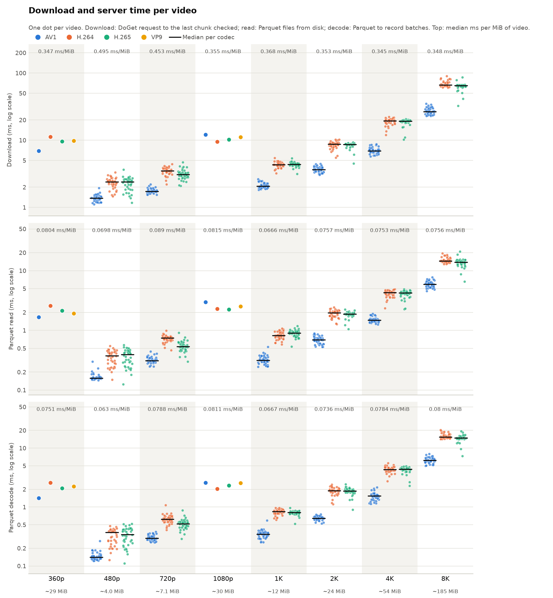

# Download time per video

## What to improve first

- **Encoding and sending messages: 5.43 s, 55% of the server send time.** Server send time outside read and decode: encoding the Flight messages (with LZ4, as mosaicod; it gains nothing on encoded video, see `--get-compression none`), sending them (over loopback here) and waiting for the client to check each chunk.
- Then: Parquet decode 2.25 s (23%), Parquet read 2.15 s (22%).

728 of 728 videos came back byte-identical. The server send time is 97% of the download time, and the downloads take 10.10 s against 12.72 s of upload.

Generated by `scripts/analyze.py`: one chart per video (728 in total) with its download time (one `DoGet`, from the request until the client has checked the last chunk against the video), the server send time and, inside it, the time the server spends reading the Parquet files from disk and decoding them. The upload time is shown for reference.

## All videos

In total the server spent 2.15 s reading Parquet files and 2.25 s decoding them, for 27.85 GiB of video.

## Big Buck Bunny · 360p · AV1

| Video | Size | Identical | Upload ms | Download ms | Server send ms | Read ms | Decode ms | Download ms/MiB | Chart |
|---|---:|:---:|---:|---:|---:|---:|---:|---:|---|
| `Big_Buck_Bunny_20MB_av1.mp4` | 20.13 MiB | yes | 12.6 | 7.0 | 6.7 | 1.7 | 1.4 | 0.35 | [chart](Big-Buck-Bunny/360p/AV1/Big_Buck_Bunny_20MB_av1.png) |

## Big Buck Bunny · 360p · H.264

| Video | Size | Identical | Upload ms | Download ms | Server send ms | Read ms | Decode ms | Download ms/MiB | Chart |
|---|---:|:---:|---:|---:|---:|---:|---:|---:|---|
| `Big_Buck_Bunny_30MB_h264.mp4` | 30.52 MiB | yes | 16.7 | 11.2 | 10.9 | 2.6 | 2.6 | 0.37 | [chart](Big-Buck-Bunny/360p/H.264/Big_Buck_Bunny_30MB_h264.png) |

## Big Buck Bunny · 360p · H.265

| Video | Size | Identical | Upload ms | Download ms | Server send ms | Read ms | Decode ms | Download ms/MiB | Chart |
|---|---:|:---:|---:|---:|---:|---:|---:|---:|---|
| `Big_Buck_Bunny_28MB_h265.mp4` | 27.74 MiB | yes | 14.5 | 9.6 | 9.3 | 2.1 | 2.1 | 0.35 | [chart](Big-Buck-Bunny/360p/H.265/Big_Buck_Bunny_28MB_h265.png) |

## Big Buck Bunny · 360p · VP9

| Video | Size | Identical | Upload ms | Download ms | Server send ms | Read ms | Decode ms | Download ms/MiB | Chart |
|---|---:|:---:|---:|---:|---:|---:|---:|---:|---|
| `Big_Buck_Bunny_30MB_vp9.webm` | 30.18 MiB | yes | 12.6 | 9.8 | 9.5 | 1.9 | 2.3 | 0.32 | [chart](Big-Buck-Bunny/360p/VP9/Big_Buck_Bunny_30MB_vp9.png) |

## Big Buck Bunny · 1080p · AV1

| Video | Size | Identical | Upload ms | Download ms | Server send ms | Read ms | Decode ms | Download ms/MiB | Chart |
|---|---:|:---:|---:|---:|---:|---:|---:|---:|---|
| `Big_Buck_Bunny_30MB_av1.mp4` | 30.06 MiB | yes | 20.3 | 12.2 | 11.9 | 3.0 | 2.6 | 0.41 | [chart](Big-Buck-Bunny/1080p/AV1/Big_Buck_Bunny_30MB_av1.png) |

## Big Buck Bunny · 1080p · H.264

| Video | Size | Identical | Upload ms | Download ms | Server send ms | Read ms | Decode ms | Download ms/MiB | Chart |
|---|---:|:---:|---:|---:|---:|---:|---:|---:|---|
| `Big_Buck_Bunny_30MB_h264.mp4` | 29.28 MiB | yes | 14.2 | 9.5 | 9.2 | 2.3 | 2.0 | 0.32 | [chart](Big-Buck-Bunny/1080p/H.264/Big_Buck_Bunny_30MB_h264.png) |

## Big Buck Bunny · 1080p · H.265

| Video | Size | Identical | Upload ms | Download ms | Server send ms | Read ms | Decode ms | Download ms/MiB | Chart |
|---|---:|:---:|---:|---:|---:|---:|---:|---:|---|
| `Big_Buck_Bunny_30MB_h265.mp4` | 30.00 MiB | yes | 13.5 | 10.2 | 10.0 | 2.2 | 2.3 | 0.34 | [chart](Big-Buck-Bunny/1080p/H.265/Big_Buck_Bunny_30MB_h265.png) |

## Big Buck Bunny · 1080p · VP9

| Video | Size | Identical | Upload ms | Download ms | Server send ms | Read ms | Decode ms | Download ms/MiB | Chart |
|---|---:|:---:|---:|---:|---:|---:|---:|---:|---|
| `Big_Buck_Bunny_30MB_vp9.webm` | 30.05 MiB | yes | 12.5 | 11.1 | 10.8 | 2.5 | 2.6 | 0.37 | [chart](Big-Buck-Bunny/1080p/VP9/Big_Buck_Bunny_30MB_vp9.png) |

## SEPE 8K · 480p · AV1

| Video | Size | Identical | Upload ms | Download ms | Server send ms | Read ms | Decode ms | Download ms/MiB | Chart |
|---|---:|:---:|---:|---:|---:|---:|---:|---:|---|
| `001_av1_480p.mp4` | 1.91 MiB | yes | 2.0 | 1.7 | 0.6 | 0.2 | 0.2 | 0.87 | [chart](SEPE-8K/480p/AV1/001_av1_480p.png) |
| `002_av1_480p.mp4` | 2.30 MiB | yes | 1.9 | 1.2 | 0.9 | 0.2 | 0.2 | 0.51 | [chart](SEPE-8K/480p/AV1/002_av1_480p.png) |
| `003_av1_480p.mp4` | 2.36 MiB | yes | 1.8 | 1.2 | 0.9 | 0.2 | 0.2 | 0.52 | [chart](SEPE-8K/480p/AV1/003_av1_480p.png) |
| `004_av1_480p.mp4` | 2.32 MiB | yes | 1.8 | 1.1 | 0.9 | 0.2 | 0.2 | 0.48 | [chart](SEPE-8K/480p/AV1/004_av1_480p.png) |
| `005_av1_480p.mp4` | 2.61 MiB | yes | 1.8 | 1.3 | 0.9 | 0.2 | 0.2 | 0.49 | [chart](SEPE-8K/480p/AV1/005_av1_480p.png) |
| `006_av1_480p.mp4` | 2.29 MiB | yes | 1.5 | 1.5 | 1.1 | 0.2 | 0.2 | 0.67 | [chart](SEPE-8K/480p/AV1/006_av1_480p.png) |
| `007_av1_480p.mp4` | 2.31 MiB | yes | 1.8 | 1.5 | 1.1 | 0.2 | 0.1 | 0.65 | [chart](SEPE-8K/480p/AV1/007_av1_480p.png) |
| `008_av1_480p.mp4` | 2.11 MiB | yes | 1.8 | 1.4 | 1.0 | 0.2 | 0.1 | 0.68 | [chart](SEPE-8K/480p/AV1/008_av1_480p.png) |
| `009_av1_480p.mp4` | 2.26 MiB | yes | 1.7 | 1.6 | 1.2 | 0.2 | 0.1 | 0.69 | [chart](SEPE-8K/480p/AV1/009_av1_480p.png) |
| `010_av1_480p.mp4` | 2.08 MiB | yes | 1.8 | 1.5 | 1.1 | 0.2 | 0.1 | 0.72 | [chart](SEPE-8K/480p/AV1/010_av1_480p.png) |
| `011_av1_480p.mp4` | 2.31 MiB | yes | 1.8 | 1.5 | 1.0 | 0.2 | 0.1 | 0.63 | [chart](SEPE-8K/480p/AV1/011_av1_480p.png) |
| `012_av1_480p.mp4` | 2.36 MiB | yes | 3.2 | 1.5 | 0.9 | 0.2 | 0.1 | 0.62 | [chart](SEPE-8K/480p/AV1/012_av1_480p.png) |
| `013_av1_480p.mp4` | 2.26 MiB | yes | 1.6 | 1.5 | 1.2 | 0.2 | 0.1 | 0.67 | [chart](SEPE-8K/480p/AV1/013_av1_480p.png) |
| `014_av1_480p.mp4` | 2.47 MiB | yes | 1.8 | 1.9 | 1.4 | 0.3 | 0.3 | 0.79 | [chart](SEPE-8K/480p/AV1/014_av1_480p.png) |
| `015_av1_480p.mp4` | 2.19 MiB | yes | 1.8 | 1.2 | 1.1 | 0.2 | 0.1 | 0.56 | [chart](SEPE-8K/480p/AV1/015_av1_480p.png) |
| `016_av1_480p.mp4` | 2.30 MiB | yes | 1.8 | 1.3 | 1.1 | 0.2 | 0.1 | 0.54 | [chart](SEPE-8K/480p/AV1/016_av1_480p.png) |
| `017_av1_480p.mp4` | 2.32 MiB | yes | 1.7 | 1.5 | 1.1 | 0.2 | 0.1 | 0.64 | [chart](SEPE-8K/480p/AV1/017_av1_480p.png) |
| `018_av1_480p.mp4` | 2.28 MiB | yes | 1.7 | 1.5 | 1.0 | 0.2 | 0.1 | 0.64 | [chart](SEPE-8K/480p/AV1/018_av1_480p.png) |
| `019_av1_480p.mp4` | 2.16 MiB | yes | 1.7 | 1.4 | 1.0 | 0.2 | 0.1 | 0.65 | [chart](SEPE-8K/480p/AV1/019_av1_480p.png) |
| `020_av1_480p.mp4` | 2.36 MiB | yes | 1.8 | 1.2 | 0.8 | 0.2 | 0.1 | 0.51 | [chart](SEPE-8K/480p/AV1/020_av1_480p.png) |
| `021_av1_480p.mp4` | 2.20 MiB | yes | 1.8 | 1.3 | 0.9 | 0.1 | 0.1 | 0.59 | [chart](SEPE-8K/480p/AV1/021_av1_480p.png) |
| `022_av1_480p.mp4` | 2.20 MiB | yes | 1.7 | 1.4 | 1.0 | 0.2 | 0.1 | 0.63 | [chart](SEPE-8K/480p/AV1/022_av1_480p.png) |
| `023_av1_480p.mp4` | 2.05 MiB | yes | 1.7 | 1.4 | 1.0 | 0.1 | 0.1 | 0.66 | [chart](SEPE-8K/480p/AV1/023_av1_480p.png) |
| `024_av1_480p.mp4` | 2.22 MiB | yes | 2.0 | 1.3 | 1.1 | 0.2 | 0.1 | 0.59 | [chart](SEPE-8K/480p/AV1/024_av1_480p.png) |
| `025_av1_480p.mp4` | 2.30 MiB | yes | 1.8 | 1.2 | 0.9 | 0.2 | 0.2 | 0.52 | [chart](SEPE-8K/480p/AV1/025_av1_480p.png) |
| `026_av1_480p.mp4` | 2.52 MiB | yes | 1.6 | 1.2 | 0.8 | 0.2 | 0.2 | 0.46 | [chart](SEPE-8K/480p/AV1/026_av1_480p.png) |
| `027_av1_480p.mp4` | 2.35 MiB | yes | 1.7 | 1.6 | 1.2 | 0.2 | 0.1 | 0.66 | [chart](SEPE-8K/480p/AV1/027_av1_480p.png) |
| `028_av1_480p.mp4` | 2.53 MiB | yes | 1.9 | 1.2 | 0.9 | 0.2 | 0.2 | 0.47 | [chart](SEPE-8K/480p/AV1/028_av1_480p.png) |
| `029_av1_480p.mp4` | 2.21 MiB | yes | 1.8 | 1.2 | 0.8 | 0.2 | 0.1 | 0.54 | [chart](SEPE-8K/480p/AV1/029_av1_480p.png) |
| `030_av1_480p.mp4` | 2.27 MiB | yes | 1.7 | 1.2 | 1.0 | 0.2 | 0.1 | 0.52 | [chart](SEPE-8K/480p/AV1/030_av1_480p.png) |
| `031_av1_480p.mp4` | 2.13 MiB | yes | 1.7 | 1.4 | 1.0 | 0.1 | 0.1 | 0.67 | [chart](SEPE-8K/480p/AV1/031_av1_480p.png) |
| `032_av1_480p.mp4` | 2.03 MiB | yes | 1.7 | 1.3 | 0.6 | 0.2 | 0.1 | 0.66 | [chart](SEPE-8K/480p/AV1/032_av1_480p.png) |
| `033_av1_480p.mp4` | 2.02 MiB | yes | 1.6 | 1.3 | 0.6 | 0.1 | 0.1 | 0.67 | [chart](SEPE-8K/480p/AV1/033_av1_480p.png) |
| `034_av1_480p.mp4` | 2.18 MiB | yes | 1.8 | 1.4 | 1.0 | 0.2 | 0.1 | 0.63 | [chart](SEPE-8K/480p/AV1/034_av1_480p.png) |
| `035_av1_480p.mp4` | 2.36 MiB | yes | 1.7 | 1.6 | 1.3 | 0.2 | 0.1 | 0.66 | [chart](SEPE-8K/480p/AV1/035_av1_480p.png) |
| `036_av1_480p.mp4` | 2.24 MiB | yes | 1.7 | 1.4 | 1.0 | 0.1 | 0.1 | 0.62 | [chart](SEPE-8K/480p/AV1/036_av1_480p.png) |
| `037_av1_480p.mp4` | 2.17 MiB | yes | 1.7 | 1.4 | 1.0 | 0.2 | 0.1 | 0.64 | [chart](SEPE-8K/480p/AV1/037_av1_480p.png) |
| `038_av1_480p.mp4` | 2.56 MiB | yes | 1.9 | 1.3 | 1.1 | 0.2 | 0.1 | 0.53 | [chart](SEPE-8K/480p/AV1/038_av1_480p.png) |
| `039_av1_480p.mp4` | 2.06 MiB | yes | 1.7 | 1.3 | 0.8 | 0.2 | 0.1 | 0.64 | [chart](SEPE-8K/480p/AV1/039_av1_480p.png) |
| `040_av1_480p.mp4` | 2.59 MiB | yes | 1.8 | 1.6 | 0.9 | 0.2 | 0.1 | 0.62 | [chart](SEPE-8K/480p/AV1/040_av1_480p.png) |

## SEPE 8K · 480p · H.264

| Video | Size | Identical | Upload ms | Download ms | Server send ms | Read ms | Decode ms | Download ms/MiB | Chart |
|---|---:|:---:|---:|---:|---:|---:|---:|---:|---|
| `001_h264_480p.mp4` | 5.36 MiB | yes | 3.8 | 2.6 | 2.4 | 0.5 | 0.4 | 0.49 | [chart](SEPE-8K/480p/H.264/001_h264_480p.png) |
| `002_h264_480p.mp4` | 2.57 MiB | yes | 2.0 | 1.5 | 0.9 | 0.2 | 0.2 | 0.59 | [chart](SEPE-8K/480p/H.264/002_h264_480p.png) |
| `003_h264_480p.mp4` | 5.50 MiB | yes | 3.6 | 2.3 | 1.8 | 0.5 | 0.4 | 0.41 | [chart](SEPE-8K/480p/H.264/003_h264_480p.png) |
| `004_h264_480p.mp4` | 3.25 MiB | yes | 4.9 | 1.7 | 1.5 | 0.2 | 0.2 | 0.53 | [chart](SEPE-8K/480p/H.264/004_h264_480p.png) |
| `005_h264_480p.mp4` | 6.91 MiB | yes | 4.3 | 3.0 | 2.5 | 0.5 | 0.5 | 0.43 | [chart](SEPE-8K/480p/H.264/005_h264_480p.png) |
| `006_h264_480p.mp4` | 4.70 MiB | yes | 3.1 | 2.2 | 1.7 | 0.3 | 0.3 | 0.46 | [chart](SEPE-8K/480p/H.264/006_h264_480p.png) |
| `007_h264_480p.mp4` | 5.03 MiB | yes | 3.2 | 2.4 | 2.2 | 0.3 | 0.3 | 0.48 | [chart](SEPE-8K/480p/H.264/007_h264_480p.png) |
| `008_h264_480p.mp4` | 5.96 MiB | yes | 3.7 | 2.4 | 2.0 | 0.4 | 0.4 | 0.41 | [chart](SEPE-8K/480p/H.264/008_h264_480p.png) |
| `009_h264_480p.mp4` | 6.36 MiB | yes | 3.8 | 2.5 | 2.2 | 0.4 | 0.4 | 0.40 | [chart](SEPE-8K/480p/H.264/009_h264_480p.png) |
| `010_h264_480p.mp4` | 4.21 MiB | yes | 2.9 | 1.8 | 1.5 | 0.3 | 0.3 | 0.43 | [chart](SEPE-8K/480p/H.264/010_h264_480p.png) |
| `011_h264_480p.mp4` | 4.54 MiB | yes | 2.9 | 2.0 | 1.6 | 0.3 | 0.3 | 0.44 | [chart](SEPE-8K/480p/H.264/011_h264_480p.png) |
| `012_h264_480p.mp4` | 3.80 MiB | yes | 2.5 | 2.2 | 1.3 | 0.2 | 0.2 | 0.59 | [chart](SEPE-8K/480p/H.264/012_h264_480p.png) |
| `013_h264_480p.mp4` | 6.52 MiB | yes | 6.4 | 3.0 | 2.6 | 0.4 | 0.4 | 0.47 | [chart](SEPE-8K/480p/H.264/013_h264_480p.png) |
| `014_h264_480p.mp4` | 6.23 MiB | yes | 5.1 | 2.5 | 2.3 | 0.5 | 0.4 | 0.40 | [chart](SEPE-8K/480p/H.264/014_h264_480p.png) |
| `015_h264_480p.mp4` | 6.50 MiB | yes | 4.0 | 2.8 | 2.2 | 0.5 | 0.4 | 0.42 | [chart](SEPE-8K/480p/H.264/015_h264_480p.png) |
| `016_h264_480p.mp4` | 6.40 MiB | yes | 4.0 | 2.8 | 2.4 | 0.4 | 0.4 | 0.43 | [chart](SEPE-8K/480p/H.264/016_h264_480p.png) |
| `017_h264_480p.mp4` | 6.13 MiB | yes | 5.8 | 2.5 | 2.3 | 0.4 | 0.4 | 0.42 | [chart](SEPE-8K/480p/H.264/017_h264_480p.png) |
| `018_h264_480p.mp4` | 4.28 MiB | yes | 2.9 | 2.5 | 1.9 | 0.3 | 0.2 | 0.58 | [chart](SEPE-8K/480p/H.264/018_h264_480p.png) |
| `019_h264_480p.mp4` | 5.29 MiB | yes | 3.4 | 2.4 | 2.1 | 0.4 | 0.4 | 0.46 | [chart](SEPE-8K/480p/H.264/019_h264_480p.png) |
| `020_h264_480p.mp4` | 3.53 MiB | yes | 2.5 | 2.2 | 1.6 | 0.2 | 0.2 | 0.61 | [chart](SEPE-8K/480p/H.264/020_h264_480p.png) |
| `021_h264_480p.mp4` | 5.86 MiB | yes | 4.3 | 2.5 | 2.1 | 0.4 | 0.4 | 0.42 | [chart](SEPE-8K/480p/H.264/021_h264_480p.png) |
| `022_h264_480p.mp4` | 5.77 MiB | yes | 3.6 | 2.5 | 2.1 | 0.4 | 0.4 | 0.43 | [chart](SEPE-8K/480p/H.264/022_h264_480p.png) |
| `023_h264_480p.mp4` | 5.09 MiB | yes | 3.6 | 2.3 | 2.1 | 0.4 | 0.3 | 0.45 | [chart](SEPE-8K/480p/H.264/023_h264_480p.png) |
| `024_h264_480p.mp4` | 4.16 MiB | yes | 2.9 | 1.9 | 1.7 | 0.3 | 0.3 | 0.46 | [chart](SEPE-8K/480p/H.264/024_h264_480p.png) |
| `025_h264_480p.mp4` | 6.24 MiB | yes | 4.1 | 2.4 | 2.1 | 0.4 | 0.4 | 0.38 | [chart](SEPE-8K/480p/H.264/025_h264_480p.png) |
| `026_h264_480p.mp4` | 7.10 MiB | yes | 4.6 | 2.8 | 2.5 | 0.5 | 0.5 | 0.39 | [chart](SEPE-8K/480p/H.264/026_h264_480p.png) |
| `027_h264_480p.mp4` | 3.48 MiB | yes | 2.3 | 2.1 | 1.7 | 0.2 | 0.2 | 0.59 | [chart](SEPE-8K/480p/H.264/027_h264_480p.png) |
| `028_h264_480p.mp4` | 6.99 MiB | yes | 4.4 | 2.9 | 2.4 | 0.5 | 0.4 | 0.41 | [chart](SEPE-8K/480p/H.264/028_h264_480p.png) |
| `029_h264_480p.mp4` | 2.29 MiB | yes | 1.7 | 1.5 | 1.0 | 0.1 | 0.1 | 0.64 | [chart](SEPE-8K/480p/H.264/029_h264_480p.png) |
| `030_h264_480p.mp4` | 6.44 MiB | yes | 4.0 | 2.6 | 2.2 | 0.4 | 0.4 | 0.40 | [chart](SEPE-8K/480p/H.264/030_h264_480p.png) |
| `031_h264_480p.mp4` | 5.26 MiB | yes | 2.8 | 2.2 | 1.9 | 0.4 | 0.3 | 0.42 | [chart](SEPE-8K/480p/H.264/031_h264_480p.png) |
| `032_h264_480p.mp4` | 5.88 MiB | yes | 4.6 | 2.3 | 1.9 | 0.4 | 0.4 | 0.40 | [chart](SEPE-8K/480p/H.264/032_h264_480p.png) |
| `033_h264_480p.mp4` | 4.61 MiB | yes | 3.1 | 2.3 | 1.9 | 0.3 | 0.3 | 0.50 | [chart](SEPE-8K/480p/H.264/033_h264_480p.png) |
| `034_h264_480p.mp4` | 4.93 MiB | yes | 3.1 | 2.2 | 1.6 | 0.3 | 0.3 | 0.45 | [chart](SEPE-8K/480p/H.264/034_h264_480p.png) |
| `035_h264_480p.mp4` | 3.94 MiB | yes | 2.8 | 2.4 | 1.3 | 0.2 | 0.2 | 0.61 | [chart](SEPE-8K/480p/H.264/035_h264_480p.png) |
| `036_h264_480p.mp4` | 5.93 MiB | yes | 3.7 | 2.5 | 2.0 | 0.4 | 0.4 | 0.42 | [chart](SEPE-8K/480p/H.264/036_h264_480p.png) |
| `037_h264_480p.mp4` | 3.23 MiB | yes | 2.3 | 1.6 | 1.4 | 0.2 | 0.2 | 0.48 | [chart](SEPE-8K/480p/H.264/037_h264_480p.png) |
| `038_h264_480p.mp4` | 6.76 MiB | yes | 4.1 | 2.7 | 2.3 | 0.5 | 0.4 | 0.40 | [chart](SEPE-8K/480p/H.264/038_h264_480p.png) |
| `039_h264_480p.mp4` | 3.34 MiB | yes | 2.3 | 1.7 | 1.5 | 0.2 | 0.2 | 0.52 | [chart](SEPE-8K/480p/H.264/039_h264_480p.png) |
| `040_h264_480p.mp4` | 6.72 MiB | yes | 4.3 | 3.3 | 2.9 | 0.4 | 0.4 | 0.50 | [chart](SEPE-8K/480p/H.264/040_h264_480p.png) |

## SEPE 8K · 480p · H.265

| Video | Size | Identical | Upload ms | Download ms | Server send ms | Read ms | Decode ms | Download ms/MiB | Chart |
|---|---:|:---:|---:|---:|---:|---:|---:|---:|---|
| `001_hevc_480p.mp4` | 5.46 MiB | yes | 3.9 | 2.5 | 2.1 | 0.4 | 0.4 | 0.46 | [chart](SEPE-8K/480p/H.265/001_hevc_480p.png) |
| `002_hevc_480p.mp4` | 2.28 MiB | yes | 2.1 | 1.2 | 0.9 | 0.2 | 0.2 | 0.52 | [chart](SEPE-8K/480p/H.265/002_hevc_480p.png) |
| `003_hevc_480p.mp4` | 5.47 MiB | yes | 3.6 | 2.3 | 1.9 | 0.4 | 0.3 | 0.43 | [chart](SEPE-8K/480p/H.265/003_hevc_480p.png) |
| `004_hevc_480p.mp4` | 3.11 MiB | yes | 2.3 | 1.7 | 1.5 | 0.2 | 0.2 | 0.53 | [chart](SEPE-8K/480p/H.265/004_hevc_480p.png) |
| `005_hevc_480p.mp4` | 6.68 MiB | yes | 4.7 | 2.9 | 2.3 | 0.6 | 0.5 | 0.43 | [chart](SEPE-8K/480p/H.265/005_hevc_480p.png) |
| `006_hevc_480p.mp4` | 3.55 MiB | yes | 2.4 | 1.9 | 1.5 | 0.2 | 0.2 | 0.52 | [chart](SEPE-8K/480p/H.265/006_hevc_480p.png) |
| `007_hevc_480p.mp4` | 4.72 MiB | yes | 3.0 | 2.1 | 1.6 | 0.3 | 0.3 | 0.45 | [chart](SEPE-8K/480p/H.265/007_hevc_480p.png) |
| `008_hevc_480p.mp4` | 6.04 MiB | yes | 4.0 | 2.5 | 2.3 | 0.4 | 0.4 | 0.41 | [chart](SEPE-8K/480p/H.265/008_hevc_480p.png) |
| `009_hevc_480p.mp4` | 6.18 MiB | yes | 4.0 | 2.3 | 2.1 | 0.4 | 0.4 | 0.38 | [chart](SEPE-8K/480p/H.265/009_hevc_480p.png) |
| `010_hevc_480p.mp4` | 4.28 MiB | yes | 3.0 | 2.2 | 1.6 | 0.4 | 0.3 | 0.51 | [chart](SEPE-8K/480p/H.265/010_hevc_480p.png) |
| `011_hevc_480p.mp4` | 3.93 MiB | yes | 2.6 | 1.8 | 1.4 | 0.3 | 0.2 | 0.47 | [chart](SEPE-8K/480p/H.265/011_hevc_480p.png) |
| `012_hevc_480p.mp4` | 3.66 MiB | yes | 2.3 | 1.9 | 1.5 | 0.2 | 0.2 | 0.52 | [chart](SEPE-8K/480p/H.265/012_hevc_480p.png) |
| `013_hevc_480p.mp4` | 6.43 MiB | yes | 3.9 | 2.6 | 2.1 | 0.5 | 0.4 | 0.40 | [chart](SEPE-8K/480p/H.265/013_hevc_480p.png) |
| `014_hevc_480p.mp4` | 6.52 MiB | yes | 4.0 | 2.7 | 2.3 | 0.5 | 0.5 | 0.42 | [chart](SEPE-8K/480p/H.265/014_hevc_480p.png) |
| `015_hevc_480p.mp4` | 6.44 MiB | yes | 3.9 | 2.7 | 2.4 | 0.4 | 0.4 | 0.42 | [chart](SEPE-8K/480p/H.265/015_hevc_480p.png) |
| `016_hevc_480p.mp4` | 6.33 MiB | yes | 3.8 | 2.5 | 2.2 | 0.4 | 0.5 | 0.39 | [chart](SEPE-8K/480p/H.265/016_hevc_480p.png) |
| `017_hevc_480p.mp4` | 6.18 MiB | yes | 3.3 | 2.4 | 2.1 | 0.5 | 0.4 | 0.39 | [chart](SEPE-8K/480p/H.265/017_hevc_480p.png) |
| `018_hevc_480p.mp4` | 3.79 MiB | yes | 2.1 | 1.6 | 1.2 | 0.2 | 0.3 | 0.41 | [chart](SEPE-8K/480p/H.265/018_hevc_480p.png) |
| `019_hevc_480p.mp4` | 5.25 MiB | yes | 3.0 | 2.5 | 2.2 | 0.4 | 0.4 | 0.47 | [chart](SEPE-8K/480p/H.265/019_hevc_480p.png) |
| `020_hevc_480p.mp4` | 3.91 MiB | yes | 2.4 | 2.0 | 1.6 | 0.4 | 0.3 | 0.52 | [chart](SEPE-8K/480p/H.265/020_hevc_480p.png) |
| `021_hevc_480p.mp4` | 6.01 MiB | yes | 3.6 | 2.4 | 2.0 | 0.4 | 0.4 | 0.40 | [chart](SEPE-8K/480p/H.265/021_hevc_480p.png) |
| `022_hevc_480p.mp4` | 5.29 MiB | yes | 3.5 | 2.2 | 1.9 | 0.4 | 0.3 | 0.42 | [chart](SEPE-8K/480p/H.265/022_hevc_480p.png) |
| `023_hevc_480p.mp4` | 5.04 MiB | yes | 3.4 | 2.2 | 1.9 | 0.3 | 0.3 | 0.43 | [chart](SEPE-8K/480p/H.265/023_hevc_480p.png) |
| `024_hevc_480p.mp4` | 4.46 MiB | yes | 2.9 | 2.6 | 2.1 | 0.3 | 0.3 | 0.59 | [chart](SEPE-8K/480p/H.265/024_hevc_480p.png) |
| `025_hevc_480p.mp4` | 6.39 MiB | yes | 4.4 | 2.6 | 2.2 | 0.5 | 0.4 | 0.41 | [chart](SEPE-8K/480p/H.265/025_hevc_480p.png) |
| `026_hevc_480p.mp4` | 6.92 MiB | yes | 4.1 | 2.6 | 2.2 | 0.5 | 0.5 | 0.38 | [chart](SEPE-8K/480p/H.265/026_hevc_480p.png) |
| `027_hevc_480p.mp4` | 4.24 MiB | yes | 2.5 | 1.8 | 1.5 | 0.3 | 0.3 | 0.44 | [chart](SEPE-8K/480p/H.265/027_hevc_480p.png) |
| `028_hevc_480p.mp4` | 6.85 MiB | yes | 5.6 | 2.6 | 2.2 | 0.5 | 0.4 | 0.38 | [chart](SEPE-8K/480p/H.265/028_hevc_480p.png) |
| `029_hevc_480p.mp4` | 2.00 MiB | yes | 1.6 | 1.4 | 0.6 | 0.1 | 0.1 | 0.69 | [chart](SEPE-8K/480p/H.265/029_hevc_480p.png) |
| `030_hevc_480p.mp4` | 6.15 MiB | yes | 4.0 | 3.6 | 3.3 | 0.4 | 0.4 | 0.59 | [chart](SEPE-8K/480p/H.265/030_hevc_480p.png) |
| `031_hevc_480p.mp4` | 4.86 MiB | yes | 3.2 | 2.5 | 1.9 | 0.3 | 0.3 | 0.51 | [chart](SEPE-8K/480p/H.265/031_hevc_480p.png) |
| `032_hevc_480p.mp4` | 5.99 MiB | yes | 3.7 | 2.4 | 2.0 | 0.4 | 0.4 | 0.41 | [chart](SEPE-8K/480p/H.265/032_hevc_480p.png) |
| `033_hevc_480p.mp4` | 3.99 MiB | yes | 2.6 | 2.3 | 1.7 | 0.2 | 0.2 | 0.59 | [chart](SEPE-8K/480p/H.265/033_hevc_480p.png) |
| `034_hevc_480p.mp4` | 4.72 MiB | yes | 3.0 | 2.7 | 2.0 | 0.3 | 0.3 | 0.57 | [chart](SEPE-8K/480p/H.265/034_hevc_480p.png) |
| `035_hevc_480p.mp4` | 3.19 MiB | yes | 2.3 | 1.5 | 1.3 | 0.3 | 0.2 | 0.48 | [chart](SEPE-8K/480p/H.265/035_hevc_480p.png) |
| `036_hevc_480p.mp4` | 6.01 MiB | yes | 4.0 | 2.5 | 2.1 | 0.4 | 0.4 | 0.41 | [chart](SEPE-8K/480p/H.265/036_hevc_480p.png) |
| `037_hevc_480p.mp4` | 3.13 MiB | yes | 2.3 | 1.5 | 1.2 | 0.2 | 0.2 | 0.47 | [chart](SEPE-8K/480p/H.265/037_hevc_480p.png) |
| `038_hevc_480p.mp4` | 6.85 MiB | yes | 4.1 | 2.9 | 2.4 | 0.5 | 0.4 | 0.42 | [chart](SEPE-8K/480p/H.265/038_hevc_480p.png) |
| `039_hevc_480p.mp4` | 3.01 MiB | yes | 2.3 | 1.6 | 1.1 | 0.2 | 0.2 | 0.54 | [chart](SEPE-8K/480p/H.265/039_hevc_480p.png) |
| `040_hevc_480p.mp4` | 6.62 MiB | yes | 4.0 | 2.8 | 2.5 | 0.5 | 0.4 | 0.42 | [chart](SEPE-8K/480p/H.265/040_hevc_480p.png) |

## SEPE 8K · 720p · AV1

| Video | Size | Identical | Upload ms | Download ms | Server send ms | Read ms | Decode ms | Download ms/MiB | Chart |
|---|---:|:---:|---:|---:|---:|---:|---:|---:|---|
| `001_av1_720p.mp4` | 2.97 MiB | yes | 2.4 | 1.7 | 1.2 | 0.3 | 0.3 | 0.56 | [chart](SEPE-8K/720p/AV1/001_av1_720p.png) |
| `002_av1_720p.mp4` | 3.44 MiB | yes | 2.5 | 1.8 | 1.4 | 0.4 | 0.3 | 0.51 | [chart](SEPE-8K/720p/AV1/002_av1_720p.png) |
| `003_av1_720p.mp4` | 3.54 MiB | yes | 2.6 | 1.9 | 1.6 | 0.4 | 0.4 | 0.55 | [chart](SEPE-8K/720p/AV1/003_av1_720p.png) |
| `004_av1_720p.mp4` | 3.52 MiB | yes | 2.3 | 1.8 | 1.4 | 0.3 | 0.4 | 0.51 | [chart](SEPE-8K/720p/AV1/004_av1_720p.png) |
| `005_av1_720p.mp4` | 3.88 MiB | yes | 2.4 | 2.0 | 1.5 | 0.3 | 0.3 | 0.51 | [chart](SEPE-8K/720p/AV1/005_av1_720p.png) |
| `006_av1_720p.mp4` | 2.87 MiB | yes | 1.9 | 1.6 | 1.1 | 0.3 | 0.3 | 0.55 | [chart](SEPE-8K/720p/AV1/006_av1_720p.png) |
| `007_av1_720p.mp4` | 3.48 MiB | yes | 2.4 | 1.8 | 1.4 | 0.3 | 0.3 | 0.52 | [chart](SEPE-8K/720p/AV1/007_av1_720p.png) |
| `008_av1_720p.mp4` | 3.13 MiB | yes | 2.2 | 1.8 | 1.4 | 0.4 | 0.3 | 0.56 | [chart](SEPE-8K/720p/AV1/008_av1_720p.png) |
| `009_av1_720p.mp4` | 3.33 MiB | yes | 2.4 | 1.9 | 1.5 | 0.3 | 0.4 | 0.56 | [chart](SEPE-8K/720p/AV1/009_av1_720p.png) |
| `010_av1_720p.mp4` | 3.02 MiB | yes | 2.5 | 1.6 | 1.3 | 0.3 | 0.3 | 0.53 | [chart](SEPE-8K/720p/AV1/010_av1_720p.png) |
| `011_av1_720p.mp4` | 3.46 MiB | yes | 2.3 | 1.7 | 1.4 | 0.3 | 0.3 | 0.49 | [chart](SEPE-8K/720p/AV1/011_av1_720p.png) |
| `012_av1_720p.mp4` | 3.55 MiB | yes | 2.5 | 1.7 | 1.4 | 0.3 | 0.3 | 0.49 | [chart](SEPE-8K/720p/AV1/012_av1_720p.png) |
| `013_av1_720p.mp4` | 3.32 MiB | yes | 2.2 | 1.6 | 1.3 | 0.3 | 0.3 | 0.49 | [chart](SEPE-8K/720p/AV1/013_av1_720p.png) |
| `014_av1_720p.mp4` | 3.84 MiB | yes | 3.6 | 1.9 | 1.5 | 0.3 | 0.3 | 0.49 | [chart](SEPE-8K/720p/AV1/014_av1_720p.png) |
| `015_av1_720p.mp4` | 3.32 MiB | yes | 2.7 | 1.7 | 1.4 | 0.3 | 0.3 | 0.51 | [chart](SEPE-8K/720p/AV1/015_av1_720p.png) |
| `016_av1_720p.mp4` | 3.37 MiB | yes | 2.4 | 1.7 | 1.3 | 0.3 | 0.3 | 0.51 | [chart](SEPE-8K/720p/AV1/016_av1_720p.png) |
| `017_av1_720p.mp4` | 2.90 MiB | yes | 2.3 | 1.6 | 1.2 | 0.2 | 0.3 | 0.56 | [chart](SEPE-8K/720p/AV1/017_av1_720p.png) |
| `018_av1_720p.mp4` | 3.41 MiB | yes | 2.4 | 1.8 | 1.4 | 0.3 | 0.3 | 0.52 | [chart](SEPE-8K/720p/AV1/018_av1_720p.png) |
| `019_av1_720p.mp4` | 3.42 MiB | yes | 2.5 | 1.7 | 1.4 | 0.3 | 0.3 | 0.50 | [chart](SEPE-8K/720p/AV1/019_av1_720p.png) |
| `020_av1_720p.mp4` | 3.10 MiB | yes | 2.4 | 1.7 | 1.3 | 0.3 | 0.3 | 0.55 | [chart](SEPE-8K/720p/AV1/020_av1_720p.png) |
| `021_av1_720p.mp4` | 3.32 MiB | yes | 2.2 | 1.8 | 1.4 | 0.3 | 0.3 | 0.53 | [chart](SEPE-8K/720p/AV1/021_av1_720p.png) |
| `022_av1_720p.mp4` | 3.29 MiB | yes | 2.4 | 1.7 | 1.4 | 0.3 | 0.3 | 0.52 | [chart](SEPE-8K/720p/AV1/022_av1_720p.png) |
| `023_av1_720p.mp4` | 3.01 MiB | yes | 2.7 | 1.8 | 1.4 | 0.3 | 0.3 | 0.60 | [chart](SEPE-8K/720p/AV1/023_av1_720p.png) |
| `024_av1_720p.mp4` | 2.85 MiB | yes | 2.2 | 1.8 | 1.3 | 0.3 | 0.3 | 0.63 | [chart](SEPE-8K/720p/AV1/024_av1_720p.png) |
| `025_av1_720p.mp4` | 3.60 MiB | yes | 3.0 | 2.1 | 1.7 | 0.4 | 0.4 | 0.58 | [chart](SEPE-8K/720p/AV1/025_av1_720p.png) |
| `026_av1_720p.mp4` | 3.82 MiB | yes | 4.4 | 2.2 | 1.8 | 0.4 | 0.4 | 0.58 | [chart](SEPE-8K/720p/AV1/026_av1_720p.png) |
| `027_av1_720p.mp4` | 3.23 MiB | yes | 2.5 | 1.8 | 1.6 | 0.3 | 0.3 | 0.56 | [chart](SEPE-8K/720p/AV1/027_av1_720p.png) |
| `028_av1_720p.mp4` | 3.85 MiB | yes | 2.6 | 2.0 | 1.6 | 0.4 | 0.3 | 0.52 | [chart](SEPE-8K/720p/AV1/028_av1_720p.png) |
| `029_av1_720p.mp4` | 3.49 MiB | yes | 2.3 | 1.7 | 1.3 | 0.3 | 0.3 | 0.49 | [chart](SEPE-8K/720p/AV1/029_av1_720p.png) |
| `030_av1_720p.mp4` | 3.43 MiB | yes | 2.3 | 1.7 | 1.4 | 0.3 | 0.3 | 0.48 | [chart](SEPE-8K/720p/AV1/030_av1_720p.png) |
| `031_av1_720p.mp4` | 3.24 MiB | yes | 2.5 | 1.6 | 1.3 | 0.3 | 0.3 | 0.50 | [chart](SEPE-8K/720p/AV1/031_av1_720p.png) |
| `032_av1_720p.mp4` | 3.04 MiB | yes | 2.2 | 1.5 | 1.3 | 0.2 | 0.3 | 0.51 | [chart](SEPE-8K/720p/AV1/032_av1_720p.png) |
| `033_av1_720p.mp4` | 3.29 MiB | yes | 2.3 | 1.5 | 1.2 | 0.3 | 0.3 | 0.47 | [chart](SEPE-8K/720p/AV1/033_av1_720p.png) |
| `034_av1_720p.mp4` | 3.51 MiB | yes | 2.5 | 1.9 | 1.4 | 0.4 | 0.3 | 0.53 | [chart](SEPE-8K/720p/AV1/034_av1_720p.png) |
| `035_av1_720p.mp4` | 3.56 MiB | yes | 2.5 | 1.7 | 1.3 | 0.3 | 0.3 | 0.49 | [chart](SEPE-8K/720p/AV1/035_av1_720p.png) |
| `036_av1_720p.mp4` | 3.18 MiB | yes | 2.4 | 1.6 | 1.3 | 0.3 | 0.3 | 0.51 | [chart](SEPE-8K/720p/AV1/036_av1_720p.png) |
| `037_av1_720p.mp4` | 3.41 MiB | yes | 2.5 | 1.7 | 1.4 | 0.3 | 0.3 | 0.50 | [chart](SEPE-8K/720p/AV1/037_av1_720p.png) |
| `038_av1_720p.mp4` | 3.91 MiB | yes | 2.5 | 2.0 | 1.5 | 0.4 | 0.4 | 0.50 | [chart](SEPE-8K/720p/AV1/038_av1_720p.png) |
| `039_av1_720p.mp4` | 3.57 MiB | yes | 2.2 | 1.7 | 1.3 | 0.3 | 0.3 | 0.48 | [chart](SEPE-8K/720p/AV1/039_av1_720p.png) |
| `040_av1_720p.mp4` | 3.83 MiB | yes | 2.5 | 1.7 | 1.3 | 0.4 | 0.3 | 0.45 | [chart](SEPE-8K/720p/AV1/040_av1_720p.png) |

## SEPE 8K · 720p · H.264

| Video | Size | Identical | Upload ms | Download ms | Server send ms | Read ms | Decode ms | Download ms/MiB | Chart |
|---|---:|:---:|---:|---:|---:|---:|---:|---:|---|
| `001_h264_720p.mp4` | 7.62 MiB | yes | 4.9 | 3.6 | 3.1 | 0.8 | 0.8 | 0.47 | [chart](SEPE-8K/720p/H.264/001_h264_720p.png) |
| `002_h264_720p.mp4` | 4.49 MiB | yes | 3.4 | 2.2 | 1.9 | 0.5 | 0.4 | 0.49 | [chart](SEPE-8K/720p/H.264/002_h264_720p.png) |
| `003_h264_720p.mp4` | 7.81 MiB | yes | 4.1 | 3.4 | 3.0 | 0.8 | 0.6 | 0.44 | [chart](SEPE-8K/720p/H.264/003_h264_720p.png) |
| `004_h264_720p.mp4` | 6.14 MiB | yes | 4.0 | 2.8 | 2.5 | 0.6 | 0.5 | 0.46 | [chart](SEPE-8K/720p/H.264/004_h264_720p.png) |
| `005_h264_720p.mp4` | 8.87 MiB | yes | 6.1 | 4.0 | 3.6 | 0.9 | 0.8 | 0.45 | [chart](SEPE-8K/720p/H.264/005_h264_720p.png) |
| `006_h264_720p.mp4` | 7.70 MiB | yes | 4.6 | 3.3 | 3.0 | 0.7 | 0.6 | 0.43 | [chart](SEPE-8K/720p/H.264/006_h264_720p.png) |
| `007_h264_720p.mp4` | 7.66 MiB | yes | 4.5 | 3.4 | 3.0 | 0.7 | 0.6 | 0.44 | [chart](SEPE-8K/720p/H.264/007_h264_720p.png) |
| `008_h264_720p.mp4` | 8.04 MiB | yes | 5.5 | 3.5 | 3.3 | 0.8 | 0.6 | 0.44 | [chart](SEPE-8K/720p/H.264/008_h264_720p.png) |
| `009_h264_720p.mp4` | 8.68 MiB | yes | 5.4 | 3.9 | 3.5 | 0.8 | 0.7 | 0.45 | [chart](SEPE-8K/720p/H.264/009_h264_720p.png) |
| `010_h264_720p.mp4` | 6.31 MiB | yes | 4.4 | 3.2 | 2.5 | 0.6 | 0.5 | 0.51 | [chart](SEPE-8K/720p/H.264/010_h264_720p.png) |
| `011_h264_720p.mp4` | 7.41 MiB | yes | 4.8 | 3.4 | 3.0 | 0.8 | 0.6 | 0.45 | [chart](SEPE-8K/720p/H.264/011_h264_720p.png) |
| `012_h264_720p.mp4` | 6.16 MiB | yes | 3.5 | 2.8 | 2.6 | 0.6 | 0.5 | 0.46 | [chart](SEPE-8K/720p/H.264/012_h264_720p.png) |
| `013_h264_720p.mp4` | 8.69 MiB | yes | 5.4 | 3.9 | 3.5 | 0.8 | 0.7 | 0.45 | [chart](SEPE-8K/720p/H.264/013_h264_720p.png) |
| `014_h264_720p.mp4` | 8.05 MiB | yes | 5.4 | 3.6 | 3.3 | 0.7 | 0.6 | 0.45 | [chart](SEPE-8K/720p/H.264/014_h264_720p.png) |
| `015_h264_720p.mp4` | 8.82 MiB | yes | 5.3 | 3.8 | 3.4 | 0.8 | 0.6 | 0.43 | [chart](SEPE-8K/720p/H.264/015_h264_720p.png) |
| `016_h264_720p.mp4` | 8.59 MiB | yes | 5.5 | 4.4 | 4.1 | 1.0 | 1.1 | 0.52 | [chart](SEPE-8K/720p/H.264/016_h264_720p.png) |
| `017_h264_720p.mp4` | 8.65 MiB | yes | 5.0 | 3.7 | 3.3 | 0.8 | 0.6 | 0.43 | [chart](SEPE-8K/720p/H.264/017_h264_720p.png) |
| `018_h264_720p.mp4` | 6.96 MiB | yes | 4.5 | 2.9 | 2.5 | 0.6 | 0.5 | 0.42 | [chart](SEPE-8K/720p/H.264/018_h264_720p.png) |
| `019_h264_720p.mp4` | 8.01 MiB | yes | 4.9 | 3.5 | 3.2 | 0.7 | 0.7 | 0.44 | [chart](SEPE-8K/720p/H.264/019_h264_720p.png) |
| `020_h264_720p.mp4` | 6.80 MiB | yes | 5.6 | 3.1 | 2.7 | 0.7 | 0.6 | 0.45 | [chart](SEPE-8K/720p/H.264/020_h264_720p.png) |
| `021_h264_720p.mp4` | 8.04 MiB | yes | 5.1 | 3.4 | 3.2 | 0.7 | 0.6 | 0.43 | [chart](SEPE-8K/720p/H.264/021_h264_720p.png) |
| `022_h264_720p.mp4` | 8.13 MiB | yes | 4.3 | 3.9 | 3.6 | 0.8 | 0.8 | 0.48 | [chart](SEPE-8K/720p/H.264/022_h264_720p.png) |
| `023_h264_720p.mp4` | 7.27 MiB | yes | 4.2 | 3.2 | 2.9 | 0.6 | 0.6 | 0.44 | [chart](SEPE-8K/720p/H.264/023_h264_720p.png) |
| `024_h264_720p.mp4` | 8.39 MiB | yes | 4.3 | 3.6 | 3.2 | 0.7 | 0.7 | 0.43 | [chart](SEPE-8K/720p/H.264/024_h264_720p.png) |
| `025_h264_720p.mp4` | 8.38 MiB | yes | 4.8 | 3.6 | 3.2 | 0.7 | 0.6 | 0.42 | [chart](SEPE-8K/720p/H.264/025_h264_720p.png) |
| `026_h264_720p.mp4` | 9.45 MiB | yes | 6.0 | 4.1 | 3.8 | 0.8 | 0.7 | 0.44 | [chart](SEPE-8K/720p/H.264/026_h264_720p.png) |
| `027_h264_720p.mp4` | 7.73 MiB | yes | 7.3 | 3.4 | 3.0 | 0.8 | 0.6 | 0.44 | [chart](SEPE-8K/720p/H.264/027_h264_720p.png) |
| `028_h264_720p.mp4` | 9.48 MiB | yes | 6.1 | 4.1 | 3.7 | 0.9 | 0.7 | 0.44 | [chart](SEPE-8K/720p/H.264/028_h264_720p.png) |
| `029_h264_720p.mp4` | 5.16 MiB | yes | 3.1 | 2.5 | 2.2 | 0.5 | 0.4 | 0.49 | [chart](SEPE-8K/720p/H.264/029_h264_720p.png) |
| `030_h264_720p.mp4` | 8.44 MiB | yes | 5.0 | 3.8 | 3.5 | 0.8 | 0.7 | 0.45 | [chart](SEPE-8K/720p/H.264/030_h264_720p.png) |
| `031_h264_720p.mp4` | 7.65 MiB | yes | 4.8 | 3.5 | 3.1 | 0.7 | 0.6 | 0.45 | [chart](SEPE-8K/720p/H.264/031_h264_720p.png) |
| `032_h264_720p.mp4` | 7.65 MiB | yes | 4.7 | 3.4 | 3.0 | 0.7 | 0.6 | 0.44 | [chart](SEPE-8K/720p/H.264/032_h264_720p.png) |
| `033_h264_720p.mp4` | 7.77 MiB | yes | 5.0 | 3.7 | 3.3 | 0.8 | 0.6 | 0.47 | [chart](SEPE-8K/720p/H.264/033_h264_720p.png) |
| `034_h264_720p.mp4` | 7.66 MiB | yes | 4.3 | 3.5 | 3.2 | 0.7 | 0.6 | 0.46 | [chart](SEPE-8K/720p/H.264/034_h264_720p.png) |
| `035_h264_720p.mp4` | 7.40 MiB | yes | 5.7 | 3.3 | 2.9 | 0.7 | 0.6 | 0.45 | [chart](SEPE-8K/720p/H.264/035_h264_720p.png) |
| `036_h264_720p.mp4` | 8.43 MiB | yes | 4.9 | 3.7 | 3.3 | 0.8 | 0.7 | 0.44 | [chart](SEPE-8K/720p/H.264/036_h264_720p.png) |
| `037_h264_720p.mp4` | 6.96 MiB | yes | 4.3 | 3.5 | 3.1 | 0.7 | 0.6 | 0.51 | [chart](SEPE-8K/720p/H.264/037_h264_720p.png) |
| `038_h264_720p.mp4` | 8.81 MiB | yes | 5.2 | 4.0 | 3.5 | 0.8 | 0.7 | 0.45 | [chart](SEPE-8K/720p/H.264/038_h264_720p.png) |
| `039_h264_720p.mp4` | 7.29 MiB | yes | 4.6 | 3.1 | 2.8 | 0.7 | 0.6 | 0.43 | [chart](SEPE-8K/720p/H.264/039_h264_720p.png) |
| `040_h264_720p.mp4` | 8.60 MiB | yes | 5.1 | 3.8 | 3.4 | 0.8 | 0.7 | 0.44 | [chart](SEPE-8K/720p/H.264/040_h264_720p.png) |

## SEPE 8K · 720p · H.265

| Video | Size | Identical | Upload ms | Download ms | Server send ms | Read ms | Decode ms | Download ms/MiB | Chart |
|---|---:|:---:|---:|---:|---:|---:|---:|---:|---|
| `001_hevc_720p.mp4` | 8.07 MiB | yes | 8.1 | 3.8 | 3.5 | 0.8 | 0.9 | 0.48 | [chart](SEPE-8K/720p/H.265/001_hevc_720p.png) |
| `002_hevc_720p.mp4` | 3.96 MiB | yes | 2.8 | 2.1 | 1.5 | 0.4 | 0.3 | 0.53 | [chart](SEPE-8K/720p/H.265/002_hevc_720p.png) |
| `003_hevc_720p.mp4` | 7.86 MiB | yes | 5.8 | 4.1 | 3.6 | 0.9 | 0.7 | 0.52 | [chart](SEPE-8K/720p/H.265/003_hevc_720p.png) |
| `004_hevc_720p.mp4` | 5.67 MiB | yes | 3.8 | 2.5 | 2.0 | 0.5 | 0.5 | 0.43 | [chart](SEPE-8K/720p/H.265/004_hevc_720p.png) |
| `005_hevc_720p.mp4` | 8.63 MiB | yes | 5.1 | 4.7 | 4.2 | 0.6 | 0.5 | 0.55 | [chart](SEPE-8K/720p/H.265/005_hevc_720p.png) |
| `006_hevc_720p.mp4` | 6.84 MiB | yes | 7.6 | 3.1 | 2.6 | 0.4 | 0.4 | 0.45 | [chart](SEPE-8K/720p/H.265/006_hevc_720p.png) |
| `007_hevc_720p.mp4` | 7.42 MiB | yes | 4.3 | 3.1 | 2.7 | 0.5 | 0.5 | 0.42 | [chart](SEPE-8K/720p/H.265/007_hevc_720p.png) |
| `008_hevc_720p.mp4` | 7.91 MiB | yes | 4.9 | 3.3 | 2.9 | 0.5 | 0.5 | 0.41 | [chart](SEPE-8K/720p/H.265/008_hevc_720p.png) |
| `009_hevc_720p.mp4` | 8.57 MiB | yes | 5.1 | 3.1 | 2.7 | 0.7 | 0.6 | 0.36 | [chart](SEPE-8K/720p/H.265/009_hevc_720p.png) |
| `010_hevc_720p.mp4` | 6.33 MiB | yes | 3.9 | 2.5 | 2.2 | 0.5 | 0.4 | 0.39 | [chart](SEPE-8K/720p/H.265/010_hevc_720p.png) |
| `011_hevc_720p.mp4` | 6.70 MiB | yes | 4.0 | 2.8 | 2.2 | 0.5 | 0.4 | 0.42 | [chart](SEPE-8K/720p/H.265/011_hevc_720p.png) |
| `012_hevc_720p.mp4` | 5.84 MiB | yes | 4.4 | 2.4 | 1.9 | 0.4 | 0.4 | 0.41 | [chart](SEPE-8K/720p/H.265/012_hevc_720p.png) |
| `013_hevc_720p.mp4` | 8.68 MiB | yes | 5.0 | 4.0 | 3.7 | 0.6 | 0.6 | 0.46 | [chart](SEPE-8K/720p/H.265/013_hevc_720p.png) |
| `014_hevc_720p.mp4` | 8.52 MiB | yes | 5.2 | 3.2 | 2.8 | 0.7 | 0.6 | 0.38 | [chart](SEPE-8K/720p/H.265/014_hevc_720p.png) |
| `015_hevc_720p.mp4` | 8.70 MiB | yes | 5.2 | 3.3 | 2.9 | 0.6 | 0.6 | 0.38 | [chart](SEPE-8K/720p/H.265/015_hevc_720p.png) |
| `016_hevc_720p.mp4` | 8.26 MiB | yes | 4.6 | 3.3 | 2.7 | 0.6 | 0.5 | 0.40 | [chart](SEPE-8K/720p/H.265/016_hevc_720p.png) |
| `017_hevc_720p.mp4` | 8.48 MiB | yes | 4.8 | 3.5 | 2.9 | 0.6 | 0.6 | 0.42 | [chart](SEPE-8K/720p/H.265/017_hevc_720p.png) |
| `018_hevc_720p.mp4` | 6.66 MiB | yes | 4.1 | 2.7 | 2.2 | 0.5 | 0.4 | 0.40 | [chart](SEPE-8K/720p/H.265/018_hevc_720p.png) |
| `019_hevc_720p.mp4` | 7.92 MiB | yes | 4.7 | 2.9 | 2.5 | 0.6 | 0.5 | 0.37 | [chart](SEPE-8K/720p/H.265/019_hevc_720p.png) |
| `020_hevc_720p.mp4` | 7.01 MiB | yes | 4.2 | 2.8 | 2.3 | 0.5 | 0.5 | 0.40 | [chart](SEPE-8K/720p/H.265/020_hevc_720p.png) |
| `021_hevc_720p.mp4` | 7.92 MiB | yes | 4.6 | 3.6 | 3.2 | 0.5 | 0.5 | 0.46 | [chart](SEPE-8K/720p/H.265/021_hevc_720p.png) |
| `022_hevc_720p.mp4` | 7.88 MiB | yes | 5.0 | 2.9 | 2.5 | 0.6 | 0.6 | 0.37 | [chart](SEPE-8K/720p/H.265/022_hevc_720p.png) |
| `023_hevc_720p.mp4` | 7.08 MiB | yes | 4.5 | 2.9 | 2.6 | 0.5 | 0.5 | 0.41 | [chart](SEPE-8K/720p/H.265/023_hevc_720p.png) |
| `024_hevc_720p.mp4` | 8.30 MiB | yes | 5.0 | 3.1 | 2.8 | 0.6 | 0.5 | 0.37 | [chart](SEPE-8K/720p/H.265/024_hevc_720p.png) |
| `025_hevc_720p.mp4` | 8.63 MiB | yes | 5.3 | 3.3 | 2.8 | 0.6 | 0.6 | 0.38 | [chart](SEPE-8K/720p/H.265/025_hevc_720p.png) |
| `026_hevc_720p.mp4` | 9.39 MiB | yes | 5.6 | 3.4 | 3.1 | 0.7 | 0.6 | 0.36 | [chart](SEPE-8K/720p/H.265/026_hevc_720p.png) |
| `027_hevc_720p.mp4` | 8.07 MiB | yes | 5.1 | 3.0 | 2.7 | 0.6 | 0.5 | 0.38 | [chart](SEPE-8K/720p/H.265/027_hevc_720p.png) |
| `028_hevc_720p.mp4` | 9.64 MiB | yes | 5.6 | 4.0 | 3.5 | 0.6 | 0.6 | 0.42 | [chart](SEPE-8K/720p/H.265/028_hevc_720p.png) |
| `029_hevc_720p.mp4` | 4.58 MiB | yes | 3.1 | 2.1 | 1.8 | 0.3 | 0.3 | 0.47 | [chart](SEPE-8K/720p/H.265/029_hevc_720p.png) |
| `030_hevc_720p.mp4` | 8.06 MiB | yes | 5.0 | 3.4 | 3.1 | 0.5 | 0.5 | 0.42 | [chart](SEPE-8K/720p/H.265/030_hevc_720p.png) |
| `031_hevc_720p.mp4` | 7.34 MiB | yes | 4.2 | 2.7 | 2.3 | 0.5 | 0.5 | 0.37 | [chart](SEPE-8K/720p/H.265/031_hevc_720p.png) |
| `032_hevc_720p.mp4` | 7.82 MiB | yes | 4.2 | 2.8 | 2.4 | 0.5 | 0.6 | 0.36 | [chart](SEPE-8K/720p/H.265/032_hevc_720p.png) |
| `033_hevc_720p.mp4` | 7.21 MiB | yes | 4.5 | 3.0 | 2.7 | 0.5 | 0.5 | 0.41 | [chart](SEPE-8K/720p/H.265/033_hevc_720p.png) |
| `034_hevc_720p.mp4` | 7.37 MiB | yes | 4.4 | 2.9 | 2.6 | 0.5 | 0.5 | 0.39 | [chart](SEPE-8K/720p/H.265/034_hevc_720p.png) |
| `035_hevc_720p.mp4` | 6.91 MiB | yes | 6.0 | 3.0 | 2.4 | 0.5 | 0.4 | 0.43 | [chart](SEPE-8K/720p/H.265/035_hevc_720p.png) |
| `036_hevc_720p.mp4` | 8.26 MiB | yes | 5.0 | 3.0 | 2.7 | 0.6 | 0.7 | 0.37 | [chart](SEPE-8K/720p/H.265/036_hevc_720p.png) |
| `037_hevc_720p.mp4` | 7.03 MiB | yes | 3.9 | 2.7 | 2.5 | 0.5 | 0.4 | 0.39 | [chart](SEPE-8K/720p/H.265/037_hevc_720p.png) |
| `038_hevc_720p.mp4` | 8.94 MiB | yes | 5.1 | 3.3 | 2.8 | 0.6 | 0.6 | 0.37 | [chart](SEPE-8K/720p/H.265/038_hevc_720p.png) |
| `039_hevc_720p.mp4` | 7.40 MiB | yes | 4.4 | 3.2 | 2.8 | 0.5 | 0.5 | 0.43 | [chart](SEPE-8K/720p/H.265/039_hevc_720p.png) |
| `040_hevc_720p.mp4` | 8.57 MiB | yes | 5.1 | 3.3 | 2.8 | 0.6 | 0.6 | 0.39 | [chart](SEPE-8K/720p/H.265/040_hevc_720p.png) |

## SEPE 8K · 1K · AV1

| Video | Size | Identical | Upload ms | Download ms | Server send ms | Read ms | Decode ms | Download ms/MiB | Chart |
|---|---:|:---:|---:|---:|---:|---:|---:|---:|---|
| `001_av1_1K.mp4` | 4.74 MiB | yes | 4.7 | 2.0 | 1.7 | 0.4 | 0.4 | 0.43 | [chart](SEPE-8K/1K/AV1/001_av1_1K.png) |
| `002_av1_1K.mp4` | 5.31 MiB | yes | 2.8 | 2.3 | 2.1 | 0.4 | 0.6 | 0.43 | [chart](SEPE-8K/1K/AV1/002_av1_1K.png) |
| `003_av1_1K.mp4` | 5.28 MiB | yes | 4.6 | 2.1 | 1.8 | 0.3 | 0.4 | 0.39 | [chart](SEPE-8K/1K/AV1/003_av1_1K.png) |
| `004_av1_1K.mp4` | 5.28 MiB | yes | 3.0 | 2.0 | 1.8 | 0.4 | 0.4 | 0.38 | [chart](SEPE-8K/1K/AV1/004_av1_1K.png) |
| `005_av1_1K.mp4` | 5.75 MiB | yes | 3.1 | 2.2 | 1.8 | 0.4 | 0.4 | 0.38 | [chart](SEPE-8K/1K/AV1/005_av1_1K.png) |
| `006_av1_1K.mp4` | 4.79 MiB | yes | 5.2 | 2.0 | 1.5 | 0.3 | 0.3 | 0.41 | [chart](SEPE-8K/1K/AV1/006_av1_1K.png) |
| `007_av1_1K.mp4` | 5.16 MiB | yes | 2.7 | 2.0 | 1.7 | 0.4 | 0.3 | 0.39 | [chart](SEPE-8K/1K/AV1/007_av1_1K.png) |
| `008_av1_1K.mp4` | 4.75 MiB | yes | 4.2 | 1.9 | 1.5 | 0.3 | 0.3 | 0.39 | [chart](SEPE-8K/1K/AV1/008_av1_1K.png) |
| `009_av1_1K.mp4` | 5.00 MiB | yes | 2.8 | 2.4 | 1.9 | 0.5 | 0.4 | 0.49 | [chart](SEPE-8K/1K/AV1/009_av1_1K.png) |
| `010_av1_1K.mp4` | 4.64 MiB | yes | 3.6 | 1.8 | 1.5 | 0.3 | 0.3 | 0.40 | [chart](SEPE-8K/1K/AV1/010_av1_1K.png) |
| `011_av1_1K.mp4` | 5.03 MiB | yes | 2.7 | 1.9 | 1.7 | 0.4 | 0.4 | 0.38 | [chart](SEPE-8K/1K/AV1/011_av1_1K.png) |
| `012_av1_1K.mp4` | 5.33 MiB | yes | 3.0 | 2.1 | 1.7 | 0.4 | 0.4 | 0.40 | [chart](SEPE-8K/1K/AV1/012_av1_1K.png) |
| `013_av1_1K.mp4` | 5.32 MiB | yes | 2.8 | 2.1 | 1.8 | 0.4 | 0.4 | 0.40 | [chart](SEPE-8K/1K/AV1/013_av1_1K.png) |
| `014_av1_1K.mp4` | 5.70 MiB | yes | 3.1 | 2.3 | 1.8 | 0.4 | 0.3 | 0.40 | [chart](SEPE-8K/1K/AV1/014_av1_1K.png) |
| `015_av1_1K.mp4` | 5.14 MiB | yes | 3.0 | 2.0 | 1.7 | 0.3 | 0.4 | 0.38 | [chart](SEPE-8K/1K/AV1/015_av1_1K.png) |
| `016_av1_1K.mp4` | 5.02 MiB | yes | 3.0 | 2.0 | 1.6 | 0.3 | 0.3 | 0.39 | [chart](SEPE-8K/1K/AV1/016_av1_1K.png) |
| `017_av1_1K.mp4` | 4.74 MiB | yes | 3.0 | 1.9 | 1.5 | 0.3 | 0.3 | 0.40 | [chart](SEPE-8K/1K/AV1/017_av1_1K.png) |
| `018_av1_1K.mp4` | 5.20 MiB | yes | 2.8 | 2.2 | 1.9 | 0.3 | 0.3 | 0.42 | [chart](SEPE-8K/1K/AV1/018_av1_1K.png) |
| `019_av1_1K.mp4` | 5.31 MiB | yes | 2.8 | 2.1 | 1.8 | 0.3 | 0.3 | 0.39 | [chart](SEPE-8K/1K/AV1/019_av1_1K.png) |
| `020_av1_1K.mp4` | 5.06 MiB | yes | 2.9 | 2.0 | 1.8 | 0.3 | 0.4 | 0.40 | [chart](SEPE-8K/1K/AV1/020_av1_1K.png) |
| `021_av1_1K.mp4` | 4.86 MiB | yes | 4.3 | 1.9 | 1.5 | 0.3 | 0.3 | 0.39 | [chart](SEPE-8K/1K/AV1/021_av1_1K.png) |
| `022_av1_1K.mp4` | 4.93 MiB | yes | 5.7 | 2.1 | 1.7 | 0.4 | 0.4 | 0.43 | [chart](SEPE-8K/1K/AV1/022_av1_1K.png) |
| `023_av1_1K.mp4` | 4.87 MiB | yes | 5.2 | 2.1 | 1.6 | 0.3 | 0.3 | 0.43 | [chart](SEPE-8K/1K/AV1/023_av1_1K.png) |
| `024_av1_1K.mp4` | 4.41 MiB | yes | 2.8 | 2.3 | 1.9 | 0.2 | 0.3 | 0.52 | [chart](SEPE-8K/1K/AV1/024_av1_1K.png) |
| `025_av1_1K.mp4` | 4.74 MiB | yes | 2.9 | 1.9 | 1.5 | 0.3 | 0.3 | 0.40 | [chart](SEPE-8K/1K/AV1/025_av1_1K.png) |
| `026_av1_1K.mp4` | 5.77 MiB | yes | 5.0 | 2.2 | 1.9 | 0.3 | 0.4 | 0.39 | [chart](SEPE-8K/1K/AV1/026_av1_1K.png) |
| `027_av1_1K.mp4` | 4.74 MiB | yes | 5.5 | 2.6 | 2.0 | 0.3 | 0.3 | 0.56 | [chart](SEPE-8K/1K/AV1/027_av1_1K.png) |
| `028_av1_1K.mp4` | 5.83 MiB | yes | 6.0 | 2.5 | 1.9 | 0.3 | 0.4 | 0.43 | [chart](SEPE-8K/1K/AV1/028_av1_1K.png) |
| `029_av1_1K.mp4` | 4.78 MiB | yes | 5.4 | 2.1 | 1.6 | 0.3 | 0.3 | 0.44 | [chart](SEPE-8K/1K/AV1/029_av1_1K.png) |
| `030_av1_1K.mp4` | 5.17 MiB | yes | 3.2 | 2.1 | 1.9 | 0.3 | 0.3 | 0.41 | [chart](SEPE-8K/1K/AV1/030_av1_1K.png) |
| `031_av1_1K.mp4` | 4.83 MiB | yes | 4.8 | 2.0 | 1.6 | 0.3 | 0.3 | 0.42 | [chart](SEPE-8K/1K/AV1/031_av1_1K.png) |
| `032_av1_1K.mp4` | 4.60 MiB | yes | 2.9 | 1.9 | 1.5 | 0.3 | 0.3 | 0.42 | [chart](SEPE-8K/1K/AV1/032_av1_1K.png) |
| `033_av1_1K.mp4` | 4.32 MiB | yes | 2.8 | 2.3 | 2.0 | 0.3 | 0.3 | 0.54 | [chart](SEPE-8K/1K/AV1/033_av1_1K.png) |
| `034_av1_1K.mp4` | 5.36 MiB | yes | 3.1 | 2.4 | 2.2 | 0.3 | 0.4 | 0.45 | [chart](SEPE-8K/1K/AV1/034_av1_1K.png) |
| `035_av1_1K.mp4` | 5.18 MiB | yes | 3.1 | 2.0 | 1.8 | 0.3 | 0.4 | 0.39 | [chart](SEPE-8K/1K/AV1/035_av1_1K.png) |
| `036_av1_1K.mp4` | 4.81 MiB | yes | 5.5 | 2.0 | 1.6 | 0.3 | 0.3 | 0.41 | [chart](SEPE-8K/1K/AV1/036_av1_1K.png) |
| `037_av1_1K.mp4` | 5.27 MiB | yes | 3.5 | 2.2 | 1.9 | 0.4 | 0.4 | 0.41 | [chart](SEPE-8K/1K/AV1/037_av1_1K.png) |
| `038_av1_1K.mp4` | 6.09 MiB | yes | 3.8 | 2.5 | 2.3 | 0.4 | 0.4 | 0.41 | [chart](SEPE-8K/1K/AV1/038_av1_1K.png) |
| `039_av1_1K.mp4` | 4.24 MiB | yes | 2.9 | 2.0 | 1.6 | 0.2 | 0.3 | 0.47 | [chart](SEPE-8K/1K/AV1/039_av1_1K.png) |
| `040_av1_1K.mp4` | 5.86 MiB | yes | 5.2 | 2.4 | 2.0 | 0.3 | 0.4 | 0.42 | [chart](SEPE-8K/1K/AV1/040_av1_1K.png) |

## SEPE 8K · 1K · H.264

| Video | Size | Identical | Upload ms | Download ms | Server send ms | Read ms | Decode ms | Download ms/MiB | Chart |
|---|---:|:---:|---:|---:|---:|---:|---:|---:|---|
| `001_h264_1K.mp4` | 12.16 MiB | yes | 8.1 | 4.3 | 4.0 | 1.0 | 0.8 | 0.35 | [chart](SEPE-8K/1K/H.264/001_h264_1K.png) |
| `002_h264_1K.mp4` | 8.71 MiB | yes | 8.9 | 3.2 | 2.7 | 0.6 | 0.6 | 0.37 | [chart](SEPE-8K/1K/H.264/002_h264_1K.png) |
| `003_h264_1K.mp4` | 11.61 MiB | yes | 6.8 | 4.3 | 4.0 | 0.8 | 0.8 | 0.37 | [chart](SEPE-8K/1K/H.264/003_h264_1K.png) |
| `004_h264_1K.mp4` | 10.44 MiB | yes | 5.8 | 3.7 | 3.3 | 0.8 | 0.7 | 0.35 | [chart](SEPE-8K/1K/H.264/004_h264_1K.png) |
| `005_h264_1K.mp4` | 13.26 MiB | yes | 7.6 | 4.8 | 4.3 | 0.8 | 0.9 | 0.36 | [chart](SEPE-8K/1K/H.264/005_h264_1K.png) |
| `006_h264_1K.mp4` | 12.39 MiB | yes | 6.6 | 4.4 | 4.0 | 0.7 | 0.8 | 0.35 | [chart](SEPE-8K/1K/H.264/006_h264_1K.png) |
| `007_h264_1K.mp4` | 12.37 MiB | yes | 6.8 | 4.5 | 4.0 | 0.7 | 0.8 | 0.36 | [chart](SEPE-8K/1K/H.264/007_h264_1K.png) |
| `008_h264_1K.mp4` | 12.22 MiB | yes | 6.4 | 4.2 | 3.9 | 0.7 | 0.9 | 0.34 | [chart](SEPE-8K/1K/H.264/008_h264_1K.png) |
| `009_h264_1K.mp4` | 13.06 MiB | yes | 6.6 | 4.5 | 4.3 | 0.8 | 0.9 | 0.35 | [chart](SEPE-8K/1K/H.264/009_h264_1K.png) |
| `010_h264_1K.mp4` | 9.78 MiB | yes | 5.1 | 3.6 | 3.1 | 0.6 | 0.6 | 0.37 | [chart](SEPE-8K/1K/H.264/010_h264_1K.png) |
| `011_h264_1K.mp4` | 11.94 MiB | yes | 6.1 | 4.4 | 3.8 | 0.8 | 0.8 | 0.37 | [chart](SEPE-8K/1K/H.264/011_h264_1K.png) |
| `012_h264_1K.mp4` | 9.97 MiB | yes | 8.1 | 3.9 | 3.4 | 0.6 | 0.6 | 0.39 | [chart](SEPE-8K/1K/H.264/012_h264_1K.png) |
| `013_h264_1K.mp4` | 13.44 MiB | yes | 7.0 | 4.6 | 4.2 | 1.0 | 0.9 | 0.34 | [chart](SEPE-8K/1K/H.264/013_h264_1K.png) |
| `014_h264_1K.mp4` | 12.16 MiB | yes | 6.7 | 4.1 | 3.9 | 0.8 | 0.9 | 0.34 | [chart](SEPE-8K/1K/H.264/014_h264_1K.png) |
| `015_h264_1K.mp4` | 13.90 MiB | yes | 7.3 | 4.9 | 4.4 | 0.9 | 0.9 | 0.35 | [chart](SEPE-8K/1K/H.264/015_h264_1K.png) |
| `016_h264_1K.mp4` | 13.02 MiB | yes | 6.7 | 4.6 | 4.2 | 0.9 | 0.9 | 0.36 | [chart](SEPE-8K/1K/H.264/016_h264_1K.png) |
| `017_h264_1K.mp4` | 13.40 MiB | yes | 10.4 | 4.5 | 4.1 | 0.8 | 0.9 | 0.34 | [chart](SEPE-8K/1K/H.264/017_h264_1K.png) |
| `018_h264_1K.mp4` | 11.00 MiB | yes | 5.6 | 3.9 | 3.3 | 0.7 | 0.8 | 0.35 | [chart](SEPE-8K/1K/H.264/018_h264_1K.png) |
| `019_h264_1K.mp4` | 12.16 MiB | yes | 6.4 | 4.3 | 4.0 | 0.8 | 0.9 | 0.35 | [chart](SEPE-8K/1K/H.264/019_h264_1K.png) |
| `020_h264_1K.mp4` | 11.52 MiB | yes | 6.2 | 3.9 | 3.5 | 0.8 | 0.8 | 0.34 | [chart](SEPE-8K/1K/H.264/020_h264_1K.png) |
| `021_h264_1K.mp4` | 12.45 MiB | yes | 6.4 | 4.3 | 3.9 | 0.8 | 0.9 | 0.35 | [chart](SEPE-8K/1K/H.264/021_h264_1K.png) |
| `022_h264_1K.mp4` | 12.53 MiB | yes | 6.5 | 4.2 | 3.8 | 0.8 | 0.8 | 0.33 | [chart](SEPE-8K/1K/H.264/022_h264_1K.png) |
| `023_h264_1K.mp4` | 11.56 MiB | yes | 6.3 | 4.1 | 3.8 | 0.7 | 0.8 | 0.36 | [chart](SEPE-8K/1K/H.264/023_h264_1K.png) |
| `024_h264_1K.mp4` | 13.13 MiB | yes | 7.3 | 4.7 | 4.4 | 0.8 | 0.9 | 0.36 | [chart](SEPE-8K/1K/H.264/024_h264_1K.png) |
| `025_h264_1K.mp4` | 12.04 MiB | yes | 6.1 | 4.4 | 4.2 | 0.7 | 0.8 | 0.37 | [chart](SEPE-8K/1K/H.264/025_h264_1K.png) |
| `026_h264_1K.mp4` | 14.39 MiB | yes | 7.5 | 4.8 | 4.5 | 0.8 | 1.0 | 0.33 | [chart](SEPE-8K/1K/H.264/026_h264_1K.png) |
| `027_h264_1K.mp4` | 12.67 MiB | yes | 8.7 | 4.3 | 3.9 | 0.8 | 0.8 | 0.34 | [chart](SEPE-8K/1K/H.264/027_h264_1K.png) |
| `028_h264_1K.mp4` | 14.59 MiB | yes | 10.0 | 5.4 | 5.0 | 0.9 | 0.9 | 0.37 | [chart](SEPE-8K/1K/H.264/028_h264_1K.png) |
| `029_h264_1K.mp4` | 10.26 MiB | yes | 5.5 | 3.8 | 3.5 | 0.6 | 0.7 | 0.37 | [chart](SEPE-8K/1K/H.264/029_h264_1K.png) |
| `030_h264_1K.mp4` | 12.79 MiB | yes | 7.0 | 4.9 | 4.4 | 1.1 | 1.0 | 0.38 | [chart](SEPE-8K/1K/H.264/030_h264_1K.png) |
| `031_h264_1K.mp4` | 12.03 MiB | yes | 7.0 | 4.3 | 4.0 | 0.9 | 0.8 | 0.36 | [chart](SEPE-8K/1K/H.264/031_h264_1K.png) |
| `032_h264_1K.mp4` | 11.59 MiB | yes | 7.3 | 4.1 | 3.7 | 0.8 | 0.8 | 0.35 | [chart](SEPE-8K/1K/H.264/032_h264_1K.png) |
| `033_h264_1K.mp4` | 12.75 MiB | yes | 10.9 | 4.8 | 4.1 | 1.0 | 0.9 | 0.37 | [chart](SEPE-8K/1K/H.264/033_h264_1K.png) |
| `034_h264_1K.mp4` | 12.14 MiB | yes | 6.5 | 4.9 | 4.6 | 0.9 | 0.7 | 0.40 | [chart](SEPE-8K/1K/H.264/034_h264_1K.png) |
| `035_h264_1K.mp4` | 12.68 MiB | yes | 7.1 | 4.3 | 4.0 | 1.0 | 0.9 | 0.34 | [chart](SEPE-8K/1K/H.264/035_h264_1K.png) |
| `036_h264_1K.mp4` | 12.86 MiB | yes | 6.8 | 4.5 | 4.1 | 1.0 | 0.9 | 0.35 | [chart](SEPE-8K/1K/H.264/036_h264_1K.png) |
| `037_h264_1K.mp4` | 12.60 MiB | yes | 6.4 | 4.3 | 3.9 | 1.0 | 0.8 | 0.34 | [chart](SEPE-8K/1K/H.264/037_h264_1K.png) |
| `038_h264_1K.mp4` | 13.22 MiB | yes | 7.0 | 4.6 | 4.3 | 1.0 | 0.8 | 0.35 | [chart](SEPE-8K/1K/H.264/038_h264_1K.png) |
| `039_h264_1K.mp4` | 11.68 MiB | yes | 6.1 | 4.2 | 3.7 | 0.8 | 0.8 | 0.36 | [chart](SEPE-8K/1K/H.264/039_h264_1K.png) |
| `040_h264_1K.mp4` | 12.93 MiB | yes | 9.9 | 4.4 | 3.9 | 0.9 | 0.9 | 0.34 | [chart](SEPE-8K/1K/H.264/040_h264_1K.png) |

## SEPE 8K · 1K · H.265

| Video | Size | Identical | Upload ms | Download ms | Server send ms | Read ms | Decode ms | Download ms/MiB | Chart |
|---|---:|:---:|---:|---:|---:|---:|---:|---:|---|
| `001_hevc_1K.mp4` | 12.56 MiB | yes | 9.9 | 5.4 | 4.9 | 1.2 | 1.0 | 0.43 | [chart](SEPE-8K/1K/H.265/001_hevc_1K.png) |
| `002_hevc_1K.mp4` | 7.75 MiB | yes | 5.4 | 3.2 | 2.8 | 0.5 | 0.5 | 0.41 | [chart](SEPE-8K/1K/H.265/002_hevc_1K.png) |
| `003_hevc_1K.mp4` | 12.07 MiB | yes | 7.1 | 4.3 | 4.0 | 1.0 | 0.8 | 0.36 | [chart](SEPE-8K/1K/H.265/003_hevc_1K.png) |
| `004_hevc_1K.mp4` | 11.43 MiB | yes | 6.8 | 4.7 | 4.2 | 1.1 | 0.8 | 0.41 | [chart](SEPE-8K/1K/H.265/004_hevc_1K.png) |
| `005_hevc_1K.mp4` | 12.58 MiB | yes | 9.1 | 4.7 | 4.0 | 1.1 | 0.8 | 0.38 | [chart](SEPE-8K/1K/H.265/005_hevc_1K.png) |
| `006_hevc_1K.mp4` | 12.52 MiB | yes | 7.1 | 4.4 | 4.0 | 1.0 | 0.8 | 0.35 | [chart](SEPE-8K/1K/H.265/006_hevc_1K.png) |
| `007_hevc_1K.mp4` | 12.28 MiB | yes | 8.0 | 4.4 | 3.9 | 0.8 | 0.8 | 0.36 | [chart](SEPE-8K/1K/H.265/007_hevc_1K.png) |
| `008_hevc_1K.mp4` | 12.33 MiB | yes | 7.2 | 4.4 | 4.1 | 0.7 | 0.9 | 0.36 | [chart](SEPE-8K/1K/H.265/008_hevc_1K.png) |
| `009_hevc_1K.mp4` | 12.64 MiB | yes | 8.7 | 4.5 | 4.1 | 0.8 | 0.9 | 0.36 | [chart](SEPE-8K/1K/H.265/009_hevc_1K.png) |
| `010_hevc_1K.mp4` | 11.69 MiB | yes | 8.8 | 3.9 | 3.5 | 0.8 | 0.8 | 0.34 | [chart](SEPE-8K/1K/H.265/010_hevc_1K.png) |
| `011_hevc_1K.mp4` | 11.17 MiB | yes | 6.1 | 4.3 | 3.9 | 0.9 | 0.8 | 0.38 | [chart](SEPE-8K/1K/H.265/011_hevc_1K.png) |
| `012_hevc_1K.mp4` | 10.35 MiB | yes | 9.3 | 3.7 | 3.3 | 0.9 | 0.7 | 0.36 | [chart](SEPE-8K/1K/H.265/012_hevc_1K.png) |
| `013_hevc_1K.mp4` | 12.56 MiB | yes | 6.4 | 4.4 | 3.9 | 1.0 | 0.8 | 0.35 | [chart](SEPE-8K/1K/H.265/013_hevc_1K.png) |
| `014_hevc_1K.mp4` | 12.66 MiB | yes | 6.5 | 4.2 | 3.9 | 1.0 | 0.8 | 0.34 | [chart](SEPE-8K/1K/H.265/014_hevc_1K.png) |
| `015_hevc_1K.mp4` | 12.51 MiB | yes | 6.0 | 4.5 | 4.1 | 0.9 | 0.8 | 0.36 | [chart](SEPE-8K/1K/H.265/015_hevc_1K.png) |
| `016_hevc_1K.mp4` | 12.63 MiB | yes | 8.9 | 4.6 | 4.2 | 1.0 | 0.9 | 0.37 | [chart](SEPE-8K/1K/H.265/016_hevc_1K.png) |
| `017_hevc_1K.mp4` | 12.56 MiB | yes | 6.6 | 4.8 | 4.4 | 0.9 | 0.8 | 0.38 | [chart](SEPE-8K/1K/H.265/017_hevc_1K.png) |
| `018_hevc_1K.mp4` | 11.72 MiB | yes | 10.9 | 4.4 | 3.7 | 0.8 | 0.8 | 0.38 | [chart](SEPE-8K/1K/H.265/018_hevc_1K.png) |
| `019_hevc_1K.mp4` | 12.22 MiB | yes | 7.2 | 4.5 | 4.2 | 0.8 | 0.8 | 0.37 | [chart](SEPE-8K/1K/H.265/019_hevc_1K.png) |
| `020_hevc_1K.mp4` | 12.11 MiB | yes | 6.6 | 4.3 | 4.0 | 0.8 | 0.8 | 0.35 | [chart](SEPE-8K/1K/H.265/020_hevc_1K.png) |
| `021_hevc_1K.mp4` | 12.20 MiB | yes | 6.9 | 4.6 | 4.3 | 0.8 | 0.8 | 0.37 | [chart](SEPE-8K/1K/H.265/021_hevc_1K.png) |
| `022_hevc_1K.mp4` | 12.56 MiB | yes | 6.7 | 4.1 | 3.8 | 0.8 | 0.9 | 0.33 | [chart](SEPE-8K/1K/H.265/022_hevc_1K.png) |
| `023_hevc_1K.mp4` | 11.44 MiB | yes | 8.5 | 3.9 | 3.5 | 0.7 | 0.8 | 0.34 | [chart](SEPE-8K/1K/H.265/023_hevc_1K.png) |
| `024_hevc_1K.mp4` | 12.39 MiB | yes | 6.4 | 4.4 | 4.0 | 0.9 | 0.8 | 0.35 | [chart](SEPE-8K/1K/H.265/024_hevc_1K.png) |
| `025_hevc_1K.mp4` | 12.49 MiB | yes | 5.8 | 4.3 | 4.1 | 0.7 | 0.8 | 0.35 | [chart](SEPE-8K/1K/H.265/025_hevc_1K.png) |
| `026_hevc_1K.mp4` | 12.49 MiB | yes | 6.1 | 4.1 | 3.7 | 0.8 | 0.9 | 0.32 | [chart](SEPE-8K/1K/H.265/026_hevc_1K.png) |
| `027_hevc_1K.mp4` | 12.23 MiB | yes | 6.1 | 4.2 | 3.9 | 0.8 | 0.8 | 0.34 | [chart](SEPE-8K/1K/H.265/027_hevc_1K.png) |
| `028_hevc_1K.mp4` | 12.79 MiB | yes | 9.9 | 4.8 | 4.3 | 0.9 | 0.8 | 0.37 | [chart](SEPE-8K/1K/H.265/028_hevc_1K.png) |
| `029_hevc_1K.mp4` | 11.76 MiB | yes | 9.6 | 4.1 | 3.7 | 0.9 | 0.8 | 0.35 | [chart](SEPE-8K/1K/H.265/029_hevc_1K.png) |
| `030_hevc_1K.mp4` | 12.29 MiB | yes | 6.9 | 4.2 | 3.8 | 1.0 | 0.8 | 0.34 | [chart](SEPE-8K/1K/H.265/030_hevc_1K.png) |
| `031_hevc_1K.mp4` | 12.08 MiB | yes | 6.8 | 4.3 | 4.1 | 1.0 | 0.8 | 0.36 | [chart](SEPE-8K/1K/H.265/031_hevc_1K.png) |
| `032_hevc_1K.mp4` | 12.52 MiB | yes | 6.5 | 4.4 | 3.9 | 1.0 | 0.8 | 0.35 | [chart](SEPE-8K/1K/H.265/032_hevc_1K.png) |
| `033_hevc_1K.mp4` | 12.45 MiB | yes | 6.6 | 4.2 | 3.9 | 1.0 | 0.8 | 0.34 | [chart](SEPE-8K/1K/H.265/033_hevc_1K.png) |
| `034_hevc_1K.mp4` | 12.00 MiB | yes | 7.4 | 4.5 | 4.1 | 0.9 | 0.7 | 0.38 | [chart](SEPE-8K/1K/H.265/034_hevc_1K.png) |
| `035_hevc_1K.mp4` | 12.39 MiB | yes | 7.0 | 4.5 | 4.0 | 0.9 | 0.8 | 0.36 | [chart](SEPE-8K/1K/H.265/035_hevc_1K.png) |
| `036_hevc_1K.mp4` | 12.52 MiB | yes | 7.2 | 4.8 | 4.2 | 0.9 | 0.8 | 0.39 | [chart](SEPE-8K/1K/H.265/036_hevc_1K.png) |
| `037_hevc_1K.mp4` | 12.55 MiB | yes | 7.5 | 4.5 | 4.1 | 0.9 | 0.8 | 0.36 | [chart](SEPE-8K/1K/H.265/037_hevc_1K.png) |
| `038_hevc_1K.mp4` | 12.48 MiB | yes | 6.9 | 4.2 | 3.9 | 0.9 | 0.8 | 0.34 | [chart](SEPE-8K/1K/H.265/038_hevc_1K.png) |
| `039_hevc_1K.mp4` | 12.09 MiB | yes | 6.5 | 4.2 | 3.9 | 1.0 | 0.8 | 0.35 | [chart](SEPE-8K/1K/H.265/039_hevc_1K.png) |
| `040_hevc_1K.mp4` | 12.58 MiB | yes | 6.7 | 4.5 | 4.2 | 1.0 | 0.8 | 0.36 | [chart](SEPE-8K/1K/H.265/040_hevc_1K.png) |

## SEPE 8K · 2K · AV1

| Video | Size | Identical | Upload ms | Download ms | Server send ms | Read ms | Decode ms | Download ms/MiB | Chart |
|---|---:|:---:|---:|---:|---:|---:|---:|---:|---|
| `001_av1_2K.mp4` | 9.98 MiB | yes | 6.2 | 4.1 | 3.6 | 0.9 | 0.7 | 0.41 | [chart](SEPE-8K/2K/AV1/001_av1_2K.png) |
| `002_av1_2K.mp4` | 9.96 MiB | yes | 5.9 | 3.7 | 3.2 | 0.7 | 0.7 | 0.37 | [chart](SEPE-8K/2K/AV1/002_av1_2K.png) |
| `003_av1_2K.mp4` | 10.02 MiB | yes | 5.9 | 4.1 | 3.4 | 0.8 | 0.6 | 0.41 | [chart](SEPE-8K/2K/AV1/003_av1_2K.png) |
| `004_av1_2K.mp4` | 10.00 MiB | yes | 5.8 | 4.0 | 3.5 | 0.7 | 0.7 | 0.40 | [chart](SEPE-8K/2K/AV1/004_av1_2K.png) |
| `005_av1_2K.mp4` | 11.05 MiB | yes | 6.7 | 4.0 | 3.8 | 0.8 | 0.7 | 0.37 | [chart](SEPE-8K/2K/AV1/005_av1_2K.png) |
| `006_av1_2K.mp4` | 9.94 MiB | yes | 5.8 | 3.6 | 3.2 | 0.8 | 0.6 | 0.37 | [chart](SEPE-8K/2K/AV1/006_av1_2K.png) |
| `007_av1_2K.mp4` | 9.68 MiB | yes | 5.6 | 3.5 | 3.1 | 0.7 | 0.6 | 0.36 | [chart](SEPE-8K/2K/AV1/007_av1_2K.png) |
| `008_av1_2K.mp4` | 8.60 MiB | yes | 5.4 | 3.3 | 2.9 | 0.6 | 0.5 | 0.38 | [chart](SEPE-8K/2K/AV1/008_av1_2K.png) |
| `009_av1_2K.mp4` | 9.16 MiB | yes | 5.3 | 3.3 | 3.1 | 0.8 | 0.6 | 0.36 | [chart](SEPE-8K/2K/AV1/009_av1_2K.png) |
| `010_av1_2K.mp4` | 8.83 MiB | yes | 5.1 | 3.6 | 3.2 | 0.6 | 0.5 | 0.41 | [chart](SEPE-8K/2K/AV1/010_av1_2K.png) |
| `011_av1_2K.mp4` | 9.99 MiB | yes | 5.9 | 3.8 | 3.3 | 0.8 | 0.6 | 0.38 | [chart](SEPE-8K/2K/AV1/011_av1_2K.png) |
| `012_av1_2K.mp4` | 9.77 MiB | yes | 5.6 | 4.0 | 3.6 | 0.7 | 0.6 | 0.41 | [chart](SEPE-8K/2K/AV1/012_av1_2K.png) |
| `013_av1_2K.mp4` | 10.79 MiB | yes | 6.2 | 4.4 | 3.8 | 0.8 | 0.7 | 0.41 | [chart](SEPE-8K/2K/AV1/013_av1_2K.png) |
| `014_av1_2K.mp4` | 10.42 MiB | yes | 6.0 | 3.7 | 3.4 | 0.7 | 0.7 | 0.36 | [chart](SEPE-8K/2K/AV1/014_av1_2K.png) |
| `015_av1_2K.mp4` | 10.37 MiB | yes | 5.9 | 3.6 | 3.2 | 0.9 | 0.7 | 0.35 | [chart](SEPE-8K/2K/AV1/015_av1_2K.png) |
| `016_av1_2K.mp4` | 9.33 MiB | yes | 4.7 | 3.2 | 2.9 | 0.5 | 0.7 | 0.34 | [chart](SEPE-8K/2K/AV1/016_av1_2K.png) |
| `017_av1_2K.mp4` | 10.93 MiB | yes | 5.7 | 4.2 | 3.8 | 0.7 | 0.7 | 0.39 | [chart](SEPE-8K/2K/AV1/017_av1_2K.png) |
| `018_av1_2K.mp4` | 9.91 MiB | yes | 4.5 | 3.5 | 3.0 | 0.6 | 0.7 | 0.35 | [chart](SEPE-8K/2K/AV1/018_av1_2K.png) |
| `019_av1_2K.mp4` | 9.84 MiB | yes | 5.0 | 3.7 | 3.2 | 0.7 | 0.7 | 0.37 | [chart](SEPE-8K/2K/AV1/019_av1_2K.png) |
| `020_av1_2K.mp4` | 8.71 MiB | yes | 4.3 | 3.1 | 2.7 | 0.5 | 0.6 | 0.36 | [chart](SEPE-8K/2K/AV1/020_av1_2K.png) |
| `021_av1_2K.mp4` | 8.70 MiB | yes | 4.9 | 3.4 | 3.0 | 0.5 | 0.6 | 0.39 | [chart](SEPE-8K/2K/AV1/021_av1_2K.png) |
| `022_av1_2K.mp4` | 9.33 MiB | yes | 4.7 | 3.4 | 3.1 | 0.6 | 0.6 | 0.37 | [chart](SEPE-8K/2K/AV1/022_av1_2K.png) |
| `023_av1_2K.mp4` | 9.96 MiB | yes | 4.9 | 3.3 | 2.9 | 0.7 | 0.6 | 0.33 | [chart](SEPE-8K/2K/AV1/023_av1_2K.png) |
| `024_av1_2K.mp4` | 9.74 MiB | yes | 4.6 | 3.5 | 3.1 | 0.7 | 0.7 | 0.36 | [chart](SEPE-8K/2K/AV1/024_av1_2K.png) |
| `025_av1_2K.mp4` | 9.87 MiB | yes | 5.5 | 4.0 | 3.4 | 0.6 | 0.6 | 0.40 | [chart](SEPE-8K/2K/AV1/025_av1_2K.png) |
| `026_av1_2K.mp4` | 11.80 MiB | yes | 8.9 | 4.5 | 4.1 | 0.7 | 0.8 | 0.38 | [chart](SEPE-8K/2K/AV1/026_av1_2K.png) |
| `027_av1_2K.mp4` | 8.69 MiB | yes | 7.4 | 3.8 | 3.0 | 0.7 | 0.6 | 0.43 | [chart](SEPE-8K/2K/AV1/027_av1_2K.png) |
| `028_av1_2K.mp4` | 10.77 MiB | yes | 8.6 | 4.2 | 3.8 | 0.8 | 0.7 | 0.39 | [chart](SEPE-8K/2K/AV1/028_av1_2K.png) |
| `029_av1_2K.mp4` | 8.59 MiB | yes | 5.1 | 3.4 | 3.0 | 0.6 | 0.5 | 0.39 | [chart](SEPE-8K/2K/AV1/029_av1_2K.png) |
| `030_av1_2K.mp4` | 9.71 MiB | yes | 5.6 | 3.6 | 3.1 | 0.7 | 0.7 | 0.37 | [chart](SEPE-8K/2K/AV1/030_av1_2K.png) |
| `031_av1_2K.mp4` | 8.86 MiB | yes | 5.2 | 3.2 | 2.8 | 0.7 | 0.6 | 0.36 | [chart](SEPE-8K/2K/AV1/031_av1_2K.png) |
| `032_av1_2K.mp4` | 9.11 MiB | yes | 5.5 | 3.4 | 3.2 | 0.7 | 0.6 | 0.38 | [chart](SEPE-8K/2K/AV1/032_av1_2K.png) |
| `033_av1_2K.mp4` | 8.20 MiB | yes | 5.1 | 3.1 | 2.8 | 0.6 | 0.6 | 0.38 | [chart](SEPE-8K/2K/AV1/033_av1_2K.png) |
| `034_av1_2K.mp4` | 10.06 MiB | yes | 8.6 | 3.7 | 3.5 | 0.8 | 0.7 | 0.37 | [chart](SEPE-8K/2K/AV1/034_av1_2K.png) |
| `035_av1_2K.mp4` | 9.11 MiB | yes | 5.1 | 3.2 | 3.0 | 0.7 | 0.6 | 0.35 | [chart](SEPE-8K/2K/AV1/035_av1_2K.png) |
| `036_av1_2K.mp4` | 9.63 MiB | yes | 5.2 | 3.7 | 3.4 | 0.6 | 0.6 | 0.39 | [chart](SEPE-8K/2K/AV1/036_av1_2K.png) |
| `037_av1_2K.mp4` | 9.44 MiB | yes | 5.5 | 3.8 | 3.5 | 0.7 | 0.7 | 0.41 | [chart](SEPE-8K/2K/AV1/037_av1_2K.png) |
| `038_av1_2K.mp4` | 11.16 MiB | yes | 6.4 | 3.9 | 3.6 | 0.9 | 0.7 | 0.35 | [chart](SEPE-8K/2K/AV1/038_av1_2K.png) |
| `039_av1_2K.mp4` | 8.32 MiB | yes | 4.2 | 3.0 | 2.7 | 0.6 | 0.6 | 0.37 | [chart](SEPE-8K/2K/AV1/039_av1_2K.png) |
| `040_av1_2K.mp4` | 11.00 MiB | yes | 5.7 | 3.9 | 3.6 | 0.9 | 0.7 | 0.36 | [chart](SEPE-8K/2K/AV1/040_av1_2K.png) |

## SEPE 8K · 2K · H.264

| Video | Size | Identical | Upload ms | Download ms | Server send ms | Read ms | Decode ms | Download ms/MiB | Chart |
|---|---:|:---:|---:|---:|---:|---:|---:|---:|---|
| `001_h264_2K.mp4` | 25.54 MiB | yes | 14.3 | 8.9 | 8.5 | 2.0 | 1.9 | 0.35 | [chart](SEPE-8K/2K/H.264/001_h264_2K.png) |
| `002_h264_2K.mp4` | 16.16 MiB | yes | 8.1 | 5.5 | 5.2 | 1.3 | 1.1 | 0.34 | [chart](SEPE-8K/2K/H.264/002_h264_2K.png) |
| `003_h264_2K.mp4` | 22.87 MiB | yes | 11.2 | 8.3 | 7.9 | 2.0 | 1.6 | 0.36 | [chart](SEPE-8K/2K/H.264/003_h264_2K.png) |
| `004_h264_2K.mp4` | 20.00 MiB | yes | 10.1 | 6.7 | 6.2 | 1.6 | 1.3 | 0.34 | [chart](SEPE-8K/2K/H.264/004_h264_2K.png) |
| `005_h264_2K.mp4` | 26.65 MiB | yes | 12.2 | 8.7 | 8.3 | 2.1 | 1.7 | 0.33 | [chart](SEPE-8K/2K/H.264/005_h264_2K.png) |
| `006_h264_2K.mp4` | 25.31 MiB | yes | 11.2 | 7.9 | 7.6 | 1.7 | 1.7 | 0.31 | [chart](SEPE-8K/2K/H.264/006_h264_2K.png) |
| `007_h264_2K.mp4` | 25.55 MiB | yes | 10.4 | 9.0 | 8.5 | 1.8 | 2.0 | 0.35 | [chart](SEPE-8K/2K/H.264/007_h264_2K.png) |
| `008_h264_2K.mp4` | 24.75 MiB | yes | 10.3 | 8.5 | 8.2 | 1.7 | 1.9 | 0.34 | [chart](SEPE-8K/2K/H.264/008_h264_2K.png) |
| `009_h264_2K.mp4` | 25.66 MiB | yes | 10.9 | 9.3 | 9.0 | 2.0 | 2.2 | 0.36 | [chart](SEPE-8K/2K/H.264/009_h264_2K.png) |
| `010_h264_2K.mp4` | 20.12 MiB | yes | 8.5 | 7.0 | 6.8 | 1.5 | 1.6 | 0.35 | [chart](SEPE-8K/2K/H.264/010_h264_2K.png) |
| `011_h264_2K.mp4` | 23.08 MiB | yes | 10.0 | 8.1 | 7.8 | 1.7 | 1.8 | 0.35 | [chart](SEPE-8K/2K/H.264/011_h264_2K.png) |
| `012_h264_2K.mp4` | 17.46 MiB | yes | 7.4 | 5.9 | 5.7 | 1.3 | 1.2 | 0.34 | [chart](SEPE-8K/2K/H.264/012_h264_2K.png) |
| `013_h264_2K.mp4` | 27.01 MiB | yes | 11.0 | 9.2 | 9.0 | 1.9 | 2.1 | 0.34 | [chart](SEPE-8K/2K/H.264/013_h264_2K.png) |
| `014_h264_2K.mp4` | 24.49 MiB | yes | 9.9 | 8.1 | 7.9 | 1.5 | 1.9 | 0.33 | [chart](SEPE-8K/2K/H.264/014_h264_2K.png) |
| `015_h264_2K.mp4` | 27.85 MiB | yes | 14.0 | 9.7 | 9.4 | 2.2 | 2.1 | 0.35 | [chart](SEPE-8K/2K/H.264/015_h264_2K.png) |
| `016_h264_2K.mp4` | 26.49 MiB | yes | 11.3 | 9.3 | 9.1 | 2.1 | 2.1 | 0.35 | [chart](SEPE-8K/2K/H.264/016_h264_2K.png) |
| `017_h264_2K.mp4` | 26.95 MiB | yes | 13.4 | 10.0 | 9.7 | 2.3 | 2.2 | 0.37 | [chart](SEPE-8K/2K/H.264/017_h264_2K.png) |
| `018_h264_2K.mp4` | 20.82 MiB | yes | 8.7 | 7.4 | 7.1 | 1.6 | 1.6 | 0.36 | [chart](SEPE-8K/2K/H.264/018_h264_2K.png) |
| `019_h264_2K.mp4` | 24.80 MiB | yes | 10.3 | 8.8 | 8.5 | 2.1 | 1.9 | 0.35 | [chart](SEPE-8K/2K/H.264/019_h264_2K.png) |
| `020_h264_2K.mp4` | 21.47 MiB | yes | 9.2 | 7.9 | 7.4 | 1.8 | 1.8 | 0.37 | [chart](SEPE-8K/2K/H.264/020_h264_2K.png) |
| `021_h264_2K.mp4` | 24.40 MiB | yes | 10.2 | 9.1 | 8.9 | 2.3 | 1.9 | 0.37 | [chart](SEPE-8K/2K/H.264/021_h264_2K.png) |
| `022_h264_2K.mp4` | 24.53 MiB | yes | 10.3 | 8.6 | 8.3 | 2.0 | 1.9 | 0.35 | [chart](SEPE-8K/2K/H.264/022_h264_2K.png) |
| `023_h264_2K.mp4` | 21.74 MiB | yes | 9.0 | 7.7 | 7.4 | 1.8 | 1.7 | 0.35 | [chart](SEPE-8K/2K/H.264/023_h264_2K.png) |
| `024_h264_2K.mp4` | 26.89 MiB | yes | 11.1 | 9.8 | 9.5 | 2.2 | 2.3 | 0.37 | [chart](SEPE-8K/2K/H.264/024_h264_2K.png) |
| `025_h264_2K.mp4` | 24.67 MiB | yes | 10.5 | 8.4 | 8.1 | 1.8 | 1.9 | 0.34 | [chart](SEPE-8K/2K/H.264/025_h264_2K.png) |
| `026_h264_2K.mp4` | 28.83 MiB | yes | 12.5 | 10.2 | 9.9 | 2.3 | 2.4 | 0.35 | [chart](SEPE-8K/2K/H.264/026_h264_2K.png) |
| `027_h264_2K.mp4` | 25.62 MiB | yes | 13.6 | 8.9 | 8.7 | 2.0 | 2.0 | 0.35 | [chart](SEPE-8K/2K/H.264/027_h264_2K.png) |
| `028_h264_2K.mp4` | 29.08 MiB | yes | 12.2 | 10.2 | 10.0 | 2.4 | 2.3 | 0.35 | [chart](SEPE-8K/2K/H.264/028_h264_2K.png) |
| `029_h264_2K.mp4` | 21.40 MiB | yes | 13.2 | 7.4 | 7.1 | 1.6 | 1.6 | 0.34 | [chart](SEPE-8K/2K/H.264/029_h264_2K.png) |
| `030_h264_2K.mp4` | 25.92 MiB | yes | 13.9 | 9.1 | 8.7 | 2.1 | 1.9 | 0.35 | [chart](SEPE-8K/2K/H.264/030_h264_2K.png) |
| `031_h264_2K.mp4` | 23.95 MiB | yes | 10.0 | 8.5 | 8.2 | 1.9 | 1.9 | 0.36 | [chart](SEPE-8K/2K/H.264/031_h264_2K.png) |
| `032_h264_2K.mp4` | 23.68 MiB | yes | 17.3 | 8.2 | 8.0 | 1.7 | 1.8 | 0.35 | [chart](SEPE-8K/2K/H.264/032_h264_2K.png) |
| `033_h264_2K.mp4` | 25.44 MiB | yes | 10.6 | 8.9 | 8.6 | 2.0 | 2.0 | 0.35 | [chart](SEPE-8K/2K/H.264/033_h264_2K.png) |
| `034_h264_2K.mp4` | 24.23 MiB | yes | 10.0 | 8.2 | 8.0 | 1.7 | 1.8 | 0.34 | [chart](SEPE-8K/2K/H.264/034_h264_2K.png) |
| `035_h264_2K.mp4` | 25.59 MiB | yes | 12.3 | 8.9 | 8.7 | 2.1 | 1.9 | 0.35 | [chart](SEPE-8K/2K/H.264/035_h264_2K.png) |
| `036_h264_2K.mp4` | 25.98 MiB | yes | 10.9 | 9.0 | 8.6 | 2.1 | 1.9 | 0.34 | [chart](SEPE-8K/2K/H.264/036_h264_2K.png) |
| `037_h264_2K.mp4` | 24.91 MiB | yes | 12.9 | 8.8 | 8.5 | 2.1 | 1.8 | 0.35 | [chart](SEPE-8K/2K/H.264/037_h264_2K.png) |
| `038_h264_2K.mp4` | 26.30 MiB | yes | 10.9 | 9.2 | 8.9 | 2.0 | 2.2 | 0.35 | [chart](SEPE-8K/2K/H.264/038_h264_2K.png) |
| `039_h264_2K.mp4` | 24.81 MiB | yes | 12.6 | 8.7 | 8.4 | 1.9 | 2.0 | 0.35 | [chart](SEPE-8K/2K/H.264/039_h264_2K.png) |
| `040_h264_2K.mp4` | 25.57 MiB | yes | 11.9 | 9.1 | 8.8 | 2.1 | 1.9 | 0.36 | [chart](SEPE-8K/2K/H.264/040_h264_2K.png) |

## SEPE 8K · 2K · H.265

| Video | Size | Identical | Upload ms | Download ms | Server send ms | Read ms | Decode ms | Download ms/MiB | Chart |
|---|---:|:---:|---:|---:|---:|---:|---:|---:|---|
| `001_hevc_2K.mp4` | 25.16 MiB | yes | 14.4 | 8.7 | 8.3 | 2.1 | 1.7 | 0.34 | [chart](SEPE-8K/2K/H.265/001_hevc_2K.png) |
| `002_hevc_2K.mp4` | 13.09 MiB | yes | 6.6 | 4.5 | 4.3 | 1.0 | 0.9 | 0.34 | [chart](SEPE-8K/2K/H.265/002_hevc_2K.png) |
| `003_hevc_2K.mp4` | 24.40 MiB | yes | 12.2 | 8.2 | 7.6 | 2.0 | 1.5 | 0.34 | [chart](SEPE-8K/2K/H.265/003_hevc_2K.png) |
| `004_hevc_2K.mp4` | 22.13 MiB | yes | 10.3 | 7.2 | 6.9 | 1.8 | 1.3 | 0.33 | [chart](SEPE-8K/2K/H.265/004_hevc_2K.png) |
| `005_hevc_2K.mp4` | 25.09 MiB | yes | 10.9 | 8.1 | 7.9 | 2.0 | 1.6 | 0.32 | [chart](SEPE-8K/2K/H.265/005_hevc_2K.png) |
| `006_hevc_2K.mp4` | 25.27 MiB | yes | 10.7 | 9.1 | 8.6 | 2.2 | 1.7 | 0.36 | [chart](SEPE-8K/2K/H.265/006_hevc_2K.png) |
| `007_hevc_2K.mp4` | 24.98 MiB | yes | 10.5 | 8.8 | 8.4 | 1.9 | 1.8 | 0.35 | [chart](SEPE-8K/2K/H.265/007_hevc_2K.png) |
| `008_hevc_2K.mp4` | 24.77 MiB | yes | 10.4 | 8.4 | 8.1 | 1.8 | 1.8 | 0.34 | [chart](SEPE-8K/2K/H.265/008_hevc_2K.png) |
| `009_hevc_2K.mp4` | 25.29 MiB | yes | 11.0 | 8.9 | 8.6 | 1.9 | 1.9 | 0.35 | [chart](SEPE-8K/2K/H.265/009_hevc_2K.png) |
| `010_hevc_2K.mp4` | 24.06 MiB | yes | 10.1 | 9.1 | 8.9 | 2.2 | 2.0 | 0.38 | [chart](SEPE-8K/2K/H.265/010_hevc_2K.png) |
| `011_hevc_2K.mp4` | 22.32 MiB | yes | 9.7 | 7.7 | 7.5 | 1.7 | 1.8 | 0.35 | [chart](SEPE-8K/2K/H.265/011_hevc_2K.png) |
| `012_hevc_2K.mp4` | 16.88 MiB | yes | 9.9 | 6.1 | 5.8 | 1.2 | 1.3 | 0.36 | [chart](SEPE-8K/2K/H.265/012_hevc_2K.png) |
| `013_hevc_2K.mp4` | 24.98 MiB | yes | 10.7 | 8.9 | 8.6 | 2.0 | 2.2 | 0.36 | [chart](SEPE-8K/2K/H.265/013_hevc_2K.png) |
| `014_hevc_2K.mp4` | 25.36 MiB | yes | 11.8 | 9.1 | 8.8 | 2.0 | 2.2 | 0.36 | [chart](SEPE-8K/2K/H.265/014_hevc_2K.png) |
| `015_hevc_2K.mp4` | 25.04 MiB | yes | 10.8 | 8.9 | 8.7 | 2.0 | 2.0 | 0.35 | [chart](SEPE-8K/2K/H.265/015_hevc_2K.png) |
| `016_hevc_2K.mp4` | 25.25 MiB | yes | 10.6 | 8.9 | 8.6 | 1.9 | 2.0 | 0.35 | [chart](SEPE-8K/2K/H.265/016_hevc_2K.png) |
| `017_hevc_2K.mp4` | 25.04 MiB | yes | 10.5 | 9.4 | 9.2 | 2.1 | 2.4 | 0.37 | [chart](SEPE-8K/2K/H.265/017_hevc_2K.png) |
| `018_hevc_2K.mp4` | 22.91 MiB | yes | 9.4 | 7.8 | 7.5 | 1.5 | 1.7 | 0.34 | [chart](SEPE-8K/2K/H.265/018_hevc_2K.png) |
| `019_hevc_2K.mp4` | 24.61 MiB | yes | 10.7 | 8.1 | 7.8 | 1.5 | 1.8 | 0.33 | [chart](SEPE-8K/2K/H.265/019_hevc_2K.png) |
| `020_hevc_2K.mp4` | 25.06 MiB | yes | 10.5 | 8.7 | 8.4 | 1.7 | 1.9 | 0.35 | [chart](SEPE-8K/2K/H.265/020_hevc_2K.png) |
| `021_hevc_2K.mp4` | 24.83 MiB | yes | 10.3 | 8.6 | 8.3 | 1.8 | 2.1 | 0.35 | [chart](SEPE-8K/2K/H.265/021_hevc_2K.png) |
| `022_hevc_2K.mp4` | 25.15 MiB | yes | 10.5 | 8.5 | 8.3 | 1.7 | 1.8 | 0.34 | [chart](SEPE-8K/2K/H.265/022_hevc_2K.png) |
| `023_hevc_2K.mp4` | 23.36 MiB | yes | 10.0 | 8.2 | 7.9 | 1.8 | 1.9 | 0.35 | [chart](SEPE-8K/2K/H.265/023_hevc_2K.png) |
| `024_hevc_2K.mp4` | 25.07 MiB | yes | 10.6 | 8.6 | 8.4 | 1.9 | 1.8 | 0.34 | [chart](SEPE-8K/2K/H.265/024_hevc_2K.png) |
| `025_hevc_2K.mp4` | 25.16 MiB | yes | 10.5 | 8.7 | 8.4 | 1.9 | 1.9 | 0.34 | [chart](SEPE-8K/2K/H.265/025_hevc_2K.png) |
| `026_hevc_2K.mp4` | 25.64 MiB | yes | 10.7 | 8.9 | 8.6 | 2.0 | 2.0 | 0.35 | [chart](SEPE-8K/2K/H.265/026_hevc_2K.png) |
| `027_hevc_2K.mp4` | 24.72 MiB | yes | 10.5 | 8.8 | 8.5 | 2.0 | 1.9 | 0.35 | [chart](SEPE-8K/2K/H.265/027_hevc_2K.png) |
| `028_hevc_2K.mp4` | 25.57 MiB | yes | 10.6 | 9.1 | 8.8 | 2.0 | 2.1 | 0.35 | [chart](SEPE-8K/2K/H.265/028_hevc_2K.png) |
| `029_hevc_2K.mp4` | 24.67 MiB | yes | 10.4 | 8.5 | 8.3 | 1.9 | 1.8 | 0.35 | [chart](SEPE-8K/2K/H.265/029_hevc_2K.png) |
| `030_hevc_2K.mp4` | 24.88 MiB | yes | 13.6 | 8.7 | 8.3 | 1.8 | 2.0 | 0.35 | [chart](SEPE-8K/2K/H.265/030_hevc_2K.png) |
| `031_hevc_2K.mp4` | 24.34 MiB | yes | 10.2 | 8.7 | 8.5 | 1.9 | 1.9 | 0.36 | [chart](SEPE-8K/2K/H.265/031_hevc_2K.png) |
| `032_hevc_2K.mp4` | 24.99 MiB | yes | 10.2 | 8.4 | 8.1 | 1.8 | 1.7 | 0.34 | [chart](SEPE-8K/2K/H.265/032_hevc_2K.png) |
| `033_hevc_2K.mp4` | 24.97 MiB | yes | 11.3 | 8.8 | 8.4 | 1.9 | 2.1 | 0.35 | [chart](SEPE-8K/2K/H.265/033_hevc_2K.png) |
| `034_hevc_2K.mp4` | 24.03 MiB | yes | 10.2 | 8.3 | 8.1 | 1.8 | 1.8 | 0.35 | [chart](SEPE-8K/2K/H.265/034_hevc_2K.png) |
| `035_hevc_2K.mp4` | 25.13 MiB | yes | 10.4 | 8.8 | 8.6 | 1.9 | 2.1 | 0.35 | [chart](SEPE-8K/2K/H.265/035_hevc_2K.png) |
| `036_hevc_2K.mp4` | 25.12 MiB | yes | 10.6 | 8.9 | 8.7 | 1.9 | 2.1 | 0.35 | [chart](SEPE-8K/2K/H.265/036_hevc_2K.png) |
| `037_hevc_2K.mp4` | 24.86 MiB | yes | 10.3 | 8.8 | 8.4 | 1.9 | 1.9 | 0.35 | [chart](SEPE-8K/2K/H.265/037_hevc_2K.png) |
| `038_hevc_2K.mp4` | 25.13 MiB | yes | 10.8 | 8.5 | 8.3 | 1.9 | 1.8 | 0.34 | [chart](SEPE-8K/2K/H.265/038_hevc_2K.png) |
| `039_hevc_2K.mp4` | 24.60 MiB | yes | 10.3 | 8.5 | 8.3 | 1.8 | 1.9 | 0.35 | [chart](SEPE-8K/2K/H.265/039_hevc_2K.png) |
| `040_hevc_2K.mp4` | 25.13 MiB | yes | 10.6 | 8.7 | 8.4 | 1.9 | 1.8 | 0.34 | [chart](SEPE-8K/2K/H.265/040_hevc_2K.png) |

## SEPE 8K · 4K · AV1

| Video | Size | Identical | Upload ms | Download ms | Server send ms | Read ms | Decode ms | Download ms/MiB | Chart |
|---|---:|:---:|---:|---:|---:|---:|---:|---:|---|
| `001_av1_4K.mp4` | 23.14 MiB | yes | 13.1 | 8.0 | 7.8 | 1.8 | 1.7 | 0.34 | [chart](SEPE-8K/4K/AV1/001_av1_4K.png) |
| `002_av1_4K.mp4` | 17.34 MiB | yes | 8.7 | 5.8 | 5.4 | 1.4 | 1.2 | 0.33 | [chart](SEPE-8K/4K/AV1/002_av1_4K.png) |
| `003_av1_4K.mp4` | 18.31 MiB | yes | 9.4 | 6.0 | 5.7 | 1.5 | 1.1 | 0.33 | [chart](SEPE-8K/4K/AV1/003_av1_4K.png) |
| `004_av1_4K.mp4` | 18.32 MiB | yes | 9.0 | 6.0 | 5.6 | 1.5 | 1.2 | 0.33 | [chart](SEPE-8K/4K/AV1/004_av1_4K.png) |
| `005_av1_4K.mp4` | 22.83 MiB | yes | 11.4 | 7.4 | 7.0 | 1.8 | 1.4 | 0.32 | [chart](SEPE-8K/4K/AV1/005_av1_4K.png) |
| `006_av1_4K.mp4` | 19.24 MiB | yes | 9.1 | 6.5 | 6.2 | 1.5 | 1.3 | 0.34 | [chart](SEPE-8K/4K/AV1/006_av1_4K.png) |
| `007_av1_4K.mp4` | 19.90 MiB | yes | 9.4 | 6.5 | 6.1 | 1.6 | 1.3 | 0.33 | [chart](SEPE-8K/4K/AV1/007_av1_4K.png) |
| `008_av1_4K.mp4` | 17.62 MiB | yes | 8.6 | 6.6 | 6.2 | 1.6 | 1.3 | 0.37 | [chart](SEPE-8K/4K/AV1/008_av1_4K.png) |
| `009_av1_4K.mp4` | 18.33 MiB | yes | 8.8 | 6.1 | 5.7 | 1.5 | 1.2 | 0.33 | [chart](SEPE-8K/4K/AV1/009_av1_4K.png) |
| `010_av1_4K.mp4` | 18.10 MiB | yes | 8.3 | 6.4 | 6.0 | 1.4 | 1.2 | 0.35 | [chart](SEPE-8K/4K/AV1/010_av1_4K.png) |
| `011_av1_4K.mp4` | 22.19 MiB | yes | 9.4 | 7.5 | 7.2 | 1.6 | 1.6 | 0.34 | [chart](SEPE-8K/4K/AV1/011_av1_4K.png) |
| `012_av1_4K.mp4` | 19.81 MiB | yes | 8.2 | 6.6 | 6.3 | 1.3 | 1.4 | 0.33 | [chart](SEPE-8K/4K/AV1/012_av1_4K.png) |
| `013_av1_4K.mp4` | 25.47 MiB | yes | 10.5 | 8.4 | 8.2 | 1.7 | 2.0 | 0.33 | [chart](SEPE-8K/4K/AV1/013_av1_4K.png) |
| `014_av1_4K.mp4` | 23.06 MiB | yes | 9.6 | 7.8 | 7.6 | 1.6 | 1.7 | 0.34 | [chart](SEPE-8K/4K/AV1/014_av1_4K.png) |
| `015_av1_4K.mp4` | 23.60 MiB | yes | 9.9 | 8.1 | 7.8 | 1.8 | 1.8 | 0.34 | [chart](SEPE-8K/4K/AV1/015_av1_4K.png) |
| `016_av1_4K.mp4` | 19.89 MiB | yes | 13.9 | 7.0 | 6.6 | 1.5 | 1.6 | 0.35 | [chart](SEPE-8K/4K/AV1/016_av1_4K.png) |
| `017_av1_4K.mp4` | 25.25 MiB | yes | 10.4 | 8.8 | 8.5 | 1.9 | 2.1 | 0.35 | [chart](SEPE-8K/4K/AV1/017_av1_4K.png) |
| `018_av1_4K.mp4` | 19.73 MiB | yes | 10.6 | 6.9 | 6.5 | 1.5 | 1.5 | 0.35 | [chart](SEPE-8K/4K/AV1/018_av1_4K.png) |
| `019_av1_4K.mp4` | 20.16 MiB | yes | 8.5 | 6.9 | 6.6 | 1.6 | 1.5 | 0.34 | [chart](SEPE-8K/4K/AV1/019_av1_4K.png) |
| `020_av1_4K.mp4` | 18.73 MiB | yes | 8.1 | 6.6 | 6.2 | 1.4 | 1.5 | 0.35 | [chart](SEPE-8K/4K/AV1/020_av1_4K.png) |
| `021_av1_4K.mp4` | 17.58 MiB | yes | 7.6 | 6.2 | 5.9 | 1.4 | 1.3 | 0.35 | [chart](SEPE-8K/4K/AV1/021_av1_4K.png) |
| `022_av1_4K.mp4` | 19.13 MiB | yes | 8.8 | 6.6 | 6.4 | 1.6 | 1.5 | 0.35 | [chart](SEPE-8K/4K/AV1/022_av1_4K.png) |
| `023_av1_4K.mp4` | 20.59 MiB | yes | 8.6 | 7.3 | 7.1 | 1.5 | 1.7 | 0.36 | [chart](SEPE-8K/4K/AV1/023_av1_4K.png) |
| `024_av1_4K.mp4` | 20.33 MiB | yes | 8.6 | 7.2 | 6.9 | 1.5 | 1.6 | 0.35 | [chart](SEPE-8K/4K/AV1/024_av1_4K.png) |
| `025_av1_4K.mp4` | 18.56 MiB | yes | 8.0 | 6.5 | 6.2 | 1.4 | 1.6 | 0.35 | [chart](SEPE-8K/4K/AV1/025_av1_4K.png) |
| `026_av1_4K.mp4` | 23.96 MiB | yes | 12.5 | 8.5 | 8.1 | 1.8 | 1.9 | 0.35 | [chart](SEPE-8K/4K/AV1/026_av1_4K.png) |
| `027_av1_4K.mp4` | 19.75 MiB | yes | 8.4 | 6.8 | 6.5 | 1.4 | 1.4 | 0.34 | [chart](SEPE-8K/4K/AV1/027_av1_4K.png) |
| `028_av1_4K.mp4` | 22.00 MiB | yes | 9.9 | 8.6 | 8.2 | 1.8 | 2.2 | 0.39 | [chart](SEPE-8K/4K/AV1/028_av1_4K.png) |
| `029_av1_4K.mp4` | 18.95 MiB | yes | 8.1 | 6.8 | 6.5 | 1.3 | 1.6 | 0.36 | [chart](SEPE-8K/4K/AV1/029_av1_4K.png) |
| `030_av1_4K.mp4` | 19.22 MiB | yes | 12.8 | 7.0 | 6.7 | 1.4 | 1.6 | 0.36 | [chart](SEPE-8K/4K/AV1/030_av1_4K.png) |
| `031_av1_4K.mp4` | 17.83 MiB | yes | 11.6 | 6.2 | 5.9 | 1.3 | 1.3 | 0.35 | [chart](SEPE-8K/4K/AV1/031_av1_4K.png) |
| `032_av1_4K.mp4` | 18.90 MiB | yes | 8.2 | 6.9 | 6.6 | 1.4 | 1.5 | 0.37 | [chart](SEPE-8K/4K/AV1/032_av1_4K.png) |
| `033_av1_4K.mp4` | 21.04 MiB | yes | 8.7 | 7.1 | 7.0 | 1.5 | 1.6 | 0.34 | [chart](SEPE-8K/4K/AV1/033_av1_4K.png) |
| `034_av1_4K.mp4` | 20.62 MiB | yes | 8.5 | 7.1 | 6.8 | 1.5 | 1.5 | 0.34 | [chart](SEPE-8K/4K/AV1/034_av1_4K.png) |
| `035_av1_4K.mp4` | 20.86 MiB | yes | 8.6 | 7.3 | 7.0 | 1.4 | 1.7 | 0.35 | [chart](SEPE-8K/4K/AV1/035_av1_4K.png) |
| `036_av1_4K.mp4` | 21.44 MiB | yes | 8.9 | 7.0 | 6.8 | 1.4 | 1.6 | 0.33 | [chart](SEPE-8K/4K/AV1/036_av1_4K.png) |
| `037_av1_4K.mp4` | 21.39 MiB | yes | 9.6 | 7.2 | 7.0 | 1.5 | 1.6 | 0.34 | [chart](SEPE-8K/4K/AV1/037_av1_4K.png) |
| `038_av1_4K.mp4` | 22.89 MiB | yes | 9.1 | 7.6 | 7.3 | 1.5 | 1.7 | 0.33 | [chart](SEPE-8K/4K/AV1/038_av1_4K.png) |
| `039_av1_4K.mp4` | 20.02 MiB | yes | 8.2 | 6.6 | 6.4 | 1.4 | 1.4 | 0.33 | [chart](SEPE-8K/4K/AV1/039_av1_4K.png) |
| `040_av1_4K.mp4` | 21.91 MiB | yes | 8.9 | 7.3 | 7.0 | 1.4 | 1.7 | 0.33 | [chart](SEPE-8K/4K/AV1/040_av1_4K.png) |

## SEPE 8K · 4K · H.264

| Video | Size | Identical | Upload ms | Download ms | Server send ms | Read ms | Decode ms | Download ms/MiB | Chart |
|---|---:|:---:|---:|---:|---:|---:|---:|---:|---|
| `001_h264_4K.mp4` | 57.46 MiB | yes | 27.8 | 18.9 | 18.3 | 4.5 | 3.9 | 0.33 | [chart](SEPE-8K/4K/H.264/001_h264_4K.png) |
| `002_h264_4K.mp4` | 39.19 MiB | yes | 16.4 | 13.6 | 13.4 | 3.0 | 3.3 | 0.35 | [chart](SEPE-8K/4K/H.264/002_h264_4K.png) |
| `003_h264_4K.mp4` | 51.01 MiB | yes | 21.6 | 17.8 | 17.5 | 3.9 | 4.3 | 0.35 | [chart](SEPE-8K/4K/H.264/003_h264_4K.png) |
| `004_h264_4K.mp4` | 44.23 MiB | yes | 18.1 | 15.2 | 14.9 | 3.2 | 3.6 | 0.34 | [chart](SEPE-8K/4K/H.264/004_h264_4K.png) |
| `005_h264_4K.mp4` | 59.66 MiB | yes | 25.0 | 20.6 | 20.2 | 4.3 | 5.1 | 0.34 | [chart](SEPE-8K/4K/H.264/005_h264_4K.png) |
| `006_h264_4K.mp4` | 56.69 MiB | yes | 22.8 | 18.6 | 18.3 | 3.7 | 4.4 | 0.33 | [chart](SEPE-8K/4K/H.264/006_h264_4K.png) |
| `007_h264_4K.mp4` | 57.51 MiB | yes | 24.1 | 19.0 | 18.5 | 3.9 | 4.2 | 0.33 | [chart](SEPE-8K/4K/H.264/007_h264_4K.png) |
| `008_h264_4K.mp4` | 56.33 MiB | yes | 22.6 | 18.5 | 18.2 | 3.6 | 4.2 | 0.33 | [chart](SEPE-8K/4K/H.264/008_h264_4K.png) |
| `009_h264_4K.mp4` | 55.93 MiB | yes | 22.7 | 19.9 | 19.6 | 4.5 | 4.7 | 0.36 | [chart](SEPE-8K/4K/H.264/009_h264_4K.png) |
| `010_h264_4K.mp4` | 49.37 MiB | yes | 21.5 | 17.8 | 17.5 | 4.2 | 4.2 | 0.36 | [chart](SEPE-8K/4K/H.264/010_h264_4K.png) |
| `011_h264_4K.mp4` | 50.16 MiB | yes | 20.3 | 17.5 | 17.2 | 3.5 | 4.0 | 0.35 | [chart](SEPE-8K/4K/H.264/011_h264_4K.png) |
| `012_h264_4K.mp4` | 35.64 MiB | yes | 14.5 | 12.0 | 11.7 | 2.3 | 2.8 | 0.34 | [chart](SEPE-8K/4K/H.264/012_h264_4K.png) |
| `013_h264_4K.mp4` | 60.64 MiB | yes | 25.2 | 20.6 | 20.4 | 4.7 | 4.6 | 0.34 | [chart](SEPE-8K/4K/H.264/013_h264_4K.png) |
| `014_h264_4K.mp4` | 55.29 MiB | yes | 23.0 | 18.8 | 18.6 | 4.4 | 4.3 | 0.34 | [chart](SEPE-8K/4K/H.264/014_h264_4K.png) |
| `015_h264_4K.mp4` | 62.61 MiB | yes | 25.9 | 21.7 | 21.5 | 4.9 | 5.2 | 0.35 | [chart](SEPE-8K/4K/H.264/015_h264_4K.png) |
| `016_h264_4K.mp4` | 57.82 MiB | yes | 23.5 | 20.1 | 19.8 | 4.4 | 4.8 | 0.35 | [chart](SEPE-8K/4K/H.264/016_h264_4K.png) |
| `017_h264_4K.mp4` | 60.45 MiB | yes | 25.5 | 21.5 | 21.2 | 4.7 | 5.1 | 0.36 | [chart](SEPE-8K/4K/H.264/017_h264_4K.png) |
| `018_h264_4K.mp4` | 46.51 MiB | yes | 19.2 | 16.1 | 15.7 | 3.6 | 3.7 | 0.35 | [chart](SEPE-8K/4K/H.264/018_h264_4K.png) |
| `019_h264_4K.mp4` | 56.31 MiB | yes | 23.9 | 19.3 | 19.1 | 4.5 | 4.2 | 0.34 | [chart](SEPE-8K/4K/H.264/019_h264_4K.png) |
| `020_h264_4K.mp4` | 47.86 MiB | yes | 20.8 | 17.0 | 16.7 | 3.9 | 4.0 | 0.36 | [chart](SEPE-8K/4K/H.264/020_h264_4K.png) |
| `021_h264_4K.mp4` | 55.19 MiB | yes | 25.8 | 19.4 | 19.1 | 4.4 | 4.4 | 0.35 | [chart](SEPE-8K/4K/H.264/021_h264_4K.png) |
| `022_h264_4K.mp4` | 55.41 MiB | yes | 23.6 | 19.5 | 19.2 | 4.2 | 5.0 | 0.35 | [chart](SEPE-8K/4K/H.264/022_h264_4K.png) |
| `023_h264_4K.mp4` | 46.26 MiB | yes | 19.2 | 16.0 | 15.7 | 3.5 | 3.7 | 0.35 | [chart](SEPE-8K/4K/H.264/023_h264_4K.png) |
| `024_h264_4K.mp4` | 60.18 MiB | yes | 24.6 | 20.7 | 20.4 | 4.4 | 4.8 | 0.34 | [chart](SEPE-8K/4K/H.264/024_h264_4K.png) |
| `025_h264_4K.mp4` | 55.95 MiB | yes | 22.7 | 19.0 | 18.6 | 4.1 | 4.2 | 0.34 | [chart](SEPE-8K/4K/H.264/025_h264_4K.png) |
| `026_h264_4K.mp4` | 64.24 MiB | yes | 30.4 | 21.6 | 21.4 | 4.7 | 4.9 | 0.34 | [chart](SEPE-8K/4K/H.264/026_h264_4K.png) |
| `027_h264_4K.mp4` | 59.60 MiB | yes | 24.5 | 20.3 | 20.0 | 4.3 | 4.8 | 0.34 | [chart](SEPE-8K/4K/H.264/027_h264_4K.png) |
| `028_h264_4K.mp4` | 64.56 MiB | yes | 27.9 | 22.4 | 22.1 | 4.8 | 5.6 | 0.35 | [chart](SEPE-8K/4K/H.264/028_h264_4K.png) |
| `029_h264_4K.mp4` | 51.06 MiB | yes | 21.4 | 18.0 | 17.8 | 3.9 | 4.2 | 0.35 | [chart](SEPE-8K/4K/H.264/029_h264_4K.png) |
| `030_h264_4K.mp4` | 60.16 MiB | yes | 25.7 | 20.7 | 20.4 | 4.7 | 4.7 | 0.34 | [chart](SEPE-8K/4K/H.264/030_h264_4K.png) |
| `031_h264_4K.mp4` | 52.03 MiB | yes | 21.5 | 17.7 | 17.5 | 3.9 | 4.0 | 0.34 | [chart](SEPE-8K/4K/H.264/031_h264_4K.png) |
| `032_h264_4K.mp4` | 53.56 MiB | yes | 22.2 | 18.5 | 18.2 | 4.1 | 4.4 | 0.34 | [chart](SEPE-8K/4K/H.264/032_h264_4K.png) |
| `033_h264_4K.mp4` | 57.67 MiB | yes | 26.4 | 19.5 | 19.2 | 4.3 | 4.5 | 0.34 | [chart](SEPE-8K/4K/H.264/033_h264_4K.png) |
| `034_h264_4K.mp4` | 52.85 MiB | yes | 24.9 | 18.2 | 17.8 | 4.1 | 4.1 | 0.34 | [chart](SEPE-8K/4K/H.264/034_h264_4K.png) |
| `035_h264_4K.mp4` | 56.95 MiB | yes | 25.7 | 19.4 | 19.0 | 4.1 | 4.5 | 0.34 | [chart](SEPE-8K/4K/H.264/035_h264_4K.png) |
| `036_h264_4K.mp4` | 58.66 MiB | yes | 26.5 | 20.2 | 19.9 | 4.4 | 4.6 | 0.34 | [chart](SEPE-8K/4K/H.264/036_h264_4K.png) |
| `037_h264_4K.mp4` | 57.20 MiB | yes | 26.2 | 19.5 | 19.3 | 4.3 | 4.4 | 0.34 | [chart](SEPE-8K/4K/H.264/037_h264_4K.png) |
| `038_h264_4K.mp4` | 59.10 MiB | yes | 28.1 | 19.9 | 19.7 | 4.3 | 4.7 | 0.34 | [chart](SEPE-8K/4K/H.264/038_h264_4K.png) |
| `039_h264_4K.mp4` | 57.45 MiB | yes | 32.0 | 20.0 | 19.5 | 4.3 | 4.4 | 0.35 | [chart](SEPE-8K/4K/H.264/039_h264_4K.png) |
| `040_h264_4K.mp4` | 58.22 MiB | yes | 24.5 | 20.1 | 19.8 | 4.6 | 4.7 | 0.34 | [chart](SEPE-8K/4K/H.264/040_h264_4K.png) |

## SEPE 8K · 4K · H.265

| Video | Size | Identical | Upload ms | Download ms | Server send ms | Read ms | Decode ms | Download ms/MiB | Chart |
|---|---:|:---:|---:|---:|---:|---:|---:|---:|---|
| `001_hevc_4K.mp4` | 57.03 MiB | yes | 28.4 | 19.0 | 18.7 | 4.5 | 4.2 | 0.33 | [chart](SEPE-8K/4K/H.265/001_hevc_4K.png) |
| `002_hevc_4K.mp4` | 28.99 MiB | yes | 12.0 | 10.3 | 9.9 | 2.3 | 2.3 | 0.35 | [chart](SEPE-8K/4K/H.265/002_hevc_4K.png) |
| `003_hevc_4K.mp4` | 55.52 MiB | yes | 23.9 | 18.9 | 18.6 | 4.2 | 4.2 | 0.34 | [chart](SEPE-8K/4K/H.265/003_hevc_4K.png) |
| `004_hevc_4K.mp4` | 45.77 MiB | yes | 18.7 | 15.8 | 15.5 | 3.4 | 3.6 | 0.35 | [chart](SEPE-8K/4K/H.265/004_hevc_4K.png) |
| `005_hevc_4K.mp4` | 56.37 MiB | yes | 22.9 | 19.5 | 19.0 | 4.2 | 4.5 | 0.35 | [chart](SEPE-8K/4K/H.265/005_hevc_4K.png) |
| `006_hevc_4K.mp4` | 56.41 MiB | yes | 22.9 | 19.4 | 19.2 | 4.3 | 4.5 | 0.34 | [chart](SEPE-8K/4K/H.265/006_hevc_4K.png) |
| `007_hevc_4K.mp4` | 56.08 MiB | yes | 23.1 | 20.2 | 20.0 | 4.6 | 4.7 | 0.36 | [chart](SEPE-8K/4K/H.265/007_hevc_4K.png) |
| `008_hevc_4K.mp4` | 56.11 MiB | yes | 22.8 | 19.0 | 18.8 | 4.1 | 4.1 | 0.34 | [chart](SEPE-8K/4K/H.265/008_hevc_4K.png) |
| `009_hevc_4K.mp4` | 57.05 MiB | yes | 23.1 | 20.6 | 20.4 | 4.9 | 4.9 | 0.36 | [chart](SEPE-8K/4K/H.265/009_hevc_4K.png) |
| `010_hevc_4K.mp4` | 54.70 MiB | yes | 22.2 | 18.9 | 18.6 | 4.0 | 4.2 | 0.34 | [chart](SEPE-8K/4K/H.265/010_hevc_4K.png) |
| `011_hevc_4K.mp4` | 49.32 MiB | yes | 19.9 | 18.2 | 17.7 | 4.0 | 4.3 | 0.37 | [chart](SEPE-8K/4K/H.265/011_hevc_4K.png) |
| `012_hevc_4K.mp4` | 31.44 MiB | yes | 13.0 | 11.0 | 10.8 | 2.3 | 2.7 | 0.35 | [chart](SEPE-8K/4K/H.265/012_hevc_4K.png) |
| `013_hevc_4K.mp4` | 56.11 MiB | yes | 22.8 | 19.4 | 19.2 | 4.2 | 4.4 | 0.35 | [chart](SEPE-8K/4K/H.265/013_hevc_4K.png) |
| `014_hevc_4K.mp4` | 57.56 MiB | yes | 24.4 | 20.1 | 19.8 | 4.4 | 4.7 | 0.35 | [chart](SEPE-8K/4K/H.265/014_hevc_4K.png) |
| `015_hevc_4K.mp4` | 56.35 MiB | yes | 23.8 | 19.5 | 19.2 | 4.3 | 4.6 | 0.35 | [chart](SEPE-8K/4K/H.265/015_hevc_4K.png) |
| `016_hevc_4K.mp4` | 56.45 MiB | yes | 23.5 | 19.2 | 18.9 | 4.2 | 4.4 | 0.34 | [chart](SEPE-8K/4K/H.265/016_hevc_4K.png) |
| `017_hevc_4K.mp4` | 56.51 MiB | yes | 22.6 | 18.8 | 18.5 | 3.7 | 4.4 | 0.33 | [chart](SEPE-8K/4K/H.265/017_hevc_4K.png) |
| `018_hevc_4K.mp4` | 52.04 MiB | yes | 21.5 | 16.9 | 16.7 | 3.2 | 3.9 | 0.32 | [chart](SEPE-8K/4K/H.265/018_hevc_4K.png) |
| `019_hevc_4K.mp4` | 55.97 MiB | yes | 22.9 | 18.6 | 18.3 | 3.6 | 4.3 | 0.33 | [chart](SEPE-8K/4K/H.265/019_hevc_4K.png) |
| `020_hevc_4K.mp4` | 56.89 MiB | yes | 22.5 | 20.0 | 19.6 | 4.0 | 4.5 | 0.35 | [chart](SEPE-8K/4K/H.265/020_hevc_4K.png) |
| `021_hevc_4K.mp4` | 55.97 MiB | yes | 22.1 | 19.0 | 18.7 | 3.9 | 4.4 | 0.34 | [chart](SEPE-8K/4K/H.265/021_hevc_4K.png) |
| `022_hevc_4K.mp4` | 54.17 MiB | yes | 21.8 | 18.1 | 17.8 | 3.7 | 4.0 | 0.33 | [chart](SEPE-8K/4K/H.265/022_hevc_4K.png) |
| `023_hevc_4K.mp4` | 47.00 MiB | yes | 18.9 | 15.6 | 15.4 | 3.1 | 3.5 | 0.33 | [chart](SEPE-8K/4K/H.265/023_hevc_4K.png) |
| `024_hevc_4K.mp4` | 56.44 MiB | yes | 23.1 | 19.2 | 18.9 | 4.1 | 4.4 | 0.34 | [chart](SEPE-8K/4K/H.265/024_hevc_4K.png) |
| `025_hevc_4K.mp4` | 56.15 MiB | yes | 23.1 | 19.5 | 19.3 | 4.4 | 4.5 | 0.35 | [chart](SEPE-8K/4K/H.265/025_hevc_4K.png) |
| `026_hevc_4K.mp4` | 58.43 MiB | yes | 23.6 | 20.3 | 20.1 | 4.3 | 4.8 | 0.35 | [chart](SEPE-8K/4K/H.265/026_hevc_4K.png) |
| `027_hevc_4K.mp4` | 56.21 MiB | yes | 23.2 | 19.0 | 18.8 | 4.2 | 4.3 | 0.34 | [chart](SEPE-8K/4K/H.265/027_hevc_4K.png) |
| `028_hevc_4K.mp4` | 57.47 MiB | yes | 24.1 | 20.1 | 19.9 | 4.6 | 4.6 | 0.35 | [chart](SEPE-8K/4K/H.265/028_hevc_4K.png) |
| `029_hevc_4K.mp4` | 55.80 MiB | yes | 23.4 | 19.2 | 18.8 | 4.1 | 4.5 | 0.34 | [chart](SEPE-8K/4K/H.265/029_hevc_4K.png) |
| `030_hevc_4K.mp4` | 56.50 MiB | yes | 23.4 | 19.6 | 19.4 | 4.5 | 4.3 | 0.35 | [chart](SEPE-8K/4K/H.265/030_hevc_4K.png) |
| `031_hevc_4K.mp4` | 54.07 MiB | yes | 23.5 | 18.3 | 18.0 | 4.1 | 4.0 | 0.34 | [chart](SEPE-8K/4K/H.265/031_hevc_4K.png) |
| `032_hevc_4K.mp4` | 55.96 MiB | yes | 23.1 | 19.7 | 19.2 | 4.2 | 4.9 | 0.35 | [chart](SEPE-8K/4K/H.265/032_hevc_4K.png) |
| `033_hevc_4K.mp4` | 56.51 MiB | yes | 23.8 | 19.6 | 19.3 | 4.3 | 4.4 | 0.35 | [chart](SEPE-8K/4K/H.265/033_hevc_4K.png) |
| `034_hevc_4K.mp4` | 54.11 MiB | yes | 22.5 | 18.9 | 18.7 | 4.2 | 4.5 | 0.35 | [chart](SEPE-8K/4K/H.265/034_hevc_4K.png) |
| `035_hevc_4K.mp4` | 56.85 MiB | yes | 24.7 | 19.7 | 19.4 | 4.5 | 4.5 | 0.35 | [chart](SEPE-8K/4K/H.265/035_hevc_4K.png) |
| `036_hevc_4K.mp4` | 56.52 MiB | yes | 23.7 | 19.7 | 19.4 | 4.7 | 4.4 | 0.35 | [chart](SEPE-8K/4K/H.265/036_hevc_4K.png) |
| `037_hevc_4K.mp4` | 56.21 MiB | yes | 23.8 | 19.9 | 19.6 | 4.7 | 4.5 | 0.35 | [chart](SEPE-8K/4K/H.265/037_hevc_4K.png) |
| `038_hevc_4K.mp4` | 56.98 MiB | yes | 24.1 | 19.4 | 19.0 | 4.5 | 4.3 | 0.34 | [chart](SEPE-8K/4K/H.265/038_hevc_4K.png) |
| `039_hevc_4K.mp4` | 56.12 MiB | yes | 26.4 | 19.2 | 18.9 | 4.2 | 4.6 | 0.34 | [chart](SEPE-8K/4K/H.265/039_hevc_4K.png) |
| `040_hevc_4K.mp4` | 56.51 MiB | yes | 23.4 | 19.8 | 19.5 | 4.4 | 4.5 | 0.35 | [chart](SEPE-8K/4K/H.265/040_hevc_4K.png) |

## SEPE 8K · 8K · AV1

| Video | Size | Identical | Upload ms | Download ms | Server send ms | Read ms | Decode ms | Download ms/MiB | Chart |
|---|---:|:---:|---:|---:|---:|---:|---:|---:|---|
| `001_av1_8K.mp4` | 101.51 MiB | yes | 46.7 | 35.1 | 34.8 | 7.7 | 8.0 | 0.35 | [chart](SEPE-8K/8K/AV1/001_av1_8K.png) |
| `002_av1_8K.mp4` | 73.43 MiB | yes | 30.4 | 25.4 | 25.2 | 5.8 | 6.0 | 0.35 | [chart](SEPE-8K/8K/AV1/002_av1_8K.png) |
| `003_av1_8K.mp4` | 71.20 MiB | yes | 28.4 | 24.4 | 24.2 | 4.8 | 5.9 | 0.34 | [chart](SEPE-8K/8K/AV1/003_av1_8K.png) |
| `004_av1_8K.mp4` | 72.11 MiB | yes | 29.6 | 24.1 | 23.9 | 4.6 | 5.2 | 0.33 | [chart](SEPE-8K/8K/AV1/004_av1_8K.png) |
| `005_av1_8K.mp4` | 88.45 MiB | yes | 35.5 | 30.8 | 30.5 | 6.3 | 7.0 | 0.35 | [chart](SEPE-8K/8K/AV1/005_av1_8K.png) |
| `006_av1_8K.mp4` | 65.35 MiB | yes | 26.8 | 23.0 | 22.8 | 5.1 | 5.2 | 0.35 | [chart](SEPE-8K/8K/AV1/006_av1_8K.png) |
| `007_av1_8K.mp4` | 81.81 MiB | yes | 34.0 | 28.3 | 27.9 | 6.0 | 6.4 | 0.35 | [chart](SEPE-8K/8K/AV1/007_av1_8K.png) |
| `008_av1_8K.mp4` | 78.51 MiB | yes | 32.7 | 27.1 | 26.8 | 5.8 | 6.3 | 0.35 | [chart](SEPE-8K/8K/AV1/008_av1_8K.png) |
| `009_av1_8K.mp4` | 66.84 MiB | yes | 28.5 | 23.4 | 23.0 | 5.3 | 5.2 | 0.35 | [chart](SEPE-8K/8K/AV1/009_av1_8K.png) |
| `010_av1_8K.mp4` | 67.19 MiB | yes | 27.8 | 23.6 | 23.3 | 5.5 | 5.2 | 0.35 | [chart](SEPE-8K/8K/AV1/010_av1_8K.png) |
| `011_av1_8K.mp4` | 87.97 MiB | yes | 36.0 | 30.5 | 30.2 | 6.8 | 6.6 | 0.35 | [chart](SEPE-8K/8K/AV1/011_av1_8K.png) |
| `012_av1_8K.mp4` | 68.40 MiB | yes | 28.2 | 23.9 | 23.6 | 5.2 | 5.2 | 0.35 | [chart](SEPE-8K/8K/AV1/012_av1_8K.png) |
| `013_av1_8K.mp4` | 91.12 MiB | yes | 37.6 | 30.8 | 30.5 | 6.3 | 7.3 | 0.34 | [chart](SEPE-8K/8K/AV1/013_av1_8K.png) |
| `014_av1_8K.mp4` | 82.84 MiB | yes | 33.7 | 29.0 | 28.7 | 6.3 | 6.6 | 0.35 | [chart](SEPE-8K/8K/AV1/014_av1_8K.png) |
| `015_av1_8K.mp4` | 85.07 MiB | yes | 34.3 | 29.8 | 29.6 | 6.5 | 6.9 | 0.35 | [chart](SEPE-8K/8K/AV1/015_av1_8K.png) |
| `016_av1_8K.mp4` | 87.97 MiB | yes | 36.0 | 30.8 | 30.4 | 6.7 | 7.0 | 0.35 | [chart](SEPE-8K/8K/AV1/016_av1_8K.png) |
| `017_av1_8K.mp4` | 94.79 MiB | yes | 39.3 | 33.1 | 32.7 | 7.1 | 7.3 | 0.35 | [chart](SEPE-8K/8K/AV1/017_av1_8K.png) |
| `018_av1_8K.mp4` | 74.40 MiB | yes | 30.6 | 26.6 | 26.4 | 6.1 | 6.2 | 0.36 | [chart](SEPE-8K/8K/AV1/018_av1_8K.png) |
| `019_av1_8K.mp4` | 77.37 MiB | yes | 32.0 | 28.0 | 27.8 | 6.0 | 6.8 | 0.36 | [chart](SEPE-8K/8K/AV1/019_av1_8K.png) |
| `020_av1_8K.mp4` | 78.30 MiB | yes | 33.8 | 27.1 | 26.9 | 6.3 | 5.9 | 0.35 | [chart](SEPE-8K/8K/AV1/020_av1_8K.png) |
| `021_av1_8K.mp4` | 64.11 MiB | yes | 27.3 | 23.0 | 22.8 | 5.4 | 5.0 | 0.36 | [chart](SEPE-8K/8K/AV1/021_av1_8K.png) |
| `022_av1_8K.mp4` | 70.71 MiB | yes | 28.4 | 23.9 | 23.6 | 5.0 | 5.7 | 0.34 | [chart](SEPE-8K/8K/AV1/022_av1_8K.png) |
| `023_av1_8K.mp4` | 71.16 MiB | yes | 29.7 | 24.6 | 24.4 | 5.3 | 5.9 | 0.35 | [chart](SEPE-8K/8K/AV1/023_av1_8K.png) |
| `024_av1_8K.mp4` | 84.78 MiB | yes | 34.4 | 29.1 | 28.7 | 6.3 | 6.7 | 0.34 | [chart](SEPE-8K/8K/AV1/024_av1_8K.png) |
| `025_av1_8K.mp4` | 68.31 MiB | yes | 28.8 | 23.4 | 23.1 | 5.0 | 5.1 | 0.34 | [chart](SEPE-8K/8K/AV1/025_av1_8K.png) |
| `026_av1_8K.mp4` | 99.26 MiB | yes | 40.0 | 34.1 | 33.8 | 7.2 | 7.7 | 0.34 | [chart](SEPE-8K/8K/AV1/026_av1_8K.png) |
| `027_av1_8K.mp4` | 73.61 MiB | yes | 30.0 | 26.2 | 25.9 | 5.9 | 5.9 | 0.36 | [chart](SEPE-8K/8K/AV1/027_av1_8K.png) |
| `028_av1_8K.mp4` | 79.03 MiB | yes | 31.6 | 26.6 | 26.4 | 5.2 | 6.1 | 0.34 | [chart](SEPE-8K/8K/AV1/028_av1_8K.png) |
| `029_av1_8K.mp4` | 76.46 MiB | yes | 31.9 | 26.5 | 26.2 | 5.5 | 6.2 | 0.35 | [chart](SEPE-8K/8K/AV1/029_av1_8K.png) |
| `030_av1_8K.mp4` | 80.05 MiB | yes | 34.8 | 27.6 | 27.5 | 6.2 | 6.3 | 0.35 | [chart](SEPE-8K/8K/AV1/030_av1_8K.png) |
| `031_av1_8K.mp4` | 65.81 MiB | yes | 36.1 | 23.5 | 23.1 | 5.2 | 5.4 | 0.36 | [chart](SEPE-8K/8K/AV1/031_av1_8K.png) |
| `032_av1_8K.mp4` | 76.90 MiB | yes | 34.2 | 27.0 | 26.6 | 6.0 | 6.2 | 0.35 | [chart](SEPE-8K/8K/AV1/032_av1_8K.png) |
| `033_av1_8K.mp4` | 72.65 MiB | yes | 37.1 | 25.6 | 25.3 | 5.6 | 5.6 | 0.35 | [chart](SEPE-8K/8K/AV1/033_av1_8K.png) |
| `034_av1_8K.mp4` | 75.23 MiB | yes | 38.1 | 26.3 | 26.0 | 5.6 | 6.1 | 0.35 | [chart](SEPE-8K/8K/AV1/034_av1_8K.png) |
| `035_av1_8K.mp4` | 75.00 MiB | yes | 36.2 | 26.2 | 25.8 | 5.4 | 6.3 | 0.35 | [chart](SEPE-8K/8K/AV1/035_av1_8K.png) |
| `036_av1_8K.mp4` | 90.92 MiB | yes | 53.7 | 31.3 | 30.9 | 6.9 | 6.8 | 0.34 | [chart](SEPE-8K/8K/AV1/036_av1_8K.png) |
| `037_av1_8K.mp4` | 90.98 MiB | yes | 39.5 | 31.7 | 31.3 | 7.1 | 7.1 | 0.35 | [chart](SEPE-8K/8K/AV1/037_av1_8K.png) |
| `038_av1_8K.mp4` | 84.03 MiB | yes | 43.6 | 29.7 | 29.4 | 6.9 | 6.6 | 0.35 | [chart](SEPE-8K/8K/AV1/038_av1_8K.png) |
| `039_av1_8K.mp4` | 71.72 MiB | yes | 29.3 | 25.1 | 24.7 | 5.5 | 5.7 | 0.35 | [chart](SEPE-8K/8K/AV1/039_av1_8K.png) |
| `040_av1_8K.mp4` | 76.40 MiB | yes | 35.1 | 26.9 | 26.6 | 5.9 | 6.0 | 0.35 | [chart](SEPE-8K/8K/AV1/040_av1_8K.png) |

## SEPE 8K · 8K · H.264

| Video | Size | Identical | Upload ms | Download ms | Server send ms | Read ms | Decode ms | Download ms/MiB | Chart |
|---|---:|:---:|---:|---:|---:|---:|---:|---:|---|
| `001_h264_8K.mp4` | 189.97 MiB | yes | 84.3 | 66.7 | 66.3 | 15.0 | 15.5 | 0.35 | [chart](SEPE-8K/8K/H.264/001_h264_8K.png) |
| `002_h264_8K.mp4` | 185.83 MiB | yes | 74.9 | 64.1 | 63.8 | 13.6 | 15.4 | 0.35 | [chart](SEPE-8K/8K/H.264/002_h264_8K.png) |
| `003_h264_8K.mp4` | 181.88 MiB | yes | 71.6 | 63.8 | 63.4 | 13.8 | 14.7 | 0.35 | [chart](SEPE-8K/8K/H.264/003_h264_8K.png) |
| `004_h264_8K.mp4` | 182.14 MiB | yes | 74.5 | 63.6 | 63.4 | 13.5 | 15.3 | 0.35 | [chart](SEPE-8K/8K/H.264/004_h264_8K.png) |
| `005_h264_8K.mp4` | 200.33 MiB | yes | 80.6 | 69.1 | 68.7 | 14.4 | 16.0 | 0.35 | [chart](SEPE-8K/8K/H.264/005_h264_8K.png) |
| `006_h264_8K.mp4` | 212.24 MiB | yes | 85.6 | 72.6 | 72.3 | 14.5 | 17.2 | 0.34 | [chart](SEPE-8K/8K/H.264/006_h264_8K.png) |
| `007_h264_8K.mp4` | 186.61 MiB | yes | 75.8 | 63.6 | 63.1 | 13.6 | 14.8 | 0.34 | [chart](SEPE-8K/8K/H.264/007_h264_8K.png) |
| `008_h264_8K.mp4` | 193.79 MiB | yes | 81.5 | 68.3 | 68.0 | 15.2 | 15.8 | 0.35 | [chart](SEPE-8K/8K/H.264/008_h264_8K.png) |
| `009_h264_8K.mp4` | 191.60 MiB | yes | 78.9 | 66.7 | 66.4 | 14.8 | 15.2 | 0.35 | [chart](SEPE-8K/8K/H.264/009_h264_8K.png) |
| `010_h264_8K.mp4` | 218.85 MiB | yes | 90.4 | 75.9 | 75.5 | 16.0 | 17.6 | 0.35 | [chart](SEPE-8K/8K/H.264/010_h264_8K.png) |
| `011_h264_8K.mp4` | 171.12 MiB | yes | 70.3 | 60.4 | 60.1 | 12.9 | 14.2 | 0.35 | [chart](SEPE-8K/8K/H.264/011_h264_8K.png) |
| `012_h264_8K.mp4` | 179.89 MiB | yes | 74.5 | 63.7 | 63.3 | 14.4 | 14.5 | 0.35 | [chart](SEPE-8K/8K/H.264/012_h264_8K.png) |
| `013_h264_8K.mp4` | 193.35 MiB | yes | 78.8 | 66.7 | 66.5 | 14.7 | 15.2 | 0.35 | [chart](SEPE-8K/8K/H.264/013_h264_8K.png) |
| `014_h264_8K.mp4` | 182.27 MiB | yes | 74.8 | 63.6 | 63.3 | 14.1 | 14.4 | 0.35 | [chart](SEPE-8K/8K/H.264/014_h264_8K.png) |
| `015_h264_8K.mp4` | 198.33 MiB | yes | 80.9 | 68.1 | 67.8 | 14.5 | 15.4 | 0.34 | [chart](SEPE-8K/8K/H.264/015_h264_8K.png) |
| `016_h264_8K.mp4` | 185.77 MiB | yes | 76.2 | 63.9 | 63.6 | 13.5 | 15.1 | 0.34 | [chart](SEPE-8K/8K/H.264/016_h264_8K.png) |
| `017_h264_8K.mp4` | 195.06 MiB | yes | 84.4 | 66.7 | 66.5 | 14.6 | 15.6 | 0.34 | [chart](SEPE-8K/8K/H.264/017_h264_8K.png) |
| `018_h264_8K.mp4` | 185.13 MiB | yes | 85.4 | 65.6 | 64.4 | 14.0 | 14.9 | 0.35 | [chart](SEPE-8K/8K/H.264/018_h264_8K.png) |
| `019_h264_8K.mp4` | 196.94 MiB | yes | 82.3 | 68.5 | 68.2 | 14.8 | 16.0 | 0.35 | [chart](SEPE-8K/8K/H.264/019_h264_8K.png) |
| `020_h264_8K.mp4` | 183.00 MiB | yes | 80.7 | 61.7 | 61.4 | 13.0 | 14.4 | 0.34 | [chart](SEPE-8K/8K/H.264/020_h264_8K.png) |
| `021_h264_8K.mp4` | 178.57 MiB | yes | 77.3 | 63.4 | 63.0 | 14.5 | 14.3 | 0.35 | [chart](SEPE-8K/8K/H.264/021_h264_8K.png) |
| `022_h264_8K.mp4` | 174.05 MiB | yes | 74.2 | 61.9 | 61.7 | 13.5 | 14.9 | 0.36 | [chart](SEPE-8K/8K/H.264/022_h264_8K.png) |
| `023_h264_8K.mp4` | 179.62 MiB | yes | 78.8 | 63.5 | 63.2 | 14.5 | 14.4 | 0.35 | [chart](SEPE-8K/8K/H.264/023_h264_8K.png) |
| `024_h264_8K.mp4` | 235.20 MiB | yes | 102.6 | 81.2 | 81.0 | 17.4 | 18.9 | 0.35 | [chart](SEPE-8K/8K/H.264/024_h264_8K.png) |
| `025_h264_8K.mp4` | 244.86 MiB | yes | 105.3 | 84.2 | 83.8 | 18.4 | 19.5 | 0.34 | [chart](SEPE-8K/8K/H.264/025_h264_8K.png) |
| `026_h264_8K.mp4` | 258.91 MiB | yes | 112.7 | 90.2 | 89.8 | 19.6 | 20.4 | 0.35 | [chart](SEPE-8K/8K/H.264/026_h264_8K.png) |
| `027_h264_8K.mp4` | 232.57 MiB | yes | 97.0 | 80.9 | 80.3 | 16.5 | 18.8 | 0.35 | [chart](SEPE-8K/8K/H.264/027_h264_8K.png) |
| `028_h264_8K.mp4` | 209.97 MiB | yes | 91.9 | 72.9 | 72.5 | 16.6 | 16.1 | 0.35 | [chart](SEPE-8K/8K/H.264/028_h264_8K.png) |
| `029_h264_8K.mp4` | 210.79 MiB | yes | 90.7 | 74.5 | 74.1 | 16.9 | 17.2 | 0.35 | [chart](SEPE-8K/8K/H.264/029_h264_8K.png) |
| `030_h264_8K.mp4` | 211.09 MiB | yes | 90.0 | 72.0 | 71.8 | 14.8 | 16.4 | 0.34 | [chart](SEPE-8K/8K/H.264/030_h264_8K.png) |
| `031_h264_8K.mp4` | 173.21 MiB | yes | 74.4 | 61.5 | 61.2 | 13.3 | 14.6 | 0.35 | [chart](SEPE-8K/8K/H.264/031_h264_8K.png) |
| `032_h264_8K.mp4` | 230.51 MiB | yes | 100.1 | 79.9 | 79.6 | 18.0 | 18.1 | 0.35 | [chart](SEPE-8K/8K/H.264/032_h264_8K.png) |
| `033_h264_8K.mp4` | 209.36 MiB | yes | 91.7 | 72.9 | 72.7 | 15.6 | 17.3 | 0.35 | [chart](SEPE-8K/8K/H.264/033_h264_8K.png) |
| `034_h264_8K.mp4` | 191.27 MiB | yes | 81.1 | 66.4 | 65.9 | 14.6 | 15.1 | 0.35 | [chart](SEPE-8K/8K/H.264/034_h264_8K.png) |
| `035_h264_8K.mp4` | 208.01 MiB | yes | 89.7 | 71.4 | 71.1 | 14.8 | 16.4 | 0.34 | [chart](SEPE-8K/8K/H.264/035_h264_8K.png) |
| `036_h264_8K.mp4` | 188.69 MiB | yes | 83.6 | 65.9 | 65.5 | 14.0 | 15.3 | 0.35 | [chart](SEPE-8K/8K/H.264/036_h264_8K.png) |
| `037_h264_8K.mp4` | 193.94 MiB | yes | 81.6 | 66.5 | 66.1 | 14.1 | 15.7 | 0.34 | [chart](SEPE-8K/8K/H.264/037_h264_8K.png) |
| `038_h264_8K.mp4` | 187.01 MiB | yes | 80.0 | 66.1 | 65.8 | 14.8 | 15.3 | 0.35 | [chart](SEPE-8K/8K/H.264/038_h264_8K.png) |
| `039_h264_8K.mp4` | 236.14 MiB | yes | 97.4 | 82.1 | 81.9 | 18.0 | 19.0 | 0.35 | [chart](SEPE-8K/8K/H.264/039_h264_8K.png) |
| `040_h264_8K.mp4` | 186.26 MiB | yes | 81.9 | 65.1 | 64.6 | 14.1 | 15.1 | 0.35 | [chart](SEPE-8K/8K/H.264/040_h264_8K.png) |

## SEPE 8K · 8K · H.265

| Video | Size | Identical | Upload ms | Download ms | Server send ms | Read ms | Decode ms | Download ms/MiB | Chart |
|---|---:|:---:|---:|---:|---:|---:|---:|---:|---|
| `001_hevc_8K.mp4` | 189.91 MiB | yes | 83.6 | 66.8 | 66.4 | 14.3 | 16.1 | 0.35 | [chart](SEPE-8K/8K/H.265/001_hevc_8K.png) |
| `002_hevc_8K.mp4` | 119.41 MiB | yes | 48.7 | 41.3 | 41.0 | 8.8 | 9.7 | 0.35 | [chart](SEPE-8K/8K/H.265/002_hevc_8K.png) |
| `003_hevc_8K.mp4` | 190.85 MiB | yes | 78.6 | 65.4 | 65.0 | 14.3 | 15.1 | 0.34 | [chart](SEPE-8K/8K/H.265/003_hevc_8K.png) |
| `004_hevc_8K.mp4` | 157.04 MiB | yes | 63.1 | 54.1 | 53.9 | 11.8 | 12.2 | 0.34 | [chart](SEPE-8K/8K/H.265/004_hevc_8K.png) |
| `005_hevc_8K.mp4` | 187.88 MiB | yes | 75.0 | 65.0 | 64.6 | 13.8 | 14.9 | 0.35 | [chart](SEPE-8K/8K/H.265/005_hevc_8K.png) |
| `006_hevc_8K.mp4` | 189.54 MiB | yes | 76.8 | 66.0 | 65.4 | 13.7 | 15.3 | 0.35 | [chart](SEPE-8K/8K/H.265/006_hevc_8K.png) |
| `007_hevc_8K.mp4` | 188.60 MiB | yes | 76.4 | 65.7 | 65.4 | 13.9 | 14.8 | 0.35 | [chart](SEPE-8K/8K/H.265/007_hevc_8K.png) |
| `008_hevc_8K.mp4` | 188.21 MiB | yes | 76.4 | 65.6 | 65.4 | 13.8 | 15.2 | 0.35 | [chart](SEPE-8K/8K/H.265/008_hevc_8K.png) |
| `009_hevc_8K.mp4` | 188.89 MiB | yes | 75.5 | 65.1 | 64.7 | 13.9 | 15.0 | 0.34 | [chart](SEPE-8K/8K/H.265/009_hevc_8K.png) |
| `010_hevc_8K.mp4` | 187.01 MiB | yes | 73.7 | 64.6 | 64.3 | 13.0 | 15.0 | 0.35 | [chart](SEPE-8K/8K/H.265/010_hevc_8K.png) |
| `011_hevc_8K.mp4` | 165.82 MiB | yes | 66.3 | 55.0 | 54.6 | 10.9 | 12.4 | 0.33 | [chart](SEPE-8K/8K/H.265/011_hevc_8K.png) |
| `012_hevc_8K.mp4` | 98.11 MiB | yes | 38.8 | 32.7 | 32.4 | 6.6 | 7.3 | 0.33 | [chart](SEPE-8K/8K/H.265/012_hevc_8K.png) |
| `013_hevc_8K.mp4` | 190.19 MiB | yes | 75.4 | 62.6 | 62.4 | 12.1 | 14.2 | 0.33 | [chart](SEPE-8K/8K/H.265/013_hevc_8K.png) |
| `014_hevc_8K.mp4` | 195.42 MiB | yes | 77.9 | 66.6 | 66.1 | 13.9 | 15.1 | 0.34 | [chart](SEPE-8K/8K/H.265/014_hevc_8K.png) |
| `015_hevc_8K.mp4` | 189.69 MiB | yes | 79.1 | 64.7 | 64.3 | 13.5 | 15.1 | 0.34 | [chart](SEPE-8K/8K/H.265/015_hevc_8K.png) |
| `016_hevc_8K.mp4` | 187.59 MiB | yes | 77.9 | 65.8 | 65.5 | 15.0 | 15.0 | 0.35 | [chart](SEPE-8K/8K/H.265/016_hevc_8K.png) |
| `017_hevc_8K.mp4` | 189.37 MiB | yes | 78.6 | 66.7 | 66.4 | 15.5 | 14.8 | 0.35 | [chart](SEPE-8K/8K/H.265/017_hevc_8K.png) |
| `018_hevc_8K.mp4` | 183.48 MiB | yes | 76.1 | 66.3 | 66.1 | 15.5 | 15.4 | 0.36 | [chart](SEPE-8K/8K/H.265/018_hevc_8K.png) |
| `019_hevc_8K.mp4` | 189.03 MiB | yes | 77.7 | 66.2 | 65.9 | 14.7 | 15.3 | 0.35 | [chart](SEPE-8K/8K/H.265/019_hevc_8K.png) |
| `020_hevc_8K.mp4` | 188.76 MiB | yes | 82.6 | 78.9 | 78.4 | 18.6 | 18.4 | 0.42 | [chart](SEPE-8K/8K/H.265/020_hevc_8K.png) |
| `021_hevc_8K.mp4` | 188.31 MiB | yes | 107.7 | 86.9 | 86.6 | 21.1 | 19.3 | 0.46 | [chart](SEPE-8K/8K/H.265/021_hevc_8K.png) |
| `022_hevc_8K.mp4` | 162.69 MiB | yes | 69.7 | 60.6 | 60.2 | 13.6 | 14.4 | 0.37 | [chart](SEPE-8K/8K/H.265/022_hevc_8K.png) |
| `023_hevc_8K.mp4` | 142.88 MiB | yes | 57.0 | 50.5 | 50.2 | 11.5 | 12.1 | 0.35 | [chart](SEPE-8K/8K/H.265/023_hevc_8K.png) |
| `024_hevc_8K.mp4` | 188.24 MiB | yes | 76.0 | 66.3 | 66.1 | 15.0 | 16.4 | 0.35 | [chart](SEPE-8K/8K/H.265/024_hevc_8K.png) |
| `025_hevc_8K.mp4` | 191.31 MiB | yes | 78.8 | 66.3 | 66.0 | 15.2 | 15.7 | 0.35 | [chart](SEPE-8K/8K/H.265/025_hevc_8K.png) |
| `026_hevc_8K.mp4` | 192.38 MiB | yes | 78.2 | 66.2 | 65.9 | 15.2 | 15.9 | 0.34 | [chart](SEPE-8K/8K/H.265/026_hevc_8K.png) |
| `027_hevc_8K.mp4` | 187.79 MiB | yes | 75.2 | 65.4 | 65.0 | 14.6 | 16.2 | 0.35 | [chart](SEPE-8K/8K/H.265/027_hevc_8K.png) |
| `028_hevc_8K.mp4` | 191.46 MiB | yes | 76.1 | 67.0 | 66.7 | 14.8 | 16.7 | 0.35 | [chart](SEPE-8K/8K/H.265/028_hevc_8K.png) |
| `029_hevc_8K.mp4` | 188.89 MiB | yes | 76.3 | 66.3 | 65.9 | 14.8 | 16.7 | 0.35 | [chart](SEPE-8K/8K/H.265/029_hevc_8K.png) |
| `030_hevc_8K.mp4` | 187.88 MiB | yes | 75.0 | 64.8 | 64.4 | 14.4 | 15.9 | 0.35 | [chart](SEPE-8K/8K/H.265/030_hevc_8K.png) |
| `031_hevc_8K.mp4` | 173.50 MiB | yes | 70.0 | 60.8 | 60.5 | 13.4 | 15.0 | 0.35 | [chart](SEPE-8K/8K/H.265/031_hevc_8K.png) |
| `032_hevc_8K.mp4` | 187.08 MiB | yes | 78.3 | 65.3 | 65.1 | 13.9 | 15.0 | 0.35 | [chart](SEPE-8K/8K/H.265/032_hevc_8K.png) |
| `033_hevc_8K.mp4` | 188.39 MiB | yes | 76.3 | 64.4 | 64.1 | 13.9 | 14.8 | 0.34 | [chart](SEPE-8K/8K/H.265/033_hevc_8K.png) |
| `034_hevc_8K.mp4` | 183.01 MiB | yes | 75.3 | 63.8 | 63.4 | 13.9 | 14.6 | 0.35 | [chart](SEPE-8K/8K/H.265/034_hevc_8K.png) |
| `035_hevc_8K.mp4` | 190.25 MiB | yes | 78.3 | 65.3 | 65.0 | 13.9 | 14.8 | 0.34 | [chart](SEPE-8K/8K/H.265/035_hevc_8K.png) |
| `036_hevc_8K.mp4` | 188.90 MiB | yes | 74.8 | 63.2 | 62.8 | 13.1 | 14.2 | 0.33 | [chart](SEPE-8K/8K/H.265/036_hevc_8K.png) |
| `037_hevc_8K.mp4` | 185.89 MiB | yes | 74.5 | 62.4 | 62.1 | 12.1 | 14.9 | 0.34 | [chart](SEPE-8K/8K/H.265/037_hevc_8K.png) |
| `038_hevc_8K.mp4` | 187.65 MiB | yes | 74.4 | 62.9 | 62.6 | 12.6 | 14.3 | 0.34 | [chart](SEPE-8K/8K/H.265/038_hevc_8K.png) |
| `039_hevc_8K.mp4` | 188.05 MiB | yes | 75.6 | 62.7 | 62.5 | 12.6 | 14.3 | 0.33 | [chart](SEPE-8K/8K/H.265/039_hevc_8K.png) |
| `040_hevc_8K.mp4` | 188.18 MiB | yes | 76.8 | 63.4 | 63.1 | 13.0 | 14.8 | 0.34 | [chart](SEPE-8K/8K/H.265/040_hevc_8K.png) |
