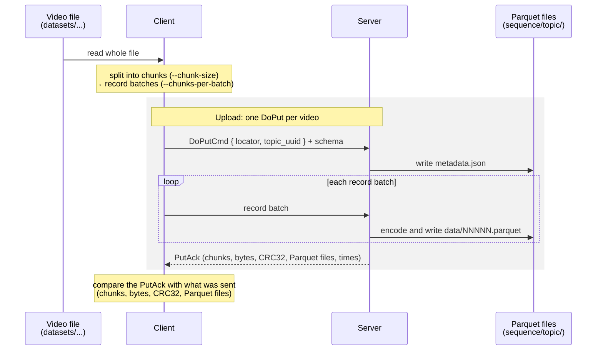

# video-parquet: video upload over Arrow Flight

A Rust client and server built on [Arrow Flight](https://arrow.apache.org/docs/format/Flight.html).
The client reads every video in a directory (by default `datasets/VideoChunks/BigBuckBunny/1080p`),
splits it into chunks and uploads each video with its **own `DoPut` call**.
The server receives and stores each upload the way
[mosaicod](https://github.com/mosaico-labs/mosaico) stores a topic: **one
Parquet file per record batch** (see [Compatibility with mosaicod](#compatibility-with-mosaicod)).

## Data flow

For each video:



## Data layout

Each video is a mosaicod topic with the locator `<sequence>/<topic>`. The
sequence is the dataset folder name (or `--sequence`), the topic is the video
file name; in both, every character other than letters, digits and `-`
becomes `_`, because mosaicod rejects `.` and spaces in locators. For
example `datasets/VideoChunks/BigBuckBunny/1080p/Big_Buck_Bunny_30MB_av1.mp4` becomes
`1080p/Big_Buck_Bunny_30MB_av1_mp4`.

Each record batch holds `--chunks-per-batch` chunks:

| Column | Type | Meaning |
|---|---|---|
| `timestamp_ns` | `Int64` | Index column every mosaicod topic needs. Here it is the chunk index |
| `chunk_index` | `UInt32` | Position of the chunk in the file |
| `offset` | `UInt64` | Byte offset of the chunk in the file |
| `data` | `Binary` | Raw bytes of the chunk |

The video name and original file size are stored as schema metadata, which
the Parquet files keep. Chunks hold the encoded bytes exactly as they are on
disk. The video is not decoded or demuxed into frames, so `timestamp_ns` can't
be a real presentation time. It only has to grow strictly: the mosaicod store
optimizer sorts rows by `timestamp_ns` when it merges files, and equal values
could reorder the chunks.

The server writes each topic to:

```
<out-dir>/<sequence>/<topic>/metadata.json
<out-dir>/<sequence>/<topic>/data/00000.parquet, 00001.parquet, ...
```

mosaicod uses the same `metadata.json` + `data/NNNNN.parquet` layout, but
names the topic folder `tp_<ULID>` and keeps the locator in its database.

## What is measured

For each video the server sends back what it received: chunk count, byte
counts, a CRC32 of the reassembled data, how long it took and the number and
size of the Parquet files it wrote. The client compares this with what it sent
and reports:

| Metric | What it covers |
|---|---|
| Video / `.arrow` / Parquet size | Size of the original video, of an Arrow IPC file (`.arrow`) holding the same batches (see [`.arrow` vs Parquet](#arrow-vs-parquet)), and of all its Parquet files, with the differences between them. Charted for every video in `results/per-video/file-size-comparison/` |
| Parquet files | One per record batch; the client checks that it matches the batches it sent |
| Received | Whether the server got every chunk and every byte with a matching CRC32 |
| Upload | From the start of `DoPut` until the server acknowledges it. Charted in `results/per-video/server-time/` with the server times |
| Server receive | From the first message the server gets until the last Parquet file is written |
| Server encode, write | Time the server spends encoding the Parquet files and writing them to disk. Charted in `results/per-video/server-time/`: one chart per video, and `all-videos.png` for all videos |
| Read, Chunk, Encode | Client steps before the upload: loading the file, splitting it into record batches (zero-copy slices) and serializing them into Flight messages. Charted in `results/per-video/client-time/`: one chart per video, and `all-videos.png` for all videos |

The client writes every report before exiting. If any video was not
received completely, the summary lists what differs and the client exits with
an error.

## Running

```sh
cd video-parquet
cargo run --release --bin server -- --addr 127.0.0.1:50051 --out-dir received
# in another terminal
cargo run --release --bin client -- --dataset ../datasets/VideoChunks/BigBuckBunny/1080p --report report.json
```

Run `--help` on either binary for all options (`--chunk-size`,
`--chunks-per-batch`, `--format`, ...).

`--chunk-size` × `--chunks-per-batch` is the amount of video in each Parquet
file. It must fit in one gRPC message: at most 50 MiB (mosaicod's default
limit) minus 64 KiB of headroom. Change it on both sides with
`--max-message-size` (client) and `--max-decode-message-size` (server).

## End-to-end test

A quick check that client and server work together, on the 4 videos in
`datasets/VideoChunks/BigBuckBunny/1080p` (119.39 MiB), to run after changing
the code ([Running on every dataset](#running-on-every-dataset) measures
everything). It is `run-all.sh` on one folder, writing outside the repository
so that the committed results stay untouched:

```sh
DATASETS=datasets/VideoChunks/BigBuckBunny/1080p OUT_DIR=/tmp/video-parquet-1080p video-parquet/scripts/run-all.sh
```

The script fails if the client reports a chunk, byte or CRC32 mismatch, or if
the server did not store a `metadata.json` and Parquet files for every video.
It prints `all videos received and stored` when everything worked. The client
report is in `/tmp/video-parquet-1080p/reports/1080p.json`; set `KEEP_DATA=1` to also
keep the stored topics in `video-parquet/received/`.

For example, to test 512 KiB chunks with 4 chunks per record batch:

```sh
DATASETS=datasets/VideoChunks/BigBuckBunny/1080p OUT_DIR=/tmp/video-parquet-1080p \
  CLIENT_ARGS="--chunk-size 524288 --chunks-per-batch 4" \
  video-parquet/scripts/run-all.sh   # 512 KiB chunks, 2 MiB per file
```

To also get the charts and summary of that run, add
`uv run video-parquet/scripts/analyze.py /tmp/video-parquet-1080p`.

## Running on every dataset

This is how the committed [`results/`](results/) folder is produced: every
video under `datasets/VideoChunks/` is uploaded, and the measurements are
turned into a summary and charts.

> [!NOTE]
> The committed run (2026-10-13) predates the move of the videos to
> `datasets/VideoChunks/`: it covers Big Buck Bunny 360p and 1080p and SEPE
> 8K (728 videos), not Big Buck Bunny 720p nor the YouTube videos, and its
> reports keep the old folder names (`reports/360p.json`,
> `reports/LargeFiles_480p_AV1.json`, ...). A new run would name them after
> the current folders (`BigBuckBunny_1080p`, `SEPE_480p_AV1`, ...) and
> upload every video, so its totals would differ from the tables below.

**Requirements:** Rust (to build the client and server), Python 3 and
[`uv`](https://docs.astral.sh/uv/). `uv` installs `matplotlib` for
`analyze.py` on first run. The videos come from
[`scripts/build-datasets.sh`](../scripts/build-datasets.sh). `run-all.sh`
uploads every video it finds under `datasets/VideoChunks/`, so it uses
whichever of the `bbb`, `youtube` and `sepe` datasets are built: build at
least `bbb` first (`scripts/build-datasets.sh bbb`); `youtube` and `sepe`
are optional.

Run the two steps from the repository root, in order:

```sh
# 1. Upload every video and write one report per dataset folder
video-parquet/scripts/run-all.sh

# 2. Turn the reports into the CSV, the per-video charts and the summary
uv run video-parquet/scripts/analyze.py
```

| Step | Script | Writes to `video-parquet/results/` |
|---|---|---|
| 1 | `run-all.sh` | `reports/<folder>.json`, `server.log` |
| 2 | `analyze.py` | `videos.csv`; `per-video/{file-size-comparison,server-time,client-time}/<dataset>/<resolution>/<codec>/<video>.png`, `all-videos.png` in the two time folders and a `README.md` index in each folder that starts with what to improve first, computed from the data; `RESULTS.md` |

Step 1 deletes `video-parquet/results/` before it starts, so always run step 2 after
it. Then commit `video-parquet/results/`: it holds only data meant for the repository,
and the paths in the reports are relative to the repository. `analyze.py`
saves the charts as PNGs without metadata, and the per-video ones with 256
colors (under half the size of matplotlib's own PNGs, with no visible
difference), so a chart file only changes when its numbers do: running
`analyze.py` again on the same reports rewrites the same files, except the
date in `RESULTS.md`.

**How step 1 works.** `run-all.sh` builds the binaries, starts the server once
and runs the client on each folder that directly holds videos, for example
`datasets/VideoChunks/BigBuckBunny/1080p` or
`datasets/VideoChunks/SEPE/480p/AV1`. After each folder it
checks that the server stored a `metadata.json` and Parquet files for every
video. A failure on one folder is reported and the script moves on to the
next, exiting with an error at the end. Each folder is its own mosaicod
sequence, named after its path (for example `SEPE_480p_AV1`). The server
writes the topics to a temporary folder that is emptied after each dataset
folder and removed at the end, because the reports already record their
sizes.

Step 1 accepts these environment variables:

| Variable | Default | Meaning |
|---|---|---|
| `DATASETS` | `datasets/VideoChunks/` | Folder to scan for videos |
| `OUT_DIR` | `video-parquet/results/` | Where the reports go |
| `ADDR` | `127.0.0.1:50051` | Server listen address |
| `CLIENT_ARGS` | none | Extra client flags, e.g. `"--chunk-size 524288"` (512 KiB) |
| `SERVER_ARGS` | none | Extra server flags, e.g. `"--format image"` |
| `KEEP_DATA` | `0` | `1` keeps the topics in `video-parquet/received/` (ignored by git; about 28 GiB with SEPE) |

## `.arrow` vs Parquet

Before following mosaicod, the server stored each video as one Arrow IPC file
(`.arrow`). The client still computes the size of that file from the batches
it sends, so every report, `results/videos.csv`, the per-video charts and the
"`.arrow` vs Parquet" table in [`results/RESULTS.md`](results/RESULTS.md) keep
the comparison. From the committed full run (728 videos, 1 MiB per Parquet
file, `video` format):

| Dataset | Video | `.arrow` vs video | Parquet vs video | Parquet vs `.arrow` | Parquet files |
|---|---:|---:|---:|---:|---:|
| Big Buck Bunny 360p | 108.57 MiB | +96.8 KiB (+0.087%) | +141.0 KiB (+0.127%) | +44.2 KiB | 111 |
| Big Buck Bunny 1080p | 119.39 MiB | +106.7 KiB (+0.087%) | +156.2 KiB (+0.128%) | +49.5 KiB | 123 |
| SEPE 8K 480p | 499.72 MiB | +592.8 KiB (+0.116%) | +710.2 KiB (+0.139%) | +117.4 KiB | 569 |
| SEPE 8K 720p | 749.89 MiB | +793.9 KiB (+0.103%) | +1010.7 KiB (+0.132%) | +216.8 KiB | 809 |
| SEPE 8K 1K | 1.15 GiB | +1.13 MiB (+0.096%) | +1.51 MiB (+0.129%) | +396.3 KiB | 1,241 |
| SEPE 8K 2K | 2.28 GiB | +2.07 MiB (+0.088%) | +2.92 MiB (+0.125%) | +874.8 KiB | 2,391 |
| SEPE 8K 4K | 5.06 GiB | +4.40 MiB (+0.085%) | +6.41 MiB (+0.124%) | +2.01 MiB | 5,245 |
| SEPE 8K 8K | 17.91 GiB | +15.14 MiB (+0.083%) | +22.53 MiB (+0.123%) | +7.39 MiB | 18,405 |
| **Total** | 27.85 GiB | +24.28 MiB (+0.085%) | +35.34 MiB (+0.124%) | +11.06 MiB (+0.039%) | 28,894 |

Both stay within 0.14% of the video size. `.arrow` adds about 880 B per
1 MiB chunk (message framing and the `timestamp_ns`, `chunk_index` and
`offset` columns) plus one footer per video. Parquet adds about 1.3 KiB per
file, because every file has its own footer, embedded schema and
`timestamp_ns` bloom filter, so it costs 0.02–0.04% more than `.arrow`.
Larger record batches (`--chunks-per-batch`) would make fewer Parquet files
and shrink that gap.

## Compatibility with mosaicod

The server follows mosaicod's `DoPut` handling
(`mosaicod-grpc-flight/src/endpoint/do_put.rs`) and storage
(`mosaicod-rw`), so the client would work against mosaicod and the stored
sizes match what mosaicod would write:

| | mosaicod | video-parquet server |
|---|---|---|
| Descriptor | CMD holding a protobuf `DoPutCmd { locator, topic_uuid }`; PATH is rejected | Same |
| First message | Descriptor and schema together | Same |
| Schema | Must have `timestamp_ns: Int64` | Same, plus `chunk_index: UInt32` and `data: Binary` |
| Later messages | Record batches only; a schema or empty message fails the upload | Same |
| Storage | One Parquet file per record batch, `tp_<ULID>/data/NNNNN.parquet` + `metadata.json` | One Parquet file per record batch, `<sequence>/<topic>/data/NNNNN.parquet` + `metadata.json` |
| Writer settings | Chosen by the topic's serialization format | Same settings, chosen with `--format` |
| Message size limit | 50 MiB by default | Same (`--max-decode-message-size`) |
| Existing topic | Rejected unless the topic is empty | Rejected if the topic folder exists |

What the poc does not do:

- **Topic creation.** mosaicod needs the sequence and topic created with
  `do_action` beforehand, and checks the UUID in `DoPutCmd` against the
  topic's. Here the client sends a random UUID and the server only checks that
  it parses.
- **Database and statistics.** mosaicod writes a row of column statistics for
  every Parquet file and limits how many batches it encodes at once.
- **Store optimizer.** mosaicod later merges a topic's files into ~256 MiB
  files, sorted by `timestamp_ns`. Until then, every
  `--chunk-size` × `--chunks-per-batch` bytes of video is one file: with the
  defaults the largest video here (`026_h264_8K.mp4`, 258.91 MiB) is 259 files,
  and a 1 GiB video would be 1,024.
- **Acknowledgement.** mosaicod answers `DoPut` with an empty stream, no
  `PutResult` at all; the JSON
  `PutAck` exists only for this poc's checks.

## The `video` serialization format

mosaicod has three serialization formats (`default`, `ragged`, `image`), none
designed for encoded video. `src/format.rs` adds a proposed **`video`**
format, the server default, which would be `FORMAT_VIDEO = 4` in
`proto/mosaico/v1/core.proto`:

- **`data` uncompressed.** The bitstream is already entropy coded, so ZSTD
  costs CPU for almost no gain.
- **No dictionary encoding and no statistics** on the payload columns, as in
  `image`: chunks never repeat, and min/max of binary data is useless.
- **`timestamp_ns` as in `image`**: uncompressed, with page statistics and a
  bloom filter, so mosaicod's time range queries work the same way.

The four formats on `datasets/VideoChunks/BigBuckBunny/1080p` (4 videos, 119.39 MiB, 123 Parquet
files, 1 MiB per file; one run of the end-to-end test with `SERVER_ARGS="--format ..."`
per format, on loopback). The first row is the Arrow IPC file (`.arrow`) of
the same batches, as video-parquet stored it before, for reference:

| Storage | Size | vs video | vs `.arrow` | Server encode ms | Upload ms |
|---|---:|---:|---:|---:|---:|
| `.arrow` (one file per video) | 119.50 MiB | +106.7 KiB (+0.087%) | | | |
| Parquet `default` | 119.60 MiB | +211.2 KiB (+0.173%) | +104.5 KiB | 18.68 | 109.84 |
| Parquet `ragged` | 119.54 MiB | +150.5 KiB (+0.123%) | +43.8 KiB | 41.29 | 108.13 |
| Parquet `image` | 119.54 MiB | +150.5 KiB (+0.123%) | +43.8 KiB | 41.86 | 104.55 |
| Parquet `video` | 119.55 MiB | +156.2 KiB (+0.128%) | +49.5 KiB | 20.56 | 82.43 |

ZSTD saves 5.7 KiB on 119 MiB of video (0.005%) and doubles the encode time.
`default` encodes as fast as `video` but stores 55 KiB more. Every Parquet
format costs a little more than `.arrow`, because each 1 MiB file carries its
own footer, schema and bloom filter; [`.arrow` vs Parquet](#arrow-vs-parquet)
has the numbers for every dataset.

## Notes

Client and server ran on the same machine, so the upload times measure
loopback, not a real network. To test a real link, run the server on another
host and point the client's `--server` at it.
